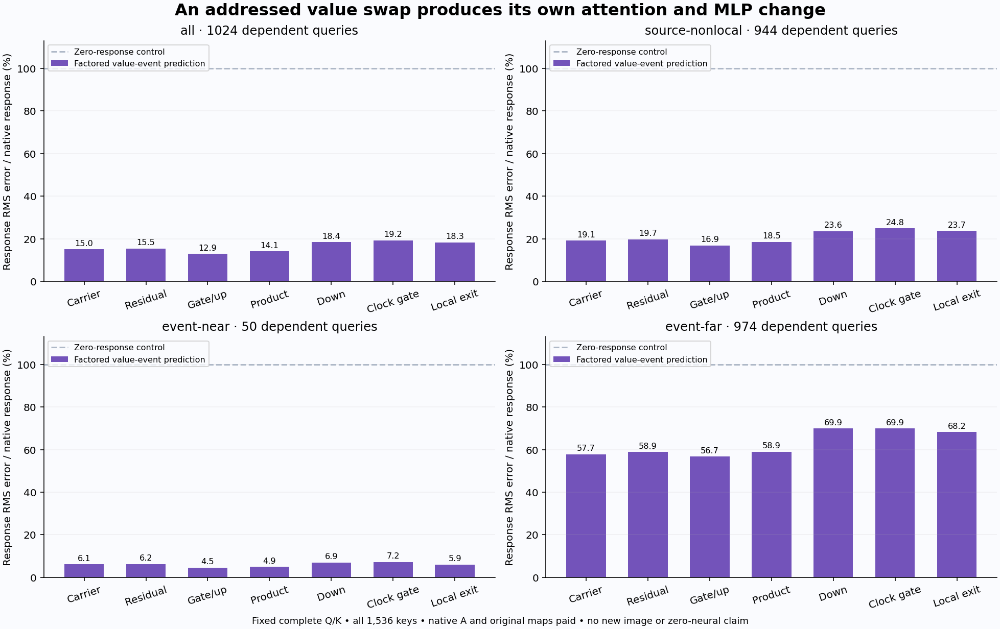

# An addressed value event produces its own attention and MLP change

A new producer forms its B attention carrier and gate/up operands without receiving either native B field. It starts from a natural native A state, swaps two fixed value addresses while holding complete Q/K fixed, and factors the resulting finite attention change. Local-exit response error is **18.34% overall**, **5.93% near the event**, and **68.22% farther away**. The more accurate near-event result carries most of the aggregate response energy.

This extends the [shared normalization producer](shared-normalization-innovation.md) beyond its supplied carrier pair. It is one synthetic intervention on one specimen, not a natural prompt edit or an image generator. Native A baselines, original matrices, conditioning/latent/clock preparation and fresh Q/K/V remain paid.

The [frozen plan](results/value-innovation/frozen-plan.md), [report](results/value-innovation/report.json), [primary seal](results/value-innovation/primary-seal.json), [native reference seal](results/value-innovation/reference-seal.json), [candidate execution](results/value-innovation/execution.json), [reference execution](results/value-innovation/reference-execution.json), [mechanics](results/value-innovation-evidence/mechanics.json) and complete [query](results/value-innovation/queries.jsonl.gz)/[operand](results/value-innovation/operand-queries.jsonl.gz) records preserve all outcomes.

## A finite event supplies the factorization

Use s60672.base.canonical, clock 3, first joint image block of FLUX.2 Klein 4B. Freeze image rows 264 and 792 before the run; after the 512 text keys, their actual key indices are 776 and 1304. Swap their full V rows across all 24 heads. Q, K, text values, rotary positions and clock stay fixed.

The archive contains no Q/K/V or probability arrays. Fresh source-qualified acquisition pays seven original affines, attention-input normalization, head normalization and rotary work, stopping before SDPA. CPU FP64 scores normalize against all 1,536 keys. For each head,

\[
\gamma_{ih}=p^h_{ij}-p^h_{ik},\qquad d_h=v^h_k-v^h_j,
\qquad \Delta H_i^h=\gamma_{ih}d_h.
\]

This is an exact real-arithmetic finite value-swap law. It uses no local derivative, fit, SVD or selected numerical rank. The assembled innovation has rank at most 24 by construction, while the native finite response need not have that rank.

Push each 128-wide head direction through its physical output-matrix head block, then the centered/scaled fused map:

\[
b_h=g_A\odot W_o^{(h)}d_h,\qquad
t_h=W_{\rm in}[d_M\odot Cb_h],
\]
\[
\delta a_i=\sum_h\gamma_{ih}b_h,\qquad
J_i=\sum_h\gamma_{ih}t_h.
\]

This replaces a full-grid fused innovation projection by a 24-row projection and explicit bank assemblies. It still evaluates original learned maps. The 24 physical output blocks each have shape 3,072 × 128; the implementation does not zero-pad each direction and multiply a complete 3,072-wide input.

With Q denoting explicit FP64→FP32→BF16 conversion, form the actual candidate carrier and residual:

\[
\widehat a_B=Q(a_A+\delta a),\qquad
\widehat u_B=\operatorname{BF16}(E+\widehat a_B).
\]

Calculate standard deviations from committed residuals in FP64 and apply the previous normalization-affine law:

\[
\widehat F_B=\frac{s_A}{\widehat s_B}(F_A-\beta)+\beta+\frac{J}{\widehat s_B}.
\]

Native BF16 SiLU/product, one original down, the clock gate and residual commit produce the candidate exit. The complete candidate seals and its process exits before native reference execution.

## The native comparison qualifies its baseline

The A attention sham reproduces H0, carrier, residual, embedding and modulation exactly, with matching local parameter/source/profile identities. That qualifies inherited A local MLP fields from the same deterministic source-order implementation. It does not supply the independently archived full-native-block-exit witness missing from cycle 48.

The new B reference consumes the independently byte-verified V-row swap through native SDPA, output projection and the complete local MLP. It performs two SDPA calls and two output projections across A/B, plus one B gate/up and down. No extra A MLP is needed. Candidate/native processes share no mutable tensors.

Both the attention/output factorization and normalization secant move finite arithmetic boundaries. Rho records (candidate uB−uA)−delta a; the combined error is not attributed solely to rho. Native attention probabilities, output projection, modulation and conversion remain additional sources of discrepancy. No extra attribution projections run.

## The response is useful, with a large distant limitation

All relative errors use the actual native B−A norm at that stage. Event-near is a frozen Chebyshev grid radius of two around either changed address: 50 queries. Event-far contains 974 queries. The 944-row source-nonlocal mask is inherited from earlier experiments and is unrelated to this new event's placement.

| Stage | All | Inherited nonlocal | Event-near | Event-far |
|---|---:|---:|---:|---:|
| Gated attention carrier | 14.99% | 19.11% | 6.12% | 57.73% |
| Residual | 15.45% | 19.69% | 6.22% | 58.90% |
| Fused gate/up | 12.85% | 16.86% | 4.50% | 56.68% |
| SiLU × up product | 14.09% | 18.47% | 4.91% | 58.92% |
| Down write | 18.35% | 23.59% | 6.93% | 69.91% |
| Gated MLP write | 19.18% | 24.83% | 7.22% | 69.93% |
| Local exit | 18.34% | 23.69% | 5.93% | 68.22% |

Overall exit cosine is .9831, versus .9982 near and .7365 far. Its endpoint error is only .313%, which obscures the changed-computation error. Native carrier response RMS falls from .05527 near to .00307 far; substantial relative discrepancy is already present at that upstream boundary. This does not isolate which numerical operation causes it.

Median exit row error is **95.49% overall**, **11.47% near**, and **95.97% far**. The candidate improves on zero at 872 rows and loses at 152; all losing rows are event-far. Three product rows, one down row and four gated-write rows have negative response cosines, while no exit row does. These observations remain in the record. Aggregate response energy and a median query answer different questions.

After conversion, gate/up response errors are 13.67%/11.72% overall and 58.80%/53.49% far. The corresponding far errors before conversion are 55.62%/50.84%. Rho RMS is .000802 overall and .000686 far. These are diagnostics, not independent additive error shares.

## Actual work and custody

Job **job-b187c2bccbdd** succeeds in **125.07 scheduler seconds**, with **3,086 MB peak RSS** and **748 MB peak device usage**. Candidate formation costs:

| Operation | Nominal MACs |
|---|---:|
| Fresh seven-affine Q/K/V prefix | 51,136,954,368 |
| All-key QK scores | 4,831,838,208 |
| 24 physical output head blocks | 9,437,184 |
| Fused map on 24 directions | 1,358,954,496 |
| Carrier assembly | 75,497,472 |
| J assembly | 452,984,832 |
| One native down | 28,991,029,248 |
| Candidate total | **86,856,695,808** |
| Post-seal native reference | **125,627,793,408** |
| Total new arithmetic | **212,484,489,216** |

The candidate has 33 affine calls and three other contractions. It loads 331,088,640 distinct BF16 parameter bytes; reference reloads make process-level selected payloads total 519,832,320 bytes. Full checkpoint hashing, FP64 working copies, norms, exponentials, transfers, captures and I/O are additional costs. Beta compilation historically costs another 56,623,104 MACs, and native baseline/conditioning preparation remains paid.

Primary, reference and saved-scoring phases take 38.08, 23.60 and 60.17 seconds. Post-import primary arithmetic/instrumentation takes 19.54 wall /15.84 CPU seconds; native reference takes 7.84 wall /6.53 CPU seconds. Neither these timings nor the smaller contractions establish a serving speedup.

[Complete byte custody](results/value-innovation/retained-array-verification.json) covers 109 files /9,769,450,612 bytes, including original assets and every new field. A separate byte-row permutation of the retained V payload reproduces the actual native-consumer V fingerprint. Its 9,437,184 reread bytes are not new storage. All 66 new arrays /1,904,795,904 bytes remain near compute. Eighteen compact files total 2,017,751 bytes before summaries and figure. Two Saturn Acts and 9,216 complete query/operand records retain actual state lineage; the evidence sweep has separate instrument scope and no terminal scientific claim.

All **266 mechanics tests pass in 16.90 seconds**, including independent finite-swap and physical-head-block checks and regressions for the two engineering failures. The [earlier failures](results/value-innovation-failed-v1/README.md) remain unchanged, including the pre-Q/K/V parameter-receipt failure. Use the corrected primary/driver v2. The [planner request](results/value-innovation-evidence/planning-request.json) records actual selected-component geometry rather than treating the full-model fallback estimate as applicable.

[Astra51](results/value-innovation-evidence/advisor.json) found no material equation, cost or release defect. Its [single next plan](plans/sparse-text-kv-innovation.md) bridges to the prospective computation family's tokenizer-resolved four-row text update at the next image reader. A paid complement cache and newly formed selected K/V preserve partition changes, rather than carrying the value-only rank-24 law into changed keys. That plan is written and unexecuted.

The scheduled [storage cleanup](results/storage-cleanup-cycle51/README.md) archives 800,539,996 bytes in four redundant transports, retaining extracted science and full recovery paths. The [audit](results/storage-audit-cycle51/README.md) checks 52 pointer/custody joins, with full-byte verification for the new four objects and fresh metadata checks for the older 48. Next cleanup is due 54 or earlier pressure.

This establishes a conditional fixed-Q/K value-event producer through a local MLP. It does not establish natural prompt-change production, semantic object reassignment, later own-state denoising, a complete velocity or image, or arbitrary-prompt zero-neural generation. The original goal remains active.
