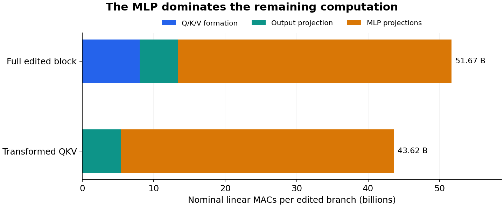

# Predict mixed-support updates from transformed Q/K/V

The transformed-positioned-QKV experiment predicts both new block updates exactly at attention head, receiving residual, MLP write and next state. It handles the mixed-support rows missed by the previous positive-R/G/U shortcut. This is a source-bound conditional reduction: the own-positive operands and remaining learned computations remain paid. It does not serve a first arbitrary image without neural evaluations.

The independently repeated [compact verifier](results/cached-qkv-intake/verification/verification.json) authenticates the executed source, captured job/log custody, complete report census and 12 actual installed catalog/atlas lookups. Four exact occurrences match; eight changed-source/profile queries abstain. All raw arrays remain near compute. The [public metadata intake](results/cached-qkv-intake/provenance.json) contains 66 files / 4,671,294 bytes and no activation or weight payload.

## The update and its remaining computation

For a row-sign edit h′ᵢ=sᵢhᵢ, emit the candidate operands

$$
Q'_i=s_iQ_i,\qquad K'_j=s_jK_j,\qquad V'_j=s_jV_j.
$$

The transformed attention is

$$
L'^{(a)}_{ij}=s_i s_j\frac{Q_i^{(a)}\cdot K_j^{(\kappa(a))}}{\sqrt{128}},\qquad
\mathrm{head}'^{(a)}_i=\sum_{j\le i}\operatorname{softmax}(L'^{(a)}_{i\cdot})_j s_jV_j^{(\kappa(a))}.
$$

This recomputes the live read. It then recomputes O, residual, post-attention norm and the complete MLP from that emitted head. It never reuses stale positive R/G/U after attention changes. Under the measured BF16 profile, the head/R/M/H19 fields and complete signed responses match full-functional and native execution bit for bit on both edits: last row negative and alternating 64-row sign blocks.

Each comparison channel has eight whole primary fields / 12,058,624 scalar positions. The three channels and protocol windows share operands; their counts are not independent trials. The all-attended 512-row source is inherited own-functional H18/Q/K/V, not a new raw-prompt forecast.

## Internal finite differences remain visible

Cached QKV values agree numerically with direct formation, while raw Q/K bits retain 432 signed-zero differences: 1 Q zero on the last-row edit; 364 Q and 67 K zeros on alternating blocks. V is bit-exact. Directly formed QKV matches actual native QKV bit for bit. These same counterexamples recur across comparison channels and are counted once as distinct operand coordinates.

All downstream primary outputs reconcile exactly under the stated profile. This does not establish that signed zeros are universally irrelevant. Original Q/K/V layouts, mask=None, is_causal=True and enable_gqa=True remain part of the qualified contract. The [preceding composition result](sign-composition-boundary.md) also remains: exact H19 does not retain the input's sign/scaling family, so later reuse must consume the actual emitted state.

## Count the work that remains

At 512 rows, hidden width 2,560, Q width 4,096, KV width 1,024 and MLP width 9,728:

$$
\mathrm{QKV}=512\cdot2560(4096+2\cdot1024)=8{,}053{,}063{,}680\ \mathrm{MACs},
$$

$$
\mathrm{O}=5{,}368{,}709{,}120,\qquad \mathrm{MLP}=38{,}252{,}052{,}480.
$$

The candidate has four linear operations instead of seven, but removes only **15.5844% of nominal linear MACs**: 51.674 billion becomes 43.621 billion per edited branch. SDPA, elementwise arithmetic, source acquisition and all other model stages are additional. These are mathematical operation counts, not measured hardware utilization or a speedup. The source-bound [budget](results/cached-qkv-evidence/budget/budget.json) retains its exact geometry and exclusions.

The complete original campaign executes seven SDPA and 43 linear operations across candidates, full-functional references and native targets. Native job `job-585e40c9614b` took 45.4 seconds, with 1,697.3 MB sampled peak RSS and 676 MB VRAM. Saved-only audit `job-aa0dc56ace52` took 18.83 seconds and 1,045.3 MB RSS, with no learned operations. These are complete campaign costs, not isolated candidate timings.

The forecast seal `f55ba3ef6ef0c5a16cefc4efff42fdc9fe58062dfc6432a46942cf8392c096c4` precedes all three native targets. Raw custody retains 148 members / 423,853,232 bytes, excluding its manifest. The compact has 43 members / 2,651,374 expanded bytes. The independent local verifier receipt is `244d56431cf703cfd91b7e7cb3548f458ae86675171e350c6ba335d2190ebf70`.

## Return to the first-prompt boundary

Astra's holistic review separates this successful conditional rewrite from the original arbitrary-prompt goal. Neighboring dispatcher and block-19 propagation work can explain applicability and error consumption; they do not currently reduce first-prompt computation. This goal's [first-prompt follow-up](masked-kv-own-state.md) now starts with fresh raw strings and the existing complete-vocabulary atom store, emits its own H1 and omits only masked K/V formation while producing every H2 query row. It measures genuine row-work reduction with finite projection drift; the next fixed contrast concerns accumulation policy.

The alternative projected-value atom table was considered and deferred. It would require about 24.9 GB of learned-output atoms and widen each per-head value read twentyfold; finite head rounding also breaks exact commutation with O. Removing a named projection while increasing total work is not the current priority. The mask-aware cut introduces no new learned-output bank and requires no positive-history baseline. Substantial learned computation and the full zero-neural image objective remain open.
