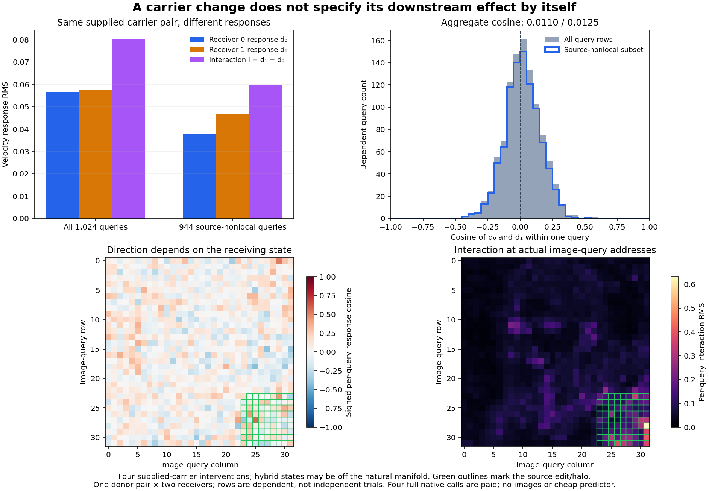

# The same carrier change has a different effect in a different receiver

One fixed pair of complete attention payloads produces nearly orthogonal velocity changes in two receivers. The all-query response cosine is **0.01096**; their RMS amplitudes differ by only 1.74%. This is evidence of receiver dependence under the declared supplied-payload intervention. It does not establish that natural attention outputs lack receiver information, identify one missing variable, or provide a cheap generator.

The [frozen plan](results/carrier-crossing/frozen-plan.md), [raw report](results/carrier-crossing/report.json), [complete execution census](results/carrier-crossing/execution.json), [lossless query observations](results/carrier-crossing/observations.jsonl.gz), [mechanics](results/carrier-crossing-evidence/mechanics.json) and [byte custody](results/carrier-crossing/retained-array-verification.json) preserve the experiment. This follows the [extension-geometry audit](minimum-response-extension-geometry.md), which found poor response transfer even when feedback inputs were almost entirely within the discovery source span.

## Factor the actual computation at an internal boundary

Write the complete native denoiser as a consumer of the receiving context R and one complete first-joint image-attention payload H:

\[
v=F(R,H).
\]

Here R contains every other live operand and the unchanged remaining native computation. It is not a proposed compact state. We reuse H_A and H_B from the canonical and bottom-right-edited s60672.base source, respectively. Each is a complete BF16 [1,1024,3072] image field, including every flattened attention head. R_0 and R_1 use the archived canonical clock3 states of seeds60672 and60673. Starting conditioning, positions, clock, all169 original transformer tensors and numerical profile are fixed.

The native boundary is the input to `transformer.transformer_blocks[0].attn.to_out[0]`. Each ordinary call first computes its own image/text attention. The hook replaces only the complete image input with the specified donor. It preserves the actual stride [4718592,3072,1] and storage offset1572864 in a separate allocation. The native text projection remains live. Its consumed input/output and the unmodified receiver prefix are byte-identical across A/B within each receiver.

The four retained outcomes are

\[
v_{0A}=F(R_0,H_A),\quad v_{0B}=F(R_0,H_B),
\qquad v_{1A}=F(R_1,H_A),\quad v_{1B}=F(R_1,H_B).
\]

All four velocities seal before scoring. FP64 subtraction defines

\[
d_0=v_{0B}-v_{0A},\qquad d_1=v_{1B}-v_{1A},\qquad I=d_1-d_0.
\]

A response rule depending only on this identical supplied carrier pair predicts d_1=d_0. The measured interaction tests that restricted law. It does not test whether a sufficiently rich natural H can encode context, whether a nonlinear receiver-conditioned law can transfer, or whether these crossed states lie on the natural model trajectory. Donors were archived from selective image SDPA, so all four arms remain declared interventions. One post-seal metadata observation is that H_A's bytes equal R_0's newly computed native H0 exactly; that coincidence does not establish natural parity for the full crossing.

## Similar amplitude, different direction

| Scope | RMS d₀ | RMS d₁ | RMS I | ‖I‖/‖d₀‖ | Response cosine |
|---|---:|---:|---:|---:|---:|
| All1,024 image queries | .056562 | .057548 | .080248 | 1.41876 | .010960 |
| 944queries outside source edit/halo | .037836 | .046930 | .059912 | 1.58346 | .012549 |

The all-query amplitude ratio is1.01744; the source-nonlocal ratio is1.24036. Even a corrected scalar gain would leave the nearly orthogonal direction unresolved. The complete dependent query distribution, including signed positive and negative cosines, is retained; no magnitude threshold decides whether the effect exists.

The signed response identity is

\[
\|I\|^2=\|d_0\|^2+\|d_1\|^2-2\langle d_0,d_1\rangle.
\]

For all queries, these terms are419.332922+434.082907−9.352174=844.063655. Their scalar reconstruction closes to−5.68×10⁻¹⁴. The 944-query terms are172.979367+266.127176−5.385117=433.721425. Thus the interaction is large relative to the carrier response because little of the two responses aligns, rather than because one merely has a much larger norm.

The complete factorial also retains the receiver-only change, diagonal change and signed cross terms:

\[
v_{1B}-v_{0A}=(v_{1A}-v_{0A})+d_0+I.
\]

Its squared-energy closure residual is1.25×10⁻¹². Receiver-change energy is290,931.6976, much larger than carrier-response energy419.3329. That does not diminish the measured carrier interaction; it emphasizes that a successful small response law must be conditioned appropriately. These are finite-computation observations on one donor pair/two receivers, not independent trials or broad prompt coverage.

## Charge every native operation

Job **job-0b06996e8215** succeeds in **55.38scheduler seconds**, with **7,546.3MB peak RSS** and **8,120MB peak device usage**. It uses one model load and four scalar B1 native transformer calls, with436affine calls and100attention dispatches. Original image H0 is computed and discarded four times; native text and original clock work are paid.

The actual shape census totals **18,896,391,241,728 nominal affine MACs**, plus **1,449,551,462,400 QK/AV MACs**. Normalization, activations, memory traffic and instrumentation are additional. No new donor formation, encoder, fit, scheduler image update, VAE decode or image occurs. Historical source acquisition remains paid. This is a research instrument with four full native evaluations, not a zero-neural serving reduction.

After imports, measured setup is17.1784seconds and instrumented worker wall time19.7398seconds. Per-call wall intervals are1.9629/.1696/.1817/.1617seconds; the first includes first-use costs. CUDA event intervals also include the instrumented capture interval. These are not a matched serving-speed comparison or an end-to-end image latency.

Full-byte verification covers43files/7,806,875,075bytes, including the original transformer assets and all supplied/new fields. Sixteen new arrays totaling32,507,904bytes stay near compute. The twelve compact publication files total387,877bytes; the scientific figure and evidence summaries are additional. No bulk model/table/state hydration or storage deletion occurs. Last actual cleanup remains45; the next scheduled review is48 or earlier pressure.

All244 generator mechanics tests pass. The typed runtime records four Act/Frame handoffs, exact donor consumption, separate storage, source/profile closure, immutable inputs and model parameter-pointer/version/buffer closure. The [Saturn sweep](results/carrier-crossing-evidence/saturn-instrument.json) reads the original1,024-row uncompressed stream and exits0for run/verify, with no watch fires or formal scientific claim receipts. Instrument applicability does not certify the scientific interpretation.

## What this changes in the mathematical target

The previous fixed law tried to assign a shared downstream response from a source attention representation. This crossing shows why an economical next law should explicitly account for the receiver:

\[
\Delta v\approx\mathcal K(R;H_A,H_B),
\]

or, only under differentiability and an appropriate finite-step approximation,

\[
F(R,H_B)-F(R,H_A)
=\int_0^1 D_HF(R,H_A+s\Delta H)[\Delta H]ds.
\]

The integral is an explanatory real-arithmetic identity for a differentiable surrogate, not an executed derivative measurement or an exact description of discrete BF16 rounding. It makes the missing condition explicit: the action of the consumer on a carrier change can depend on the receiving state and the path through nonlinearities. Simply finding source-span coordinates does not determine that action. Discovering an inexpensive reusable operator remains open.

Astra recommends [one two-call text-write clamp](plans/carrier-text-write-crossing.md) before fitting such an operator. The first joint text path also reads image state, even with fixed initial conditioning. Holding that concrete co-carrier fixed gives an ordered decomposition of the remaining interaction. This plan is written and unexecuted. It still pays full native calls and cannot generate an arbitrary-prompt zero-neural image.

The website's live reconstructed generator already accepts arbitrary text prompts while evaluating learned equations and native encoding/VAE. Its hosted static version shows saved runs. The zero-neural RGB chart remains a supplied-scene variation demo. These capabilities remain distinct from the unresolved original goal.
