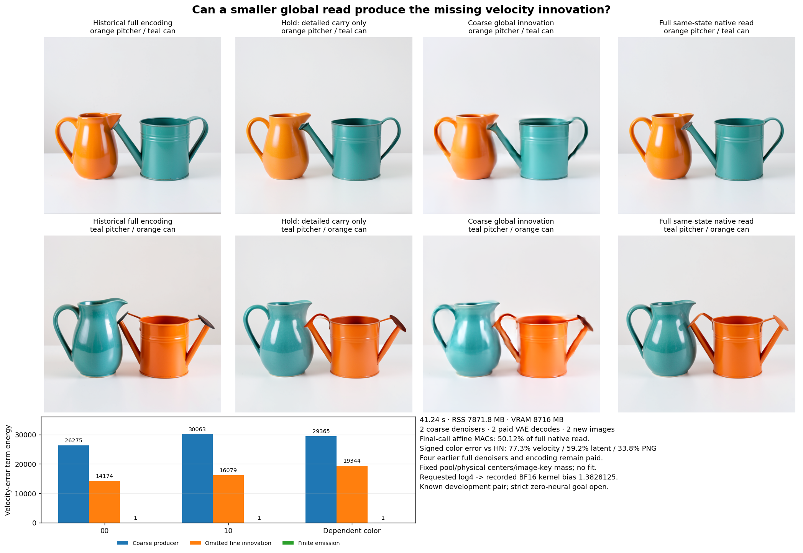

# Pooling reduces work without preserving the velocity computation

A source-fixed coarse global reader uses 50.12% of the full final reader's nominal affine MACs, but gives worse velocity and image fidelity than holding the old velocity on both tested contexts. It preserves coarse vessel colors and order while adding visible surface, highlight and shape changes.

The error split matters more than the aggregate score: about 65% of endpoint smooth error energy comes from the coarse producer itself, and 35% from excluded fine innovation. Increasing fine representation alone would leave the larger discrepancy. The factorization does not yet localize that producer error to attention, normalization, MLPs or positions.

This is reduced original learned computation on a known development pair. Encoding, two full prefix calls per context, original weights and VAE remain paid. Arbitrary-prompt generation with zero neural evaluations remains open.

## Produce a new global direction from actual state

The [previous two-clock experiment](two-clock-velocity-factorial.md) found that the final native read supplies useful image computation while amplifying incoming latent differences. Most changed-write energy is orthogonal to that difference. Neighboring [local-read counterexamples](../../obsidian/blog/2026-11-06-170012-a-compact-diffusion-update-needs-a-nonlocal-reader.md) also show that distant tokens can change a native central write while a local stencil's inputs stay identical.

The [frozen plan](plans/coarse-global-innovation.md) therefore asks a constructive question: can a smaller globally conditioned computation produce the missing innovation? Let P average each 2×2 cell of the 32×32 packed-token grid, independently across its 128 channels, and let L repeat each coarse token to its four original locations. Then PL=I and Q=LP is the equal-cell orthogonal projection in real arithmetic.

The candidate is

\[
\widehat v_3=v_1+L\bigl(F_3^c(PZ_3^H,E)-Pv_1\bigr).
\]

It retains the detailed previous velocity while replacing its coarse component with a newly calculated global direction. F3c runs the original five joint and twenty single blocks on 256 image tokens plus all 512 text rows. It receives the actual saved Z3H and complete E, without a historical correction or supplied native internal Q/K/V. No coefficient, gain, basis or support is fitted.

Physical image IDs are [0,2h+.5,2w+.5,0]; text IDs remain original. Image keys receive a source-fixed requested logweight log4, because each represents four original keys. This matches multiplicity in the identical-key/value idealization, not arbitrary within-cell states and RoPE phases. Pooling packed components is an explicit approximate operator, not established lower-resolution image equivalence.

## Keep the numerical contract visible

The first job, `job-976d565ca3f5`, stopped at its first attention dispatch: the pinned CUDA backend rejects FP32 additive bias for BF16 queries. It produced no image or complete velocity and never reached target scoring. Its 38.21 seconds, original weight loading and partial learned projections remain charged; seven partial arrays/3,497,856 bytes remain retained. The [failure record](results/coarse-global-failed-v1/README.md) is not a scientific null.

A tiny synthetic kernel check then reproduced that rejection and exercised the shared query-dtype conversion. Its first harness stopped before CUDA on an exact-version-string error after 13.51 seconds, 831.2 MB RSS and 0 VRAM; the corrected check uses the qualified full Torch version, including +cu130. The [successful check](results/coarse-bias-kernel/report.json), job `job-03d02d1ff02e`, takes 4.31 seconds, 984.5 MB RSS and 276 MB VRAM, with no source weights, learned maps or images. Independent FP64 softmax comparison has RMS .0006447 and maximum .0024447; these are observations. All four current jobs sum to 97.27 scheduler execution seconds, including failures and kernel checks, before queue/transport/analysis time; this is a research cost account, not image latency.

Fresh v2 preserves requested FP32 log4=1.3862943649 and records consumed BF16 bias=1.3828125. All 50 actual attention dispatches bind both hashes. Historical clock guards and the failed payload stay unchanged. Ordered FP32 pooling, one BF16 coarse-input conversion, FP32 innovation/carry arithmetic, BF16 velocity emission and the original final scheduler are explicit. The complete source and finite arrays remain retained.

## A smaller final read is worse than hold on these cases

HN supplies the existing full final reader on exactly the same Z3H. HH supplies the old-velocity hold. Both candidate images seal before these targets become available. Their historical values were already seen during development; this is not held-out generalization.

| Context | Hold velocity RMS error to HN | Coarse velocity RMS error | Hold PNG RMS error | Coarse PNG RMS error |
| --- | ---: | ---: | ---: | ---: |
| Orange pitcher / teal can | .41461 | .55553 | 9.4636 | 14.3613 |
| Teal pitcher / orange can | .43715 | .59335 | 13.0640 | 20.1193 |

Hold baseline magnitudes are the authenticated HN−HH candidateRms fields in the [parent's late-read comparison](results/two-clock/report.json). Candidate errors are measured against HN in the [new report](results/coarse-global/report.json). Denominators and endpoint contexts remain explicit.

The coarse signed color-response errors against HN are 77.30% velocity, 59.25% final latent and 33.82% PNG. Against the original four-call NN parent they are 81.89%, 67.95% and 39.71%; HH's parent PNG response error was 36.31%. Against historical full encoding, coarse PNG response error is 50.78%. These are different comparisons, not semantic quality percentages.

Original images retain orange/teal body assignment and order. The coarse arm adds distorted highlights, blur or duplicate edges and altered shape/contact, especially case10. Source images also retain nozzle/contact defects. Reference fidelity and prompt faithfulness remain separate.

## Factor producer error from excluded innovation

With same-state native velocity vN, the smooth difference is

\[
\widehat v_3-v_N
=\underbrace{L(F_3^c-Pv_N)}_{\text{coarse producer error}}
-\underbrace{(I-Q)(v_N-v_1)}_{\text{excluded fine innovation}}.
\]

The first term is cell-constant and the second has zero cell mean, so they are orthogonal. The actual emitted BF16 velocity adds a separately retained finite term. Complete vector closure and coarse/fine dot products are exactly zero on these operands.

| Domain | Coarse producer energy | Excluded fine energy | Finite emission energy | Total error energy |
| --- | ---: | ---: | ---: | ---: |
| 00 | 26,274.75 | 14,174.07 | .54276 | 40,450.96 |
| 10 | 30,063.35 | 16,079.32 | .54716 | 46,145.53 |
| Dependent color contrast | 29,364.51 | 19,343.52 | 1.07963 | 48,713.19 |

Small signed finite cross terms remain in the account. Additional fields separate held-velocity pooling error, innovation subtraction, carried addition and BF16 emission; the finite telescope also closes exactly. BF16 emission dominates that small finite term. Input pooling and key-bias rounding remain separate measured fields; their downstream effect is already part of the executed coarse producer.

The large first term measures failure of this complete coarse operator to reproduce the mean native write. It does not establish that a specific MLP or attention head is responsible. It also does not exclude every nonlocal summary or every reduced producer. It does show why a resolution or gain sweep would not yet explain the computation.

## Physical work, custody and storage

Successful primary job `job-35352e10295f` takes 41.24 scheduler seconds, 7871.8 MB sampled RSS and 8716 MB VRAM. It performs two coarse denoisers, 206 affine calls/4,735,604,097,024 nominal MACs and 50 attention dispatches/181,193,932,800 nominal QK/AV MACs. Two original VAE decodes add 80 convolution/linear calls and 2,481,224,417,280 nominal MACs. Four historical full denoisers/18,895,708,618,752 affine MACs, encoding and original parameter residency remain paid.

Per-call coarse denoiser times are 3.1102 seconds for first use and .09329 seconds for the next case; VAE times are 2.6278 and .05364 seconds. Setup, new kernel geometry and first-use effects remain visible. These separate-lease measurements do not establish matched end-to-end speedup. Nominal MACs omit other arithmetic and are not measured hardware FLOPs or energy.

All 218 mechanics tests pass in 15.475 seconds. Full byte verification covers 181 members/8,005,172,349 bytes, including original image weights and consumed ancestors. All 64 new arrays/48,043,008 bytes stay near compute. The compact publication contains 25 files/3,451,583 bytes and all 5120 dependent token/scanline observations losslessly. The [audit](results/coarse-global-evidence/mechanics.json) binds 14 owned source pins, actual coarse operands, requested/consumed bias, all dispatches, exact same-state comparisons, final commits, original PNGs and custody. Saturn run/verify returns zero in observation-stream scope, with no terminal claim receipts.

The [cycle39 cleanup](results/storage-cleanup-cycle39/README.md) moves four redundant terminal transports/1,131,592,232 bytes to full-SHA-verified cold storage with restore pointers. Extracted scientific data remains local. Its [audit](results/storage-audit-cycle39/README.md) checks 36 pointer/custody joins and fresh remote file sizes; the older 32 objects are not freshly byte-rehashed. The remaining 44 name/size candidates are not deletion certificates. Next storage review is due cycle42 or earlier pressure.

Use **`coarse_global_study_v2.py stage|submit|collect`** for a new run directory. The original driver is retained as failed execution history. `publish_coarse_global.py verify|publish`, `audit_coarse_global.py` and `plot_coarse_global.py` preserve complete evidence and derive the public presentation.

[Astra39](results/coarse-global-evidence/advisor.json) reviews the actual source/result/images and newest [bounded-memory post](../../obsidian/blog/2026-11-06-171900-what-bounded-memory-changes-in-the-c-state-machine.md). Its next [rotating residual-write plan](plans/rotating-residual-writes.md) preserves every fine state row and full current K/V, while calculating queries, output and MLP writes for one rotating spatial phase plus all text rows. Joint sequential and single parallel residual dependencies stay explicit; fused weights must be sliced to avoid the omitted work. The source census predicts 57.81% of full affine work. This is written and unexecuted, still learned computation. The full [research record](zero-neural-research.md) keeps the zero-neural objective unchanged.
