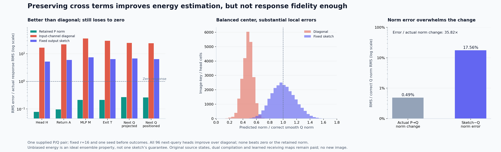
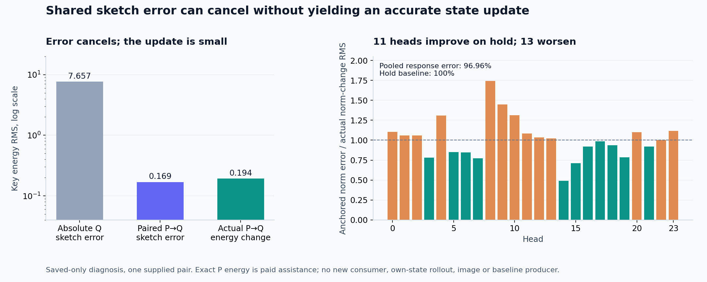

# A coherent norm sketch improves energy estimates but loses the state response

A fixed signed output sketch improves every measured next-query head over the [input-channel diagonal](diagonal-key-norm.md), while every head still loses to predicting no change. Next-query response error falls from **2,404.93% to 641.42%**, versus **25.99%** with the supplied retained norm. Median predicted/correct norm is **.992**, but norm RMS error remains **17.56%**. Nearly correct average scale does not preserve the individual attention read.

All five matched payload controls verify: actual ModLN input, image-score numerator, text logits, hybrid text keys and values. The changed norm law is isolated within this supplied P/Q comparison. The producer advances its admitted head through its own original MLP, then computes the next query from its own emitted state. Original source states, learned maps, query-specific dual table and evaluation references remain paid. This is reduced learned arithmetic, not an image generator or arbitrary-prompt zero-neural result.

[Report](results/coherent-norm/report.json), [all observations](results/coherent-norm/observations.jsonl.gz), [frozen plan](plans/coherent-output-key-norm.md), [execution request](results/coherent-norm/request.json) and [evidence index](results/coherent-norm-evidence/README.md) retain the full scope.

## Preserve channel cross terms in a smaller output space

For one 128-channel raw key z=W_hx, the correct smooth squared norm is \(\|z\|^2/128+\epsilon\). The preceding diagonal discarded the cross terms of \(W_h^TW_h\). The new law first compiles

\[
B_h=S_hW_h,\qquad S_h\in\{-1,+1\}^{16\times128},
\qquad
\widehat s_h(x)=\sqrt{\frac{\|B_hx\|^2}{16\cdot128}+10^{-6}}.
\]

Each squared projection retains input-channel products. Sixteen was frozen to target an eightfold reduction in projection matrix work before seeing the result. Seed 20261107, independent per-head SeedSequence, PCG64 raw low bits and C-order layout define exactly one sign construction. No seed rerolls, gain fitting, rank search or target-defined basis occur. Complete actual sign bytes independently match payload SHA256 **802d466813079a67a3702a473fb793334665cf8aa733ec40168672a99636c043**.

For ideal independent Rademacher signs and rank r,

\[
\mathbb E_S\left[\frac{\|Sz\|^2}{128r}\right]=\frac{\|z\|^2}{128},
\qquad
\operatorname{Var}_S\left[\frac{\|Sz\|^2}{128r}\right]
=\frac{2}{128^2r}\left(\|z\|^4-\sum_cz_c^4\right).
\]

At r=16 the relative energy standard deviation can approach **35.36%**. That is an ensemble statement at a fixed z, not an accuracy bound for one sketch across rows. The square root, softmax and MLP also make unbiased energy different from unbiased norms or consumer outputs. Rank reduction introduces possible blind directions.

The compiler hydrates original image-key W and the fixed signs. Its typed input includes the actual sign matrix. After the compiler seals and exits, the actor hydrates only the five original return/next-query parameters, consumes its actual BF16 ModLN output widened to FP64 and computes its own sketch projection, energy and norm. Native P/Q norms, raw keys, original image-key W/gamma and historical actor targets are unavailable as numerical operands before its seal and exit. Source-asset hashing remains paid byte I/O. No complete transformer or fresh full-key reference runs.

## Reduced bias does not make a useful response producer

Pooled predicted energy is **1.03407×** correct energy. Norm ratio ranges **.39368–1.62892**, with **.99198 median**. There are **12,691 underestimated** and **11,885 overestimated** cells. The old diagonal underestimated all 24,576. Signed correct-minus-sketch energy has mean **−.62220** and RMS **7.65736**; energy endpoint relative RMS error is **36.40%**.

The sketch's image-logit relative RMS error is **20.36%**, compared with **119.62%** for the diagonal. Log-partition error is **9.90%**, compared with **63.76%**. Those are meaningful improvements in the norm estimator and attention inputs. They remain far above the useful retained-norm response.

| Field | Retained norm | Diagonal norm | Fixed output sketch |
|---|---:|---:|---:|
| Head H response error |7.89%|1,665.43%|520.90%|
| Return A response error |9.58%|2,181.13%|597.51%|
| MLP M response error |21.21%|3,562.56%|735.84%|
| Own exit T response error |21.31%|2,951.25%|639.03%|
| Next positioned Q response error |25.99%|2,404.93%|641.42%|

Response error divides by the actual context response F_QQ−F_PP. Candidate and controls use the same PP baseline. Final query response cosine is **.1610**. Endpoint error is **13.15%**, despite **.99135 endpoint cosine** and almost identical candidate/reference endpoint RMS. A large endpoint can look globally similar while missing the much smaller contextual computation.

All **96 dependent next-query heads** improve over the diagonal; none beats zero, stale or retained norms. Median error is **7.16094× actual response RMS**, range **4.13426–10.82735×**. Twenty-two response cosines are negative. Whole-row errors for rows 4,11,12,13 are **5.0347×, 6.2462×, 7.4345×, 9.2719×**; row13's cosine is **−.03594**. These are dependent addresses of one source pair, not independent prompts.

The actual P→Q norm change is **.4904%** of correct Q norm RMS. Sketch error is **17.5638%** on that same denominator, or **35.818× the actual norm-change RMS**. The relevant requirement is fidelity at the scale of the changed state, rather than average scale alone. Similar P/Q lengths also do not prove similar raw-key directions.

## Work, timing and custody

| New matrix work | Nominal MACs |
|---|---:|
| Compile B=S W |150,994,944|
| Actor's r16 norm projection |1,207,959,552|
| Existing numerator/read/original own-state consumer |1,346,371,584|
| Complete actor |2,554,331,136|
| **Complete new assay** |**2,705,326,080**|

FP64 B payload is **9,437,184 bytes**, or **9,437,312** with its NPY header. Signs add **49,152 bytes**, or **49,280** with their header. The norm pays 393,216 output squares, 368,640 reduction additions, 24,576 energy scalings, epsilon additions and square roots. Additional casts, imports, memory traffic, ModLN and attention scalar work remain paid. Six distinct original BF16 parameters total **226,492,672 bytes** across compiler/actor processes. The large reused dual table and original source production are separate historical costs.

Job **job-919ded371096** succeeds in **56.48 scheduler seconds**, **1,643 MB peak RSS** and **568 MB peak device usage**. Worker time is **48.82 seconds**, with fresh compiler/actor phases **22.36/25.93 seconds** including imports. The selected-tensor exception reserves 4,096 MB RAM, 1,024 MB VRAM, four CPU threads and 3 GB disk, supported by the preceding same-geometry measurements. This single instrumented timing is not a matched speedup.

All **294 mechanics tests pass in 17.14 seconds**, including pinned-sign, independent explicit scalar, exact tiny sign-ensemble variance and positive-epsilon fixtures. Twenty-three source pins, **six typed Acts /19 explicit output ABIs**, four actual input→norm→head→own-state→next-query joins, full parameter/input/RNG closure and target quarantine verify. A pre-stage scheduling census changes five→six logical operations; its exact one-line delta from the advisor snapshot is retained. No staged or executed scientific source changes.

Complete byte custody covers **191 files /8,035,501,371 bytes**, with **130 NPY payload witnesses**, one text-prefix witness and two hybrid splice witnesses. MDB run/verify returns zero over **24,924 observations /38 numeric predicates**, with no formal semantic claims or bound xref addresses. The adverse scientific outcome remains evidence despite correct mechanics.

All **32 new arrays /36,304,384 bytes** stay near compute. Compact primary publication is **18 files /2,073,994 bytes**, before figures and extra evidence. [Scheduled cleanup60](results/storage-cleanup-cycle60/README.md) archives **1,508,098,618 bytes** of four verified redundant transport copies while retaining extracted science and restore pointers. The [64-pointer audit](results/storage-audit-cycle60/README.md) does not freshly byte-rehash the 60 older cold objects. Next storage review is cycle63 or earlier pressure.

## The same error can cancel across a state change

A separately staged [saved-only diagnostic](results/paired-sketch-diagnostic/report.json) applies the executed signs to both existing raw P and Q keys. This tests a possible cancellation mechanism, without running another original map or consumer and without changing the sealed primary.

Let \(E_P=\|z_P\|^2/128\), \(\widehat E_P=\|Sz_P\|^2/(16\cdot128)\), and similarly for Q. The hypothetical anchored energy is

\[
\widetilde E_Q=E_P+(\widehat E_Q-\widehat E_P).
\]

It requires paid exact P energy. It does not produce an inexpensive first state. If \(e_P=\widehat E_P-E_P\), the anchored error is \(e_Q-e_P\), with the exact uncentered MSE identity

\[
\operatorname{MSE}(e_Q-e_P)
=\operatorname{MSE}(e_Q)+\operatorname{MSE}(e_P)-2\mathbb E[e_Qe_P].
\]

The saved errors have **.999756 centered correlation**. Their Q RMS **7.65736** falls to **.16937** after subtraction, a **45.21× cancellation factor**. The MSE identity closes to **−8.33×10⁻¹⁵** residual. Correlation here describes the saved cells; it is not a confidence interval or independent replication across heads.

The remaining energy-response error is **87.50%**, with **.7185 cosine**. The anchored norm's endpoint error is **.4755%**, versus **.4904%** for holding P. Its actual norm-response error is **96.96%**, versus **100%** for hold, with **.6878 response cosine**. Eleven heads improve on hold and thirteen worsen; head response errors range **49.24–174.38%**. All 24,576 square-root radicands are positive. The implementation retains invalid rows explicitly if they occur; it neither clamps nor falls back.

Raw-key displacement is **1.9125% of Q RMS**. Row/head cosine has **.999941 median** and **.987436 minimum**. Thus the strong P/Q alignment is measured, rather than inferred from similar norms. Independent S·rawQ equals all **393,216 actual retained actor-projection values exactly**. Reconstructed P/Q denominators differ from their saved values by only about **8×10⁻¹⁷ relative RMS**. These finite-policy checks are separate from the approximation's scientific fidelity.

## The observed error is consistent with the ensemble's resolution

For a=rawQ, b=rawP and A=aaᵀ−bbᵀ, ideal shared signs give

\[
\operatorname{Var}_S(\widehat{\Delta E})
=\frac{2}{r\,128^2}\left[\|A\|_F^2-\sum_c A_{cc}^2\right].
\]

Use m=(a+b)/2 and d=a−b to evaluate \(\|A\|_F^2=2(\|m\|^2\|d\|^2+(m^Td)^2)\) and \(\sum A_{cc}^2=4\sum(m_cd_c)^2\). Astra requested this pre-stage midpoint form because an expansion around b can cancel near a≈−b. The independent tiny fixtures include ordinary, antipodal and nearly antipodal vectors. No assumption of high alignment enters this calculation.

Mean ideal shared variance is **.0311641**, versus realized paired error MSE **.0286861**. At this saved geometry, \(\sqrt{\mathbb E_S[\operatorname{MSE}]}\) divided by actual energy-response RMS is **91.20%**; the realized value is **87.50%**. This is a root-expected-MSE ensemble scale, not the expectation of one reported RMSE. It argues against explaining the outcome solely as an unlucky draw.

Pure 1/r extrapolation within that same independent-sign ensemble would need about **1,331 rows** for a 10% root-expected-MSE energy response. That is more projection work than forming the complete 128-channel key. This is diagnostic algebra using paid saved targets, not a proposed/tested rank and not a lower bound on other compression methods. It motivates a structural change rather than a random-seed or rank sweep.

The midpoint/direct Frobenius residual reaches **6.53×10⁻⁷** under cancellation; it remains a recorded numerical observation. All ideal-variance cells are nonnegative here. No tolerance or effect-size threshold discards rows.

Diagnostic job **job-71611cc0f699** succeeds in **2.19 scheduler seconds**, **128 MB sampled peak RSS**, zero device allocation and **1.345 worker seconds**. It pays **100,663,296 MACs** for two fixed-sign projections plus scalar work, with no new original learned map, model, consumer or image. Full-byte custody covers **23 files /82,556,756 bytes**, including **19 NPY witnesses**. Thirteen new arrays /**8,455,808 bytes** stay near compute. Complete lossless observations retain all 24,576 cells; MDB run/verify returns zero over 20 numeric predicates, without semantic claims or physical-address joins.
