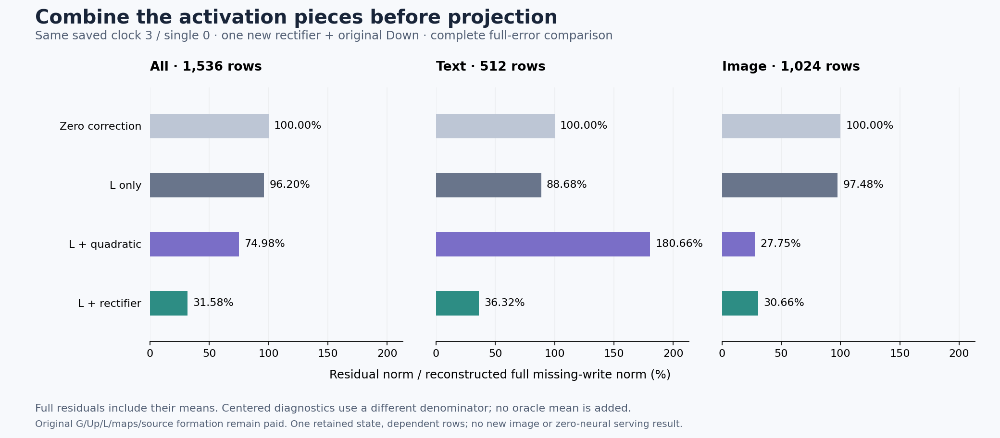

# Combining the activation pieces repairs two large errors and worsens most rows

The combined rectifier forecast lowers pooled missing-write RMS from **74.98% to 31.58%**, but **1,412 of 1,536 rows worsen** against the earlier quadratic forecast. Its gain is concentrated in text rows 3 and 35; image RMS rises **27.75%→30.66%**. Every row improves over L-only. This is a useful large-error repair on one retained state, with a broad accuracy tradeoff.

The [saved operator bound](gated-even-bound.md) supported strong smooth-even cancellation on those two text failures, conditional on its FP64 assumptions. Here a constructive producer combines the large opposing activation pieces before one Down projection. It generates a full conditional forecast, but no native model state or image is updated. Original learned operands/maps remain paid; arbitrary-prompt zero-neural generation remains open.

## Combine the activation before projecting

In real arithmetic,

\[
\operatorname{SiLU}(G)=\max(G,0)-a(|G|),\qquad
a(s)=\frac{se^{-s}}{1+e^{-s}},\quad 0\le a(s)\le 1/e.
\]

The bound follows from a(s)≤s e⁻ˢ≤1/e. The identity motivates keeping the large positive-branch contribution intact rather than separately approximating the odd/even pieces. It does not make the receiving-map error small by itself.

Keep clock 3 / single block 0 from the [mean-Up generator's own trajectory](mean-up-trajectory.md), frozen support S and original Down D. The producer receives seven authenticated saved fields: G*, U*, stream Up means, S, D, residual gate g and previous Y_L. G* is the already-paid FP64 gate projection, not native finite G. Define

\[
r=\max(G^*,0),\qquad
P^+=1_{\bar S}\odot(r-\bar r_s)\odot(U^*-\bar U_s^*),
\]
\[
Y_+=P^+D^T,\qquad \widehat X_+=g\odot(Y_L+Y_+).
\]

It evaluates 14,155,776 rectifier elements and one full-width FP64 Down, seals nine output arrays and exits before admitted A, B, Y_R/Q/E or the old quadratic forecast become available. Y_L already includes a previously paid admitted-activation mean. Target-file isolation makes the conditional measurement reviewable; it does not make its historical assistance or learned inputs free.

After release, the analysis retains A−r, B−P⁺ and the product closure against the new centered expression. Old F is never substituted for this expression's finite residual. Observed A−r spans **[−0.285160, +0.030640]** and includes source/native finite differences; the ideal nonpositive softening expression is not imposed on this field. Product residual closure is 3.89×10⁻¹⁶ maximum and 1.74×10⁻¹⁶ relative RMS. Output remainder Y_R−Y_L−Y_+ is subtraction-defined, with old Q separate.

## The aggregate gain hides a widespread reversal

The full target remains X=gY_E, the reconstructed missing-write discrepancy. Primary error is ||X−Xhat||/||X||. Within-stream centered scores use ||C_sX|| and do not add an oracle mean to the forecast.

| Stratum | L-only full RMS | Quadratic full RMS | Rectifier full RMS | Rectifier centered RMS | Better / worse vs quadratic |
|---|---:|---:|---:|---:|---:|
| All |96.20%|74.98%|31.58%|35.78%|124 / 1,412|
| Text |88.68%|180.66%|36.32%|36.28%|13 / 499|
| Image |97.48%|27.75%|30.66%|35.64%|111 / 913|

Every one of the 1,536 rows improves over L-only. Relative to zero correction, 1,530 improve and six text rows worsen: **34, 39, 40, 41, 43 and 44**. No row is removed. Image error energy increases 22.03% against the quadratic residual despite remaining much better than zero or L-only.

Rows 3 and 35 explain the pooled reversal. Their quadratic residual energies fall **5,877,907.28→47,616.54** and **669,977.82→23,329.62**. Their combined gain, 6,476,938.93, is **101.85% of the signed pooled gain** of 6,359,371.80. The other 1,534 rows collectively worsen by 117,567.13. This retrospective concentration is a sum of signed row effects, not trimmed accuracy or independent causal component shares. [All rows and concentration receipt](results/rectifier-correction-evidence/README.md) remain available.

Pooled error energy falls 90.02% against zero correction, 89.22% against L's residual and 82.26% against the quadratic residual. Yet the comparison supports no universal replacement of the quadratic law. It shows that repairing catastrophic cancellation can improve an aggregate while degrading most of its constituents. These dependent rows come from one state, not independent prompt trials.

Remaining mean norm is 10.54% of the full target norm. Centered pooled RMS is 35.78%, with its different denominator; old quadratic centered RMS was 89.00%. Centered image RMS rises 31.30%→35.64%. Full rectifier/remainder output cosine is −0.0935 pooled, compared with −0.6690 for the isolated quadratic/remainder account. Signed terms remain necessary; their energies are not additive causal shares. Full output closure is 1.19×10⁻¹⁶ relative RMS, excluding native finite concatenated-block/state rounding.

## Computation and evidence

One guarded strict-preflight CUDA job, `job-55f41e4f1e76`, succeeds in **58.96 seconds**, with sampled **2541.8 MB RSS / 1376 MB device**. It pays **43,486,543,872 MACs** plus rectification, reductions and data handling. Zero new checkpoint tensors, gate or Up projections are loaded/evaluated, but the saved original Down map adds **226,492,416 bytes** and prior G/Up/L/source formation remains paid. Imports do not construct a new native transformer.

The synchronized instrumented operation takes 2.533 seconds including internal affine fingerprints. Actor wall time after imports is 22.645 seconds, setup 8.725 seconds, and post-exit analysis 17.039 seconds. These scopes differ from scheduler time and earlier assays. There is no matched serving-speed claim or first-prompt saving from reusing G*.

The declared/sealed/executed 3,161,725-byte payload matches. All **347 mechanics tests** pass, including an independent scalar rectifier/product/Down/full-forecast reference and finite-expression/Gram/centered-Pythagorean checks. One producer Act binds seven inputs and nine output ABIs; twelve additional analysis fields are retained after producer exit. The actual Down input/map/output fingerprints match retained fields. Full byte verification covers **54 files / 1,656,893,730 bytes / 35 NPY payloads**, including inherited original-D ancestry. Arithmetic is source-audited and tiny-tested, not independently numerically replayed by the byte verifier.

Standard Saturn run/verify return zero for one 1,536-row stream, with no fires, formal claims or qualified addresses and one missing expected fire ledger. [Evidence](results/rectifier-correction-evidence/README.md) preserves these limits. All 21 new arrays / 868,912,896 file bytes remain near compute; the public core is sixteen files / 1,585,205 bytes before figure/evidence. No new archive, deletion or cold rehash occurs. Actual storage cleanup and full newest-post survey remain [cycle78](results/research-review-cycle78/advisor-survey.json), next due81 or earlier pressure/material evidence. Astra reviewed this source and actual result.

## Does this representation actually eliminate work?

The next [written, unexecuted sign-support feasibility assay](plans/rectifier-sign-support.md) asks that question before another learned projection. ReLU's raw zeros do not establish sparse execution of the centered product:

\[
P^+=1_{\bar S}\odot(r-\bar r_s)\odot\delta U.
\]

Even where G*≤0 and r=0, the coefficient −mean(r) can remain nonzero. Combining the earlier linear product gives the ideal-source identity

\[
(L+P^+)_{\bar S}=(r+c_s)_{\bar S}\odot\delta U_{\bar S},\qquad c_s=\bar A_s-\bar r_s.
\]

The stream-dependent dense c_s term stays in the ledger. Folding it into two source operators D_o diag(c_s) W_U,o would cost 130.460 billion MACs, plus 14.496 billion to apply, when both streams retain all 6,912 omitted channels—before the positive branch. Such reassociation also needs its own native finite-equivalence test. The next assay will count exact coefficient supports and fixed 16-row tile unions using saved source fields, with zero new learned products and no output-error selector. Economical operand formation, physical lowering and arbitrary-prompt closure remain unproved.
