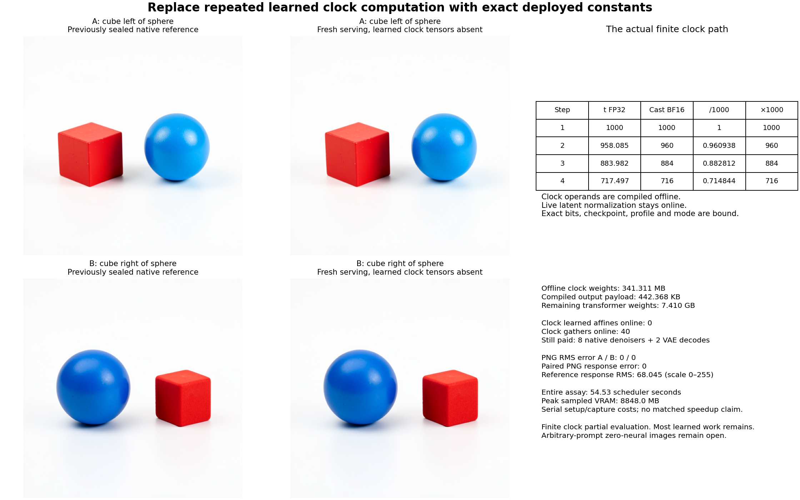

# Compile the deployed clock, keep the live state

The complete clock-only FLUX subgraph can be evaluated offline for the four deployed clocks. Fresh image serving then loads **none of its six learned parameter tensors**, gathers their compiled operands, and preserves both tested image trajectories exactly at every retained field and PNG byte. This replaces **341,311,488 parameter bytes** with **442,368 bytes of compiled outputs**. Most model computation remains: arbitrary-prompt image generation with zero neural evaluations is still unsolved.

This is a finite-dependency compiler result, following the [complete masked-encoder paths](complete-masked-encoder-image.md). The [executed protocol](results/compiled-flux-clock/frozen-plan.md), [raw report](results/compiled-flux-clock/report.json), [table](results/compiled-flux-clock/portable-table.json), [custody](results/compiled-flux-clock/provenance.json) and [full-byte verification](results/compiled-flux-clock/retained-array-verification.json) preserve the distinction between removed and remaining work.

## Factor a constant subgraph out of the transition

For fixed model parameters and an allowed clock, write the denoiser as

$$
D_\theta(Z,E,u_k)=F_{\theta_{live}}(Z,E;C_k),
$$

where

$$
z_k=T_{\theta_{clock}}(\tau_k),\qquad
C_k=\left(z_k,M_{img}(z_k),M_{txt}(z_k),M_{single}(z_k),W_{out}\operatorname{SiLU}(z_k)\right).
$$

The five operands in C read clock and parameters. Under guidanceNone with reference/KV modes and caching algorithms disabled, they read neither E nor Z nor any live residual. They can therefore be partially evaluated before a prompt or image state exists. This is learned-function memoization on a four-element domain. It does not discover a new semantic law or make the live attention/MLP computation disappear.

The output-normalization replacement caches only its conditioning affine a. It retains the original normalization object and the native arithmetic order:

$$
(s_k,b_k)=\operatorname{split}(a_k),\qquad
Y=\operatorname{Norm}(X)(1+s_k)+b_k.
$$

X is still the live state. No normalized image state is cached. Exact temb and live dtype determine the removed SiLU/cast/affine; supported clock lookup does not require a whole-scene or parent-lineage identity. A mechanics control changes a dummy live-state payload while preserving a valid clock and still accepts lookup.

## The finite clock is part of the computation

Let B denote the actual BF16 rounding boundary. The pinned pipeline and transformer perform

$$
r_k=B(t_k),\qquad u_k=B(r_k/1000),\qquad \tau_k=B(1000u_k).
$$

Compilation follows those operations serially at B1. It does not batch four clocks or substitute a nominal mathematical timestep. The actual traces are:

| Step | Scheduler t,FP32 | Pipeline cast,BF16 | Transformer argument u,BF16 | Embedding clock τ,BF16 |
|---|---:|---:|---:|---:|
| 1 | 1000 | 1000 | 1 | 1000 |
| 2 | 958.085388 | 960 | 0.9609375 | 960 |
| 3 | 883.981873 | 884 | 0.8828125 | 884 |
| 4 | 717.496582 | 716 | 0.71484375 | 716 |

Whole operand payload hashes, shape, dtype, checkpoint, native sources, parent numerical profile, attention-processor classes and scheduler bytes are bound. Guidance, reference/KV modes, enabled caching algorithms, altered profiles, unknown clocks and attention overrides reject explicitly. The ordinary pipeline `cache_context("cond")` wrapper remains supported. There is no dense clock fallback.

## Fresh serving really excludes the weights

The compiler child constructs original clock modules on meta and materializes only the six original clock tensors. It evaluates24 original affines across four separate B1 calls and seals complete operands. The process exits before image serving starts.

A fresh image child constructs the original transformer on meta, replaces the clock modules, then calls `safe_open.get_tensor(name)` only for the163-name complement of the169-tensor checkpoint. It never deserializes the six removed tensors. Loaded names and model parameters have zero overlap with the removed set; no global `to_empty` can erase the installed table buffers. All original live transformer weights, parameter versions, table buffer versions/hashes and asset signatures remain checked.

The removed tensors are the two timestep-embedding affines, three shared modulation affines and `norm_out.linear.weight`. Their BF16 payload is341,311,488bytes. Each clock stores3072+18432+18432+9216+6144 scalars, giving4×55,296×2=442,368bytes of outputs. Small clock-trace arrays and transport headers are additional bytes. This is771.56times smaller than this parameter subset, or **4.4034% of complete transformer parameter bytes excluded**. Remaining transformer parameters loaded are **7,409,777,664bytes**.

Both children still hash the complete original image assets for identity—7,919,232,916bytes per child,15,838,465,832bytes total. Those file reads are separate from selected tensor loading. This is not a checkpoint-file-absence claim; the six tensors are absent from serving's learned parameter objects and evaluations.

## Two own-state images against already sealed targets

The assay reuses the previous left/right pair's two full E fields and seed314159 noise. No text encoder, new reference image, extra seed or noise draw is run. Each candidate advances its own latent through four original denoising steps and the original VAE. Actual E, clock arguments, scheduler and latent handoffs are checked.

The compilation and serving children are denied access to saved target arrays/PNGs and target metadata after source verification. The parent verifies complete candidate constants/fields and seals them before reading evaluation values. These targets were previously observed, so this is an integration test rather than prospective image-quality evidence.

All **32 retained computed image fields**—C, velocity and latent at every step, VAE input, raw decoder output, floatRGB and PNG RGB—have equal candidate/reference payload hashes at distinct paths. Both original PNG pairs are byte-identical. All16 signed paired-response comparisons have error RMS0. The PNG B−A response itself has RMS68.045079 on the0–255 scale; equality is not a collapsed response. The images retain the visible left/right reversal, with the same size/lighting changes as before. Unretained internal arithmetic and arbitrary-prompt quality are outside this equality statement.

## What the reduction costs and leaves behind

Offline compilation evaluates **682,622,976 nominal linear MACs**. Each denoiser invocation avoids170,655,744 clock MACs; the two four-step images avoid **1,365,245,952 online MACs**. Image serving performs zero learned clock affines and40 clock gathers.

It still executes **824 original transformer linears /37,791,417,237,504 nominal MACs**,8 native denoisers,8 context projections,40 joint blocks,160 single blocks and2 VAE decodes. The avoided clock work is only **0.00361245% of original nominal transformer linear MACs**. A large parameter-byte reduction need not be a large computation reduction: clock maps operate at B1, while most live-state maps process hundreds or thousands of rows. Attention, normalization, nonlinearities and VAE work are outside that linear-MAC denominator.

Guarded Beast job **job-31811b103879** succeeds on its first launch in **54.53scheduler seconds**, with **8,201.4MB sampled RSS /8,848MB sampled VRAM**. It queues behind the existing GPU lease and runs under strict CUDA admission, no retries, B1/512/BF16,4CPU,14,336MB RAM and13,000MB VRAM. The known generic B64/fallback planner mismatch and compatible measured exception are preserved.

Worker body after NumPy imports is50.111s. Fresh-process phases take14.987s compilation and33.928s image serving. Compiler time after framework imports is4.538s, including0.0546s of clock arithmetic/capture. Image worker time after imports is31.238s, with27.332s setup including full-file hashes, explicit selected loading and per-tensor payload hashes. Complete image calls with captures take3.050s and0.685s; unequal initialization/cache costs prevent a speedup claim.

The40 gather/input-hash timing fields sum to0.7805s, but GPU→CPU operand hashes synchronize with previously queued work, particularly at output normalization. That sum is **not isolated lookup latency** or additional CPU computation time. No energy or controlled native speed comparison is measured.

## Verification and the unresolved state problem

Independent byte verification covers **191members /206,651,754bytes**, including all constants, candidates, retained targets, supplied E/noise, differences and seals. All93 new complete arrays /146,206,376bytes stay near compute. Public evidence has **55files /1,713,524bytes**, including byte-identical compact clock constants, original PNGs and lossless2,048 dependent scanline records. The payload has matching declared/sealed/executed SHA `a088f3e894ed6db9272938c1da45fd3ded37013bc27e1d49befba1efc24e3484` (39,326bytes).

All124 generator mechanics tests pass. Seven new tests cover exact clock conversion, wrong bits/dtypes/guidance, profile/mode restrictions, removed-tensor loading, live-state-dependent normalization, target denial and refusal to score a failed candidate. Saturn's one-stream sweep is `target-streams-only`; it is an instrument check, not semantic certification. [Astra's source/result review](results/compiled-flux-clock-evidence/advisor.json) independently checks structural loading, joins, per-clock gathers and bounded output equality.

The newest [own-state MLP work](../../obsidian/blog/2026-11-06-111533-improving-an-mlp-on-its-own-predicted-states.md) still pays dense first-affine computation and poorly predicts contextual interactions. The [carry/context study](../../obsidian/blog/2026-11-06-004500-what-the-c-state-machine-learned-about-carry-and-context.md) shows why projecting separate writes can destroy cancellation with carried state; its new lineage guard is engineering evidence, not a compact-state discovery. The [causal-family update](../../obsidian/blog/2026-11-06-003759-from-exact-readers-to-causal-computation-families.md) rejects a universal carry-dominance rule at the earlier commit. Its newer final-block intervention instead finds most of that consumer's RGB contrast already present in the incoming residual, with a substantial interaction retained. That conditional localization does not explain a smaller program that forms the residual from text. The [mathematical accounts](../../obsidian/blog/2026-11-06-105404-mathematical-accounts-of-model-computation.md) preserve the difference between a conditional law and its still-live operands.

The [next frozen cut](plans/raw-rank-one-image.md) follows the existing rank-one causal reader from raw A/B strings through all32 approximate heads, its actual block0 receiving computation, own full-row blocks1…26/E and two complete images. Source geometry, basis, rank/support and fallback stay fixed; existing full targets avoid another reference campaign. Full rows after H1 isolate the reader's dynamic approximation from compact-GEMM changes on new states. The exact clock table may remain because its dependencies exclude live state. This is planned, not executed.

This experiment closes one finite clock dependency. It does not close raw-prompt contextual interpretation, general own-state denoising, or pixel production without learned-map evaluation. Those remain the original goal.
