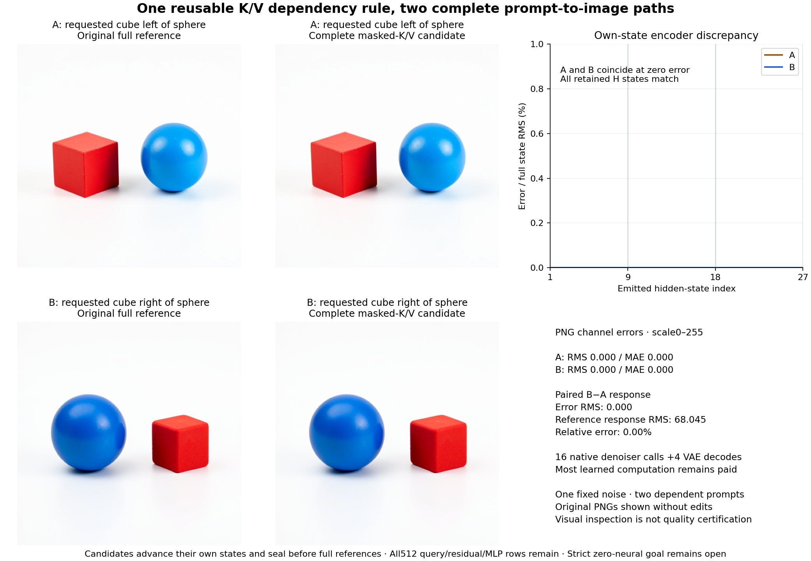

# One dependency rule through two complete prompt-to-image paths

The mask-dependent K/V reduction composes through the complete demanded encoder on two fresh strings. Both resulting images are byte-identical to their independently executed full references. Across the pair, the candidate omits **146,150,522,880 nominal encoder linear MACs (5.2376%)**. This is a bounded computational reduction: original learned attention, MLPs, FLUX and VAE still execute. Arbitrary-prompt image generation with zero neural evaluations remains open.

The [frozen plan](plans/complete-masked-encoder-image.md), [raw report](results/complete-masked-image/report.json), [custody](results/complete-masked-image/provenance.json) and [complete-byte verification](results/complete-masked-image/retained-array-verification.json) preserve the source and scope. This follows the [mixed pixel consequence](conditioning-image-consequence.md) of a local numerical improvement, rather than extending its one-scene precision search.

## What the two paths actually compute

Before tokenization we froze A, “A red cube to the left of a blue sphere on a plain white tabletop. Two separate objects, studio photograph.” B changes only “left” to “right.” Both have 35 active and 477 padding rows under the pinned 512-row interface. These are two dependent examples with one inherited noise state, not a semantic-quality benchmark.

Candidate block0 gathers complete-vocabulary compiled lexical embedding/Q/K/V operands, then computes the original attention, output projection and MLP tail. In blocks1…26 it forms K/V only at the35 mask-permitted key rows. All512 query, residual and MLP rows remain live. Each block consumes its own previously emitted H; H9/H18/H27 form its own E. The fixed K/V-only BF16 reduced-precision-reduction policy is False; it is not tuned by layer or prompt.

Each full reference independently advances all27 original native Qwen3 decoder blocks from the common lexical embedding H0. It forms512 K/V rows with the original reduction flag True. It never refreshes a candidate state. Candidate encoder and image outputs seal before the full encoder starts; the full receipts bind that earlier seal.

Each branch then runs the original pinned four-step Klein4B denoiser and native VAE. All four start from independent clones of the already sealed seed314159 noise and identical fresh schedulers. There are zero new noise draws. Actual E reads, latent handoffs, schedules, parameter versions and source bytes are checked. Five serial children—lexical, candidate encoder, candidate images, full encoder, full images—avoid encoder/denoiser co-residency.

## The mathematical state is triangular

Let A be the active key addresses and P the padding addresses. At one block,

$$
K_\ell=W^K_\ell N(H_\ell)_A,\qquad
V_\ell=W^V_\ell N(H_\ell)_A,
$$

while Q is formed at every query row. For query i,

$$
O_i=\sum_{j\in A\cap\operatorname{Causal}(i)}
\frac{\exp(q_i^\top k_j/\sqrt d)}
{\sum_{r\in A\cap\operatorname{Causal}(i)}\exp(q_i^\top k_r/\sqrt d)}v_j.
$$

The implementation preserves the original mask behavior, including any boundary convention for a row with no permitted key. The support identity does not license changing that convention.

Write a for active state rows and p for padding state rows. Because normalization and MLPs are row-local and padding keys are unread, the ideal dependency graph has the form

$$
a_{\ell+1}=f_\ell(a_\ell),\qquad
p_{\ell+1}=g_\ell(p_\ell,a_\ell).
$$

The active subsystem is closed to padding state. Padding queries still read active memory, carry their own residuals, and receive their own MLP writes. FLUX consumes those padding rows through E, so dropping p would change the demanded computation. This is a state-sufficiency and dependency result; it does not discover object symbols or eliminate contextual learned computation.

Real-arithmetic support and finite implementation parity are different questions. Changing GEMM row geometry can change BF16 results. The earlier28-row teapot case retained nonzero discrepancies even with the fixed policy. This new35-row pair happens to preserve every retained output; it supplies no universal35-row parity rule.

## What matched, including the prompt response

For each prompt, complete payload hashes agree at H0…H27 and E, and at all16 retained image fields: four context projections, four velocities, four committed latents, VAE input, raw decoder output, processed float RGB and PNG RGB. H0 is the shared supplied input, so the total is **88 computed output comparisons plus two common-input checks**. All four original PNG files also have matching candidate/reference bytes. Distinct candidate/full paths and independent state advancement exclude simple branch aliasing. Unretained arithmetic intermediates are outside this equality claim.

For the signed response, cast to a signed/widened dtype before subtraction:

$$
\Delta X=X_B-X_A,\qquad
\widehat{\Delta X}=\widehat X_B-\widehat X_A,\qquad
e_\Delta=\widehat{\Delta X}-\Delta X.
$$

Every retained paired error has RMS0, changed-value count0 and cosine1. The response itself is nonzero:

| Port | Full B−A response RMS | Candidate response error RMS |
|---|---:|---:|
| E | 0.758053 | 0 |
| Final latent | 0.730338 | 0 |
| VAE input | 1.295616 | 0 |
| Raw decoder | 0.539433 | 0 |
| Processed float RGB | 0.266896 | 0 |
| PNG RGB,0–255 scale | 68.045079 | 0 |

Both original images visibly implement the requested left/right reversal. Size, lighting and shading also change. The observation does not isolate a pure spatial translation, certify image quality, or establish unseen-prompt fidelity.

## Removed work and the much larger remaining computation

Per prompt, the blocks1…26 support reduction omits

$$
26(512-35)\,2560\,(2\cdot1024)=65,022,197,760\quad\text{MACs}.
$$

Compiled block0 Q/K/V separately removes8,053,063,680 nominal online MACs per prompt. Together that is73,075,261,440 per prompt. Across two prompts, nominal encoder linear work falls from2,790,386,565,120 to2,644,236,042,240 MACs. Historical table compilation, the2.645GB learned-output store, gathers/scatters, attention, normalization, nonlinearities and image computation are excluded from this linear-operation denominator. This is neither measured device FLOPs nor energy.

The assay still executes108 encoder SDPA calls,372 candidate encoder linears and378 full-reference linears,54 native reference decoder blocks,16 native FLUX denoiser calls,16 context projections,80 joint blocks,320 single blocks and4 VAE decodes. Avoiding a decoder-layer wrapper in the candidate does not remove the learned equations it reconstructs.

Guarded Beast job **job-394733a01129** succeeds in **109.59 scheduler seconds**, with sampled peak **7,925.7MB RSS /9,148.0MB VRAM**. Worker time after NumPy imports is107.819s. Phase wall times including fresh processes are2.418s lexical,40.384s candidate encoder,20.165s candidate images,21.049s full encoder and14.039s full images. Startup/loading/cache order differs; candidate encoder is slower in this sequence. No serving speedup is established.

Intent-first preview retains the known generic B64/fallback-dimension mismatch. The frozen compatible measured exception reserves14,336MB RAM /13,000MB VRAM /4CPU with strict CUDA admission and no retry; actual geometry is B1/512/BF16. Extra reservation is not a performance explanation.

## Evidence and the next reduction

Independent verification reads **238 complete members /708,332,383bytes**, including inherited noise, lexical packets, complete fields and seals. All210 new arrays /669,018,368bytes stay near compute. The compact public result has20files /2,128,167bytes; its gzip reproduces all30,720 dependent observation records byte for byte. The executed payload SHA is `3a91792eb8cde72facb075787fd3b09f6cc2cddf93193db47ad367b4607f8a9e` (42,829bytes), with declared/sealed/executed custody agreeing.

All117 generator mechanics tests pass, including BF16 transport, signed image differences, own-state continuation and a corrupt-candidate reference-release test. Saturn run/verify both exit0 with `target-streams-only`: one stream /30,720records, no semantic terminal receipt or physical address joins. These are instrument checks. Astra's [source/result review](results/complete-masked-image-evidence/advisor.json) independently retains the bounded equality, paid work, earlier counterexample and absence of speedup.

Astra selects [complete clock-only FLUX partial evaluation](plans/compiled-flux-clock.md) next. Four deployed clocks determine the timestep embedding, three shared modulation vectors and output-conditioning affine without reading prompt or latent. Compile those learned constants offline, then exclude their original parameters from fresh serving. Live normalization, attention, MLPs and decoding remain. This proposal is unexecuted and preserves the strict goal: the complete arbitrary-prompt zero-neural generator is still missing.
