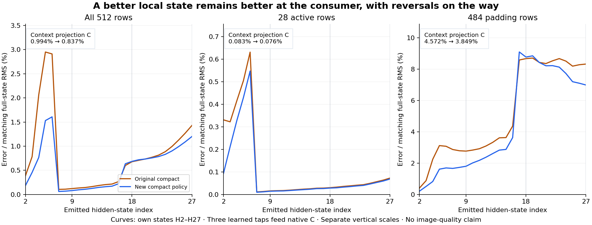

# Does a better H2 survive the conditioning consumer?

The K/V-only numerical policy remains better at FLUX's first context projection, but its advantage shrinks and reverses on some rows. Complete C error RMS falls from **0.178039 to 0.149982**, a **15.76% reduction**, versus the 52.62% local improvement at H2. Error relative to C is **0.9935%→0.8370%**. At H18, pooled error becomes slightly worse. At C, **347/512 rows improve and 165 worsen**. No image has been rendered in this assay.

This executes the [complete-demand plan](plans/conditioning-demand-consequence.md) following the [fixed K/V policy result](kv-accumulation-profile.md). It measures the consequence of the existing approximation. All **75 original Qwen blocks and three native FLUX context projections** are paid learned computation; there is no additional operation elimination or zero-neural suffix claim.

## Three actual states, one unchanged suffix

The source branches are the actual previously sealed H2 fields for one short prompt: full K/V formation, original compact formation and the new compact policy. The source is authenticated by `job-332caa7e03a6`, including its inherited originals. Each branch advances itself through original blocks 2..26, with no further compaction, target activation or reference refresh.

The pinned pipeline reads outputs after decoder blocks 8, 17 and 26:

$$
H_{\ell+1}^b=F_\ell(H_\ell^b),\quad\ell=2,\ldots,26,
\qquad E^b=[H_9^b,H_{18}^b,H_{27}^b],
\qquad C^b=\operatorname{context\_embedder}(E^b).
$$

E is the pipeline's actual stack/permute/reshape layout, `[1,512,7680]`; C is `[1,512,3072]`. All padding rows remain. The [worker](../generator/conditioning_demand_study.py) retains all H2..H27 states and checks actual input-payload hashes at each of 75 block handoffs. It hydrates one layer's original weights, consumes all three branches serially at the original B1/512 geometry, then releases those weights. Every SDPA receipt checks the actual Boolean mask, causal flag, GQA, scale and zero dropout.

A meta-only original FLUX container supplies its real `context_embedder` component. Only that component's original 47.19 MB weight is loaded. Three actual module prehooks verify that the projection consumes each branch's complete E. The remaining denoiser and VAE do not run. No new tokenizer, embedding or full encoder reference runs; the suffix's qualified source and numerical profile define the instrument.

## The improvement is not monotonic or uniform

| Port | Old error / full endpoint RMS | New error / full endpoint RMS | Rows improved / worsened |
|---|---:|---:|---:|
| H2 |0.3852%|0.1825%|500 / 12|
| H9 |0.1210%|0.0793%|411 / 101|
| H18 |0.6769%|0.6846%|322 / 190|
| H27 |1.4283%|1.1994%|344 / 168|
| Packed E |0.9259%|0.8074%|349 / 163|
| Native projection C |0.9935%|0.8370%|347 / 165|

These are dependent rows in one context. More rows can improve while pooled RMS worsens, as at H18, because magnitudes differ. Relative error can also decline while absolute error grows when the reference state's amplitude increases. The [complete report](results/conditioning-demand/report.json) retains absolute RMS, denominators, word/signed-zero counts and all regions at every layer.

At C, active error is **0.08272%→0.07616%**, while padding error is **4.5722%→3.8492%**. Active-row absolute RMS is 0.061881→0.056972, and padding RMS is 0.182511→0.153650. Large active-state amplitudes dominate the pooled denominator. Neither regional percentage measures visual importance. Twenty of 28 active rows improve; eight worsen. Padding has 327 improvements and 157 reversals. All 14,336 per-position records remain in the [lossless stream](results/conditioning-demand/observations.jsonl.gz).

The old and new C error vectors have cosine **0.45390**. The new result is not the old error multiplied by one smaller scalar. With errors e_old and e_new relative to the full branch, and d=e_old−e_new, the saved vectors obey

$$
\|e_{\rm old}\|^2=\|e_{\rm new}\|^2+2\langle e_{\rm new},d\rangle+\|d\|^2.
$$

The maximum absolute FP64 residual of this accounting across reported regions/ports is 7.28e−12. This is an identity on the observed vectors, not an independent prediction or a stability law. Before projection, concatenating taps introduces no cross terms between their disjoint feature coordinates. After projection, tap contributions can interact; aggregate C error does not identify those separate projected cross terms. We did not run that extra decomposition.

## Cost and custody

Successful guarded CUDA job **`job-0dddb989549a`** takes **40.0 scheduler seconds**, 1,819.7 MB sampled RSS and 692 MB VRAM. The timed worker body after framework imports takes 25.481 seconds. It executes **75 SDPA / 528 linears / three native context projections**, with 25 layer hydrations and 276 selected parameter payloads totaling **5,093,726,720 logical bytes**. Actual linear geometry accounts for **3,911,775,682,560 nominal MACs** across the three suffixes/projections. These exclude SDPA and other operations; they are neither measured device FLOPs nor energy. CPU math uses one thread within default 4 CPU / 4 GB RAM / 4 GB VRAM admission. Captured phase times include state writes and establish no speedup.

Both original encoder shards receive full-byte hashes. For FLUX, the selected projection entry—dtype, shape and offsets—and exact payload are checked against the original recipe; its whole-header digest is recorded, not compared with a pinned whole-header digest. No fresh full-transformer-file byte hash is claimed.

The first staged attempt, **`job-6da90f538bf6`**, failed after 33.92 seconds before its first consumer block. Its version-counter instrument tried to inspect inference-created weights. The [authenticated failed job/log](results/conditioning-demand-evidence/failed-job.json) remain preserved; it supplies no scientific continuation result. A regression test now ensures parameter materialization remains version-tracked inside an inference caller. Fresh v2 preserves the same scientific comparison and succeeds. All **110 mechanics tests** pass.

The successful [request/custody](results/conditioning-demand/provenance.json) binds request `551e29bb9ede226399051781ae31247d908a48b1a27b2e1a036cd6d45e601899` and matching declared/sealed/executed payload `8f7320ac6a67bc9a2764fbb2414d8d7f14a849f3611711fa6854a06142a9cf56`. The [consumer seal](results/conditioning-demand/consumer-seal.json), written before scoring, is `810c2c78a119e494afc2592dad7cd7f286c07629711b749a5451aad2411186a3`.

An independent [byte check](results/conditioning-demand/retained-array-verification.json) verifies **92 members / 263,695,137 bytes**, including all 84 complete H2..H27/E/C fields, the lexical source packet and compact reports. New arrays occupy **229,648,512 bytes near compute**. The public primary result is ten files / **2,596,570 bytes**, with lossless row compression and no local tensor/weight hydration. Saturn run/verify pass as stream-only instrument checks, with no terminal scientific claim or physical model-address join.

## Next: actual pixel consequence

Astra reviewed the result and newest mechanism posts. Its [advice](results/conditioning-demand-evidence/advisor.json) selects the [fixed image-consumer assay](plans/conditioning-image-consequence.md): pass actual E through `prompt_embeds`, clone one presealed noise state across all three branches, and run the pinned four-step native FLUX/VAE consumer. C is already projected and must not be passed as prompt embeddings.

Retain final latent, floating-point decoded pixels and PNG, then compare signed/absolute differences against the full branch at identical scales. No state threshold, favorable seed selection or further precision search decides whether image effects exist. This will measure a real computation reduction's consequence while charging the remaining learned computation. Arbitrary-prompt zero-neural generation remains the full unsolved goal.
