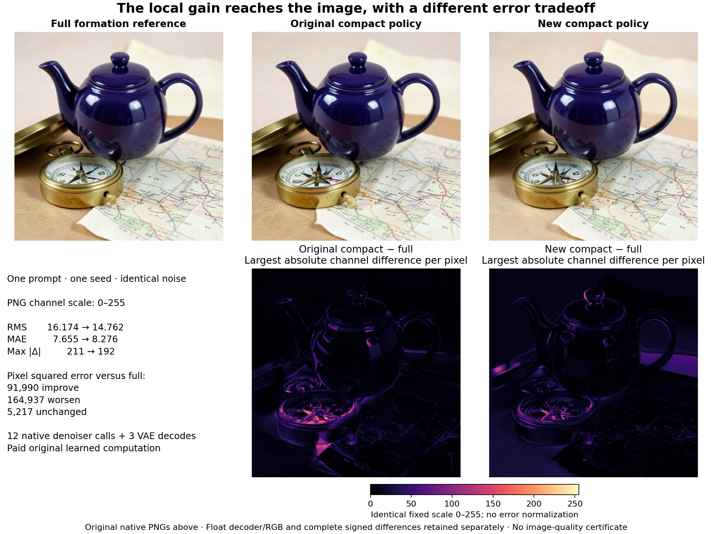

# From a reduced encoder computation to its actual image

The new compact K/V policy reduces final PNG RMS error by **8.73%**, while **MAE rises 8.11%**. Most pixels become less similar to the full reference by squared error. This is a mixed image consequence of the existing reduction, not evidence of better image quality. Arbitrary-prompt generation with zero neural evaluations remains unsolved.

The [interactive comparison](https://time-circuit-explorer.jholl-sub.chatgpt.site/?model=flux2-klein-4b#conditioning-image) exposes the original PNGs with a divider, a fixed 0–255 error view and measured compute. The hosted explorer requires its owner's ChatGPT sign-in. It loads the images on approach; the browser compares saved pixels and executes no model. The [complete report](results/conditioning-image/report.json) preserves raw-decoder, float-RGB and PNG results separately.

## The computation we actually changed

The [first-prompt reduction](masked-kv-own-state.md) forms K/V only for mask-permitted source rows, while retaining all 512 query, residual and MLP rows. The [fixed accumulation follow-up](kv-accumulation-profile.md) changes only the compact K/V numerical policy. Its local H2 error falls 52.62%. The [complete conditioning assay](conditioning-demand-consequence.md) then advances three actual H2 states through the same original learned suffix, yielding full, old-compact and new-compact E. At native context projection C, the RMS gain is 15.76%, with row-level reversals.

This experiment executes the [frozen image-consumer plan](plans/conditioning-image-consequence.md). It introduces no additional approximation. Each branch receives its own actual E `[1,512,7680]`, including padding, through native `prompt_embeds`. Passing C would project the state twice and test a different computation.

For branch b, the native consumer follows

$$
Z_0^b=Z_0,\qquad
V_s^b=D_\theta(Z_s^b,E^b,\sigma_s),\qquad
Z_{s+1}^b=\operatorname{NativeEuler}(Z_s^b,V_s^b,\sigma_s,\sigma_{s+1}),
$$

$$
R^b=\operatorname{VAE}_\theta(\operatorname{UnpackAndNormalize}(Z_4^b)),\quad
I^b=\operatorname{NativePostprocess}(R^b),\quad
P^b=\operatorname{NativePNG}(I^b).
$$

These denote the pinned finite-arithmetic implementation, including BF16 rounding, rather than an ideal real-arithmetic update. Seed **314159** draws noise once. Native unpack/repack closes exactly; every branch receives an independent raw-noise clone and a fresh scheduler from the same config. Actual E inputs, all scheduler-to-denoiser latent handoffs, initial noise and schedule bytes are checked. Every step advances its branch's preceding latent. The original transformer and VAE are shared without learned parameter/buffer mutation.

All **12** native context projections exactly reproduce their corresponding prior C field at every BF16 word. Actual execution is four denoiser calls and one VAE decode per branch: **12 denoisers, 12 context projections, 60 joint blocks, 240 single blocks and three VAE decodes** total. No text encoder runs here. These are paid original learned computations.

## Lower squared error, higher absolute error

| Actual consumer port | Old RMS | New RMS | Old MAE | New MAE |
|---|---:|---:|---:|---:|
| Final packed latent |0.288003|0.223250|0.169246|0.146610|
| Actual VAE input |0.509741|0.395013|0.299212|0.259177|
| Raw BF16 decoder output |0.126888|0.115771|0.060062|0.064855|
| Processed float RGB |0.063449|0.057902|0.029998|0.032410|
| PNG RGB, channel scale 0–255 |16.173822|14.761943|7.655066|8.275528|

Each row has its own units. The reversal between RMS and MAE already appears in raw decoder output, before postprocessing or PNG quantization. Final latent error relative to matching full-state RMS is **28.51%→22.10%**; PNG relative error is **9.14%→8.35%**. Those different denominators do not identify a contraction law for the decoder.

For PNG pixels, define the three-channel squared error to full as

$$
q_b(x)=\sum_{c=1}^{3}(P^b_{x,c}-P^{\rm full}_{x,c})^2.
$$

The new policy lowers q at **91,990 pixels (35.09%)**, raises it at **164,937 (62.92%)**, and leaves **5,217 (1.99%)** unchanged. Its maximum channel discrepancy decreases **211→192**. Lower total squared error can coexist with more worsened pixels and higher MAE: the distribution changes, not merely one scale factor. Old/new PNG error cosine is **0.38198**. Complete 256-bin channel-error histograms and 1,024 dependent scanline records remain available, with signed FP64 differences retained near compute.

The original images preserve the indigo teapot, brass compass and map composition. Compass dial geometry, map markings, reflections, shading and edges visibly differ. The full reference is itself a model output. Similarity to it does not certify prompt faithfulness, spatial-relation accuracy or semantic quality; this one scene and seed establish no prompt generalization.

## Compute and evidence

Guarded CUDA job **`job-36aca5f049e6`** succeeds in **41.29 scheduler seconds**, with **3,424.6 MB sampled peak RSS** and **9,168.0 MB sampled VRAM**. The timed body after framework imports takes **23.283 seconds**; setup including full asset hashes, loading and noise takes **15.315 seconds**. PyTorch peak allocated CUDA memory is **8,627,475,456 bytes**, a separate counter from sampled device residency.

| Phase | Full branch | Old compact | New compact |
|---|---:|---:|---:|
| Four denoisers, including context-hook checks |2.747 s|0.550 s|0.541 s|
| VAE decode, excluding captures |2.706 s|0.051 s|0.051 s|
| Complete native image call, with captures |5.679 s|0.676 s|0.640 s|

The first branch pays initialization/warm-up costs. These serial timings establish no speedup. Image-call time includes context, decoder and latent callback capture; it excludes the final RGB-array retention and PNG save. Whole worker time includes those operations and scoring. Denoiser/VAE calls are measured; no energy or device-FLOP measurement is claimed.

The generic intent-first planner incorrectly assumes batch64 and fallback text-model dimensions, estimating 40.2 GB VRAM. The [resource basis](results/conditioning-image/resource-basis.json) preserves that preview and historical native B1 job `job-4350531b1dcd`, measured at 12,936 MB peak VRAM. The compatible measured exception reserves 14,336 MB RAM, 13,000 MB VRAM and four CPU threads; its guarded ceiling fits the physical card. Actual geometry is B1/512px/BF16. The existing Saturn `diffusion-sizing-guardrails` request is upvoted to four with this evidence.

The [provenance](results/conditioning-image/provenance.json) binds request `a7554c4126b019106633d376a53b7a7cd2695996913bec0423b24c68dcbd884d` to matching declared/sealed/executed payload `a0adeaad91c2e6172c44d594250cc46bd01f474afc328ea638fa4a0fe233b15c`. Seven relevant native implementation files and original image-consumer assets receive full-byte hashes. The actual deterministic profile includes cuBLAS workspace `:4096:8`, disabled TF32 and recorded BF16-reduction settings.

The [noise seal](results/conditioning-image/noise-seal.json) precedes every image branch. The [consumer seal](results/conditioning-image/consumer-seal.json) precedes scoring and binds original consumer arrays and PNGs. Derived signed differences are created afterward. Independent [byte verification](results/conditioning-image/retained-array-verification.json) covers **79 members / 138,722,352 bytes**, including inherited E/C and complete new outputs. The new **61 arrays / 103,849,600 bytes** remain near compute. Primary publication is **15 files / 1,323,152 bytes**, with lossless JSONL compression and original PNG copies. A source-only v1 stage remains unsubmitted; v2 adds explicit runtime-profile recording before the sole scientific launch.

All **112 generator mechanics tests** and **33 website tests** pass. Saturn run/verify report stream-only instrument success over 1,024 records, without terminal claim receipts or physical model-address joins. The [cycle25 cleanup](results/storage-cleanup-cycle25/README.md) separately archives 1.536 GB of redundant old transports, preserving scientific data and recovery pointers.

## Next: compose the reusable rule from raw input

Astra's [result review](results/conditioning-image-evidence/advisor.json) recommends the [fresh paired complete-encoder test](plans/complete-masked-encoder-image.md). Apply the already chosen mask-based K/V reduction throughout the remaining encoder demand, retain all query/residual/MLP rows, advance only each branch's own state and measure the paired spatial-relation image response. Do not tune precision again or refresh candidate states from full references.

That next test asks whether a reusable dependency rule composes into a complete input path. It still pays most learned encoder arithmetic, FLUX and VAE. It cannot redefine or satisfy the strict zero-neural goal.
