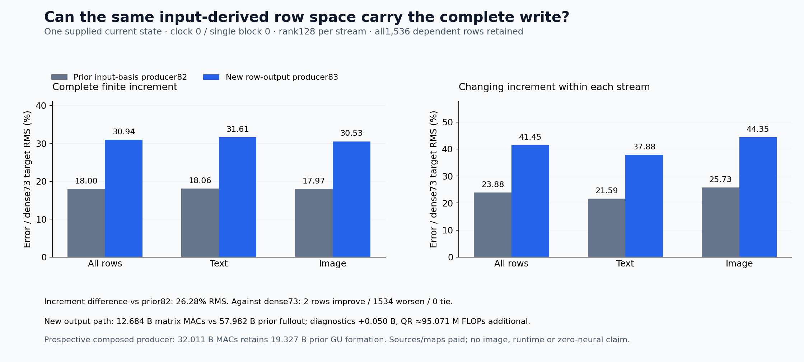

# The same-coordinate output cut loses useful write variation

Reusing the same input-derived row coordinates makes the output calculation smaller, but worsens the local state update. Actual increment error against the retained dense result rises **18.00%→30.94%**, and 1,534 of 1,536 rows worsen. Centered increment error rises 23.88%→41.45%. The cut remains better than no update on 1,535 rows, so the evidence is a cost/accuracy tradeoff on this specimen, not an absence claim about useful structure or every possible compact representation.

The [frozen plan](plans/current-row-output-projection.md) and [implementation contract](plans/current-row-output-implementation.md) are now executed. The [evidence record](results/current-row-output-evidence/README.md) preserves every row, signed accounts, exact source/byte/typed/work checks and Astra's reviews. No continuation or image was run; arbitrary-prompt zero-neural generation remains open.

## Two different axes of compression

The [previous producer](current-state-gate-up.md) built a feature basis Q with 3072 rows and 128 columns, then coordinates C=ZQ for every current text/image row. This cut takes those same C columns as patterns across token/spatial rows. A second QR produces U with 512 or 1024 rows and 128 columns. It is the column span of C in row-index space; no output-derived basis is fitted.

For each stream,

\[
C_s=U_sR_s,\qquad J_s=[\operatorname{paidAttentionRead}_s,\operatorname{ownProduct}_{82,s}],
\]
\[
K_s=U_s^TJ_s,\qquad B_s=K_sW_{\rm out}^T,\qquad \widehat Y_s=U_sB_s.
\]

All six products use FP64. There is one final FP64→FP32→BF16 update admission, then separate BF16 gate multiplication and residual addition. All 128 columns remain, including any numerical rank deficiency. The original complete output weight remains paid.

In ideal arithmetic the complete write becomes U_sU_sᵀJ_sWoutᵀ without first evaluating that write. Attention and the nonlinear product can introduce row patterns that were not in the input-coordinate span. The current experiment measures their combined receiving computation and finite arithmetic; it does not identify which component causes any lost pattern.

The actual BF16 J concatenation matches the prior cycle 82 full-affine input payload byte for byte. An independent byte-only witness also rebuilds that concatenation from the complete source read/product rows. Thus the changed output path consumes the same recorded input values. The original BF16-input/output affine’s finite arithmetic and the new FP64 grouping still differ, so the measured discrepancy cannot yet be assigned exclusively to subspace escape.

## The complete row evidence

The primary comparison is with cycle 82, isolating this new output path. The secondary comparison is with the existing cycle 73 dense local result, retaining total error from both cuts. This remains one supplied moment-attention state at clock 0 / single block 0, not a fresh prompt or independent full-native-model reference.

| Field, pooled relative RMS | New83 vs82 | Prior82 vs73 | New83 vs73 |
|---|---:|---:|---:|
| Complete pre-residual update |20.204%|15.243%|24.827%|
| Actual finite exit increment |26.277%|18.003%|30.936%|
| Complete exit state |1.993%|1.402%|2.408%|
| Stream-centered increment |35.520%|23.879%|41.446%|

Total increment error is 31.606% text and 30.532% image; centered error 37.881%/44.354%. Only text row 27 and image row 1524 improve over cycle 82 against cycle 73. Text row 33 reaches 222.23% error relative to the dense increment; no update would have 100% error. All dependent rows and countertrends remain; none is trimmed or counted as an independent prompt trial. Full-state error remains diluted by the carried residual.

Let e=update82−target73 and Δ=update83−update82, using the actual finite exit increments when interpreting state error. The retained identity is

\[
e_{83,73}=e+\Delta,\qquad
\|e+\Delta\|^2=\|e\|^2+\|\Delta\|^2+2\langle e,\Delta\rangle.
\]

Pooled increment error energy changes from 6,362,870.441 to 18,788,691.258. The new-cut delta contributes 12,854,450.380 and its signed cross term with the old error is −428,629.563. Cancellation offsets only 3.33% of the new delta energy. Over 99.99% of that delta energy is within-stream variation. These are signed numerical accounts, not positive causal shares. Vector identity closures are zero in the saved FP64 subtraction accounts; scalar energy-account remainders remain around 10⁻⁸ at these scales.

Coordinate reconstruction error is 5.87×10⁻¹⁶ relative RMS; the largest measured UᵀU discrepancy is 1.44×10⁻¹⁵, and neither unpivoted R diagonal contains an exact zero. Those diagnostics support the QR implementation, not numerical-rank certification or output sufficiency. Accurate coordinates can coexist with a write that demands additional row patterns.

## Paid arithmetic and measured execution

| New operation | Actual matrix MACs |
|---|---:|
| UᵀJ |2,415,919,104|
| Compressed rows through original Wout |9,663,676,416|
| Complete update reconstruction |603,979,776|
| New output subtotal |12,683,575,296|
| Post-exit UR and UᵀU diagnostics |50,331,648|
| Complete new assay |12,733,906,944|

The new output path uses 78.125% fewer matrix MACs than cycle 82's 57.982B full output affine. Retaining cycle 82's 19.327B G/Up formation yields a prospective composed subtotal 32.011B. That complete composed producer was not rerun here. QR adds approximately 95.071M algorithmic FLOPs, separately from MACs, plus all source formation, attention, maps, casts, copies, hashes and scalar/state work. No cross-state reuse or matched runtime gain is established.

Guarded job `job-50d1afc5dce1` succeeds in 25.81 scheduler seconds with 1,795.6MB sampled RSS/1,564MB device memory. Producer wall time after imports is 9.224s, setup 6.004s, instrumented operation time 2.723s including internal fingerprints, and post-exit analysis 6.867s. Synchronized QR calls take 0.444s/0.00274s; first-use effects prevent a warm benchmark interpretation. Requested cuSOLVER preference is recorded configuration, not vendor-kernel attestation.

All 353 tiny mechanics tests pass. One Act binds six source fields and the 75,497,472-byte original output tensor to 11 producer fields; four analysis fields follow successful producer exit. Complete byte checks authenticate 45 files/205,911,020 bytes and 25 NPY payloads, plus the original output tensor and 37,748,736-byte J join. This is source/byte/tiny-reference evidence, distinct from independent numerical replay of real arrays.

The standard Saturn source-entry run/verify returns 0 on the raw compact result: one stream/1,536 records, zero fires/formal claims/qualified addresses and one expected missing no-fire ledger. This is applied stream coverage, not numerical or semantic certification. All 15 complete arrays/111,759,232 NPY bytes remain near compute. The 17-file compact core is 1,891,568 bytes before figures/evidence. No archive/deletion or cold rehash is needed this cycle; full storage and newest-post reviews 81 remain current and are due 84 before another science stage.

## The next question is numerical row-space escape

Astra's [next written, unexecuted plan](plans/fixed-row-projection-diagnostic.md) projects the already retained 82 output through the same fixed cycle 83 U. Four projector contractions cost 1.208B MACs and load no original learned map. They separate the recorded-row projection residual, combined finite-policy/reassociation discrepancy and final admission discrepancy, then use saved gated writes/exits to account for actual finite state differences. No new basis, correction candidate or image is proposed.

The working inference is that the input-coordinate span does not carry enough of the complete write's changing row structure in this implementation. The next diagnostic tests how much of the discrepancy belongs to that span versus the joint finite policy. Economical raw-prompt formation, evolving-state closure, prompt faithfulness and a general non-neural pixel producer remain open.
