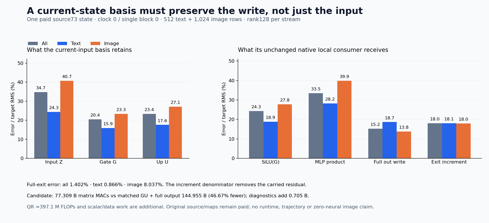

# A current-input basis produces complete operands, with 18% state-increment error

A rank 128 basis built from the current normalized input can produce complete gate and Up operands for this local FLUX computation. The candidate uses **77.309 billion matrix MACs**, including basis/map construction and the complete original output affine, versus 144.955 billion for the matched dense G/Up-plus-output subtotal. Its actual state-increment RMS error is **18.00%**; every one of the 1,536 rows improves over a no-update baseline. This is useful local approximation evidence, with all original learned maps and source formation paid. It is not zero-neural image generation, a runtime gain or a closed trajectory.

The [coefficient census](rectifier-liveness.md) closed one proposed exact-zero correction route: its complete coefficients were dense. This [different frozen experiment](plans/current-state-gate-up-basis.md) moves upstream and produces the complete operands from a basis of the input itself. The [implementation contract](plans/current-state-gate-up-implementation.md) records the finite geometry and extra diagnostic charges. [Complete evidence](results/current-state-gate-up-evidence/README.md) links source, receipts, full row observations and retained-byte checks.

## Factor the input before applying the learned maps

The source is the [matched cycle 73 capture](matched-single-write.md), clock 0 / single 0: 512 text rows and 1,024 image rows, width d=3072 and MLP width m=9216. Its normalized input Z, paid moment-attention read, gate and incoming residual are authenticated saved fields. This is that specific moment-attention path, not an independent full-native-model reference or a fresh prompt producer.

For each stream s, one fixed Rademacher sketch uses every current row. With r=128,

\[
Y_s=Z_s^T\Omega_s,\qquad Q_sR_s=Y_s,\qquad C_s=Z_sQ_s,
\]
\[
B_s=Q_s^T[W_G^T\;W_U^T],\qquad [\widehat G_s\;\widehat U_s]=C_sB_s.
\]

The signs come from PCG64 `SeedSequence([20261107,82,s])`, low raw bits in C order. There is no centering, oversampling, power iteration, seed/rank search or output-dependent basis fit. CUDA FP64 reduced Householder QR retains all 128 columns and canonicalizes their signs using the diagonal of R. The complete signs, sketches, bases, coordinates, projected maps and operands are retained.

In ideal arithmetic the candidate applies the original maps to Z_sQ_sQ_sᵀ. If E_s=Z_s−Z_sQ_sQ_sᵀ, then

\[
\widehat G_s-G_s=-E_sW_G^T,\qquad
\widehat U_s-U_s=-E_sW_U^T.
\]

Small input residual alone does not certify small operand error: the maps weight discarded directions differently. Nor does small operand error certify product or state accuracy. For a=SiLU(G), δa=SiLU(G+δG)−a and δu=Û−U,

\[
\widehat P-P=\delta a\odot U+a\odot\delta u+\delta a\odot\delta u.
\]

That identity concerns ideal products of the stated operands. The actual experiment also includes original BF16 contractions, FP64 regrouping/QR and the explicit FP64→FP32→BF16 admission. Their numerical discrepancies remain in the measured errors; this assay does not isolate each term as a cause.

The receiving computation uses the native parameter-free `transformer_flux2.Flux2SwiGLU`, original complete output affine, then separate BF16 gate multiplication and residual addition. The native GU view and recorded post-concatenation product geometry are restored from the pinned source. No original full-width G/Up projection runs before compression. Historical G/Up, activations, products, updates and exits remain denied until the producer seals and exits.

## What survives at each boundary

Each entry below is error RMS divided by that field's target RMS. All target fields are the existing complete dense local results; no new reference evaluation runs.

| Field | All | Text | Image |
|---|---:|---:|---:|
| Reconstructed input Z |34.745%|24.313%|40.695%|
| Gate G |20.434%|15.872%|23.303%|
| Up U |23.353%|17.557%|27.092%|
| SiLU activation |24.328%|18.870%|27.771%|
| MLP product |33.515%|28.181%|39.862%|
| Complete pre-residual output |15.243%|18.660%|13.816%|
| Actual finite exit increment |18.003%|18.065%|17.966%|
| Complete exit state |1.402%|0.866%|8.037%|

The full output affine receives a byte-identical supplied attention read alongside the new MLP product. Its smaller relative error than the MLP product therefore does not independently demonstrate attenuation by the output map: the reference fields and denominators differ. Finite fused accumulation does not separately establish an exact output-space attention contribution. No pure-MLP output decomposition was evaluated here.

The complete exit carries a large incoming residual. Dividing by that entire state gives 1.40% pooled error, while dividing the same exit discrepancy by the actual native increment gives 18.00%. The median individual state-row error is 7.36%, so the pooled state ratio also obscures row heterogeneity. The increment measure uses `saved exit − incoming residual`, after promotion of the stored fields to FP64; it includes the finite gate/addition boundary. Every row's candidate increment beats retaining the incoming state without an update, but none of this establishes native equality or a useful complete image future.

Stream-centered measurements retain the changing part rather than the shared mean. Pooled centered input error is 43.40%; centered product error 37.19%, rising to 45.70% for image rows; centered exit-increment error 23.88% (21.59% text/25.73% image). Full increment row errors range 3.58–37.95%, with median 17.18%. No row is trimmed. The text/image rows are dependent observations of one state, not 1,536 independent prompt trials.

Both measured QᵀQ errors have maximum absolute discrepancy 8.88×10⁻¹⁶. Neither R diagonal has an exact zero. These are numerical diagnostics, not a rank certificate or grounds for changing the law.

## The computation is smaller, and still learned

| Actual candidate operation | Matrix MACs |
|---|---:|
| Current-input sketches |603,979,776|
| Coordinates C |603,979,776|
| Compile both complete GU maps |14,495,514,624|
| Reconstruct complete GU |3,623,878,656|
| Original full concatenated output affine |57,982,058,496|
| Candidate subtotal |77,309,411,328|

The matched dense G/Up-plus-output subtotal is 144,955,146,240 MACs, so the candidate avoids 67,645,734,912, or 46.67%, of that subtotal. Common QKV/attention/conditioning/source preparation is excluded from both sides and remains paid. This is not a whole-block or trajectory reduction.

Post-exit exact input reconstruction costs 603,979,776 additional MACs, and two QᵀQ diagnostics add 100,663,296. Total assay matrix work is 78,014,054,400 MACs. Both QR factorizations and explicit Q formations add an estimated 397.1 million algorithmic FLOPs, with measured synchronized QR times 1.139s/0.00291s. The first-call timing can include initialization effects; it is not a warm repeated benchmark. Requested cuSOLVER preference and Torch/CUDA/build identity are recorded without claiming vendor-kernel attestation.

The finite guarded job completed in 54.43 scheduler seconds, with sampled 2,079.3MB RSS and 1,998MB device memory. Producer wall time after imports is 21.602s, setup 8.370s, and instrumented operation time 8.388s includes internal fingerprints. Post-exit analysis takes 10.177s after imports. These scopes differ; there is no matched serving-speed comparison. The worker loads 245,366,784 original parameter bytes, promotes the 453 MB GU view, initializes 85 MB of native backing, and pays all casts, nonlinear arithmetic, hashes and retention.

All 351 tiny mechanics tests pass. One typed Act binds five source fields and two original parameters to 18 producer outputs; four post-exit analysis outputs are separate. Complete byte checks cover 46 files/633,741,396 bytes and 33 NPY payloads, plus the two original tensors and physical GU view. The source audit and independent tiny references are distinct from an independent numerical replay of the real arrays.

The Saturn source-entry sweep and verification return0 on the actual raw compact result: one stream / 1,536 records, zero fires/formal claims/qualified addresses, with one expected absent no-fire ledger. The initial compressed-publication sweep and invalid verification arguments are retained as instrument findings, then corrected. This establishes the applied stream check, not numerical or semantic certification. The existing bounded-gzip support request was upvoted.

All 22 complete new arrays, 468,652,800 NPY bytes, remain near compute. The 17-file compact publication is 1,726,902 bytes before figures/evidence. No archive or deletion is needed this cycle; the full storage/newest-post reviews from 81 remain current, with the next scheduled review 84 or earlier pressure/material evidence.

## The next mathematical question

The complete output affine consumes 57.982 of the candidate's 77.309 billion MACs. Astra's [next proposed cut](plans/current-row-output-projection.md) asks whether the same source-derived row coordinates can carry the whole concatenated read/product write through that affine. That tests closure under the nonlinear/read computation, rather than increasing rank or selecting a better seed. Its prospective composed subtotal is 32.011B MACs, retaining the current G/Up formation cost; it remains written and unexecuted, with no extra job this cycle.

The working inference is bounded: an input-only factorization produces complete local learned operands with a useful but imperfect write. Economical raw-prompt formation, own evolving-state closure, broad prompt faithfulness and a general non-neural pixel producer remain open. This experiment produces no continuation or image.
