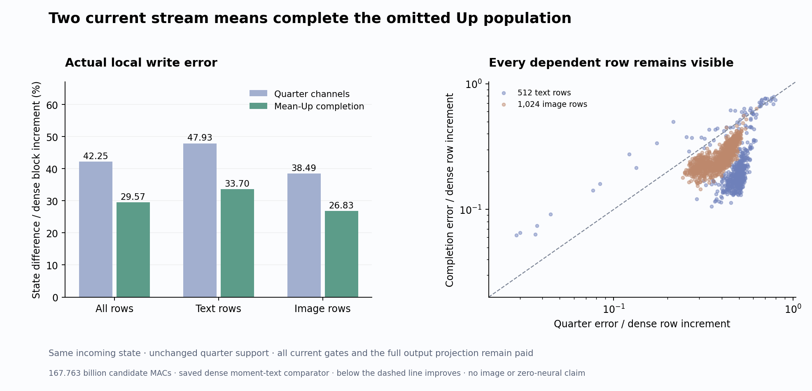

# Two current means restore part of the omitted MLP write

The [matched first-single diagnostic](matched-single-write.md) showed that omitted channels make a coherent contribution. One source-defined completion now recovers part of that write: pooled block-increment error falls from 42.25% to 29.57%, and image-row error from 38.49% to 26.83%. It uses two current stream means, current gates and selected Up values, and the full original output projection. Of 1,536 dependent rows, 1,486 improve and 50 worsen.

This is one own local state write from one supplied clock0/single0 input. It is not a new image, an arbitrary-prompt test or zero-neural serving. The candidate still evaluates four original learned affines, image attention and moment-text products: 167.763 billion nominal MACs, 16.253% below the dense local path. All original source maps and historical state preparation remain paid.

## Factor an Up value into a mean and a centered term

For normalized input row z_i in stream s, original up row u_j and current gate activation a_ij, the ideal real-arithmetic product is

\[
p_{ij}=a_{ij}\langle u_j,z_i\rangle
=a_{ij}\left[\langle u_j,\mu_s\rangle+
\langle u_j,z_i-\mu_s\rangle\right].
\]

The candidate retains every channel's mean-conditioned contribution and only the selected quarter's current deviation:

\[
\widehat u_{ij}=\begin{cases}
\langle u_j,z_i\rangle,&j\in S,\\
\langle u_j,\mu_s\rangle,&j\notin S.
\end{cases}
\qquad
\widehat p_{ij}=a_{ij}\widehat u_{ij}.
\]

The ideal remaining write error is therefore

\[
(Y-\widehat Y)_{i:}=\sum_{j\notin S}
a_{ij}\langle u_j,z_i-\mu_s\rangle d_j^T.
\]

This factorization suggests a cheap current-input component. It does not say the centered term is small. The previous positive cross-channel energies motivated the test without proving that stream means would suffice.

The finite implementation follows the [frozen plan](plans/current-stream-mean-up.md):

1. Reduce the actual admitted normalized text and image rows separately in FP32, producing two means, then admit BF16.
2. Evaluate the original BF16 U affine on the stacked two rows.
3. Broadcast those anchors onto omitted channels; overwrite selected channels with their actual current Up values, without anchor-plus-residual reassociation.
4. Multiply by all actual BF16 SiLU gates, admit the product, and pay one original full-width concatenated attention/product output affine and residual commit.

The displayed algebra is not a native-bit identity. Mean reduction/admission, two-row affine geometry, BF16 product/output and residual arithmetic remain explicit parts of the operator. Compared with the old quarter path, this candidate changes both omitted products and output-contraction width; the experiment does not separately attribute their effects.

## Actual emitted state improves, with retained exceptions

One guarded mrun job evaluates the candidate, seals it and exits. A separate saved-array analysis then opens immutable cycle73 dense and sparse comparators. No new dense model reference, prefix, next block, head, sampler or VAE runs. The own quarter support matches the historical sparse support.

Of 60 comparisons, 49 are numerically exact. Normalized input, Q/K/V/G, activation, attention fields/reads, moment fields, gates, selection and selected Up/product agree. The full completed product and emitted update/state change. If selected supports had differed, only the two unaligned historical sparse-channel comparisons would be marked inapplicable; full-state evidence would continue.

| Rows | Quarter error / dense block increment | Completion error / dense block increment | Completion / quarter error RMS | Improved / worsened |
|---|---:|---:|---:|---:|
| All | 42.251% | 29.572% | 0.69991× | 1,486 / 50 |
| Text | 47.930% | 33.696% | 0.70303× | 465 / 47 |
| Image | 38.489% | 26.828% | 0.69702× | 1,021 / 3 |

These errors use the actual dense block increment, including attention. Exit-relative errors have different denominators: pooled exit error is 2.302%, text 1.616% and image 12.001%. Completed-product error remains 53.272%, so the two means are far from a complete reconstruction.

Let e=S−D be the old sparse exit error and c=C−S the new correction. The signed energy account is

\[
\|e+c\|_F^2=\|e\|_F^2+\|c\|_F^2+2\langle e,c\rangle.
\]

For all rows, error energy falls from 35.0462 million to 17.1680 million. Correction energy adds 16.6335 million, while its cross term contributes −34.5117 million. The correction opposes prior error in projection on every row. Nevertheless, 50 rows worsen because correction energy outweighs that benefit; these are not wrong-sign corrections.

Text median completion/quarter error is 0.3988×, image median 0.6736×. The worst ratios are 2.3121× for text and 1.05793× for image. Previously finite-sensitive text rows34/40/41 worsen by 2.250×/1.987×/1.742×. Cycle74 contains no new decomposition that assigns this worsening to finite arithmetic. All [row observations](results/current-stream-mean-up/write-observations.jsonl.gz) remain visible; the rows are dependent and do not establish cross-prompt generalization.

The two-row anchors differ from the post-seal FP64 means of archived admitted native Up by only 0.18623% relative RMS. That is a finite mean/projection agreement diagnostic. It is not the completion error: replacing individual Up rows by a mean still loses substantial variation.

## What is saved, and what is still paid

| Actual computation | Nominal MACs |
|---|---:|
| Current Q/K/V/G | 86,973,087,744 |
| Current quarter Up | 10,871,635,968 |
| Original U on two current means | 56,623,104 |
| Full attention/MLP output affine | 57,982,058,496 |
| Image-attention QK/AV | 9,663,676,416 |
| Moment-text products | 2,216,165,376 |
| Total | **167,763,247,104** |

The dense local path pays 200,321,531,904 MACs; the difference is 32,558,284,800 (16.253%). Relative to the old quarter path, the new candidate restores 32,614,907,904 down/output MACs and adds 56,623,104 anchor MACs. This buys a more accurate local write at greater cost than deleting the omitted channels entirely.

No full current Up projection runs. Full-sized completed-Up and product buffers still exist, each 28,311,552 BF16 bytes. The original UAnchor clone is 56,623,104 bytes while live; the maximum sequential physical map is 113,246,208 logical bytes. Source norm preparation, full gate evaluation, stream reductions, support ranking, gathers, copies, fingerprints and I/O are additional paid work.

The job takes 66.67 scheduler seconds, with sampled peaks of 2,094.2 MB RSS and 902 MB device. Actor wall time after imports is 17.790 seconds, including 9.536 seconds setup. Its synchronized instrumented operation interval is 4.289 seconds, including internal map/copy work and excluding later finite checks/fingerprints. Post-import saved-array analysis takes 16.840 seconds. These diagnostic timings do not establish a serving speedup.

## Evidence and the next own-state question

[Mechanics](results/current-stream-mean-up-evidence/mechanics.json) covers one typed Act with 36 output ABIs, four affines, one image-attention read and five moment products. The independent byte verifier covers 135 files / 8,546,268,342 bytes including inherited assets, 104 NPY payloads, four original parameters, three source maps, the original U slice/offset, all 1,536 stream-anchor/selected overwrites and the emitted exit join. Mean/projection/product arithmetic is source-audited and toy-tested, not independently numerically replayed by that byte verifier.

The final suite passes 338 mechanics tests in 18.64 seconds. The standard Saturn run and verify both return 0: two streams / 84,518 records, zero fires, claims or qualified addresses. No fire ledgers are written and two missing expected are reported. This states the actual instrument scope without semantic certification.

All 40 new raw arrays / 345,857,032 bytes remain near compute. The primary publication is 18 files / 2,994,380 bytes. No archive or deletion occurs this cycle; actual cleanup and full newest-post survey last completed72, next due75 or earlier pressure/material evidence.

Astra's [next plan](plans/mean-up-own-trajectory.md) carries the frozen law through all twenty single blocks and four own sampler steps. The first nineteen use two evolving stream means; the terminal block uses only its live image mean while retaining full current K/V. Prospective whole-path work is 18.559 trillion MACs, 12.127% below cycle70. This plan is written and unexecuted. The remaining local error and text countertrends make the actual image consumer necessary; they do not justify assuming either success or absence of a useful trend.

See the [report](results/current-stream-mean-up/report.json), [execution](results/current-stream-mean-up/execution.json), [byte witnesses](results/current-stream-mean-up/retained-array-verification.json) and [evidence summary](results/current-stream-mean-up-evidence/README.md). Original learned maps, incoming states and historical preparation remain paid. Arbitrary-prompt zero-neural generation remains unresolved.
