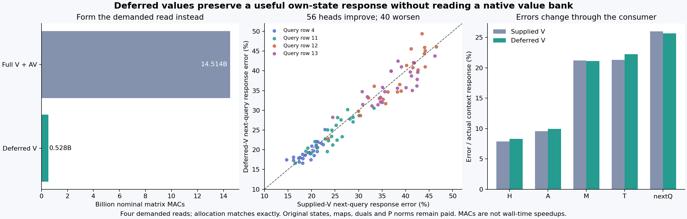

# Let attention choose the input before projecting its value

The deferred value producer runs successfully without numerical access to full or selected native V fields. Its allocation matches the previous supplied-value actor exactly, and its own head advances through the unchanged MLP into its own next query. Next-query response error is **25.662%**, versus **25.993%** for the supplied-value actor and **71.668%** for stale context. The structural result is removal of a supplied value-bank operand; the small pooled error improvement is not a uniform quality repair.

This follows the unsuccessful [absolute norm approximations](spatial-key-norm-capacity.md) and the useful [query-side image numerator](image-dual-score-response.md). It preserves a known allocation law and changes how its values are formed. Original source states, learned maps, text keys, query-specific duals, retained P norm and receiving computation remain paid. No image is generated here, and arbitrary-prompt zero-neural generation remains unresolved.

## The computation that can move

The pinned FLUX joint block computes bias-free linear image and text value maps. Values have neither Q/K RMSNorm nor RoPE. After native BF16 ModLN, let X_t and X_i denote text and image inputs, and let p denote the live full-joint attention probabilities. For each head h and demanded query a,

\[
H_{ha}=\sum_{j\in t}p_{haj}X_{tj}W_{V,t,h}^{T}
+\sum_{j\in i}p_{haj}X_{ij}W_{V,i,h}^{T}
=\overline X_{t,ha}W_{V,t,h}^{T}+\overline X_{i,ha}W_{V,i,h}^{T},
\]

where each weighted input is formed before projection:

\[
\overline X_{t,ha}=\sum_{j\in t}p_{haj}X_{tj},\qquad
\overline X_{i,ha}=\sum_{j\in i}p_{haj}X_{ij}.
\]

The two streams keep their different learned maps and original probability masses. They are not independently renormalized. Each head gets its own input average. The identity is exact over real arithmetic because the value path is linear. It does not move ModLN, softmax or a nonlinear operation, and it does not claim exact native finite arithmetic.

## The actor produces its own inputs and continuation

Three native BF16 ModLN operations form Q's image input, Q's full text input and P's full text input from authenticated StateCuts. P's original full `[1,512,3072]` finite geometry is preserved before selecting rows. The fixed support [4,11,12,13] is spliced from P into Q's normalized text input, matching the earlier selected-P value contract without reading selected V.

The actor then recomputes the unchanged cycle58 image numerator, text logits and joint probabilities. It reads the paid query-specific duals and retained P denominator, not an old probability or head output. Two head-specific weighted inputs pass through the original V head slices in CPU FP64. Their sum is admitted FP64→FP32→BF16 and consumed by the unchanged native output projection, sequential MLP and next-query computation.

Eight typed Acts connect actual outputs across ModLN, splice, allocation, value production, receiving state and next query. The original seven parameter tensors are loaded exactly; full V projection through an original affine is rejected by the worker. Full P/Q K/V banks, selected V, prior hybrid V, old probabilities and archived consumer outputs are numerically inaccessible before the candidate seals and exits. The declared text-only key prefix remains a paid exception. Source hashing and metadata custody do not authorize numerical use of denied tensors.

## What actually matches, and what changes

All eight complete controls match the previous actor byte for byte: image ModLN input, image numerator, text logits, hybrid text K, full logits, probability, peak and partition. After the new actor exits, one paid historical-bank AV uses **its actual probabilities**. Its FP64 head matches the previous Torch AV at 2.55×10⁻¹⁷ relative RMS. This identifies the comparison as matched allocation.

The deferred FP64 head differs from that native-BF16-value route by 0.1651% of endpoint RMS, or 1.8779% of the actual H context response. After admission, 3,752 of 12,288 BF16 H words differ. The new admitted head differs from the old admitted head by 2.9278% of actual H-response RMS.

The exact finite telescope is

\[
H_{new}-H_{old}=(H_{new}-H_{deferred})
+(H_{deferred}-H_{bank})+(H_{bank}-H_{old,raw})
+(H_{old,raw}-H_{old}).
\]

The four terms respectively retain new admission, deferred projection versus native value-bank arithmetic, allocation/contraction difference and negative old admission. The observed telescoping residual is zero. Native per-row BF16 projection and reordered FP64 contraction differ jointly; this is not an isolated rounding-cause experiment. Signed cross energies remain published.

| Actual response field | Supplied V error | Deferred V error |
|---|---:|---:|
| H | 7.891% | 8.277% |
| Attention output A | 9.581% | 9.915% |
| MLP output M | 21.207% | 21.098% |
| Emitted state T | 21.312% | 22.217% |
| Own next query | 25.993% | 25.662% |

The directions are mixed through the computation. Of 96 dependent next-query heads, 56 improve over supplied V and 40 worsen. All 96 still beat stale and zero response. Their response errors range from 16.63% to 49.41%, with median 28.68% and no negative cosines. Pooled next-query endpoint error is only 0.526%, which should not be confused with the 25.662% error relative to the smaller context response.

## Compute is demand-specific

For four demanded queries, H=24, D=3072, d_h=128 and 512 text plus 1,024 image positions, the measured operation ledger is

| New value-route operation | Nominal matrix MACs |
|---|---:|
| Weighted text inputs | 150,994,944 |
| Weighted image inputs | 301,989,888 |
| Deferred text V slices | 37,748,736 |
| Deferred image V slices | 37,748,736 |
| Total value route | **528,482,304** |

Full original text/image V formation costs 14,495,514,624 MACs, before the previous 18,874,368-MAC AV. The demanded value route therefore uses 27.46× fewer nominal MACs than that full-formation-plus-AV account. This comparison charges formerly supplied V production; comparing only against the previous actor's 18.87-million-MAC AV would hide that dependency.

The complete new actor pays **1,855,979,520 MACs**. Full V formation plus the old actor costs 15,841,886,208, a nominal 8.54× ratio for this four-read scope. A separate post-seal diagnostic AV adds 18,874,368, bringing this experiment's total new work to **1,874,853,888**. Current ModLN/state production, old dual compilation, keys, retained P norms, original parameter storage and historical reference work are additional paid dependencies. Seven loaded tensors total 245,367,040 BF16 bytes; this is not a claim of lower parameter memory.

The advantage depends on few reads. Head-specific weighted-input work grows as HqND, and extending this association to all 1,536 queries can cost more than forming the bank once. This is an executable few-read producer, not a whole-denoiser speedup.

Guarded strict-preflight **job-c5be79476937** completes in **41.23 scheduler seconds**, with 1,868.1 MB sampled peak RSS and 626 MB sampled device memory. Worker time is 35.864 seconds; the fresh actor process takes 35.156 seconds. The value Act's arithmetic scope is 0.1355 seconds, including conversions/contractions/admission but excluding imports, source/weight loading, prior input formation and capture. These timings do not establish a speedup against a matched full-V implementation. Numerical execution uses four CPU threads for FP64 work and CUDA for the BF16 state/consumer operations.

## Evidence and remaining dependencies

The [evidence index](results/deferred-value-evidence/README.md) links the source-pinned request, candidate seal, operation ledger, complete lossless rows and independent byte witnesses. Verification covers **171 files / 8,011,902,691 bytes / 121 NPY payloads**, including the original checkpoint and inherited evidence; that total is not the new storage footprint. The actual normalized-input splice, text-key splice and text-only prefix have independent byte witnesses. The typed audit checks 23 source pins, eight Acts, 22 explicit output ABIs and eight actual own-state joins. All 299 mechanics tests pass.

Thirty-seven new complete arrays total 28,489,856 bytes and remain near compute. Compact primary publication is 719,700 bytes before figures and evidence receipts. The evidence-plane run/verify succeeds over 444 target-stream records and 29 numerical predicates, with zero formal semantic claims or bound xref addresses. No new archive/deletion occurs; actual storage cleanup remains cycle60, with review due63 or earlier pressure.

The scheduled Astra review rechecks the newest working notebook posts, then the exact implementation and actual result. The useful conclusion is structural: a supplied contextual operand can be replaced by an explicit producer that retains useful own-state continuation. The remaining native source states, frozen-query allocation dependencies, original learned equations and pixel production still prevent the strict arbitrary-prompt zero-neural goal from being considered solved.
