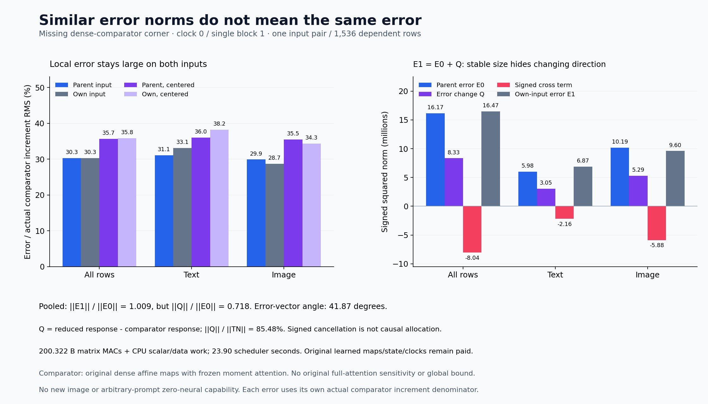

# Similar error norms hide a different state response

The reduced block has **30.318% error relative to the dense comparator's actual increment on its own input**, or **35.819% after within-stream centering**. Its error norm changes only 0.91% between the parent and own inputs, but the error vector turns **41.87°**. The change in error is **85.48% of the comparator's input-response norm**. A nearly unchanged error magnitude therefore does not establish a transferable correction.

This completes the [missing-corner plan](plans/dense-own-state-corner.md) after the [matched-parent control](matched-parent-successor.md). The question was whether the incoming state difference propagates similarly through the dense and reduced programs. One additional block evaluation answers that bounded question. It produces no new image, arbitrary-prompt capability or zero-neural generator.

The comparator uses the original dense affine maps and the frozen cycle-70 moment-attention law. It is not an independent original full-attention reference. All observations concern one existing input pair at clock 0, single block 1: 512 text rows and 1,024 image rows. These are dependent rows in one specimen.

Let x be the parent input and \(\hat x\) the actual cycle-86 output. Existing corners are \(y=F_{70}(x)\), \(y_0=\hat F(x)\) and \(\hat y=\hat F(\hat x)\). The sole new corner is

\[
y_1=F_{70}(\hat x).
\]

The earlier experiment already defined

\[
D=\hat x-x,\quad E_0=y_0-y,\quad T=\hat y-y_0,\quad U=T-D,
\]
\[
E_{\rm out}=\hat y-y,\qquad
W=(\hat y-\hat x)-(y-x).
\]

Now we can separate the dense comparator's response from the approximation's changing error:

\[
T_N=y_1-y,\qquad E_1=\hat y-y_1,\qquad V=T_N-D,
\]
\[
Q=T-T_N=E_1-E_0.
\]

The two independently formed expressions for Q agree. Consequently,

\[
E_{\rm out}=T_N+E_1,\qquad W=V+E_1,\qquad
U=V+Q,\qquad E_1=E_0+Q.
\]

Tₙ includes the carried input difference; V removes it. Q is the approximation-error change over this displacement. Its norm measures response disagreement for this pair. It does not identify a global Jacobian norm, Lipschitz bound or original full-attention sensitivity.

| Error / actual comparator increment RMS | All rows | Text | Image |
| --- | ---: | ---: | ---: |
| Parent input: E₀ / (y−x) | 30.321% | 31.094% | 29.893% |
| Own input: E₁ / (y₁−x̂) | 30.318% | 33.093% | 28.712% |
| Parent, within-stream centered | 35.682% | 36.042% | 35.474% |
| Own, within-stream centered | 35.819% | 38.232% | 34.343% |

Each denominator is the comparator's increment on that row's input. Centering removes the stream mean separately for text and image, then pools their energies. Dividing E₁ by the entire carried outgoing state instead gives 2.242% pooled; that smaller number obscures error relative to the computation being approximated. The [increment-normalized supplement](results/dense-corner-evidence/increment-normalized.json) derives these ratios from published scalar energies without loading scientific tensors.

The magnitude and direction accounts tell different stories:

| Finite-pair observation | All rows | Text | Image |
| --- | ---: | ---: | ---: |
| ‖E₁‖ / ‖E₀‖ | 1.0091 | 1.0718 | 0.9705 |
| ‖Q‖ / ‖E₀‖ | 0.7179 | 0.7137 | 0.7203 |
| ‖Q‖ / ‖Tₙ‖ | 0.8548 | 0.8467 | 0.8596 |
| Error-vector cosine, E₀ vs E₁ | 0.7447 | 0.7647 | 0.7331 |
| Dense/reduced response cosine | 0.6874 | 0.7112 | 0.6729 |
| Comparator gain ‖Tₙ‖ / ‖D‖ | 1.0448 | 1.0262 | 1.0564 |
| Reduced gain ‖T‖ / ‖D‖ | 1.1894 | 1.2141 | 1.1736 |

The comparator's finite-pair gain is lower than the reduced program's gain. Even that comparison is incomplete without direction: the two responses have cosine 0.6874. Their discrepancy is 75.09% of the reduced response norm. Within-stream centering leaves the main pattern: Q/Tₙ is 85.85% and the error-vector cosine is 0.7436.

Error energy grows on 748 rows: 452 text and 296 image. Q energy exceeds Tₙ energy on 83 rows: 54 text and 29 image. Comparator response energy exceeds incoming-difference energy on 1,138 rows. These are descriptive row counts, without an independent-sample or universal-behavior claim. The [lossless observations](results/dense-corner/observations.jsonl.gz) and [row localization](results/dense-corner-evidence/row-localization.json) retain exceptions.

The signed identity explains how a large change in error can leave its norm almost unchanged:

\[
\|E_1\|^2
=\|E_0\|^2+\|Q\|^2+2\langle E_0,Q\rangle,
\]
\[
16{,}467{,}602.812
=16{,}171{,}503.743+8{,}334{,}445.714-8{,}038{,}346.645.
\]

The corresponding centered account is 15,997,393.205+8,285,383.462−7,972,885.665=16,309,891.003. Negative cross terms preserve norm while direction changes. They are signed interactions, not positive causal shares.

The outgoing and increment accounts are also retained:

\[
\|E_{\rm out}\|^2
=11{,}405{,}543.179+16{,}467{,}602.812-1{,}864{,}216.122
=26{,}008{,}929.870,
\]
\[
\|W\|^2
=8{,}360{,}285.834+16{,}467{,}602.812-5{,}934{,}028.302
=18{,}893{,}860.344.
\]

For U=V+Q the signed cross term is −10,306,815.841, giving 6,387,915.707. Every full and centered vector-subtraction closure has zero energy; independent dual-Q closure is also zero. FP64 aggregate summation remainders remain around 10⁻⁸. Byte authentication and these identities do not independently replay real-array numerical execution.

The [producer](../generator/dense_corner_worker.py) directly invokes the frozen [cycle-70 consumer](../generator/image_partition_moments.py). It forms the complete original [27,648,3,072] fused QKV/G/Up projection and [3,072,12,288] output projection with their original BF16 geometry. It retains normalization, RoPE, actual gate/product, full image SDPA, text moments and the BF16 residual commit. Hooks return None; wrappers call and return the original functions. Capture-time payload hashes are checked before typed return and after retention, catching mutation through aliases. All 27 observed fields are retained.

The typed Act consumes nine source/parameter fields and produces 27 fields. The analyzer runs after a complete candidate seal and parent-observed successful producer exit. Comparisons and historical operands/bases stay quarantined before that boundary; actual86 x̂ is the explicit admitted source exception. Source/parameter/RNG closure, original view offsets, fused/output/exit byte joins, 27 producer plus five analysis ABIs and every scalar aggregate pass.

One guarded CUDA lease, **job-19256302f930**, succeeds in **23.90 scheduler seconds**, with sampled **2,286.5 MB RSS / 1,164.0 MB device**. Producer time after imports is 9.617s, including 4.839s setup; analysis takes 3.356s after imports. Peak Torch allocation/reservation is 754,678,784/891,289,600 bytes. The 3,214,973-byte payload has identical declared/sealed/executed SHA256.

| Actual matrix work | MACs |
| --- | ---: |
| Original full fused QKV/G/Up | 130,459,631,616 |
| Original output | 57,982,058,496 |
| Image QK + AV | 9,663,676,416 |
| Five FP32 moment/text products | 2,216,165,376 |
| **Total** | **200,321,531,904** |

There is no QR, FP64 candidate product or repeated factorization diagnostic. FP64 CPU differences, centering, elementwise products, reductions and data work are additional. Original learned maps, supplied incoming state/clocks, historical production, normalization, nonlinearities, casts, hashes and retention remain paid. Lower elapsed time than the earlier reduced assays establishes no matched runtime gain: dtype, QR, capture, analysis, setup and cache scopes differ.

All **368 mechanics tests pass in 19.09s**, including independent tiny six-corner accounts, nonzero-gate exact frozen-consumer equivalence, capture/view/restoration checks and prior dense/attention references. Thirty-six payload source identities remain frozen. Fresh intake covers 44 files/53,241,416 bytes/13 NPY plus 245,367,296 original parameter bytes. Post-run complete byte verification covers 90 files/563,254,649 bytes/45 NPY plus those four original tensors. The [evidence index](results/dense-corner-evidence/README.md) separates test, source, byte, typed and numerical scopes.

Saturn run/verify over the actual raw result both return 0, with 1,536 records, zero fires/formal claims/qualified addresses and one expected missing no-fire ledger. All 32 new arrays/503,019,520 NPY bytes remain near compute. Eighteen compact core files total 1,974,956 bytes locally/publicly, with figure and receipts additional. No archive, deletion or fresh cold-object rehash occurs. Full research/storage review 87 remains current; review 90 is due before any next stage, and last actual archive remains 78.

The working inference is that a stable approximation-error magnitude is an inadequate summary of a state transition. A reusable computation must also preserve how output changes when its input changes. This pair shows substantial response disagreement; it does not tell us how much comes from changing GU bases, changing output bases, finite geometry or nonlinear interactions.

Astra recommends one conditional [whole-template transport test](plans/frozen-template-transport.md): retain the parent88 GU and output template, feed it the actual86 own input, and compute fresh operands through its consumers. The scheduled full review90 can supersede that plan before staging. It is written and unexecuted. Arbitrary-prompt zero-neural image generation remains active and unsolved.
