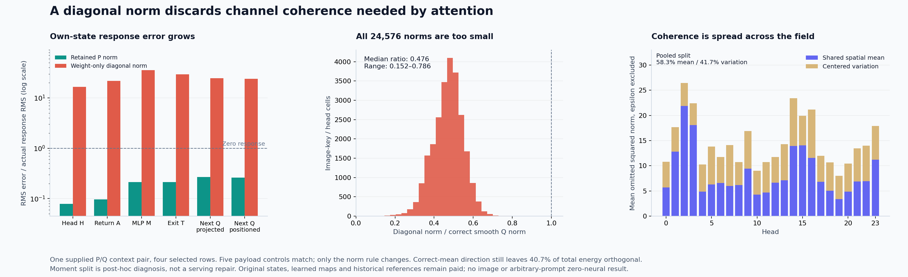

# A diagonal norm loses the channel coherence that attention needs

Removing a supplied normalization operand is mechanically possible, but the first weight-only replacement is inaccurate. With the same actual input, score numerator, text logits, text keys and values, next-query context-response error rises from **25.99% to 2,404.93%**. All **96 dependent query heads** lose to both the retained-norm producer and predicting zero response; 48 have negative response cosine. Every one of the **24,576 image-key/head norms** is underestimated.

This is a valid negative result for one specific positive quadratic approximation on one supplied P/Q pair. It does not show that compact normalization is impossible. A separate saved-only diagnosis locates the discarded structure: **58.32% of omitted mean energy comes from the shared spatial mean and 41.68% from centered variation**. Even a direction derived from the correct output mean leaves **40.69% of true projected energy orthogonal to it**. A mean-only repair would miss substantial structure.

The actor computes its own attention head, advances that head through its own original sequential MLP, and computes the next query from its own emitted state. Original states, learned receiving maps, the query-specific coefficient table and historical references remain paid. No new image, arbitrary-prompt generation or zero-neural execution is established.

[Primary report](results/diagonal-norm/report.json), [all scalar observations](results/diagonal-norm/observations.jsonl.gz), [moment report](results/diagonal-norm-moments/report.json), [evidence index](results/diagonal-norm-evidence/README.md), and [original frozen plan](plans/source-defined-diagonal-key-norm.md) preserve the computation and its boundaries.

## The hypothesis was a positive diagonal quadratic

The [preceding image-dual producer](image-dual-score-response.md) moved the demanded score numerator onto the query side. It still received a paid smooth P norm. For actual widened BF16 ModLN input x and one 128-channel image-key head,

\[
z_h=W_hx,\qquad s_h(x)^2=\frac{\|W_hx\|^2}{128}+\epsilon
=x^TG_hx+\epsilon,\qquad G_h=\frac{W_h^TW_h}{128},\quad\epsilon=10^{-6}.
\]

Instead of materializing the full Gram matrix, the new compiler reads original W alone and retains

\[
d_{ha}=\frac1{128}\sum_cW_{hca}^2,\qquad
\widehat s_h(x)^2=\sum_a d_{ha}x_a^2+\epsilon.
\]

The law is positive, source-defined and target-free at compilation. It has no fitted gain, chosen rank, native norm input or full current-key projection. Its unmodeled term is explicit:

\[
s_h(x)^2-\widehat s_h(x)^2
=\sum_{a\ne b}G_{h,ab}x_ax_b.
\]

Dropping that term is a scientific assumption about the relevant input/weight alignment. Positive coefficients do not make it a small term. Orthogonal W columns or sufficiently canceling cross products would simplify the computation; this specimen does not satisfy that approximation.

The compiler cannot read source states, queries, old duals or evaluation targets. After its seal, a fresh actor receives the diagonal and the previous frozen query-side numerator producer. It forms its actual Q ModLN input, computes the norm, admits the FP64 attention head through the existing FP64→FP32→BF16 boundary, and executes the original finite MLP/next-query consumer. It cannot read native P/Q norms, raw keys or old actor targets. Archived references open only after it seals and exits.

## The changed norm is isolated within this comparison

Five complete payload controls match the preceding producer byte for byte: actual ModLN input, image-score numerator, text logits, hybrid text keys and hybrid values. The changed norm law is therefore isolated in this bounded comparison. Unlike the earlier stale→dual gain, this comparison does not also refresh text keys.

For every field, the actual response is F_QQ−F_PP, and the forecast is F_candidate−F_PP. Errors divide by actual response RMS, rather than the larger endpoint RMS.

| Field | Retained-norm response error | Diagonal-norm response error |
|---|---:|---:|
| Attention head H |7.89%|1,665.43%|
| Attention return A |9.58%|2,181.13%|
| MLP return M |21.21%|3,562.56%|
| Own exit T |21.31%|2,951.25%|
| Next projected query |26.71%|2,448.23%|
| Next positioned query |25.99%|2,404.93%|

The final query response cosine is **.02046**. Absolute RMS error is **.61356**, against actual response RMS **.02551** and endpoint RMS **1.24438**. Endpoint error is still **49.31%**; this is not merely a small response denominator exposing a harmless endpoint perturbation.

All 96 final heads have response errors above zero response and the retained-norm control. Median error is **24.13× actual response RMS**, with **12.26–54.03×** range. Whole-row errors for rows 4,11,12,13 are **15.93×, 18.09×, 31.44×, 43.34×**. The last two whole-row response directions are negative. These heads are dependent addresses, not 96 independent prompt examples.

The norm ratio has **.4756 median**, **.1524 minimum** and **.7855 maximum**. Norm endpoint relative RMS error is **56.99%**, compared with **.4904%** for retained P norms. The diagonal rule amplifies each image logit's magnitude by a different erroneous factor; it is not just one shared attention temperature. Image-logit relative RMS error is **119.62%**, and log-partition relative RMS error **63.76%**.

Saved correct-Q energy minus diagonal energy is positive in all 24,576 cells, with signed mean **14.63880**, RMS **17.85759** and range **2.19038–233.58758**. Its channel-cross interpretation is applicable because actual inputs match. The saved-norm reconstruction also includes small FP64 projection/reduction/square-root differences; the report retains that qualification and every raw scalar difference.

## Expand around the shared spatial state

Astra recommended measuring the missing structure before fitting or launching a repair. A separately staged CPU job consumes only saved actual x, compiled d, correct smooth raw Q keys z, and the actor's diagonal energies. It runs no original projection, model or consumer. This is post-hoc diagnosis; z is a paid reference, unavailable to a target-free serving producer.

Write x_j=μ+δ_j and z_j=\bar z+η_j, where spatial means of δ and η vanish. The omitted energy at each row decomposes as

\[
E_{jh}=M_h+C_{jh}+V_{jh},
\]

\[
M_h=\frac{\|\bar z_h\|^2}{128}-d_h^T\mu^{\odot2},
\qquad
C_{jh}=2\left[\frac{\bar z_h^T\eta_{jh}}{128}-d_h^T(\mu\odot\delta_j)\right],
\]

\[
V_{jh}=\frac{\|\eta_{jh}\|^2}{128}-d_h^T\delta_j^{\odot2}.
\]

The cross term has zero spatial mean in exact arithmetic, but need not be small row by row. All per-row signed cross and centered terms remain near compute. Maximum observed row-identity residual is **5.68×10⁻¹⁴**; maximum mean-identity residual is **3.91×10⁻¹⁴**.

| Pooled spatial mean | Correct projected energy | Diagonal energy | Omitted energy |
|---|---:|---:|---:|
| Shared mean |9.85933|1.32144|8.53789|
| Centered variation |8.40342|2.30252|6.10091|
| Total |18.26275|3.62396|14.63880|

The shared mean explains **58.32%** of mean omitted energy, with **42.07–82.78%** across heads. Centered variation supplies the remaining **41.68%** pooled. Row-cross RMS is **5.90966** and centered-defect RMS **9.80670**. Those RMS values do not add to the mean or to each other; signed arrays do.

For an additional target-assisted capacity observation, let u_h=\bar z_h/\|\bar z_h\|. Energy orthogonal to that correct-mean direction is **7.43159**, or **40.69% of total energy**, with **20.75–57.97%** across heads. All 24 mean directions are defined here. The implementation preserves an explicitly flagged zero-mean branch using direction zero and full raw energy rather than inventing a direction.

## A bound rules out one tempting simplification

An exact mean-axis plus residual-diagonal law would retain the component parallel to u and approximate only the orthogonal residual. Define B_h=(I−u_hu_h^T)W_h. Because orthogonal projection cannot increase any column norm,

\[
\operatorname{diag}(B_h^TB_h)/128\le d_h.
\]

Its mean predicted residual energy is therefore no larger than the existing diagonal centered energy **2.30252**. Correct orthogonal energy is **7.43159**. Even with an exact mean-axis calculation, this particular repair must omit at least

\[
7.43159-2.30252=5.12907,
\qquad\frac{5.12907}{18.26275}=28.09\%
\]

of pooled true mean squared key energy. This is a bound on a mean energy observable, not a bound on norm RMS, attention error or next-query fidelity. It is enough reason to reconsider an automatic mean-axis/diagonal repair before paying for another consumer experiment.

## Charge the producer and the diagnosis separately

The primary compiler retains **589,824 FP64 coefficient bytes**, **589,952 bytes** with the NPY header. It performs 9,437,184 weight squares, 9,363,456 sum additions and 73,728 mean scalings. The actor adds **75,497,472 contraction MACs**, 3,145,728 input squares, 24,576 epsilon additions and 24,576 roots to the previous actor's work. Total new primary matrix work is **1,421,869,056 MACs**. Six distinct original BF16 parameters total **226,492,672 bytes** across compiler/actor processes. Previously compiled duals, source production and evaluation references remain paid.

Primary job **job-188150561700** succeeds in **76.89 scheduler seconds**, with **1,622 MB peak RSS**, **568 MB peak device usage** and 69.30 worker seconds. Fresh compiler/actor processes take 40.14/28.63 seconds including imports. No full-key reference, extra consumer arm, suffix or image runs. This is one instrumented assay, not a matched runtime saving.

All **292 generator mechanics tests pass in 18.82 seconds**. Twenty-three owned source pins, six typed Acts, 17 explicit output ABIs and four actual input→norm→head→own-state→next-query joins verify. Full-byte custody covers **166 files /8,023,321,022 bytes**, with **113 NPY payload witnesses**, one text-prefix witness and two independent hybrid splices. MDB run/verify returns zero over **24,924 observations /29 numeric predicates**; there are no formal semantic claims or bound xref addresses. Scientific error remains evidence even though mechanics pass.

The separate saved-moment job **job-3f486b18e216** succeeds in **2.25 scheduler seconds**, **204.3 MB peak RSS**, zero device allocation and **.872 worker seconds**. It pays **151,142,400 compiled-diagonal contraction MACs**. The 6,291,456 counted output-space dot multiplications cover only two explicit contractions; other square/product/reduction passes remain paid. Intent-first admission chooses a default four-thread reservation, while the NumPy environment uses one arithmetic thread. Full-byte verification covers **15 files /32,983,932 bytes**, with **12 NPY witnesses**. A derived 24-head scalar stream has a separate MDB run/verify result with 18 predicates and no fires or formal claims.

Thirty primary arrays /**24,261,888 bytes** and eight moment arrays /**713,728 bytes** stay near compute. The large reused dual table is not copied to the Mac or Git. Last actual storage cleanup remains [cycle57](results/storage-cleanup-cycle57/README.md); review remains due by cycle60 or earlier pressure. Arbitrary raw-prompt conditioning, reusable own-state diffusion and a general pixel decoder remain open.
