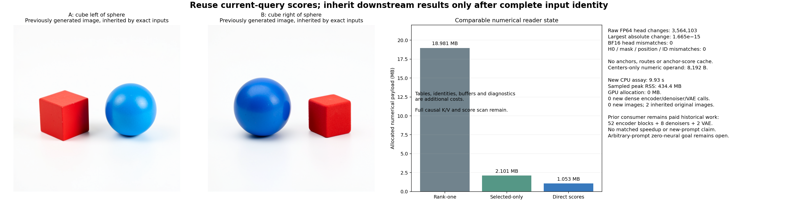

# The selected read does not need its anchor machinery

The direct reader removes source anchors, metrics, routing, anchor-admission GEMVs, the anchor-score cache and selected delta-dot products. Its complete consumed BF16 head banks, H0 and lexical controls match the selected-only parent exactly on the tested raw pair. Comparable numerical state falls **2,101,376→1,052,800 bytes per prompt**, and the runtime source operand falls **3,153,920→8,192 bytes**. Raw FP64 results change slightly; exactness holds at the actual consumed boundary, not every intermediate.

No new image or dense encoder/denoiser/VAE execution runs. Complete input identity binds the already generated parent images to this reader. Their19.37% signed PNG response error is inherited evidence on the same known pair/noise, not fresh arbitrary-prompt generation. The whole zero-neural goal remains open.

## Reuse the score that selection already computed

The [selected-only reader](selected-reader-image.md) keeps source-centered/scaled keys U, scaled query x and values V. Its full causal scan already computes g=Ux to select the ordered top-four set S. The old selected logits use a routed anchor ell:

$$
a_j=\ell^TU_j+(x-\ell)^TU_j=x^TU_j.
$$

The new program simply returns

$$
H=\operatorname{softmax}(g_S)^T V_S.
$$

It reuses the exact current-query GEMV call, key-cache layout, source centers, scaling and ordered tie policy. It removes the now redundant anchor machinery rather than recomputing selected scores through another dot product. Full causal K/V storage and score scans remain. The fixed output conversion is FP64→FP32→BF16 round-to-nearest-even.

The real-arithmetic identity does not promise finite equality. In A,1,783,342 raw head values change; in B,1,780,761 change. Maximum absolute head change is1.6653345369377348e−15, with RMS2.214e−17/2.207e−17. Selected-logit changes reach1.0658e−14 and weight changes1.7764e−15. Ordered supports and all lexical operands remain identical. After the declared conversion, all **4,194,304 head words** match.

## Compile a small operand and exclude its parent asset

A separate compiler extracts unchanged FP64 key centers from the frozen source geometry. The [compile receipt](results/direct-reader/compile-receipt.json) binds its original hash,4,347,690 file bytes hashed, and the8,192-byte numeric output. The public [centers-only array](results/direct-reader-evidence/centers.npy) is8,320 bytes including its NPY header; its [copy receipt](results/direct-reader-evidence/centers-publication.json) verifies the complete bytes.

Fresh serving receives this small array and is denied access to the original geometry. Its blocked-open canary confirms the exclusion before prefix/reader execution. No landmarks, metrics, basis, tail moments, envelopes or native fallback are loaded by serving. The large learned lexical table, tokenization, BF16 positional arithmetic and input/output/diagnostic buffers remain paid. Source extraction is compilation, not a new source fit or contextual target calculation.

## Prove identity at the actual consumer

Both complete raw/BF16 head banks and own H0 seal before parent values open. The [input proof](results/direct-reader/input-identity.json) checks all head words, all **2,621,440 H0 words**, and every token-ID, mask and position entry. Masks and positions matter because later encoder layers read them too. Source/checkpoint, consumer implementation, numerical profiles, inherited clock, schedule and noise remain bound to the original invocation.

The proof checks the parent's actual consumed head and H0 fields and actual conditioning/schedule joins. The [inherited-output record](results/direct-reader/inherited-outputs.json) then names every original encoder/image field and original PNG under that contract. Their complete retained bytes receive independent verification. The current reader has supplied identical required inputs to that qualified deterministic suffix; rerunning it would add no evidence about this cut.

This is a strict input-identity condition for reuse, not a scientific accuracy threshold. A changed word or lexical control produces `own-consumer-required`, retaining the result and requesting its own fixed original continuation. Negative tests cover one changed head word, one changed mask entry, a foreign contract and a broken actual-consumer binding. No approximate tolerance authorizes inherited images.

## What work changes

At the tested capacity, per prompt:

| Account | Selected-only parent | Direct scores |
|---|---:|---:|
| Allocated numerical index/cache plus count/clock | 2,101,376B | 1,052,800B |
| Occupied K/V/position entries plus count/clock | 1,149,248B including anchor scores | 575,808B |
| Runtime geometry or centers | 3,153,920B | 8,192B |
| Anchor-admission MACs | 9,175,040 | 0 |
| Current-query score products | 70,963,200 | 70,963,200 |
| Selected delta-dot products | 8,364,032 | 0 |
| Selected value products | 8,364,032 | 8,364,032 |

Counts/clocks are128 bytes across eight groups. Identities/counter metadata, complete compiled lexical storage, input/output arrays, diagnostics and serialization are additional costs. This is not a whole-pipeline memory claim. Group streaming wall times sum to0.274/0.152 seconds; pair serving with serialization takes0.498 seconds. The full reader body takes2.663 seconds,0.811 CPU seconds and287,624KiB high-water RSS. Source extraction takes0.063 seconds, with its own0.164-second fresh-process phase. Reader fresh-process time is2.768 seconds. These are measured scopes, not a matched speed comparison.

Guarded CPU job **`job-b24fec394c5a`** succeeds once in **9.93 scheduler seconds**, with434.4MB sampled peak RSS and0MB VRAM. Automatic sizing reserves4096MB RAM and4 CPU threads; the actual command fixes OMP/OpenBLAS/MKL to1. The first source-only stage hit a local launch-argument validation error before any job was created; [v1 remains recorded](results/direct-reader-evidence/prelease-v1.json), and a fresh v2 is the sole executed request.

This lease performs zero new original parameter reads/projections, encoder blocks, denoisers, VAE decodes or image generations. It performs two model-derived contextual reads and a complete input proof. The inherited images still depend on historical52 original encoder blocks,8 denoisers,2 VAE decodes, learned lexical compilation and original factors. Changed or arbitrary new prompts do not automatically inherit them.

All156 mechanics tests pass in13.998 seconds, including8 direct-reader/reuse checks; the exact staged payload also imports without old readers or a neural runtime. [Independent byte verification](results/direct-reader/retained-array-verification.json) covers212 members/587,136,654B. The27 new complete arrays/packets total122,782,276B and remain near compute. Primary publication is17 files/3,871,543B, preserving32,768 dependent head-query observations losslessly. [Saturn run](results/direct-reader-evidence/saturn-run.json) and [verify](results/direct-reader-evidence/saturn-verify.json) return0 with stream-only scope; no semantic quality certification is added.

The next [single cut](plans/uncentered-reader.md) tests the common key-offset gauge and removes even the centers operand. It is written and unexecuted. Later encoder operand formation, denoising, pixel decoding and arbitrary-prompt quality remain unresolved.
