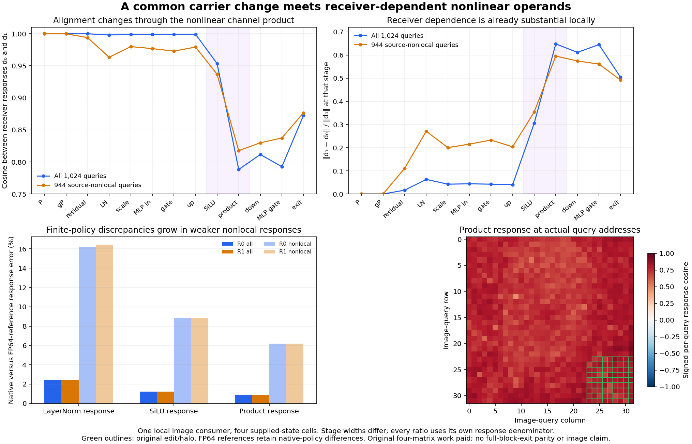

# The first nonlinear image write changes a shared carrier response

A common attention-carrier change reaches the first image MLP with almost the same gate/up response direction in two receivers. The all-query response cosine is about **0.9991** at those affine operands, **0.9534** after SiLU, and **0.7883** after multiplication. The local image exit still has cosine **0.8726**. Receiver dependence is substantial before later blocks, while this local assay does not explain the full denoiser's later near-orthogonal response by itself.

This follows the [carrier crossing](carrier-receiver-crossing.md) and [first-text-write clamp](first-text-write-crossing.md). The [frozen plan](results/first-consumer/frozen-plan.md), [raw report](results/first-consumer/report.json), [native fields/seal](results/first-consumer/primary.json), [execution census](results/first-consumer/execution.json), [mechanics](results/first-consumer-evidence/mechanics.json) and lossless [stage](results/first-consumer/queries.jsonl.gz)/[factor](results/first-consumer/factors.jsonl.gz) records preserve every measured outcome. No fit, complete velocity or image is produced.

## Follow the state into its actual local consumer

The supplied complete H_A/H_B fields are the same in both receivers. Four original matrices form two B1 image embeddings, two shared B1 carrier projections and four native image MLP paths. The qualified clock3 modulation is reused. Original parameter payloads, source/profile, input strides and the carrier projection's nonzero storage offset remain bound.

The source-ordered local function is

\[
E_r=W_x Z_r,\qquad a_h=g_a\odot W_oH_h,\qquad
u_{rh}=\operatorname{BF16}(E_r+a_h),
\]

\[
z_{rh}=\operatorname{BF16}\!\left(\operatorname{BF16}\!\left(N(u_{rh})\odot(1+s_m)\right)+b_m\right),
\]

\[
M(z)=W_d[\operatorname{SiLU}(W_gz)\odot W_uz],
\qquad y_{rh}=\operatorname{BF16}(u_{rh}+\operatorname{BF16}(g_m\odot M(z_{rh}))).
\]

The displayed MLP equation is the mathematical form; execution retains the actual fused BF16 gate/up affine, native SiLU output, product, down projection and each finite commit. The model has non-affine LayerNorm with epsilon10⁻⁶. The two input projections match archived native first-block prefix hashes exactly. There is no independently archived full native-block-exit parity witness in this experiment; prefix closure must not be relabeled as one.

All four native local outputs and intermediate fields seal before FP64 diagnostic factorization. At each stage S, retain d_r=S_rB−S_rA and I=d_1−d_0. Stage widths differ, so the relative interaction uses that stage's own R0 response norm.

| Stage | All-query response cosine | ‖I‖/‖d₀‖, all | ‖I‖/‖d₀‖, source-nonlocal |
|---|---:|---:|---:|
| Shared gated carrier write | 1.000000 | .00000 | .00000 |
| Residual commit | .999862 | .01660 | .11088 |
| LayerNorm | .997998 | .06326 | .27117 |
| Modulated MLP input | .999029 | .04413 | .21554 |
| Gate affine operand | .999099 | .04247 | .23302 |
| Up affine operand | .999184 | .04045 | .20399 |
| SiLU output | .953384 | .30525 | .35415 |
| Channel product | .788267 | .64829 | .59582 |
| Down-projection write | .811637 | .61160 | .57451 |
| Gated MLP write | .792627 | .64518 | .56126 |
| Local image exit | .872578 | .50396 | .49187 |

The changes are not monotone: clock scaling restores some response alignment after normalization, and the residual exit is more aligned than the gated MLP write. The 944 source-nonlocal queries show stronger early relative discrepancies than the all-query aggregate. Complete actual query addresses and signed row outcomes remain retained; no magnitude gate removes weak or adverse observations.

## Expand the receiving normalization exactly

The shared gated write is identical across receivers. BF16 addition makes its committed difference receiver-specific:

\[
\Delta u_r=\Delta a+\rho_r.
\]

The measured addition-rounding RMS is .000901/.000921 across all queries at R0/R1, and .000855/.000881 on the source-nonlocal subset. These terms are small absolutely but the nonlocal response is also much weaker.

Let C center channels, c=C u_A, h=C(u_B−u_A), and let s_A,s_B be the corresponding standard deviations including epsilon. In real arithmetic,

\[
\Delta N=\frac{h}{s_B}+c\left(\frac1{s_B}-\frac1{s_A}\right).
\]

The first term scales the changed centered input; the second follows the receiver's existing centered direction. We compute this identity on actual committed decoded inputs and retain both terms, their signed cross energy and the native-policy discrepancy separately. Maximum identity closure is1.61×10⁻¹⁴. At R0, the all-query squared-energy account is20,170.5423+116.4077−371.6209=19,915.3291. Negative cross terms occur in964/1,024 rows; R1 has958. On the nonlocal subset the counts are911/944 and906/944. These are dependent query observations, not independent experiments or causal shares.

Native LayerNorm response differs from the FP64-reference response by **2.413–2.414% relative RMS over all queries**, versus **16.238–16.439%** on the nonlocal subset. Native accumulation/output policy is therefore retained, especially where the true response is weak. Modulation multiplication and shift-add rounding are separate saved fields. Neither a tiny identity closure nor a large relative discrepancy proves a general approximation law.

## Factor the nonlinear channel product

For actual native activation endpoints f_A/f_B and up operands v_A/v_B,

\[
\Delta(f\odot v)=\overline v\odot\Delta f+\overline f\odot\Delta v,
\qquad \overline x=(x_A+x_B)/2.
\]

This symmetric finite identity has exact zero closure on the retained decoded values. Its coefficients depend on the receiver's endpoint values. Similar gate/up increments do not guarantee similar product increments when those coefficients differ. This is a concrete mathematical reason to test a receiver-conditioned nonlinear response program; the identity alone does not predict new operands.

At R0 the all-query energy account is2,040.2211+2,306.9047+344.6862=4,691.8119. R1 gives2,015.4746+2,271.2242+333.2162=4,619.9151. Positive aggregate cross energy coexists with122/118 negative per-query cross terms. The two factor energies and their signed cross term must stay together.

Native SiLU response differs from the stable FP64 SiLU reference by **1.214–1.224%** over all queries and **8.852–8.862%** on the nonlocal subset. Native product rounding, measured against multiplying the actual native f/v endpoints in FP64, contributes **.871–.893%** relative response discrepancy over all queries and **6.180–6.203%** on the nonlocal subset. These are different boundary comparisons, not independent additive error shares. We run no extra down projections of the separate algebraic attribution terms.

## Work, custody and scope

Job **job-0807587485a6** succeeds in **123.92 scheduler seconds**, with **2,907.1 MB peak RSS** and **700 MB peak device usage**. Only four original matrices are loaded:189,530,112 BF16 parameter bytes. The actual census is **12 affine calls /368,025,010,176 nominal MACs**. Four native LayerNorm/SiLU/MLP paths, elementwise operations, captures, transfers and diagnostics are additional. Full original asset files are hashed for custody separately from selected parameter tensor reads.

No full Transformer, attention, text path, learned clock network, encoder, fit, scheduler image update, VAE or image runs. Historical complete carriers, receiver states and clock preparation remain paid. Post-seal references evaluate37,748,736 FP64 SiLU scalars and12,582,912 LayerNorm input scalars. The123.92seconds are not a serving-speed comparison: post-import worker wall time is91.13seconds, with61.86CPU seconds, and setup/shared projections take10.76seconds. Native-cell intervals include capture/hash/I/O and vary1.894/.316/.359/5.324seconds. There is no matched runtime-speedup claim.

All252 mechanics tests pass. [Byte custody](results/first-consumer/retained-array-verification.json) verifies143files/11,335,670,670bytes, including inherited original assets and all116new arrays. Eight semantic BF16 gate/up views receive independent row-byte hashes, rereading150,994,944bytes already covered by parent-file custody. That view-read total is not additional unique artifact storage. The116new arrays total3,560,985,088bytes and stay near compute; fifteen compact public files total2,257,229bytes before separate evidence/figure summaries. Saturn run/verify exits0on the original17,408 stage/factor records, with no watch fires or formal scientific claim receipts.

The measured700MB device peak is new sizing evidence. The scheduler recommends1,024MB VRAM for a matching future workload; this valid result is not rerun merely to change its reservation. Actual retained-array/I/O and FP64 diagnostic cost remain part of the account.

The [scheduled storage transaction](results/storage-cleanup-cycle48/README.md) archives600,212,652bytes of redundant transport copies after full checks and restoration pointers. Existing extracted science stays local. The [post-audit](results/storage-audit-cycle48/README.md) checks48pointer/custody joins and fresh remote type/size; historical44objects are not freshly full-byte rehashed. Forty-two remaining name/size candidates totaling11,845,041,231bytes are not deletion certificates. Next review is51 or earlier pressure.

This is a local source-order operator experiment on supplied, potentially unnatural hybrid states. It establishes neither whole-future mediation nor natural-state information insufficiency. It supplies no cheap baseline producer, complete velocity, general pixel decoder or arbitrary-prompt zero-neural generator. The original goal remains active and unsolved.

[Astra's review](results/first-consumer-evidence/advisor.json) selects one [recipient-conditioned product prediction](plans/receiver-conditioned-product.md): reuse the source gate/up increments in the recipient's own baseline, apply the full native nonlinearity, and execute one original down projection. That proposed cut costs28.991billion nominal affine MACs plus elementwise work. It is written and unexecuted; the native baseline and source increments remain supplied and paid.
