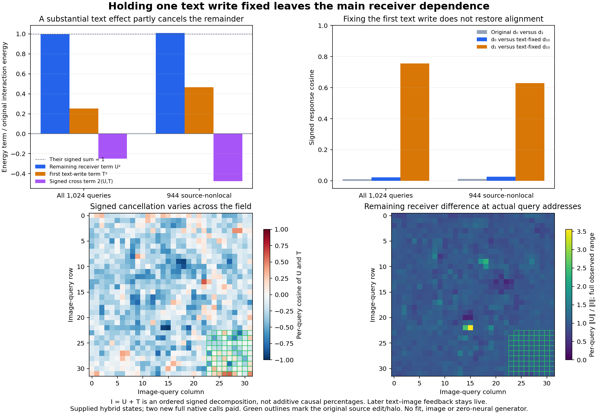

# Fixing the first text write leaves the receiver-dependent response

Holding one first-block text write fixed changes the image-carrier response substantially, but leaves almost the entire original receiver difference in norm. The remaining term is **99.84% of the original interaction norm** over all queries and **100.49%** outside the source edit/halo. Its response direction still has cosine only **0.02171** with the first receiver's response. The text path matters, and its effect partly cancels another receiver-dependent term.

This follows the [complete carrier crossing](carrier-receiver-crossing.md). The [frozen plan](results/text-crossing/frozen-plan.md), [report](results/text-crossing/report.json), [execution census](results/text-crossing/execution.json), [lossless query observations](results/text-crossing/observations.jsonl.gz), [mechanics](results/text-crossing-evidence/mechanics.json) and [full-byte custody](results/text-crossing/retained-array-verification.json) retain the result. It is one ordered intervention on supplied internal states, with no new image or compact prediction rule.

## Separate one co-carrier from the rest of the receiver

The first joint text attention reads image keys and values. Fixed initial conditioning E therefore does not keep the later text projection write T fixed across image receivers. The previous experiment kept that text path native.

Let G(R,T,H) denote the complete native consumer with receiving state R, supplied first text write T and supplied complete image-attention payload H. The previous four outcomes give

\[
d_0=G(R_0,T_0,H_B)-G(R_0,T_0,H_A),
\quad d_1=G(R_1,T_1,H_B)-G(R_1,T_1,H_A),
\qquad I=d_1-d_0.
\]

Two new original-transformer calls hold T=T0 at receiver R1 while repeating the identical H_A/H_B image pair:

\[
d_{10}=G(R_1,T_0,H_B)-G(R_1,T_0,H_A).
\]

Both complete new BF16 velocities seal before old velocity arrays are opened. FP64 subtraction then supplies an exact ordered decomposition:

\[
U=d_{10}-d_0,\qquad T=d_1-d_{10},\qquad I=U+T.
\]

Here U is remaining receiver dependence with one first text write fixed; later text–image feedback is still live. T is the controlled change from restoring the first text write T1 at R1. This T denotes an effect vector, distinct from the supplied payloads T0/T1. Neither term is a pure path through the model or a universal causal share. The order and chosen reference matter.

## A sizeable change can leave almost the same discrepancy

| Scope | ‖U‖/‖I‖ | ‖T‖/‖I‖ | cos(U,T) | cos(d₀,d₁₀) | cos(d₁,d₁₀) |
|---|---:|---:|---:|---:|---:|
| All 1,024 queries | .998378 | .502808 | −.248584 | .021708 | .756072 |
| 944 source-nonlocal queries | 1.004880 | .681965 | −.346464 | .026830 | .628540 |

Fixing the first text write does not recover the old receiver's response direction. The all-query RMS response becomes .057982 versus .056562 at R0 and .057548 in the original R1. On the 944-query subset, it becomes .047856 versus .037836 and .046930, respectively. All dependent query outcomes remain available; no magnitude gate selects a winner or erases adverse rows.

The squared-energy identity retains the cancellation:

\[
\|I\|^2=\|U\|^2+\|T\|^2+2\langle U,T\rangle.
\]

Across all queries,

\[
844.063655=841.328093+213.392946-210.657384.
\]

Outside the source edit/halo,

\[
433.721425=437.964625+201.713249-205.956449.
\]

The text effect has about half the original interaction's norm over all queries, while its signed cross term cancels nearly all of its positive squared-energy contribution. Calling it either irrelevant or a 25% causal explanation would lose that fact. U remains closely aligned with I, with cosine .87339 over all queries and .76860 on the nonlocal subset. T aligns more weakly, at .25463/.33381. The complete vector identity closes exactly in the retained FP64 fields; energy summation residuals are 5.68×10⁻¹⁴ and zero. These closure observations are numerical mechanics, not scientific quality thresholds.

## What actually ran

The image hook replaces the complete BF16 [1,1024,3072] input to first joint `attn.to_out[0]`. A second hook replaces the complete [1,512,3072] output of `attn.to_add_out` with the archived R0 text write. Both use separate storage and preserve native shape, dtype, device, stride and storage offset. Image input stride is [4718592,3072,1] with offset1572864; text output stride is [1572864,3072,1] with offset0.

Each branch records a typed text Act followed by a typed image Act bound to that text output Frame. Exact consumed words are verified. The original R1 image H0, text-attention head field, text projection output and first-block prefix match the previous qualified parent exactly before replacement. Original inputs, parameter-pointer/version identity, buffers, numerical profile and consumer RNG remain closed. Three canaries verify that original velocity targets and excluded model assets are inaccessible before the new seal. Only the four declared old velocity arrays are admitted afterward.

Job **job-718ece4a9087** succeeds in **67.75 scheduler seconds**, with **8,470.2 MB peak RSS** and **8,100 MB peak device usage**. One resident model runs two scalar B1 calls using all169 original tensors. The actual census is218 affines and50 attention dispatches: **9,448,195,620,864 nominal affine MACs**, plus **724,775,731,200 QK/AV MACs**. Original clock and all image/text computation are paid, including both discarded native image reads and text projections. Historical source donors, conditioning and velocities remain paid preparation.

There is no new donor formation, encoder, fit, noise, scheduler image update, VAE or image. Instrumented post-import setup is24.4109seconds and worker wall time26.9672seconds. The two call intervals are2.2532/.1760seconds, including first-use and capture/hash/hook overhead. These are diagnostic measurements, not a matched serving-speed or image-generation benchmark.

The measured cycle46 resource basis permits a smaller10,240MB RAM/VRAM reservation than its14,336/13,000MB parent reservation. The actual47 peaks remain the next sizing evidence. Generic alias planning still lacks exact artifact/config and previews batch64, so it does not describe this qualified scalar hook path. Strict guarded mrun preflight, one lease, CUDA needs and no retries remain active.

All248 mechanics tests pass, including an independent cancellation example and a real tiny two-boundary BF16 hook check. Full-byte verification covers46files/7,810,361,500bytes, including inherited original transformer assets. Twelve new complete arrays totaling20,448,768bytes remain near compute. Thirteen compact publication files total395,795bytes, with figure/evidence summaries additional. Saturn run/verify exits0on the original1,024-row stream, with no watch fires or formal scientific claim receipts; that checks applicability within its declared scope.

## What remains open

This result narrows one concrete explanation for the original response rotation. It shows that matching this first text write is insufficient to reproduce the other receiver's response under these supplied-carrier interventions. It does not show text is generally unimportant, isolate a unique missing state, or eliminate later text feedback. Hybrid states may be off the natural manifold; one pair and two dependent receivers do not establish broad prompt behavior.

The useful mathematical target remains a receiver-qualified action of the next computation on a carrier change. Another unconditional scalar gain or source-only affine writer cannot be justified by this result. [Astra47](results/text-crossing-evidence/advisor.json) selects one [first-image-consumer assay](plans/first-image-consumer.md), stopping after joint0's image MLP. It will compare residual commit, normalization, modulation and nonlinear product using exact finite-change identities, with native rounding separate. Its twelve affines cost368.025billion nominal MACs, with no attention, text path, full denoiser or image. This plan is written and unexecuted; even a large local interaction would not establish whole-future mediation or a cheaper producer.

The live reconstructed website generator still accepts arbitrary prompts with learned denoiser equations and native encoder/VAE. The zero-neural RGB chart still supports compiled-scene variations. This assay adds neither arbitrary-prompt zero-neural coverage nor a general pixel decoder. The original goal remains active and unsolved. No archive or deletion occurs in47; last actual cleanup is45 and scheduled review is48 or earlier pressure.
