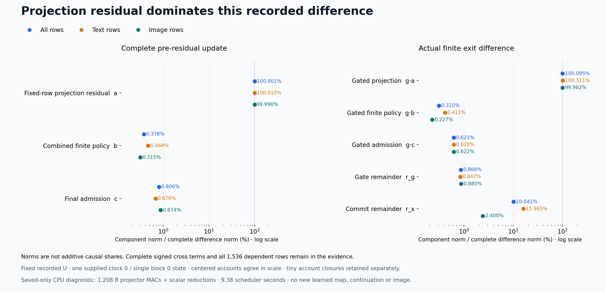

# The recorded write escapes the input-derived row span

The saved-state diagnostic changes our interpretation of the previous output rewrite. Its discrepancy is dominated by the recorded fixed-row projection residual, rather than the combined finite-policy discrepancy. Reusing the input-derived coordinates as a sufficient representation of the complete write should be retired on this specimen. That conclusion does not establish a general rank limit or separate attention from MLP effects.

The [previous cut](current-row-output.md) reduced output work while raising actual increment error from 18.00% to 30.94%. It changed both row projection and finite arithmetic. The [frozen diagnostic plan](plans/fixed-row-projection-diagnostic.md), [implementation contract](plans/fixed-row-projection-implementation.md) and [evidence](results/fixed-row-projection-evidence/README.md) now separate their recorded numerical accounts. This is a retrospective diagnosis, with no new producer, correction, continuation or image.

## Project the saved output through the same saved basis

For each stream, keep cycle 83's recorded U fixed and use cycle 82's already evaluated BF16 output Y82. Promote saved values before subtraction and compute

\[
P=\operatorname{fl}_{64}\!\left(U\operatorname{fl}_{64}(U^TY_{82})\right),\qquad
a=Y_{82}-P,\quad b=P-Y_{83}^{64},\quad c=Y_{83}^{64}-Y_{83}^{BF16}.
\]

All four projector contractions run as NumPy CPU FP64. The numerical P uses approximately orthonormal recorded U; it is not independently certified as an exact orthogonal projector. The b term combines projection/grouping policy with the earlier output path. It does not uniquely identify the original affine's accumulator precision or an individual rounding instruction.

Let saved gated writes be G and saved exits X, with exactly common gate g and incoming state. Independently form

\[
r_g=(G_{82}-G_{83})-g\odot(Y_{82}-Y_{83}),\qquad
r_x=(X_{82}-X_{83})-(G_{82}-G_{83}).
\]

The old-minus-new exit difference is accounted by g·a+g·b+g·c+r_g+r_x. We also retain explicit update/exit subtraction closures, every full and within-stream-centered signed Gram entry, and every row. Actual increment denominators use saved exit minus incoming state, so the common residual carrier cannot dilute the comparison.

| Component norm / complete difference norm | Update | Exit |
|---|---:|---:|
| Fixed-row projection residual, before/after gating |100.0008%|100.0953%|
| Combined finite policy |0.3776%|0.3102%|
| Final admission |0.8064%|0.6212%|
| Gate remainder |—|0.8656%|
| Commit remainder |—|10.0413%|
| All nonprojection terms together, with cross terms |0.8911%|10.0989%|

These are norm ratios, not additive causal shares. Projection and other terms have a negative pooled cross term. Exit projection energy is 12,878,963.051, the combined nonprojection energy is 131,100.900, and twice their inner product is −155,613.571, giving direct difference energy 12,854,450.380. The projection–commit cross term alone is −151,663.180. Preserve that cancellation rather than assigning positive percentages of error.

Centered accounts give the same scale separation: projection is 100.0007% of the centered update difference and 100.0971% of the centered exit difference. The remaining exit terms together have 10.0689% relative norm. This discrepancy is not mainly a shared stream mean.

## Keep the finite-boundary exceptions

The commit term is larger in text: 15.9648% of its exit-difference norm, versus 2.4004% for image. Among all 1,536 dependent rows, projection is the largest individual update component in every row. Exit rows 0 and 34 are exceptions where another component is larger. These are rows of one supplied state, not independent prompt trials.

Text row 33, which lost to no update in cycle 83, has a projection term at 102.93% of its exit difference; final admission is only 0.179%. Its failure is not explained by that admission boundary. Text row 27 has larger relative finite-policy/commit terms, 6.71%/22.91%, while its complete change is only 2.42% of the cycle 82 increment. We retain that heterogeneous behavior.

Update/exit subtraction closure norms are around 10⁻¹⁷ of the complete differences. Scalar energy-account remainders are zero at the pooled recorded precision, with small signed stratum remainders retained. These are numerical observations, not exact-real projector or accumulation certificates.

## What assumption failed

A small set of row coordinates need not remain sufficient after a nonlinear computation. Even a one-column pattern c generally needs a new pattern c² after multiplication. For MLP operands g=C b_G and u=C b_U, the exact identity

\[
\operatorname{SiLU}(g)\odot u
=\tfrac12g\odot u+\tfrac12g\odot u\odot\tanh(g/2)
\]

already introduces products of input coordinates. A rank-128 coordinate system has 8,256 distinct quadratic monomials; their possible span can fill the row domain. That is a capacity observation, not a measured rank or a proposal to materialize all those features. Attention can introduce changing row patterns too. This experiment measures the combined recorded write and does not assign the observed escape uniquely to either component.

The useful simplification would be a representation closed under the required transition, not merely accurate coordinates before that transition. The [next written, unexecuted cut](plans/post-nonlinearity-row-basis.md) therefore forms its rank-128 basis from the actual current attention read and nonlinear product before applying the output weight. It changes the representation boundary after measured escape; it does not increase rank or fit output labels.

## Work and evidence boundary

One guarded CPU job, job-dc81a7c1f2e3, succeeds in 9.38 scheduler seconds with sampled 1,044.6 MB RSS and no GPU allocation. Four projector contractions cost 1,207,959,552 MACs. Pairwise signed Gram reductions add 292,552,704 scalar multiplications / 292,457,472 additions; denominator reductions add 47,185,920 / 47,170,560. Means, elementwise accounts, copying, hashing, retention and runtime overhead are additional. No new learned map, QR, basis fit, model load or neural runtime executes.

All 355 tiny mechanics tests pass. Complete byte verification covers 57 files / 685,605,692 bytes and 34 NPY payloads. All 23 new arrays / 574,417,792 NPY bytes stay near compute; the 13-file public core is 1,475,333 bytes before figures and evidence. Source/byte/scalar checks do not constitute independent numerical replay of the real arrays.

The initial submission client refused explicit CPU4 without declared RAM before creating a job. A separately reviewed launcher/resource amendment preserved the frozen command, request and payload and declared 2,048 MB RAM, zero VRAM, CPU4, 2 GB disk, 60-second scheduling estimate and 180-second cap with no retry. The original resource plan and refusal remain retained. Standard Saturn raw-result run/verify returns 0 over 1,536 records; an initial receipt-writer formatting error is preserved separately, without repeating science.

Astra's fresh [full research survey](results/research-review-cycle84/advisor-survey.json) finds no neighboring economical general state/pixel producer. The [storage review](results/storage-audit-cycle84/README.md) preserves 93 recovery pointers and finds no large transport copies to archive. Both are next due at cycle 87 or earlier pressure/material evidence.

The broad objective remains open. This diagnostic evaluates no new neural computation, but it consumes paid learned outputs and generates no image. A smaller learned-map approximation is not arbitrary raw-prompt generation without neural evaluation.
