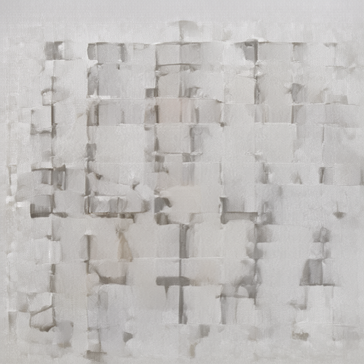
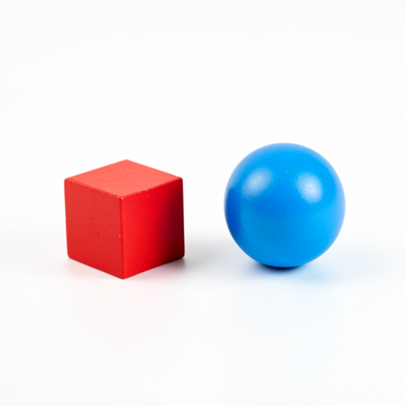
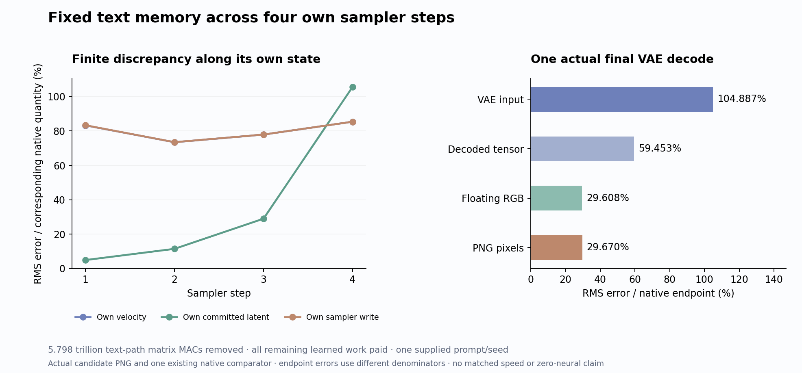

# A fixed text-memory candidate loses the image

Holding the projected prompt state fixed throughout FLUX removes **5,798,205,849,600 nominal matrix MACs**, but the actual four-step image becomes pale block texture. The red cube and blue sphere are absent. First-velocity RMS error is already **83.27%**; final latent error reaches **105.61%**, and PNG error **29.67%** against the existing native comparator. This is informative evidence against this combined fixed-state and physical-execution candidate on one supplied scene, not an exclusion of all text-state compression.

The [previous terminal rewrite](terminal-own-state-trajectory.md) preserves the scene with 0.180% PNG error. Its omitted final text output has no future consumer. The new test goes earlier: it prevents text state from evolving before later blocks read it. That changes a live dependency as well as finite projection and attention geometry.

## A state has a position in the computation

For the ordinary coupled block, write

\[
(T_{\ell+1},I_{\ell+1})=B_\ell(T_\ell,I_\ell;c_k).
\]

The candidate replaces every incoming text state by the same original projection C(E):

\[
\widehat T_\ell=C(E),\qquad
\widehat I_{\ell+1}=\Pi_I B_\ell(C(E),\widehat I_\ell;c_k).
\]

Every current text/image key and value remains live. Every image query, attention output, MLP and residual update runs. The implementation physically omits text queries, text attention-output projections and text MLP writes; it does not compute them and discard the results. Joint blocks preserve sequential image attention→MLP ordering; single blocks preserve their parallel law. All four scheduler commits consume the candidate's actual own velocity and preceding latent, followed by one actual VAE decode.

At the final block, selecting image outputs is an exact real-arithmetic demand reduction. Before that last-use boundary, replacing T_l by C(E) changes what future readers see. The source graph does not justify it as ordinary dead-work elimination. Physical slicing and rectangular SDPA introduce finite differences too. This one experiment constrains their combination without isolating text evolution as the sole cause of the loss.

One working interpretation concerns coordinates as much as new semantic information. Even if an abstract prompt variable q stayed fixed, different layers could consume representations T_l=phi_l(q). Reinjecting C at every layer assumes those coordinate maps can all be replaced by the initial one. The current result does not prove this interpretation or separate it from image-conditioned text feedback. It explains why “the prompt is fixed” is insufficient to infer that its working tensor can stay fixed.

## The first update is already wrong

All four projected C fields match the original native C bytes. The initial latent, E, clock schedule, positions and numerical profile are authenticated. At the first denoiser call, both trajectories therefore start from the same declared inputs. The candidate's first velocity nevertheless has 83.27% error. This places substantial discrepancy inside the changed denoiser, before later sampler-state differences accumulate.

| Sampler step | Velocity error | Committed latent error | Own sampler-write error |
|---|---:|---:|---:|
| 1 | 83.27% | 4.95% | 83.34% |
| 2 | 73.48% | 11.47% | 73.51% |
| 3 | 77.93% | 29.01% | 77.94% |
| 4 | 85.41% | 105.61% | 85.41% |

Each percentage uses its corresponding native quantity. The write comparison subtracts each lane's own preceding state:

\[
E_{write,k}=\frac{\|(\widehat x_{k+1}-\widehat x_k)-(x_{k+1}-x_k)\|_{RMS}}
{\|x_{k+1}-x_k\|_{RMS}}.
\]

The first committed latent still has cosine **0.99899** to its native counterpart, because the carried noise dominates the small first write. That high similarity coexists with an 83.34% write discrepancy. At the final image, RGB cosine remains **0.9698**, although the requested objects are gone. These observations are why endpoint similarity cannot stand in for computation fidelity or image meaning.

The final PNG has RMS error **70.880 channel levels**, MAE **64.011**, and maximum absolute difference **225** on the 0–255 scale. **786,079 of 786,432** channel values differ. VAE-input/decoded-tensor/floating-RGB errors are 104.89%/59.45%/29.61%, with different endpoint denominators. These percentages do not measure contraction of a common decoder norm. The actual PNG, rather than a proxy threshold, makes the scene loss visible.

## Substantial work really was removed

For N_T=512, N_I=1024, N=N_T+N_I, D=3072 and M=9216, each omitted text path removes

\[
\Delta C_{aff}=N_T(2D^2+3DM),\qquad
\Delta C_{att}=2N_TND.
\]

The separate joint attention-output/MLP maps and concatenated single output map yield the same nominal count at these widths. Across 25 blocks and four clocks, the actual ledger verifies the planned 5.798 trillion MAC removal, including the terminal work already absent in cycle66. Incremental removal beyond that result is **5,566,277,615,616 MACs**.

| Paid matrix/convolution work | MACs |
|---|---:|
| Affines | 13,585,664,180,224 |
| QK plus AV | 983,547,510,784 |
| Original VAE convolutions | 1,236,317,241,344 |
| Total | 15,805,528,932,352 |

This is about 26.84% below the matched nominal original whole-trajectory account. It is not a measured speedup. The instrumented run takes **119.85 scheduler seconds**, sampled peak **8,290.5 MB RSS / 9,116 MB device**. Worker wall time is 87.603 seconds after imports, including 30.596 seconds of setup; analysis takes 1.058 seconds. Every block fingerprints state and writes durable progress. Eighty ephemeral physical map sets materialize **13,589,544,960 logical bytes in aggregate**, while the active callback bound is one 169,869,312-byte set. That sum is repeated work, not unique resident storage or an independent GPU-residency measurement. Stage timings include internal fingerprints and fsync, excluding only the final Act-output fingerprint.

All **169 original transformer tensors / 7,751,089,152 BF16 bytes** remain loaded and paid. Full remaining image, K/V, clock, head and VAE learned computation still runs. Historical conditioning/noise/reference production, non-matrix operations and I/O remain separately paid. The bad image does not erase the verified computation saving; the saving does not make the image result adequate.

## Custody and the next mathematical question

Guarded job `job-96e74e161844` runs one candidate against the existing native case A. The producer seals and exits before target comparison; no native shadow, new reference, fit, supplied hidden text trajectory or intermediate refresh is used. Four immutable initial C digests and one hundred block handoffs bind fixed text and advancing own image state. Nine Acts declare 41 output payloads and eleven sampler-state consumption joins. The final VAE input/output are directly bound; unpack/BN/unpatchify remains source-audited rather than independently replayed through its metadata link.

Full byte verification checks **107 files / 8,097,467,276 bytes**, including **76 NPY payloads**, all original parameter witnesses, **40 distinct physical slices used in 160 four-clock map records**, and four terminal text/image concatenation byte joins. All 11,840 signed observation rows and 100 block-progress rows remain. The standard sweep checks three streams/11,945 records with no fires or semantic claims. The full **315 mechanics tests pass**. These qualify execution and instruments; no effect-size gate converts the image loss into a missing record. The [evidence index](results/fixed-text-memory-evidence/README.md) links the original outputs, source and review.

Astra's fresh neighboring-post review finds unchanged snapshots since cycle65. The conditional read-prediction results still require baseline/compilation work, and do not supply a general denoiser or decoder. The next [depth-evolving text compiler](plans/prompt-only-text-compiler.md) instead starts from C(E), evolves original text equations using text-only self-attention, and gives its own incoming-layer K/V to the image actor. It restores depth-dependent coordinates while removing image→text feedback as a source dependency. Its text-only softmax also changes normalization; neither success nor failure would isolate feedback universally.

That proposed compiler costs **6.223 trillion nominal MACs** and a **629 MB BF16 K/V cache** before one image. With common preprocessing charged once, compiler plus actor would pay **21.063 trillion MACs**, close to the original account. A reusable prompt-side program would be a structural gain whose amortization and quality remain unmeasured, not free computation. The plan is written and unexecuted. Arbitrary raw prompt → image with zero neural evaluations remains unsolved; the [living research log](../../obsidian/blog/2026-11-06-004204-toward-arbitrary-prompt-images-without-neural-evaluations.md) keeps this result connected to that larger requirement.
