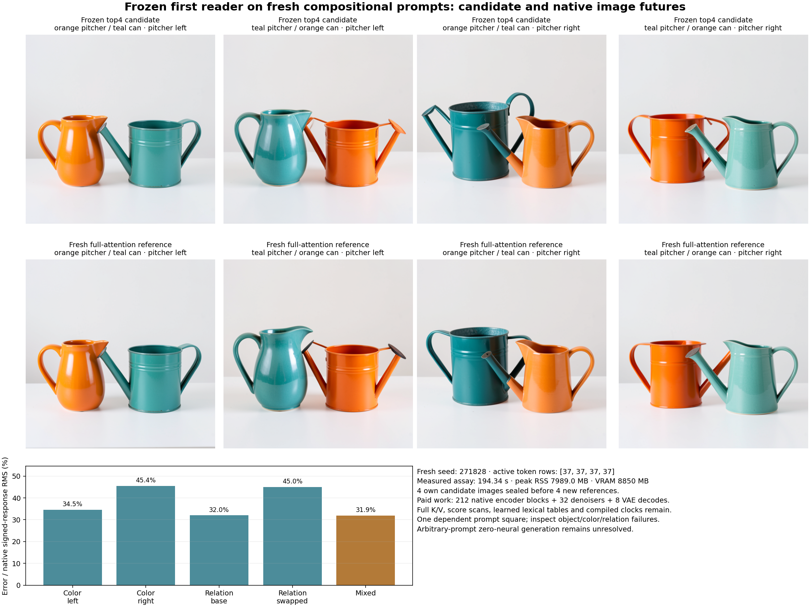

# The frozen reader survives new body colors and spatial relations

Four fresh raw prompts now run through their own frozen top-four first reader, complete encoder continuation and original image consumers. Their images preserve the visible orange/teal body assignment and requested left/right order across one fixed compositional square. Endpoint PNG errors are3.61–9.51%; signed color/relation response errors are31.99–45.43%, with31.90% error in the mixed response. This extends the known-pair result to new operands, without establishing arbitrary-prompt quality or zero-neural serving.

The native references also contain object-role defects: in the right-pitcher cases, a watering spout appears attached to the pitcher-shaped body. Candidates retain those defects, with an additional spout/handle in one case. Preservation of body color and order is therefore narrower than complete prompt compliance. All original images remain visible; no scene was replaced.

## New prompts, frozen computation

The [pre-run plan](results/fresh-prompt-square/frozen-plan.md) fixes an orange ceramic pitcher and teal metal watering can, then crosses color assignment with left/right relation. The four raw strings use seed271828. All naturally tokenize to37active rows; no length matching or prompt replacement occurs. The [uncentered reader](uncentered-reader.md) is unchanged from cycle33, including its source/group/query-head state identity and FP64→FP32→BF16 conversion.

Each candidate forms its own lexical H0 and all32first-layer heads. The original block0 output projection/MLP and native blocks1..26 then advance that candidate's own state. The resulting complete conditioning feeds four original denoiser calls, actual scheduler updates and a native VAE. Candidates receive no native hidden-state refresh, conditioning transplant or target image.

All four complete candidate trajectories seal before the first new full-attention reference executes. Fresh-process guards deny191future-reference paths and prove a blocked-open canary in reader, encoder and image phases. The [candidate seal](results/fresh-prompt-square/candidate-seal.json) binds complete own fields, source records, original PNGs, fresh noise and compiled clocks. Both reference children authenticate that request-bound seal and record its exact hash.

The reference runs all27original native encoder blocks from the same exact compiled lexical H0. Both image lanes use the previously qualified exact compiled clocks with the full original live denoiser/VAE. This is a fresh full-attention reference under that declared numerical/source contract; it does not rerun lexical compilation or the original clock affines.

## Measure the whole square

For a retained field Y, C indicates color assignment and R spatial relation. We retain four signed edge responses and the mixed response:

$$
\Delta_C(R)=Y_{1R}-Y_{0R},\qquad
\Delta_R(C)=Y_{C1}-Y_{C0},\qquad
M=Y_{11}-Y_{10}-Y_{01}+Y_{00}.
$$

All subtraction occurs after casting to FP64, including uint8 pixels. Error is reported in absolute units and relative to the corresponding native response RMS. No numerical quality threshold aborts the experiment. A zero native denominator would remain explicitly undefined; none occurs in the reported whole-PNG contrasts.

| Signed contrast | PNG absolute error RMS, 0–255 | Native PNG response RMS | Relative error | Conditioning E relative error |
|---|---:|---:|---:|---:|
|Color swap, pitcher left|20.843|60.402|34.51%|138.81%|
|Color swap, pitcher right|28.260|62.212|45.43%|141.81%|
|Left→right, original colors|21.156|66.129|31.99%|143.90%|
|Left→right, swapped colors|28.760|63.853|45.04%|144.00%|
|Mixed response|35.562|111.471|31.90%|156.95%|

The mixed PNG response has cosine0.9482 with its native counterpart, while the mixed E response has cosine0.0366. These are observations at different consumers, not proof that conditioning errors are generally irrelevant. Raster-space interaction also does not by itself identify a semantic interaction inside one model component. The [raw report](results/fresh-prompt-square/report.json) retains every endpoint and contrast, intermediate ports, signs and regional accounts.

## A small aggregate can hide a different error distribution

Whole-E endpoint relative errors are7.97–8.33%. Active-row aggregate errors are only0.148–0.158%, while padding errors are72.27–76.06%. The [row diagnostic](results/fresh-prompt-square-evidence/regional-diagnostic.json) explains why the active aggregate needs care: position0has reference RMS334.30in every corner, whereas active-row median relative errors are2.83–2.96% and90thpercentiles6.82–7.22%. A large reference row supplies a large denominator.

Padding contains99.963–99.967% of whole-E endpoint squared error. Active conditioning color-edge errors are11.14/11.83%, relation-edge errors23.74/24.35%, and mixed error73.54%. Padding edge errors remain140.27–144.24%. These complete region/row observations are preserved without turning any one scalar into a verdict. Error-energy location is not a causal attribution of image error; the image consumer still receives all512conditioning rows.

The [visual record](results/fresh-prompt-square-evidence/visual-observations.json) is an unblinded Codex inspection. All eight images show the requested body colors and ordering. The right-pitcher corners contain ambiguous or incorrect spout/role attachment in both native and candidate images; candidate01adds another spout/handle. Ceramic versus metal identity is not independently certified. There is no new zero/uniform control on this square; previous controls remain development evidence.

## Actual work and retained evidence

Guarded CUDA job **`job-b69f30eff20a`** succeeds once in **194.34scheduler seconds**, with7,989MB sampled peak RSS and8,850MB peak VRAM. It produces8new images:4candidates and4references, from1fresh shared noise draw. Worker time after imports is191.780seconds. Fresh child phases take20.398seconds for noise preparation,3.018for the reader,37.820/22.953for candidate/reference encoders and36.378/30.171for candidate/reference image phases. Setup, hashing, capture and serialization remain charged; this is no matched speed comparison.

Paid work includes212native encoder blocks,212encoder SDPA calls,1,500encoder linears,32denoisers,3,296transformer linears,8VAE decodes and160clock gathers. Nominal encoder linear work is11.129trillion MACs and transformer linear work151.166trillion MACs across all eight images; these are declared affine counts, not complete FLOPs, energy or a zero-neural claim. The first reader still scans full causal K/V, using74,866,688score products and8,364,032selected-value products per prompt. Its numerical state is1,052,800B per prompt. The compiled lexical store remains paid.

Automatic generic sizing again describes an inapplicable fallback shape. The [resource basis](results/fresh-prompt-square/resource-basis.json) records that preview and the measured serialB1/512exception:14,336MB RAM/13,000MB VRAM, separate child processes, encoderCPU1/imageCPU4, no model co-residency or retry. Actual execution remains below the measured envelope and well below the15-minute expected-duration review threshold.

All172mechanics tests pass in14.022seconds, including8new factorial/quarantine/orchestration checks and exact staged-payload imports. [Independent byte verification](results/fresh-prompt-square/retained-array-verification.json) covers578members/1,874,668,305B. The471new complete arrays/packets total1,669,076,232B and remain near compute. Primary publication is30files/9,200,616B, retaining61,440dependent row observations losslessly. Saturn [run](results/fresh-prompt-square-evidence/saturn-run.json) and [verify](results/fresh-prompt-square-evidence/saturn-verify.json) return0 with stream-only instrument scope.

Periodic [storage cleanup](results/storage-cleanup-cycle34/README.md) archives890.88MB of redundant terminal transports with complete checksum/custody/recovery checks. Extracted science remains local. The [audit](results/storage-audit-cycle34/result.json) checks28recovery pointers and inventories48remaining name/size candidates; it does not authorize their deletion.

The result supports useful transfer of this frozen reader to one new dependent prompt square. Full contextual operand formation, learned-map replacement, denoising and pixel decoding remain unresolved parts of the arbitrary-prompt zero-neural goal.

[Astra's source/result and newest-post review](results/fresh-prompt-square-evidence/advisor.json) selects [one source-anchored padding MLP tangent](plans/padding-mlp-tangent.md) next. It retains every live input coordinate and native RMS, testing a local nonlinear approximation against a constant-anchor control. The plan is unexecuted; its Jacobian is learned arithmetic, with no strict zero-neural claim.
