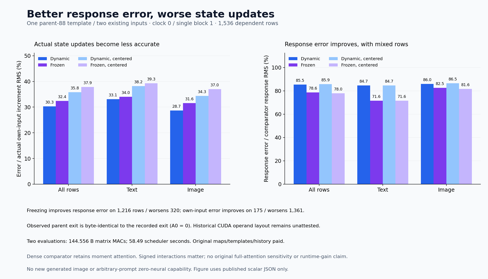

# Freezing a template improves response error and worsens the state update

Freezing the parent block's computational template lowers response discrepancy from **85.48% to 78.63%**, while increasing error in the actual own-input state increment from **30.32% to 32.45%**. On **1,045 of 1,536 rows**, response improves while the state update worsens. The approximation's interaction with existing error matters as much as the size of its response error.

The [previous dense corner](dense-own-state-corner.md) showed that nearly constant error magnitude concealed a changing error direction. This experiment evaluates the same frozen parent template on both the parent input and the actual input emitted by the preceding approximation. It completes the [matched-pair amendment](plans/frozen-template-matched-pair.md) to the earlier [single-input proposal](plans/frozen-template-transport.md). All learned maps and historical state preparation remain paid. This local experiment produces no image or arbitrary-prompt zero-neural capability.

## The state pair and its computations

Let x be the parent input and \(\hat x\) the actual cycle-86 incoming state. Existing results supply

\[
y=F_{70}(x),\quad y_1=F_{70}(\hat x),\quad
y_0=\hat F(x),\quad \hat y=\hat F(\hat x).
\]

The comparator \(F_{70}\) uses original dense affine maps with the frozen cycle-70 moment-attention law. It is not an independent original full-attention reference. The reduced program \(\hat F\) constructs its GU input and output row bases from each current input. The new program G fixes those templates to their retained parent values but recomputes current normalized operands, QKV, attention, GU coefficients, nonlinear products, output coefficients and the BF16 residual commit:

\[
z_0=G(x),\qquad z_1=G(\hat x).
\]

Both evaluations use the same explicit row-contiguous reload policy. Historical receipts did not capture all original CUDA operand strides, so merely loading the parent's saved basis does not attest historical execution geometry. Measuring z₀ supplies the necessary parent control. Its complete exit file and payload are **byte-identical to the recorded parent exit**, and the measured parent difference is zero on every row. This observed exit identity does not establish identity of all historical intermediates or uncaptured layouts. The [association receipt](results/template-transport-evidence/parent-association.json) retains that distinction.

The specimen is one state pair at clock 0, single block 1: 512 text rows and 1,024 image rows. These rows are dependent observations within one specimen.

## Separate response from endpoint error

Define the incoming displacement, comparator response and dynamic-template response:

\[
D=\hat x-x,\quad T_N=y_1-y,\quad T=\hat y-y_0.
\]

Their approximation errors and response discrepancy are

\[
E_0=y_0-y,\quad E_1=\hat y-y_1,\quad Q=T-T_N=E_1-E_0.
\]

For the fixed program, retain both parent and own-input effects:

\[
E_{f0}=z_0-y,\quad E_{f1}=z_1-y_1,\quad
A_0=y_0-z_0,\quad A_1=\hat y-z_1,
\]
\[
B=A_1-A_0,\quad T_f=z_1-z_0,\quad
Q_f=T_f-T_N=E_{f1}-E_{f0}.
\]

Independent subtractions check

\[
T=T_f+B,\quad Q=Q_f+B,\quad
E_0=E_{f0}+A_0,\quad E_1=E_{f1}+A_1.
\]

All full and within-stream-centered vector closures, including the independently formed dual Qf, have zero energy. FP64 aggregate energy-account remainders are around 10⁻⁸. These are execution accounts, without an independent numerical replay of the real scientific arrays.

The own-increment comparison divides error by the comparator's actual increment **y₁−x̂**, rather than its larger carried outgoing state. The response comparison divides Q or Qf by **Tₙ**. Both policies share the same denominator within each comparison. Centering removes text and image means separately before pooling energies.

| Actual own-increment error | Dynamic all | Fixed all | Dynamic text | Fixed text | Dynamic image | Fixed image |
| --- | ---: | ---: | ---: | ---: | ---: | ---: |
| Full | 30.318% | 32.446% | 33.093% | 34.028% | 28.712% | 31.560% |
| Centered | 35.819% | 37.881% | 38.232% | 39.292% | 34.343% | 37.038% |

| Response discrepancy relative to Tₙ | Dynamic all | Fixed all | Dynamic text | Fixed text | Dynamic image | Fixed image |
| --- | ---: | ---: | ---: | ---: | ---: | ---: |
| Full | 85.483% | 78.626% | 84.667% | 71.565% | 85.964% | 82.535% |
| Centered | 85.854% | 77.992% | 84.720% | 71.555% | 86.528% | 81.617% |

Parent increment error remains unchanged at 30.321% pooled, 31.094% text and 29.893% image. All 1,536 fixed own-input increments beat no update, although 1,361 worsen relative to the dynamic program and only 175 improve. Fixed response improves on 1,216 rows and worsens on 320; it beats zero response on 1,502 rows and loses on 34.

The [joint row account](results/template-transport-evidence/joint-outcomes.json) prevents treating those margins as the same subset: 171 rows improve both measures, 1,045 improve response but worsen the increment, four improve only the increment, and 316 worsen both. [Lossless rows](results/template-transport/observations.jsonl.gz) and [localization](results/template-transport-evidence/row-localization.json) preserve every exception. These are descriptive comparisons, without an independent-sample significance claim.

## The signed terms explain the tradeoff

Observed A₀=0 gives \(E_{f0}=E_0\). The dynamic-template change contributes A₁ to both the fixed own-input error and the fixed response error, but its alignments differ:

\[
\|E_1\|^2=\|E_{f1}\|^2+\|A_1\|^2+2\langle E_{f1},A_1\rangle,
\]
\[
16.467603\mathrm{M}=18.859653\mathrm{M}+5.058970\mathrm{M}-7.451020\mathrm{M},
\]
\[
\|Q\|^2=\|Q_f\|^2+\|B\|^2+2\langle Q_f,B\rangle,
\]
\[
8.334446\mathrm{M}=7.051014\mathrm{M}+5.058970\mathrm{M}-3.775538\mathrm{M}.
\]

The same implemented policy change helps own-input error through one signed interaction while worsening response discrepancy through another. These cross terms are signed interactions, not positive causal shares or separated effects of the GU and output bases.

Expanding around the existing parent error makes the apparent contradiction explicit:

\[
\|E_{f1}\|^2-\|E_1\|^2
=(\|E_{f0}\|^2-\|E_0\|^2)
+(\|Q_f\|^2-\|Q\|^2)
+2(\langle E_{f0},Q_f\rangle-\langle E_0,Q\rangle).
\]

The first term is zero. Response-error energy falls **1,283,431.811**, but the parent-error cross term changes **+3,675,481.562**, so own-error energy rises **2,392,049.752**. Centering gives the same direction: −1,447,998.607+3,379,523.057=+1,931,524.450. The [scalar supplement](results/template-transport-evidence/signed-tradeoff.json) infers these parent-response crosses from the published squared norms; it does not add independent vector-product measurements.

Pooled response cosine changes 0.68744→0.68661 despite the lower discrepancy norm. The fixed response's displacement gain ‖Tf‖/‖D‖ is 1.03023. These are finite-pair observations, without a derivative, global sensitivity bound or transferable correction law.

## Actual work and evidence

One guarded CUDA lease, **job-9ad2d0eb6dd0**, succeeds in **58.49 scheduler seconds**, with sampled **2,222.4 MB RSS / 2,238.0 MB device**. Producer time after imports is 31.228s, including 7.473s setup; analysis takes 6.538s after imports. Torch peak allocated/reserved memory is 1,783,331,840/2,017,460,224 bytes. The 3,231,651-byte payload has identical declared, sealed and executed SHA256.

| Two evaluations combined | Matrix MACs |
| --- | ---: |
| Original QKV | 86,973,087,744 |
| Fixed GU coordinates and reconstruction | 8,455,716,864 |
| Fixed-row original output | 25,367,150,592 |
| Attention and moments | 23,759,683,584 |
| **Total** | **144,555,638,784** |

This is 20 FP64 products, two BF16 QKV projections, ten FP32 moment products and two image SDPA calls. There is no new QR, GU template compilation, output sketch or pullback. CPU FP64 analysis, nonlinearities, casts, copies, hashes and retention are additional. All original learned maps, source states, clocks and historical template formation remain paid. Different arm and instrumentation scopes prevent a matched runtime-saving claim.

All **372 mechanics tests pass in 19.14s**, with 42 frozen scientific source identities. Independent tiny checks cover fixed-template full-rank equivalence, scalar-loop contractions, both typed Acts, template immutability, signed/centered eight-corner accounts, nonzero parent differences and zero denominators. A pre-freeze metadata-key failure is retained with its original source; it was corrected before staging. The separately passing 268 unittest checks overlap the 372 pytest tests and are not additional tests.

Fresh intake authenticates 55 files/108,954,960 bytes/17 NPY plus 245,367,296 original parameter bytes. Complete post-run byte verification covers 143 files/1,527,342,003 bytes/91 NPY plus those four parameters, including QKV/J/exit and template handoffs. Two typed Acts each have 12 inputs/33 outputs, followed by eight analysis fields; all 92 scalar columns and aggregates pass. The [evidence index](results/template-transport-evidence/README.md) separates these scopes.

Saturn's applied raw-target run and corrected verification both return 0 over 1,536 records, with zero fires, formal claims or qualified addresses. The initial verify command used unsupported run-only flags and exited at argument parsing; its failed invocation remains preserved. Correcting the invocation required no model rerun. One missing no-fire ledger is expected. This is instrument mechanics, without model-quality certification.

All 74 new arrays/1,410,856,192 NPY bytes remain near compute; 18 compact core files total 2,084,765 bytes locally/publicly, with figures and receipts additional. Full [research review 90](results/research-review-cycle90/README.md) and [storage review 90](results/storage-audit-cycle90/README.md) are complete. Storage checks retain 93 recovery pointers: 84 older custody/type-size checks and nine fresh full-SHA snapshots totaling 3,806,240,603 bytes. No new archive or deletion occurs; last actual archive remains 78 and next scheduled reviews are 93.

## The missing construction is larger than this block

Astra recommends ending this single-block matrix-compression sequence as the primary route. The [complete-vocabulary atom store](raw-prompt-encoder-atoms.md) accepts raw strings and forms the first token-local operands without serving neural projections. The [RGB response chart](zero-network-image-response.md) closes a zero-neural image path for four supplied contexts. There is no supported composition connecting them.

The next [complete-serving construction feasibility cut](plans/complete-serving-construction.md) asks for concrete c, s₀, T and R in

\[
p\mapsto c(p)\mapsto s_0,\qquad
s_{k+1}=T(s_k,c(p)),\qquad Y=R(s_K),
\]

with every offline and online dependency explicit. It is written and unexecuted, with no new GPU assay proposed. Renaming a dense map, supplying contextual state, looking up whole-prompt images or inserting a supplied procedural renderer would leave the original requirement unmet. Arbitrary-prompt zero-neural generation remains active and unsolved.
