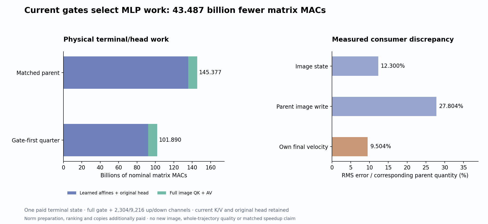

# Current gates select a quarter of the up/down channels

One terminal FLUX block now computes every current gate, selects 2,304 of 9,216 MLP channels, and physically evaluates only those up rows and down columns. Its own final head differs from the existing parent velocity by **9.50%**, while nominal terminal-plus-head work falls from **145.377 to 101.890 billion MACs (29.91%)**. The image-state error is 12.30%, and error relative to the parent write is 27.80%.

All 1,024 image rows improve over holding the incoming state. They are dependent rows from one specimen, not independent prompt or seed replications. The result supports continuing this operator experiment; it does not establish that this selector beats other fixed-quarter selectors or that a complete image will remain faithful. No new image was generated. The input is a paid terminal state from the [cycle70 own-state trajectory](image-partition-moments.md), and the remaining learned computations still run. Arbitrary-prompt zero-neural generation remains open.

## Pay the gate before choosing the up computation

For the current normalized and modulated image rows X, the native MLP contribution is

\[
A=\operatorname{SiLU}(XG^T),\qquad
Y=[A\odot XU^T]D^T.
\]

The source-native single block has two fused dense matrices, not six independent MLP matrices. The first contains Q/K/V/G/U rows; the second contains attention-output columns followed by MLP down columns. Attention and MLP are parallel functions of the same incoming normalized state.

The candidate computes all current gates A. It then uses original source-weight norms and the current input norm to score each channel:

\[
b_j=\|D_{:j}\|_2\|U_{j:}\|_2
\sqrt{\sum_i A_{ij}^2\|X_i\|_2^2}.
\]

There is no full-up evaluation, target activation, fit or budget sweep behind the selection. A stable descending FP32 sort breaks ties by original index; the selected indices return to ascending source order before gathering U rows, gate channels and D columns. One common support serves all 1,024 image rows. It keeps exactly one quarter of channels without rescaling the missing contribution.

This is a proposed approximation to the dense computation. The native model itself does not discard these channels, and the result does not show that omitted channels are inactive or causally irrelevant.

## A bound guides the rule without certifying the finite output

For fixed admitted A and real-arithmetic U/D, channelwise triangle inequality and rowwise Cauchy–Schwarz give

\[
\|Y-Y_S\|_F
\leq\sum_{j\notin S}\|D_{:j}\|_2
\|A_{:j}\odot(XU_{j:}^T)\|_2
\leq\sum_{j\notin S}b_j.
\]

Exact top-b selection minimizes this particular omitted-sum bound. It does not minimize actual output error, and it ignores signed cancellation. Operational FP32 scores can reorder near ties; the FP32 omitted sum is a diagnostic estimate rather than a certified numerical upper bound.

The observed omitted-score sum is **2,218,553.5**, versus **1,679,917.25** for the kept channels. Summing the already-rounded omitted scores in double precision gives 2,218,553.397377, illustrating the reduction boundary without recovering exact real scores. Multiplication by the residual gate’s maximum absolute value, 36.25, produces a diagnostic estimate of 80,422,564.375. These large estimates are not useful tight error certificates. They neither gate the experiment nor establish a bound on the original head’s finite output.

## Six actual state transitions

The actor takes authenticated clock3/single19 incoming rows, modulation, time embedding and absolute RoPE from cycle70. Six typed Acts run in order:

1. Prepare physical K/V and Q/G maps plus FP32 U-row and down-column norms from original parameters.
2. Normalize/modulate all 1,536 incoming rows; compute full K/V, image Q and all image gates, with native BF16 SiLU admission.
3. Form current scores, stable rank and the fixed 2,304-channel support.
4. Gather actual selected U rows and output columns from original bytes.
5. Read complete current K/V with native image attention, evaluate selected U/products/output, and emit the actual image residual state.
6. Feed that emitted state into the original final norm/head.

Terminal text Q/MLP/output remain dead, while all 1,536 K/V rows remain live. Image queries retain their absolute RoPE positions. The own image output preserves the native image-view stride. Source inputs and original parameters remain unchanged. Candidate sealing and actor exit precede target reads and independent verification of the admitted rounded-score ordering.

| Observable, relative to the existing parent | RMS error |
|---|---:|
| Terminal image state | 12.300% |
| Terminal image write | 27.804% |
| Own final velocity | 9.504% |

Image-state RMS error is 5.5029, with 3,085,805 of 3,145,728 values changed and maximum absolute difference 106. Velocity RMS error is 0.11015, with 128,384 of 131,072 values changed and maximum difference 0.875. These denominators refer to different parent quantities. They are not a contraction measurement or an image-quality estimate.

The comparator is cycle70’s terminal/head output on this same incoming state. It is not the original native trajectory. In particular, the 9.50% velocity error cannot be added to cycle70’s native-trajectory error to infer a new final-image error. Changed GEMM widths, splitting G from U and omitting channels all belong to the measured contrast; this assay does not isolate them.

## Paid work and time

| Executed operation | Nominal matrix MACs |
|---|---:|
| Full K/V | 28,991,029,248 |
| Image Q plus full G | 38,654,705,664 |
| Selected U | 7,247,757,312 |
| Attention plus selected-MLP output | 16,911,433,728 |
| Native full image attention | 9,663,676,416 |
| Original final head | 421,527,552 |
| **Total** | **101,890,129,920** |

Actual instrumentation sees six affines and one native image SDPA. The local saving is **43,486,543,872 MACs** against the already text-dead matched terminal/head computation, not a whole-image percentage.

Source-norm preparation additionally squares 56,623,104 original coefficients and computes 18,432 roots. The actor evaluates 9,437,184 current SiLU values, 3,145,728 input-norm squares, and 9,437,184 gate-energy squares and weighted multiplications each, plus reductions, ranking, gathers, copies, transfers, hashing and I/O. The first-use account pays these costs; no reused constant is treated as free.

Guarded job `job-2b906ad355a3` takes **45.43 seconds**, with sampled peak **1,855.9 MB RSS /956 MB device memory**. Worker time after imports is 19.003 seconds, including 8.197 seconds of setup; post-seal analysis takes 1.780 seconds. CUDA allocator peaks are 644,096,000 allocated and 673,185,792 reserved bytes, distinct from device telemetry.

Cold, instrumented operation timings are 0.303 seconds source maps/norms, 0.308 gates, 0.459 selection, 0.088 gathering, 0.045 image computation and 0.0027 head. They exclude subsequent finite checks and output fingerprints. Selection/preparation are material in this one-call profile, despite fewer matrix MACs. Warm repeated performance was not measured. The earlier terminal assay had different source and instrumentation; no matched runtime gain is established.

## The next test must let omitted work change future state

Astra’s [next full-trajectory plan](plans/gate-first-single-trajectory.md) applies the unchanged quarter rule to all 20 single-block MLPs over four own sampler clocks. Earlier singles score all 1,536 current rows; terminal19 scores only the 1,024 live image rows. Both streams advance through their own changed states, with joint blocks and cycle70’s moment feedback unchanged. It will test composition rather than assume that this local 9.50% head discrepancy stays small.

The prospective matrix saving is **5,131,412,176,896 MACs**, yielding **15,989,289,779,200** for the whole path, before separately paid nonmatrix work. This is written and unexecuted. Original gate maps, K/V, historical encoder-derived E, head and VAE remain paid. The strict goal still requires a general raw-prompt conditioner, own-state denoising law, pixel producer and independent quality evidence without neural evaluations.

## Evidence and retention

All **333 mechanics tests** pass. The [evidence index](results/gate-first-terminal-evidence/README.md) binds six Acts/24 explicit output ABIs, the own-image-to-head join, 5,248 signed row/channel observations and 9,216 selection rows. Independent byte verification covers **59 files /8,209,359,844 bytes**, including 33 NPY payloads, six original parameters and four physical-map witnesses reconstructed from the actual support. The original six tensors total 283,902,464 BF16 bytes. Declared, sealed and executed guarded payload identities match.

The standard Saturn sweep and verify exit zero over three streams/14,470 records, with no formal claims, addresses or fire ledgers. Three missing expected fire ledgers are retained as instrument scope, not scientific failure. All 26 new raw arrays /265,798,920 bytes stay near compute; the primary compact publication is 19 files /1,356,022 bytes. Actual cleanup and full newest-post survey last ran at cycle69 and remain due72 or earlier pressure/material evidence.

Source: [helper](../generator/gate_first_mlp.py), [worker](../generator/gate_first_worker.py), [ledger](../generator/gate_first_ledger.py), [analysis](../generator/gate_first_analysis.py), [launcher](../generator/gate_first_study.py), [publisher/audit](../generator/publish_gate_first.py), [tests](../generator/test_gate_first_mlp.py), [frozen prospective protocol](results/gate-first-terminal/frozen-plan.md), [report](results/gate-first-terminal/report.json), [state/work ledger](results/gate-first-terminal/execution.json), [selection summary](results/gate-first-terminal/selection-summary.json), [provenance](results/gate-first-terminal/provenance.json). Related: [image-key moment result](image-partition-moments.md), [physical terminal liveness](terminal-output-liveness.md), [compiled MLP write](compiled-mlp-write.md), [recipient-conditioned MLP prediction](recipient-conditioned-product.md), [research record](zero-neural-research.md).
