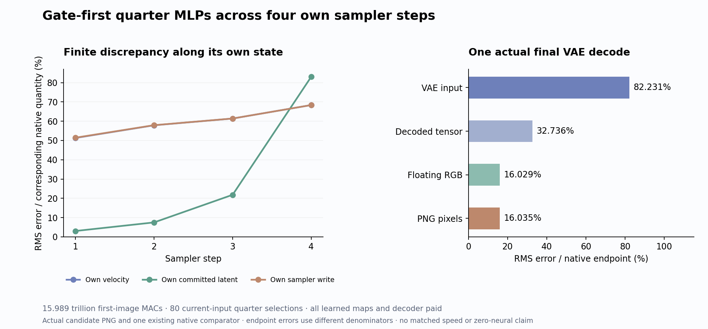

# Can a gate-selected MLP survive its own changing future?

The gate-first quarter rule removes **24.30% of nominal matrix/convolution work through one complete own-state image trajectory**, but worsens fidelity. Two objects retain their red-left/blue-right arrangement; the cube becomes a rounded red form and the blue/cyan object is blurred and distorted. PNG RMS error against the existing native image rises from the parent's 12.26% to **16.04%**. This is useful evidence about composition, with substantial remaining learned computation. The strict [arbitrary-prompt zero-neural objective](zero-neural-research.md) remains open.

The [frozen plan](plans/gate-first-single-trajectory.md) carries the quarter selector from the [local terminal assay](gate-first-terminal-mlp.md) through all twenty single blocks and four own sampler steps. Its parent is the [live image-key moment pipeline](image-partition-moments.md). One guarded CUDA run, job-e02711cf1c88, succeeds in 99.67 seconds with 335 mechanics tests and complete source/state/work/byte audits. There is no new native reference or intermediate native refresh.

Compare the [original native PNG](results/gate-first-trajectory/native-A.png), [complete measured report](results/gate-first-trajectory/report.json), [execution ledger](results/gate-first-trajectory/execution.json) and [evidence summary](results/gate-first-trajectory-evidence/README.md).

The important change is the horizon. A local approximation receives an already computed state. A generator must produce the next state that determines its next approximation. Here every changed text/image write feeds the next block, and every changed velocity feeds the next sampler step. One original VAE decodes the actual final latent.

## Factor the write before paying for every channel

For one normalized/modulated input matrix X, a SwiGLU write is

\[
M_i(X)=\sum_{j=1}^{9216}\operatorname{SiLU}(X_iG_j^T)(X_iU_j^T)D_{:j}^T.
\]

The outer product with D is understood row by row. A channel contributes through three factors: its current gate, its input-dependent value and its output direction. We still compute the complete current gate. We select a shared support S of 2,304 channels using

\[
b_j=\|D_{:j}\|_2\|U_j\|_2
\sqrt{\sum_i\operatorname{SiLU}(X_iG_j^T)^2\|X_i\|_2^2},
\qquad
\widehat M_i(X)=\sum_{j\in S}\operatorname{SiLU}(X_iG_j^T)(X_iU_j^T)D_{:j}^T.
\]

Only the selected U rows and D columns are physically evaluated. Source norms are prepared once per block and explicitly paid. Ranking uses FP32, stable descending order with source-index ties, then ascending source order for gathers. No coefficients are fitted, reweighted or renormalized. Rounded scores and omitted sums are diagnostics, not finite-error certificates. Signed channels can cancel, so a sum of channel magnitudes can be much larger than the actual write.

For single0–18, the selector sees the current 512 text and 1,024 image rows together. Full current Q/K/V/G comes from a physically reduced six-D map, followed by selected U and output maps. Attention and MLP read the same incoming normalized state. Both emitted streams advance. At single19, K/V still covers all 1,536 rows; Q/G/selection/U/output covers only the 1,024 image rows that remain live.

## Why a local error does not predict the image

Let F_l be the parent computation on the complete coupled state s_l=(T_l,I_l), and let the selected computation be \(\widehat F_l\). Define its same-input defect as \(r_l(s)=\widehat F_l(s)-F_l(s)\). The exact difference recursion is

\[
e_{l+1}=F_l(\widehat s_l)-F_l(s_l)+r_l(\widehat s_l),
\qquad e_l=\widehat s_l-s_l.
\]

The first term transports an incoming state difference through attention, normalization, MLPs and residual gates. The second creates a fresh defect on the candidate's current input. Its selected support also depends on that input. A fixed local error measured on an archived terminal state cannot bound this recursion. Differentiating F would only describe a local approximation, and a support change need not be smooth. The measured defect also includes changed finite contraction geometry.

The ranking sees magnitudes while the write is a signed sum. With \(a_{ij}=\operatorname{SiLU}(X_iG_j^T)\), the omitted row has squared norm

\[
\left\|\sum_{j\notin S}a_{ij}(X_iU_j^T)D_{:j}\right\|_2^2
=\sum_{j,k\notin S}a_{ij}a_{ik}(X_iU_j^T)(X_iU_k^T)\langle D_{:j},D_{:k}\rangle.
\]

Neither the input/value alignments nor those signed cross-channel terms appear in b. This explains what the selector does not know; this run does not measure which omission term caused the image deterioration. Poor ranking, removed cancellation, changed contraction geometry and propagation through later states remain different explanations.

At the outer clock, the sampler commits the candidate's own velocity and latent. The next denoiser therefore reads a changed image state even though the original prompt embedding and schedule are fixed. Comparing actual committed states and the actual final image tests this composition directly.

## What the own trajectory measured

All percentages below divide RMS discrepancy by the corresponding original native quantity. They compare complete paths; they are not isolated MLP errors or changes caused solely by the selector.

| Own sampler step | Velocity error | Committed latent error | Sampler-write error |
|---|---:|---:|---:|
| 1 | 51.32% | 3.06% | 51.45% |
| 2 | 57.89% | 7.50% | 57.94% |
| 3 | 61.39% | 21.83% | 61.40% |
| 4 | 68.38% | 83.04% | 68.38% |

All four source C(E) projections match the native fields exactly. The candidate still diverges substantially as its hidden states evolve. Final VAE-input error is 82.23%, decoded-tensor error 32.74% and PNG error 16.0351%; these use different endpoint denominators. PNG RMS is 38.3074 and mean absolute error 15.2072 on the 0–255 scale, with 745,130 of 786,432 channel values changed and maximum absolute error 255. Pixel brightness can conceal geometry loss; direct image inspection remains part of the evidence.

The [selection record](results/gate-first-trajectory/selection-summary.json) preserves eighty supports and 737,280 channel observations. Across the twenty blocks, median overlap with the preceding clock is 1,863.5, 1,978 and 2,024.5 of 2,304 channels at clocks 1–3; ranges are 1,699–1,985, 1,800–2,056 and 1,951–2,122. This is recurrence within one dependent trajectory. It establishes neither static support sufficiency nor prompt generalization.

## What remains paid

The actual matrix/convolution account matches the prospective **15,989,289,779,200 MACs**, 5,131,412,176,896 below the parent, or 24.2957%. Affines account for 13,556,673,150,976; native SDPA for 983,547,510,784; explicit text/moment products for 212,751,876,096; decoder convolutions for 1,236,317,241,344. The SDPA subtotal includes 966,367,641,600 from denoising and 17,179,869,184 from the decoder. The instrument observes 520 denoiser affines, 100 image SDPA operations, 480 explicit FP32 text/moment products, four own commits and one actual VAE decode.

Source norms pay 1,132,462,080 coefficient squares and 368,640 roots, retaining 1,474,560 FP32 payload bytes. Current gates pay 1,113,587,712 SiLU activations across 120,832 row-visits. Input norms, score squares/products/reductions, eighty sorts, gathers, copies, fingerprints and I/O remain additional work. One ephemeral base or selected map set is active at a time: 113,246,208 maximum logical bytes, with 244 actual map records. All maps are physically materialized from original source bytes and the candidate's own current support.

The job takes 99.67 seconds versus the earlier parent's 99.40 seconds, without a matched timing control. It establishes no runtime gain. Sampled peaks are 8,030.8 MB RSS and 9,374 MB device memory; worker CUDA allocation peaks at 8,614,106,112 bytes and reservation at 9,495,904,256 bytes. Worker time after imports is 71.3631 seconds, setup 16.1508 seconds and process CPU 58.1488 seconds; the separate saved-target analysis takes 4.1549 seconds. These are different timing scopes.

The source-norm operation interval is 0.33895 seconds; denoiser operation intervals are 9.0438, 6.9236, 6.1062 and 5.9241 seconds. They include internal map/block fingerprints and progress writes but stop before post-operation finite/ABI checks and final output hashing. The [timing qualification](results/gate-first-trajectory-evidence/timing-qualification.json) corrects the overly broad frozen interval-description text without rewriting the execution record.

The original learned Q/K/V/G maps, joint MLPs, clock maps, final head and VAE remain active. Historical neural text conditioning and reference generation remain paid. This experiment can establish a bounded reduction through autonomous state advancement; it cannot establish arbitrary-prompt generation without neural evaluation.

## Evidence and the next uncertainty

The byte audit checks 1,544 files totaling 9,618,627,622 bytes, including 1,506 NPY payloads, 169 original parameters, all 244 support-dependent physical maps and four own terminal text/image concatenations. Ten typed Acts have 1,471 output ABIs, four norm-producer/consumer joins and 100 coupled block joins. The 11,840 signed comparison rows, 2,304 partition-head rows, 2,304 moment-head rows and all selector rows remain available. The standard Saturn sweep and verification both return zero: six streams, 753,833 records, zero fires/formal claims/qualified addresses. Six expected fire ledgers are absent because none were written; this supplies no semantic or quality certification.

All 1,486 new raw arrays, totaling 1,562,823,040 file bytes, remain near compute. The primary compact publication is 28 files and 19,245,662 bytes. [Storage maintenance72](results/storage-cleanup-cycle72/README.md) archives six redundant transport copies totaling 991,780,817 bytes, with full cold hashes and durable restoration pointers before local unlink. Extracted science remains local. The [post-audit](results/storage-audit-cycle72/README.md) checks 82 pointer/custody/remote metadata joins; the eleven remaining size/name candidates are not deletion certificates.

Astra reviewed recent committed and working research posts, then the exact source, actual image and mathematical boundaries. The [next matched first-single diagnostic](plans/matched-first-single-write.md) uses byte-identical clock0 incoming text/image/modulation/RoPE fields from the two completed paths. Sparse and dense replays seal before archived exit comparisons; their common-product signed omission separates input alignment, cross-channel cancellation and a recorded finite residual. Both local paths and two FP64 down contractions prospectively cost 389,771,427,840 matrix MACs. The plan is written and unexecuted, with no next block, head, VAE or image. Support persistence cannot substitute for this measurement.
