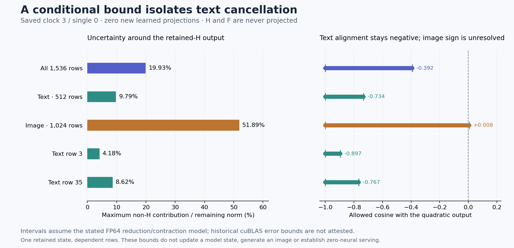

# A saved-array bound isolates the cancellation behind two text overshoots

The [quadratic SwiGLU component](odd-gate.md) substantially improved image-row writes, yet two text rows overshot badly. A saved-only bound now constrains the missing smooth-even output **without evaluating its Down projection**. Conditional on the stated FP64 model, its distance from the text remainder is at most **9.79% of that remainder's norm**, and its cosine with the quadratic output is at most **−0.733736**. Rows 3 and 35 have tighter distance bounds of **4.18% and 8.62%**. The aggregate image alignment remains unresolved.

This is an attribution result on one retained clock3/single0 state. It produces no correction vector, new model state or image. All original operand formation, learned maps and previous projections remain paid. Arbitrary-prompt zero-neural generation remains open.

## Keep the exact identity separate from numerical qualification

Let R be cycle76's centered product, L cycle77's mean-activation product, B its changing product, and T/H/F the retained quadratic/even/finite products from cycle78. Each has 9,216 columns. Keep the original selected support S, Down map D and residual gate g. Define

\[
c_1=R-L-B,\quad c_2=B-T-H-F,\quad
K_o=\operatorname{diag}(g)D_{:,\bar S},\quad K_s=\operatorname{diag}(g)D_{:,S}.
\]

The omitted map has 6,912 columns. Products must be restricted accordingly. Our unknown target is the exact-real projection of the **retained** even product,

\[
Y_H^g=H_{\bar S}K_o^T.
\]

The observed remaining field is the saved finite R_g=g⊙((Y_R−Y_L)−Y_T). Let e_A=Y_A−ADᵀ for A∈{R,L,T}, and define e_group=R_g−g⊙(Y_R−Y_L−Y_T), all as exact-real expressions over retained numbers. Then

\[
R_g-Y_H^g=(F_o+c_{1,o}+c_{2,o})K_o^T
+(R-L-T)_S K_s^T
+g\odot(e_R-e_L-e_T)+e_{\rm group}.
\]

Old Q remains outside this identity. R_g is not the entire primary forecast error. Frobenius norm inequalities give an envelope η for the distance ||R_g−Y_H^g||. It includes the finite product, both product closures, selected residue, historical contraction errors and grouping. The assay computes only scans, squares, elementwise arithmetic and reductions; no H/F projection or matrix factorization occurs.

Computed closures need their own formation allowances. The implementation uses γ₂ for (R−L)−B, γ₃ for B−((T+H)+F), and retains a separate direct combined-product check. Selected R/L/T columns are all stored zeros. Recomputed cycle78 closure, remaining output and gated remaining output match their saved fields exactly.

Historical contractions receive the conditional bound

\[
\|g\odot e_{A,i}\|\le\gamma_{2m}\|A_i\|\|\operatorname{diag}(g)D\|_F,
\quad m=9216,\quad \gamma_k=\frac{ku}{1-ku},\quad u=2^{-53}.
\]

Norm reductions, closure formation, dot products and scalar interval arithmetic also receive stated allowances and outward expansion. No subnormal norm/dot inputs or products were observed. **That scan does not attest historical cuBLAS rounding or every reduction instruction.** All resulting numerical enclosures and attribution conclusions remain conditional on the [recorded model](results/gated-even-bound/report.json). The algebraic identity itself is exact real arithmetic on the retained arrays.

## What the bounds establish, and where they are loose

From ||R_g−Y_H^g||≤η,

\[
\|Y_H^g\|\in[(r_{\rm low}-\eta)_+,r_{\rm high}+\eta],
\qquad
|\langle t,Y_H^g-R_g\rangle|\le\|t\|\eta,
\]

where t is the retained gated quadratic output. Its dot product with R_g is bounded before adding the η uncertainty.

| Stratum | Maximum η / remaining norm | Even-output norm interval | Quadratic/even cosine interval |
|---|---:|---:|---:|
| All |19.93%|[2226.37, 3334.71]|[−1, −0.391611]|
| Text |9.79%|[2358.31, 2870.10]|[−1, −0.733736]|
| Image |51.89%|[455.73, 1438.83]|[−1, +0.007613]|
| Text row 3 |4.18%|[2323.31, 2525.80]|[−1, −0.896527]|
| Text row 35 |8.62%|[748.07, 889.22]|[−1, −0.767362]|

Under the numerical assumptions, the smooth-even contribution must substantially oppose the quadratic term on the two text failures. The finite-product/operator allowance is too small to account for their large remaining vectors by itself. This constrains the explanation of those failures; it does not measure H's actual vector or prove a final-image cause. Norm bounds are not additive causal energy shares.

The text envelope is dominated by the finite-product bound, 255.893, against remaining norm 2614.202. Its historical contraction allowance is 8.89×10⁻⁷; closure allowances are smaller. The omitted-map Frobenius norm bound is 1316.961. This conservative operator bound can be loose on individual directions.

Only **78/512 text rows and 365/1024 image rows** have conditionally established negative alignment. The other 1,093 rows have unresolved sign under this bound, rather than evidence of absent cancellation. Text's median rowwise η ratio is 87.95%, despite its pooled 9.79% ratio. The energy-heavy rows make pooling informative about their failure while leaving many smaller rows weakly constrained. All rows remain in the result.

## Work and evidence

One guarded strict-preflight CPU job, `job-5d8e81f4c47d`, succeeds in **5.43 seconds**, with sampled **1291.6 MB RSS / zero VRAM**. Worker time after imports/source verification is 3.562 seconds and includes input hashes, scans, 37,050 norm calls, row reductions, retention and final input hashes. Numerical thread environments are one; the scheduler's probe-default reservation is 4096 MB RAM, four CPUs and 1 GB disk. Zero new model matrix MACs does not mean zero scalar arithmetic or free input production.

The declared/sealed/executed 20,501-byte payload matches. **346 mechanics tests** pass, including independent exact-rational/high-precision toy references, selected-residue and changed-grouping controls, and a source check against matrix products/activation calls. Complete byte verification covers **40 files / 1,251,392,389 bytes / 17 NPY payloads**. Actual norm/interval arithmetic is source-audited and tiny-tested, not independently replayed by the byte verifier. Standard Saturn run/verify both return zero for one 1,536-row stream, with no fires, formal claims or qualified addresses and one missing expected fire ledger. [Evidence](results/gated-even-bound-evidence/README.md) keeps those scopes explicit.

The sixteen saved inputs total 1,245,734,912 bytes and remain near compute. One new 123,008-byte row-bound array remains there too. The public core is ten files / 652,589 bytes before figure/evidence. No archive, deletion or new cold rehash occurs this cycle; the [actual cycle78 cleanup](results/storage-cleanup-cycle78/README.md) and its two custody classes remain intact. Next storage and full newest-post reviews are due cycle81 or earlier under pressure/material evidence. Astra reviewed this source and actual result; the last full newest-post survey remains [cycle78](results/research-review-cycle78/advisor-survey.json).

## Combine the cancelling pieces before the next projection

The next [written, unexecuted rectifier plan](plans/combined-rectifier-correction.md) uses

\[
\operatorname{SiLU}(G)=\max(G,0)-\frac{|G|e^{-|G|}}{1+e^{-|G|}}.
\]

Instead of projecting the isolated odd term or separately projecting H, it will combine the large cancelling pieces through the positive branch before one Down. The remaining softening term is bounded, but its actual receiving-map error still needs measurement. Already-paid G*/U*/L/maps remain inputs, and the new Down would cost **43,486,543,872 MACs**. Finite grouping differs from cycle78's evaluated odd/even expression; old F cannot silently become this new expression's finite residual. Economical sign-dependent execution and arbitrary-prompt operand formation remain unproved.
