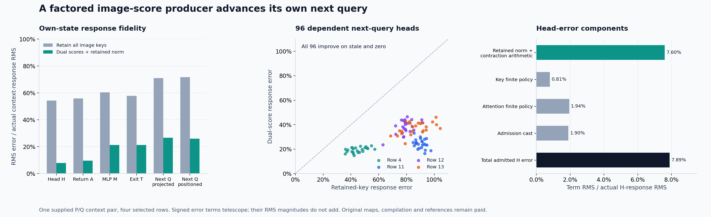

# Factor image scores onto the query side, then advance the state

A query-specific image-score producer lowers next-query context-response error from **71.67% to 25.99%**, with **.9669 response cosine**. All **96 dependent query heads** improve over the prior stale-key forecast and predicting no change. Attention-head response error falls from **54.29% to 7.89%**. The producer's admitted head feeds its own original MLP, and that MLP's actual exit feeds its own next query.

This is a conditional learned computation. It still needs authenticated native source states, a fixed selected query, paid native text keys/full values, original receiving maps and an expensive coefficient compiler. It does not produce an image or solve arbitrary-prompt zero-neural generation.

The comparison also changes text keys: the preceding stale forecast held P keys for both text and image; this candidate supplies native Q text keys while approximating image logits. The observed improvement belongs to that complete candidate. It is not a causal estimate of the image numerator's contribution alone.

[Report](results/image-dual/report.json), [all observations](results/image-dual/observations.jsonl.gz), [source and custody checks](results/image-dual-evidence/README.md), [original plan](results/image-dual/image-dual-score-producer.md), and [pre-stage execution addendum](results/image-dual/image-dual-execution-addendum.md) retain the evidence and its limits.

The figure's stale forecast retains P text and image keys. The new candidate uses paid Q text keys. Error magnitudes in its last panel do not add; the signed vectors do.

## Move a demanded scalar computation instead of producing a whole key

The [preceding test](stale-key-context-response.md) showed that replacing values while retaining old keys preserves a useful response direction but leaves a substantial gap. The new candidate updates the image-score numerator without forming the full current image-key vector inside the actor.

For image row j and head h, let x_j be its actual native BF16 ModLN input widened to FP64. In the smooth calculation,

\[
z_{jh}=W_hx_j,\qquad s_{jh}=\sqrt{\|z_{jh}\|^2/128+10^{-6}},\qquad
\ell_{ijh}=q_{ih}^{T}R_j[\gamma\odot z_{jh}]/(\sqrt{128}\,s_{jh}).
\]

The selected q is already positioned. Transposing the original learned map moves the numerator onto its side:

\[
q_{ih}^{T}R_j[\gamma\odot W_hx_j]
=x_j^TW_h^T[\gamma\odot R_j^Tq_{ih}].
\]

Gamma acts after the transpose of the stored positional transform. That transpose is not assumed to be its inverse. For one actual stored pair,

\[
R=\begin{pmatrix}c_e&-s_e\\s_o&c_o\end{pmatrix},\qquad
R^Tq=(c_eq_e+s_oq_o,\ c_oq_o-s_eq_e).
\]

The actual native axis order is **(T,H,W,L)**. Image T/L are constant, while H/W each have 32 distinct positions. An independent byte inventory confirms image group counts [1,32,32,1], text counts [1,1,1,512] and every image row's group membership. We compile one constant plus 32 H plus 32 W coefficient vectors per selected query/head:

\[
n_{ijh}=x_j^T[u_{ih,0}+u_{ih,H}(h_j)+u_{ih,W}(w_j)].
\]

This gives an exact real-arithmetic factorization of the smooth numerator. Against a direct FP64 projection/score reference, observed relative RMS discrepancy is **8.18×10⁻¹⁶**, with maximum absolute discrepancy **1.19×10⁻¹²**. It does not establish native BF16 projection/RMS/RoPE parity.

Astra caught the plan's initial axis-order assumption before staging. The implementation and independent matrix fixture were corrected from the stored-byte inventory; the committed original plan remains intact, with its correction in the execution addendum. No scientific run used the incorrect order.

## The retained denominator is a real state dependency

The candidate retains a smooth P normalization denominator:

\[
\widehat\ell_{ijh}=n^Q_{ijh}/(\sqrt{128}\,s^P_{jh}).
\]

Normalized/rotated old keys do not reveal their original magnitudes. The compiler therefore pays for a complete smooth P projection to obtain s_P. The actor receives those denominators, its query-specific coefficients and the actual Q input. It cannot read either full key array and does not hydrate the original image-key matrix. Text-only Q keys are prepared by authenticated raw-byte prefix copying, without numerically decoding image keys; selected text K/V are restored to P exactly.

The actor performs one CPU FP64 joint softmax/value contraction. Its head crosses the declared FP64→FP32→BF16 boundary and then enters the unchanged finite output map, sequential MLP and next-query calculation. There is no state refresh from a native target.

For every field, the response target is D=F_QQ−F_PP. The candidate forecast is F_candidate−F_PP. These old diagonals remain paid, immutable evaluation references.

| Field | Stale response error | New response error | New response cosine |
|---|---:|---:|---:|
| Attention head H |54.29%|7.89%|.9969|
| Attention return A |55.88%|9.58%|.9955|
| MLP return M |60.31%|21.21%|.9780|
| Own exit T |57.84%|21.31%|.9781|
| Next projected query |70.97%|26.71%|.9645|
| Next positioned query |71.67%|25.99%|.9669|

The final query endpoint error is **.5329%**, whereas its actual-response error is **25.99%**. The same absolute RMS error, .00663156, is normalized by the full endpoint RMS 1.24438 or the actual contextual response RMS .0255126. Those denominators answer different questions.

All 96 final heads beat stale and zero. Median response error is **29.38%**, with **14.71–46.51%** range. Whole-row errors are **19.24%, 23.27%, 37.17%, 36.71%** for rows 4,11,12,13. The last two rows remain weaker. These are dependent addresses from one supplied source pair, not independent generalization examples.

## Separate the approximation from numerical execution

Only after the actor seals and exits does the reference process project the actor's retained actual Q input. It verifies the numerator and computes smooth and native-key FP64 attention heads using identical selected-row restoration, text logits and values. No additional MLP or next-query arm runs.

Let H_c be the candidate's raw FP64 head, B its admission cast, H_s the correct-Q smooth head, H_k the FP64 attention head from native keys, and H_n the archived native SDPA head. Then

\[
B(H_c)-H_n=[B(H_c)-H_c]+[H_c-H_s]+[H_s-H_k]+[H_k-H_n].
\]

| Signed vector term | RMS / actual H-response RMS |
|---|---:|
| Admission cast |1.897%|
| Retained denominator + measured contraction arithmetic |7.601%|
| Combined key projection/RMS/RoPE finite policy |.805%|
| Attention numerical policy |1.943%|
| Total admitted head error |7.891%|

The signed telescope closes to **1.39×10⁻¹⁷** maximum residual. All four full arrays, per-head terms and the signed cross-energy matrix remain available. Their RMS magnitudes are not additive causal percentages. The second term is largest here; the original rounding boundaries and attention policy are also visible. The retained P denominator differs from the correct smooth Q denominator by .4904% relative RMS. This small endpoint change can matter on a smaller contextual response scale.

## Charge compilation, serving arithmetic and diagnosis separately

| New work | Matrix MACs |
|---|---:|
| P denominator and query-side coefficient compilation |10,286,530,560|
| Actor, including original receiving MLP/next query |1,346,371,584|
| Post-seal Q projection, two QK and two AV references |9,726,590,976|
| **Complete assay** |**21,359,493,120**|

The dual coefficient payload is **153,354,240 bytes**, or **153,354,368 bytes** including its NPY header. It is larger than a complete BF16 image-key field. Seven distinct original BF16 tensors occupy **226,492,928 bytes**; three processes hydrate **245,367,552 parameter bytes**. Shapes count matrix work; nonmatrix normalization, exponentials, casts, memory traffic, source production and process overhead remain separate costs.

Job job-5051d169e298 succeeds in **92.20 scheduler seconds**, with **1,712.7 MB peak RSS** and **568 MB peak device usage**. Compiler/actor/reference processes take 44.33/22.68/18.85 seconds including imports. This is a single instrumented assay, not a matched runtime speedup or amortization result. Changing the selected query may require a new coefficient table. No first-prompt or end-to-end saving is established.

All **290 mechanics tests pass in 19.78 seconds** after the axis correction. Nineteen executed source pins, seven typed Acts, 28 explicit output ABIs and both own-head/state/query joins verify. Full-byte custody covers **150 files / 8,054,216,676 bytes**, with **103 independent NPY payload witnesses**, one text-prefix byte witness and two selected/complement splice witnesses. Standard MDB evidence run/verify returns zero over **444 observations / 20 numeric predicates**, with no accepted formal claims or bound xref addresses.

All **46 new arrays / 238,519,040 bytes** remain near compute. Compact primary publication is **22 files / 715,064 bytes** before figures/additional receipts. Last actual cleanup is [cycle57](results/storage-cleanup-cycle57/README.md), which archived four transports /626,249,557 bytes with verified restore pointers. Next storage review remains cycle60 or earlier pressure; this run does not hydrate its 153 MB table onto the Mac or Git.

## The next missing operand and the broader goal

[Astra's review](results/image-dual-evidence/advisor.json) chooses one [source-defined diagonal quadratic norm producer](plans/source-defined-diagonal-key-norm.md), written and unexecuted. Instead of supplying s_P, it compiles a positive law from original W alone and evaluates it on actual own-state x. Its omitted channel cross terms are explicit; no gain, rank or fit is selected from Q targets. It tests removal of one baseline operand, while the query-specific table and all remaining learned work stay visible.

The newer [Qwen read-weight transport](../../obsidian/blog/2026-11-07-013741-predicting-a-changed-read-before-the-reader-runs.md) similarly separates an inexpensive scalar program from its expensive native baseline and dense directional compilation. Its normalized and linear alternatives split comparisons 12/12. The [math-capability union work](../../obsidian/blog/2026-11-07-014134-discovering-math-capability-and-building-smaller-unions.md) finds smaller scorers and useful supplied proposal rules, while preserving harmful unions and favorable random controls. Neither supplies an autonomous raw-prompt state producer.

The time-circuit architecture makes each dependency addressable: source state, query, normalized score, value return, MLP write, next state and next query. Factoring one dependency makes a concrete computation easier to execute and inspect. Arbitrary prompt conditioning, changing query families, full own-state diffusion and a general pixel decoder remain unresolved. The strict zero-neural objective stays active.
