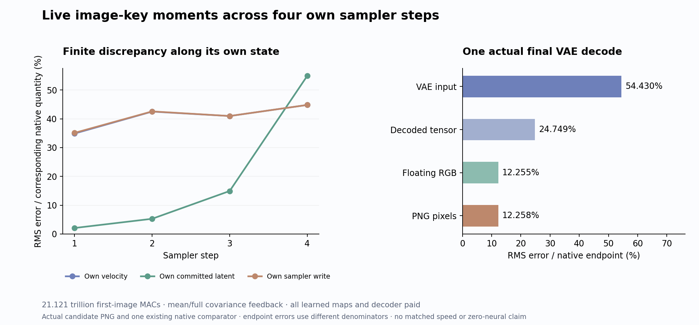

# Current key moments preserve the scene, with a small compute reduction

The candidate still produces a closed red cube on the left and one separate blue sphere on the right. It keeps the sphere’s unwanted base and differs in shape, proportions and shading. Replacing the full text-to-image attention score grid with current key means and covariances raises PNG error from **11.34% to 12.26%** on this one supplied prompt and seed. It saves **96.486 billion nominal matrix MACs**, or **0.455%** of the previous candidate’s total.

This is a constructive current-state approximation: it produces its own feedback, advances its own states through all four sampler steps, and decodes its own final latent. All original learned maps, supplied conditioning and decoding remain paid. It is not arbitrary-prompt zero-neural generation. The useful result is a smaller producer for one feedback interface; its modest whole-path saving is also a reason to move the next primary experiment toward the MLPs.

## Replace a grid with a function of current keys

The [previous partition-feedback candidate](partition-feedback.md) kept the text share of the attention denominator while excluding image values from text writes. At common incoming operands, define

\[
Z_T(q)=\sum_{j\in T}e^{q^Tk_j/\sqrt d},\quad
Z_I(q)=\sum_{j\in I}e^{q^Tk_j/\sqrt d},\quad
\alpha=\frac{Z_T}{Z_T+Z_I}.
\]

Its text read was \(\alpha O_{TT}\), where \(O_{TT}\) is normalized text-only attention. The output gate is small, but computing its exact denominator still required every text query to score every image key.

The new program summarizes each head’s **current, head-normalized and absolutely rotated image keys**:

\[
\mu=\frac1{N_I}\sum_j k_j,\qquad
\Sigma=\frac1{N_I}\sum_j(k_j-\mu)(k_j-\mu)^T.
\]

It retains the full 128 by 128 population covariance, including off-diagonal entries. For each current text query it computes

\[
\widehat{\log Z_I}(q)=\log N_I+
\frac{q^T\mu}{\sqrt d}+\frac{q^T\Sigma q}{2d},
\qquad
\hat\alpha=\sigma\!\left(\log Z_T-\widehat{\log Z_I}\right),
\]
\[
\hat O_T=\hat\alpha O_{TT}.
\]

All five matrix products are explicit: centered-key covariance, query times covariance, query times mean, TT scores and TT AV. They run in FP32 with autocast and TF32 disabled. TT scaling follows QK; stable logsumexp and conditional softmax use the same logits. Each head’s FP32 conditional read is multiplied by its own alpha before returning to BF16. There is no diagonal approximation, clipping, covariance repair, fitted coefficient or supplied native gate.

The production path never forms the text-query by image-key score grid, including for incidental diagnostics. An independent tiny reference does form that grid to check the declared score-mean/variance law; it is separate from the real candidate. Passing that test certifies implementation of the approximation, not its accuracy against native attention.

## The assumption and its mathematical limit

Let a uniformly sampled finite-bank score be \(S=q^TK/\sqrt d\). Then

\[
\log Z_I=\log N_I+\log\mathbb E[e^S]
=\log N_I+\mathbb E[S]+\tfrac12\operatorname{Var}(S)+R(q).
\]

Here \(R\) is defined as the exact residual. The candidate sets it to zero. A Gaussian score distribution has this quadratic log-moment-generating function, but a finite sample of Gaussian keys does not make its empirical partition exactly Gaussian. No convergence of an infinite cumulant expansion at the demanded query is assumed. Higher-order structure and rare large scores remain unrestricted.

Means and covariances cannot determine every finite-bank partition. For example, the one-dimensional banks

\[
A=(-1,-1,1,1),\qquad B=(-\sqrt2,0,0,\sqrt2)
\]

both have four keys, mean zero and population variance one. At query 1 their exact log-partitions are 1.820075 and 1.849457, while the common moment estimate is 1.886294. At query 4, the exact values are 4.693483 and 5.663829; the estimate is 9.386294. These are illustrative scalar calculations, not measurements of model keys.

There is a stronger asymptotic reason. Along a fixed direction \(q=tu\), a finite bank satisfies

\[
\log Z_I(tu)\leq\log N_I+t\max_j\frac{u^Tk_j}{\sqrt d}
\quad(t\geq0).
\]

The approximation grows quadratically whenever the directional variance is positive. It therefore eventually overestimates the finite bank’s at-most-linear growth. The Gaussian law can be a useful operating-range approximation; it is not a universally sufficient representation of a finite softmax bank.

At **common incoming operands**, sigmoid’s derivative gives the diagnostic bound

\[
|\hat\alpha-\alpha|\leq\tfrac14|R(q)|,
\qquad
\|\hat\alpha O_{TT}-\alpha O_{TT}\|
\leq\tfrac14|R(q)|\,\|O_{TT}\|.
\]

This is not a trajectory error bound. Subsequent attention, MLPs and sampler commits change both streams’ operands. We did not compute exact current-bank partitions in this production run, so its saved moments and image errors do not measure \(R\) or attribute the endpoint discrepancy solely to omitted cumulants. Splitting TT from the former full-key GEMM and multiplying alpha separately also changes finite arithmetic.

## What actually ran

Both text and image states evolve through their own outputs. Joint blocks preserve sequential attention then MLP; single blocks preserve parallel attention and SwiGLU from the incoming normalized concatenation. Image attention retains full current text/image K/V. Text restarts from original C(E) at each sampler clock. The final unused text write is physically omitted while its K/V remain available.

| Sampler step | Velocity error | Committed latent error | Own sampler-write error |
|---|---:|---:|---:|
| 1 | 34.89% | 2.09% | 35.12% |
| 2 | 42.51% | 5.28% | 42.58% |
| 3 | 40.96% | 14.93% | 40.98% |
| 4 | 44.82% | 54.92% | 44.82% |

All four C(E) fields match native bytes. One actual original VAE consumes the final own latent. PNG RMS is **29.284 channel levels**, MAE **9.722**, with 729,655 of 786,432 values changed and maximum difference 255/255. Velocity and latent errors at every reported step are slightly worse than the previous exact-partition candidate. Object order and separation survive this combined approximation and finite-arithmetic change on this specimen.

The VAE-input, decoded-tensor, floating-RGB and PNG percentages use different endpoint denominators. They do not establish decoder contraction. The retained alpha clock means are 0.71016, 0.66541, 0.66013 and 0.65925; mean quadratic terms are 4.2901, 4.3200, 4.0264 and 3.7195. These describe this candidate’s own evolving states, not a native gate comparison. All 2,304 head summaries for each panel and the underlying compact tensors remain retained.

## Work, time and the more consequential frontier

With N_I=1024, N_T=512, H=24 and d=128, the image-partition producer costs

\[
N_IHd^2+N_THd^2+N_THd=605{,}552{,}640
\]

matrix MACs per live read, replacing 1,610,612,736 image-score MACs. Across 96 reads the saving is **96,485,769,216 MACs**. Means, centering, quadratic row products/reductions, divisions, logarithms and sigmoid are additional paid work outside this matrix account. Full FP32 mean/covariance storage is 1,585,152 bytes per block across all 24 heads, excluding keys, TT scores and diagnostics.

Actual instrumentation records 440 denoiser affines, 100 native image SDPA calls and 480 explicit FP32 products. Including the decoder, the nominal account is

\[
18{,}688{,}085{,}327{,}872_{\rm affine}
+983{,}547{,}510{,}784_{\rm native\ SDPA}
+212{,}751{,}876{,}096_{\rm explicit}
+1{,}236{,}317{,}241{,}344_{\rm convolution}
=21{,}120{,}701{,}956{,}096.
\]

This is 483.033 billion MACs below the original native architecture, including earlier terminal/text-value omissions. The marginal gain over cycle69 is 0.455%, not a whole-model speed claim. The job takes **99.40 seconds**, with sampled RSS **8,308.8 MB** and device memory **9,476 MB**. Worker time after imports is 72.845 seconds, including 33.110 seconds of setup; post-seal analysis takes 1.414 seconds. CUDA allocator peaks are 8,667,812,864 allocated and 9,602,859,008 reserved bytes. These differ from device telemetry. The prior job took 93.23 seconds; this is neither a controlled speed comparison nor evidence of a runtime improvement.

Learned affines still account for **88.48%** of this matrix/convolution total. Allocating fused projections by their physical G/U and attention row/column widths attributes **12.872 trillion MACs (60.95%)** to MLP expansion and contraction. That arithmetic allocation is not a measured runtime split. It explains why another small partition refinement is a weaker next primary than physically reducing demanded MLP channels.

Astra reviewed the exact source, resource exception, actual image and report. The [next gate-first MLP plan](plans/gate-first-terminal-mlp.md) pays the current gate before deciding which up rows and down columns to evaluate. It does not receive supplied gate/up activations; it does receive an authenticated, paid terminal hidden state. Its FP32 ranking scores and omitted-sum estimate are diagnostics rather than certified numerical bounds. Its quality and cost still need to be measured, and it remains reduced learned computation.

## Reproducible evidence

One guarded strict-preflight CUDA lease, `job-34fbcd783e7c`, executes request `7f545c1670a42e228043d8046fd7c0271e1da9efae1137f880867f44926c1967`. Declared, sealed and executed payloads match. There is no retry, new reference campaign, encoder call, noise draw, fit or sweep. Candidate sealing and process exit precede analysis against the existing native case A and cycle69 report.

All **327 mechanics tests** pass. The [evidence receipt](results/image-partition-moments-evidence/README.md) binds nine typed Acts, 909 explicit output ABIs, 100 coupled block joins, 96 moment reads, 480 products and four terminal concatenation byte witnesses. Complete verification covers 980 files / 9,505,953,728 bytes, including 944 NPY payloads, 169 original parameter witnesses and two physical terminal slices with eight materialization records. The offline Saturn sweep and verify exit zero over five streams / 16,553 records; no formal claims or addresses are created, and no fire ledgers are written.

The 912 candidate fields and 12 differences total **1,547,521,536 bytes** and stay near compute. The primary compact publication has 26 files / 4,538,511 bytes. Actual storage cleanup last ran at cycle69, archiving 1.151 GB of redundant transports with restore pointers; the next review remains due by cycle72 or earlier pressure. No scientific result or rejected branch was deleted here.

Source: [moment helper](../generator/image_partition_moments.py), [worker](../generator/image_moments_worker.py), [typed ledger](../generator/image_moments_ledger.py), [post-seal analysis](../generator/image_moments_analysis.py), [launcher](../generator/image_moments_study.py), [publisher/audit](../generator/publish_image_moments.py), [tests](../generator/test_image_partition_moments.py), [frozen prospective plan](results/image-partition-moments/frozen-plan.md), [report](results/image-partition-moments/report.json), [work/state execution](results/image-partition-moments/execution.json), [provenance](results/image-partition-moments/provenance.json). Related: [partition-only feedback](partition-feedback.md), [depth-evolving text program](prompt-program.md), [terminal output liveness](terminal-output-liveness.md), [compiled MLP write](compiled-mlp-write.md), [recipient-conditioned MLP prediction](recipient-conditioned-product.md), [research record](zero-neural-research.md).
