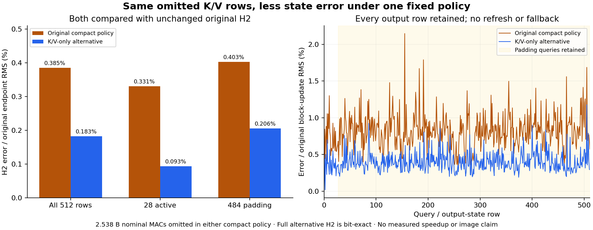

# A fixed K/V policy reduces the cost of changing projection geometry

Disabling reduced-precision BF16 reductions only for K/V formation cuts the retained compact state's H2 error from **0.3852% to 0.1825% of endpoint RMS**. Relative to the block update, error falls from **0.6300% to 0.2985%**. Both compact policies omit the same **2,537,553,920 nominal MACs**. Full-size formation under the alternative policy reproduces the original complete H2 bit for bit. Compact formation remains approximate.

This is the single fixed contrast from the [frozen plan](plans/kv-accumulation-profile.md), following the [first-prompt masked-KV result](masked-kv-own-state.md). It reuses that run's actually emitted H1. It is retrospective numerical evidence on one already-scored context, not a fresh-prompt generalization test or an image-generation result.

## Hold state and consumer fixed

The source is the short 28-attended-position prompt from `job-5f515567890f`. The run authenticates its H1, lexical mask/IDs, original block-1 weights, source code and checkpoint shard. Both alternatives consume that same H1. Full formation projects all 512 K/V rows, while compact formation projects 28 and scatters finite zeros into the excluded addresses. Every query, residual, normalization and MLP row remains.

The only changed numerical flag is `torch.backends.cuda.matmul.allow_bf16_reduced_precision_reduction=False` during each K/V linear. Q and the complete subsequent consumer use the original flags. Actual primitive receipts assert the intervention and restoration on every call. Both complete H2 fields seal before the original raw projections, saved target reads or CPU FP64 diagnostics. No reference state refresh enters either candidate.

The original [worker](../generator/kv_accumulation_study.py) evaluates two full block consumers, two additional full-size raw reference projections, and two CPU FP64 active-row products: **16 linears, two SDPA operations and two FP64 matrix products**. It constructs no native model or decoder layer. Substantial original learned computation remains.

## The real expression and its finite realization differ

For normalized BF16 input X and original BF16 weight W, write a projection as

$$
P_m^\rho(X)=Q_{\mathrm{BF16}}\!\left(A_m^\rho(XW^\top)\right).
$$

Here m is the number of projected rows, rho is the accumulation policy, A denotes the actual reduction, and Q is the final quantization. Gathering active rows commutes with a real matrix product. It need not commute with the implemented finite reduction. The new flag does not prescribe a unique reduction order.

The active normalized input is bit-identical between geometries. Under the alternative, raw compact/full K differs at **25 of 28,672 words**, and V at **34 of 28,672**. The respective RMS differences are 0.00000892810 and 0.00000674285. These are small but nonzero operands for the same original nonlinear consumer.

The actual block still computes attention, its output write, the residual, RMS normalization and the gated MLP before the final finite addition. These operations spread the remaining discrepancies across coordinates: the complete returned states differ at **360,919 of 1,310,720 BF16 words**. Word-count spread is not an image-quality measure or a universal amplification constant.

## Keep the unchanged original target

| Compact policy vs original full H2 | All endpoint error | Active endpoint error | Padding endpoint error | All block-update error |
|---|---:|---:|---:|---:|
| Original |0.3852%|0.3309%|0.4031%|0.6300%|
| K/V-only alternative |0.1825%|0.0932%|0.2055%|0.2985%|

Absolute complete-state error RMS falls from 0.0008318341 to 0.0003941095, a **52.62% reduction**. Per-row endpoint RMS improves on 500/512 rows: all 28 active rows and 472/484 padding rows. Twelve padding rows worsen; their positions are preserved in the [derived account](results/kv-accumulation-evidence/accounting.json). No numerical acceptance gate, fallback or discarded row hides those reversals.

Independently verified NPY hashes show full-alternative Q/head/R/M/H2 equal the original full fields. Raw full K/V also equal the original-policy raw reference. Masked K/V addresses are intentionally zero in the alternative full consumer; they are not claimed equal to the original unused addresses. The post-seal original positioned K and V reproduce the inherited full reference exactly.

The separate FP64 diagnostic uses the same normalized BF16 inputs and original weights on CPU. The report retains both unrounded errors and an explicitly labelled FP64→FP32→BF16 comparison. For V, original compact has 9,785 word mismatches against that rounded diagnostic, versus 18 for alternative compact and 38 for full formation. Yet unrounded V RMS errors are 0.0001230982, 0.0000886732 and 0.0000886737: quantization dominates much of the remaining distance. The rounded word counts neither establish original parity nor certify an exact real product.

## Cost and evidence

The actual full/compact block linear counts are 51,673,825,280 versus 49,136,271,360 nominal MACs, preserving the 4.9107% reduction. SDPA, normalization, gathering/scattering, byte capture, the preceding computation and all later model work are outside this linear count. There is no matched speed comparison.

Guarded CUDA job **`job-332caa7e03a6`** succeeded once in **38.0 scheduler seconds**, with 1,967.0 MB sampled RSS and 582 MB VRAM. The timed worker body after framework imports took 15.269 seconds. The two captured alternative phases took 2.967 and 0.077 seconds in that order; startup and port writes make those unequal samples unsuitable for a speedup claim. CPU math used one thread inside default 4 CPU / 4 GB RAM / 4 GB VRAM admission. The [receipt](results/kv-accumulation/provenance.json) binds declared/sealed/executed payload `dd1447c6642215e470bc3dce82782e2166e211be7430b5246641b44b124a4a4c` and request `c23b278beb301e6891ee7a6ec8d59a348d2feab27a1832453e9319b1211dc241`.

The [prediction seal](results/kv-accumulation/prediction-seal.json) is `6ecf0a365af0f115c0ed3019b3f1b513e65512578ed5c3cbddb283ba25033fbb`. Full-byte [verification](results/kv-accumulation/retained-array-verification.json) checks 52 members / 103,642,823 bytes, including inherited H1, lexical packets and complete retained fields. New arrays occupy 49,069,696 bytes near compute. The public result is ten compact files / 236,002 bytes, including all 2,048 dependent per-row accounts in lossless gzip. No tensor or parameter payload is hydrated locally. All 107 mechanics tests pass. Saturn run/verify pass as stream-only checks; they certify no scientific terminal claim.

## Next: measure the demanded conditioning

Astra reviewed the source, result and newest error-consumer work. Its [advice](results/kv-accumulation-evidence/advisor.json) is to stop precision exploration and consume the three actual H2 states through the [complete conditioning demand](plans/conditioning-demand-consequence.md): remaining blocks to H9/H18/H27, then the actual first FLUX context projection. Every branch must retain its own state throughout. This will test whether the local improvement survives at a meaningful consumer interface. It will not remove those learned operations, and conditioning similarity cannot certify an image effect. Arbitrary-prompt zero-neural images remain open.
