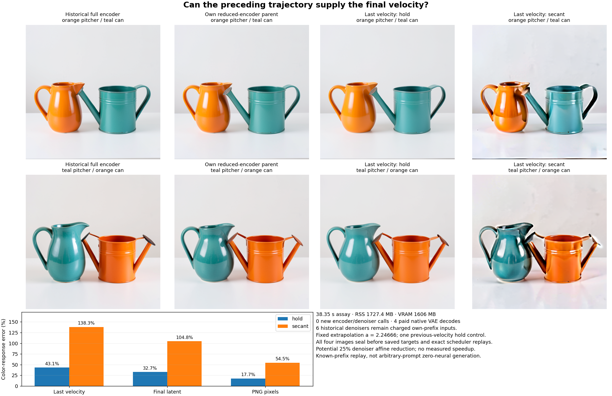

# Reusing the preceding velocity preserves more than extrapolating it

Replacing the final denoiser velocity with the preceding velocity preserves the coarse image and most of its color response on the tested pair. Signed PNG response error against the same own parent is 17.66%, versus 54.52% for the fixed secant. This is useful evidence for removing one learned evaluation. The experiment replays a previously computed three-pass prefix and pays native VAE decoding; arbitrary-prompt zero-neural generation remains unsolved.

The [frozen plan](plans/last-velocity-forecast.md) follows the [retained-query encoder](retained-padding-queries.md), which removed 89.65% of nominal encoder affine work. This experiment addresses one complete velocity computation in the dominant remaining denoiser.

## The fixed law and actual inputs

Index calls 0 through 3. Both policies receive authenticated own Z3,v1,v2, seed 271828. They receive neither the actual fourth velocity nor final latent or image. The sigma sequence is

\[
(1,\ 0.9580853581428528,\ 0.8839818835258484,\ 0.7174965739250183,\ 0).
\]

The secant predicts

\[
\widehat v_3=v_2+a(v_2-v_1),\qquad
a=\frac{\sigma_3-\sigma_2}{\sigma_2-\sigma_1}=2.2466599638045444.
\]

The control holds \(\widehat v_3=v_2\). Secant subtraction, multiplication and addition each round to FP32, followed by BF16 emission. Hold preserves the original BF16 words. No fitting, clipping, sweep or post-score blend runs. The final Euler interval is −0.7174965739250183: substantial extrapolation.

A fresh framework-free child seals four forecasts. Another child constructs only the original VAE and finite scheduler, denying transformer/encoder assets and all target values. All four images seal before scoring. Actual Z3 and emitted velocity hashes join every scheduler call. Two subsequent scheduler-only replays with the parent's actual v3 reproduce its Z4 byte for byte.

## Hold freezes an already formed clean estimate

In ideal Euler arithmetic, let

\[
c_i=Z_i-\sigma_i v_i,\qquad
Z_{i+1}=Z_i+(\sigma_{i+1}-\sigma_i)v_i.
\]

Expanding and factoring gives

\[
c_{i+1}-c_i=-\sigma_{i+1}(v_{i+1}-v_i).
\]

Thus final hold decodes the clean-latent estimate already formed at clock 2:

\[
Z_3-\sigma_3v_2=Z_2-\sigma_2v_2=c_2.
\]

The secant instead predicts another clean-estimate innovation:

\[
Z_4^{\rm secant}
=c_2+\frac{\sigma_3a}{\sigma_2}(c_2-c_1).
\]

These identities explain the policies without assuming velocity is globally constant. Native finite commits add explicit remainders; serving preserves their scalar/product/add/cast boundaries rather than algebraically cancelling them.

Writing d=v2−v1 and r=v3−v2 also exposes the required prediction:

\[
\|ad-r\|^2-\|r\|^2=a^2\|d\|^2-2a\langle d,r\rangle.
\]

The previous change needs the right magnitude and alignment for the next change. The fixed coefficient amplifies disagreement. Without a separate signed vector diagnosis, this result does not distinguish excessive magnitude from changed direction or identify the internal cause.

## What survives through the image consumer

| Signed color-response error against the own parent | Hold | Secant |
| --- | ---: | ---: |
| Final velocity | 43.14% | 138.28% |
| Final latent | 32.71% | 104.82% |
| PNG pixels | 17.66% | 54.52% |
| PNG response cosine | 0.9843 | 0.8725 |

Hold's PNG endpoint errors are 3.048%/4.145%, pixel RMS 6.52/8.74 out of 255. Secant gives 10.818%/11.875%, RMS 23.14/25.03. Hold retains the parent's smooth surfaces and broad vessel shapes, with modest rim/highlight changes. Secant adds strong metallic highlights, dark rims/streaks and changed spout contacts. All four retain coarse colors and ordering. Native and parent nozzle/pitcher overlaps remain; these observations do not certify every role or material.

Against historical full encoding, PNG response error is 49.62% hold and 71.13% secant, versus the own parent's 48.93%. Keep the signed interaction:

\[
\widehat I-I_{\rm full}
=(\widehat I-I_{\rm own})+(I_{\rm own}-I_{\rm full}).
\]

On case10, hold adds 60,016,445 units of replacement-error energy, with cross term −60,365,010 against inherited error. Total full-reference error becomes 460,070,356 versus inherited 460,418,921. This small endpoint improvement reflects cancellation, not recovery of native encoding.

On the paired color response, hold adds about 86.799 million error energy while its cross term cancels 67.452 million. The total rises from 686.977 million to 706.324 million. This [post-seal scalar account](results/last-velocity-evidence/paired-pixel-energy.json) explains why the full-reference response changes only slightly despite nontrivial new error; it retains FP64 scalar-rounding limits.

## Finite commit and paid work

Post-seal arrays retain \(D=\widehat Z_4-Z_4\), \(S=(\sigma_4-\sigma_3)(\widehat v_3-v_3)\), and \(R=D-S\). Their recorded telescope closes exactly. Hold's smooth energies are 5,816.44/6,502.08; finite remainders 1.116/1.128, cross terms 21.18/22.87. Secant's smooth energies are 47,439.04/55,735.16; finite remainders 1.748/1.813, cross terms 170.82/197.23. Finite effects are nonzero and far smaller than the velocity discrepancy on these operands.

Job job-de0d876cd53c succeeds in 38.35 scheduler seconds, with 1,727.4 MB sampled process-tree RSS and 1,606 MB VRAM. Automatic sizing selects 4,096 MB RAM/VRAM and CPU4. A local launch-argument rejection created no job; the [submission adapter](../generator/last_velocity_submit.py) omits declared-resource arguments and executes the same immutable scientific payload.

Fresh forecast/decode processes take 0.214 s/30.416 s including imports. First secant arithmetic is 55.82 ms; other calls are 0.207–0.233 ms. First VAE decode is 3.736 s; subsequent decodes are 0.052–0.054 s. First-use effects prevent a policy-speed comparison. No matched generator speedup is established.

New work is four candidate commits, four VAE decodes and two post-seal scheduler replays. There are zero new encoder/denoiser/reference-image evaluations or noise draws. VAE hooks record 160 convolution/linear calls and 4,962,448,834,560 nominal MACs, excluding attention, normalization and other operations. VAE parameters occupy 168,092,230 bytes.

The supplied prefix still costs six original denoisers, 618 linears and 28,343,562,928,128 nominal affine MACs across the pair, plus original encoding. Fresh hold serving could avoid two of eight denoisers, 206 linears and 9,447,854,309,376 nominal affine MACs: 25% of denoiser affine work. That prospective count is not demonstrated fresh execution or runtime savings.

All 198 mechanics tests pass. Independent byte verification covers 98 members/232,034,266 bytes, including VAE assets and used inherited comparisons. Forty new arrays/39,851,008 bytes remain near compute. The 22 primary public files occupy 2,754,711 bytes and retain 10,240 dependent token/scanline observations losslessly. The [audit](results/last-velocity-evidence/mechanics.json), [report](results/last-velocity/report.json), [seal](results/last-velocity/candidate-seal.json) and [custody](results/last-velocity/provenance.json) preserve the scope. Saturn run/verify remain observation-stream mechanics, not semantic certification.

## Next: can a later reader recover an omitted earlier read?

[Astra's review](results/last-velocity-evidence/advisor.json) selects a [two-clock factorial](plans/two-clock-velocity-factorial.md). Starting at the actual own Z2 with v1, skip clock2 by holding v1. Then either hold v1 again or run the native final denoiser on the newly emitted state. Existing native/native and native/hold corners supply comparisons. Native/hold and hold/native each spend three calls; hold/hold spends two. This tests downstream recomputation at matched work rather than fitting another coefficient.

The plan is written and unexecuted. Original weights, the earlier prefix, encoding and VAE remain paid. The full [research goal](zero-neural-research.md) remains arbitrary raw prompt through pixels without neural evaluations.
