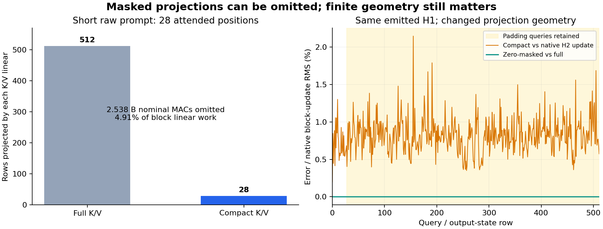

# Skip masked K/V formation from an actually emitted state

The first-prompt assay removes 484 of 512 K/V projection rows in block 1 while retaining every query and output-state row. That avoids **2,537,553,920 nominal MACs**, or **4.9107% of that block's linear work**, for the short prompt. Its emitted H2 differs from native by **0.3852% of endpoint RMS / 0.6300% of block-update RMS**. The all-attended control is exact and saves no work. Captured timings do not establish a speedup.

The controls distinguish a valid dependency reduction from a finite arithmetic change. H1 is bit-exact. Replacing only masked K/V addresses with zeros leaves every consumed head/R/M/H2 value bit-exact. Forming K/V with a shorter GEMM changes active values, and that difference accounts for the complete observed H2 error. No miss or query row is discarded.



This advances an input-defined compiler reduction for a first prompt. Original attention, norms, output and MLP projections remain. There is no full encoder, FLUX/VAE execution or zero-neural image result.

## Start from a raw string and preserve the state handoff

The frozen short prompt is “An indigo teapot balancing on a brass compass beside a folded paper map.” It produces 28 attended positions including template tokens. A second repeated description truncates to 512 attended positions and supplies a zero-savings control. Exact strings and source bindings are in the [request](results/masked-kv-own-state/request.json) and [worker source](../generator/masked_kv_study.py).

A separate guarded process uses the existing complete-vocabulary lexical store to emit E, positioned Q/K and V. It evaluates no original projection, contextual attention or neural framework. The table's original compilation and 2.645 GB of learned-output data remain paid resources. The CUDA candidate then computes block-0 attention and the original output/norm/MLP tail, producing its own complete H1.

Block 1 consumes that actual emitted H1. The candidate, full-formation control and zero-masked control all receive the same H1. The native two-block chain starts from compiled E and consumes its own native H1. No candidate is refreshed from a target state. There is no independently executed native tokenizer or embedding in this assay; both chains start from the source-bound compiled E.

All candidate H1/H2 fields seal before either diagnostic control or the native chains. The [seal](results/masked-kv-own-state/prediction-seal.json) is `0be98817c9adcf303f1a5589e9b2aebd5c69951d6f4fe0681322890354c44b93`.

## Why the masked keys can be omitted

Let S be attended key positions. For the bound causal/key-padding mask,

$$
p_{ij}=\frac{\mathbf1_{j\le i}\,m_j\exp(Q_i\cdot K_j/\sqrt d)}{\sum_k\mathbf1_{k\le i}\,m_k\exp(Q_i\cdot K_k/\sqrt d)}.
$$

Masked key addresses have zero probability. Their K/V values cannot contribute to the read. The implementation forms K/V only from H1[S], normalizes/positions those keys, and scatters them into the original full B,H,T,D layouts with finite zeros at excluded addresses. It checks that the actual Boolean SDPA mask excludes every omitted key. The all-attended path retains mask=None/is_causal/enable_gqa; the padded path retains the original Boolean causal/key mask and repeated-KV dispatch.

Every query is still required. A padded query can read attended keys and produce a contextual state used by FLUX. Input normalization and Q formation, output projection, residual and MLP therefore retain all 512 rows. Actual [primitive receipts](results/masked-kv-own-state/primitive-receipts.json) show 28 rows for each short-prompt K/V projection and 512 for every other block-1 projection. The all-attended case uses 512 throughout.

## What the finite controls measured

| Short-prompt H2 comparison | Endpoint error RMS | Error / endpoint RMS | Error / block-update RMS | Changed BF16 words |
|---|---:|---:|---:|---:|
| Compact minus full |0.0008318341|0.3852%|0.6300%|751,976|
| Compact minus zero-masked |0.0008318341|0.3852%|0.6300%|751,976|
| Compact minus native |0.0008318341|0.3852%|0.6300%|751,976|
| Zero-masked minus full |0|0%|0%|0|

The candidate/native H1 and its seven retained Q/K/V/head/R/M/H1 fields are bit-exact. Independent hashes also show all 14 block-1 full/native fields are byte-identical across both cases. Thus inherited block-0 drift is absent in this specimen. The [derived account](results/masked-kv-evidence/accounting.json) retains these direct field joins rather than inferring them from equal scalar norms.

Short-prompt active K has 8,874 numerical differences among 28,672 coordinates, RMS 0.0105748; active V has 9,782, RMS 0.000144600. V has no intervening head normalization, so its discrepancy already appears in the shortened projection path. Zero-masked/full active K/V agree exactly. Full-field padded K/V differences in that control are intentional changes to excluded addresses; its consumed outputs remain exact.

H2 endpoint error is 0.3309% on active queries and 0.4031% on padding queries. Relative to the block update, those errors are 0.4390% and 0.7318%. The largest H2 discrepancy is 0.25 on an active coordinate. The full [report](results/masked-kv-own-state/report.json) preserves all ports, regions, word/signed-zero counts and block-update denominators. Complete per-row [accounts](results/masked-kv-own-state/observations.jsonl.gz) contain 5,120 dependent records. Whole arrays, windows, ports and channels are overlapping observations, not replications.

The working inference is that reducing projection row geometry changes finite arithmetic on the live rows. A real-arithmetic dead-work identity does not ensure the same finite program. This result does not establish how the discrepancy affects later conditioning or images. The lower-work candidate remains evidence despite missing exact native parity.

## Cost, custody and reproduction

Guarded CUDA job `job-5f515567890f` completed on its first accepted scientific execution in 49.25 scheduler seconds; the timed assay body after framework imports took 23.418 seconds. Sampled peak RSS was 2,106.7 MB and VRAM 790 MB. CPU math used one thread inside a default 4 CPU / 4 GB RAM / 4 GB VRAM reservation. The campaign executed 12 SDPA and 78 linear calls across two candidates, four diagnostic blocks and four native component blocks. Original parameter hydration selected 22 tensors, with full checkpoint-shard and payload identities recorded. No original embedding, full encoder, FLUX or VAE ran.

Candidate short block 1 took 0.953 seconds including port capture; full formation took 0.081 seconds and the zero control 1.130 seconds. Startup, kernel warming, synchronization, gathering/scattering and file capture differ across these single samples. Native phase clocks also exclude the final Hnext write, unlike candidate/control clocks. These are retained measurements, not an optimized runtime comparison or a speedup claim.

The original staged v1 submission was rejected before a job existed because its scheduler note exceeded 500 characters. The [rejection](results/masked-kv-evidence/prelease-rejection.json) remains preserved. A fresh v2 shortened the note and incorporated Astra's raw-bit/direct-control reporting recommendations before the first execution. The request is `2a402a0b2c21ee9b0f083bd65f75136febbe079440846e9d0369256dfb5e8816`; declared/sealed/executed payload is `f4df202d900471c3994292108c9b98fcc0568f78496dbff7303794ec76b9c4f9`.

The [publication](results/masked-kv-own-state/provenance.json) retains ten compact files / 421,140 bytes. Complete retained field arrays total 220,211,712 bytes near compute. An independent [byte verification](results/masked-kv-own-state/retained-array-verification.json) checked 100 members / 336,147,119 bytes, including lexical packets and the inherited atom manifest. No activation or weight payload was copied to this repository. All 105 generator mechanics tests pass. The raw JSONL [evidence sweep](results/masked-kv-evidence/saturn-run.json) and [verification](results/masked-kv-evidence/saturn-verify.json) pass as stream-only checks, with no watch fires, terminal scientific claims or physical-address joins.

```sh
../common/bin/common exec python generator/masked_kv_study.py stage artifacts/masked-kv-new
../common/bin/common exec python generator/masked_kv_study.py submit artifacts/masked-kv-new
../common/bin/common exec python generator/masked_kv_study.py collect artifacts/masked-kv-new
```

The [plan](plans/masked-kv-own-state.md) specifies the source store, masks, references and retained outputs. Reproduction requires the shared workspace and qualified source/checkpoint assets.

## The next single contrast

Astra reviewed the source, controls and report. The [fixed plan](plans/kv-accumulation-profile.md) disables BF16 reduced-precision reduction only for K/V projections. Its [completed follow-up](kv-accumulation-profile.md) reduces H2 endpoint error to 0.1825%, preserving the same nominal saving. Full alternative formation is exact in this specimen; compact geometry still differs, and twelve padding rows worsen. The remaining consumer returns to the original flags.

This can test whether a shared accumulation policy retains the row-elimination saving with less geometry-dependent drift. It guarantees neither identical reduction order nor original-profile parity. If it adds little, the next question is the actual conditioning/image consequence, rather than an open-ended kernel search. Substantial learned computation remains; arbitrary-prompt zero-neural images are still the objective.
