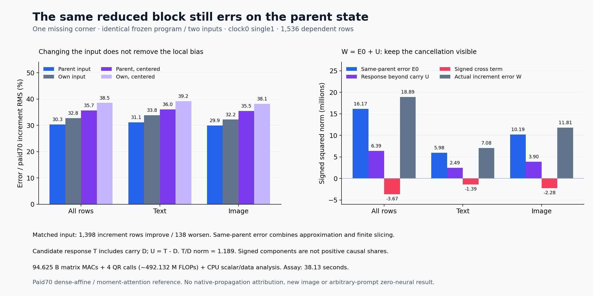

# The same reduced block still errs on the parent state

Resetting the input to the retained parent state lowers next-increment error from **32.774% to 30.321%**. Most of the discrepancy therefore remains even when the inherited incoming-state difference is removed. The matched-input control improves 1,398 dependent increment rows and worsens 138. This identifies a substantial local approximation problem; it does not provide a better autonomous generator, a new image or arbitrary-prompt zero-neural generation.

The [own-state successor](own-state-successor.md) advanced from actual cycle-86 output into single block 1. It beat holding on every row, yet accumulated error. That test combined input change with the reduced block's own error. The [frozen matched-input plan](plans/matched-parent-successor.md) fills one missing corner using the **identical numerical program** on the paid70/73 parent incoming state. Rank, seeds, physical QKV slicing, native components, rounding and all current operand/basis formation stay unchanged.

Let x be the parent input, \(\hat x\) the actual candidate input, \(y=F_{70}(x)\) the retained parent successor, \(\hat y=\hat F(\hat x)\) the existing own-state successor, and \(y_0=\hat F(x)\) the sole new output. \(F_{70}\) is the paid dense-affine, moment-attention transition. It is not an independent original full-attention reference.

Define

\[
D=\hat x-x,\quad E_0=y_0-y,\quad T=\hat y-y_0,\quad U=T-D,
\]
\[
W=(\hat y-\hat x)-(y-x),\qquad E_{\mathrm{out}}=\hat y-y.
\]

Then three separately checked identities hold:

\[
E_{\mathrm{out}}=E_0+T,\qquad
W=E_0+U,\qquad E_{\mathrm{out}}=D+W.
\]

E₀ is the implemented program's error on the exact parent input. T is that program's finite response to the incoming-state change; U removes its identity carry. E₀ still combines approximation and finite slicing/admission effects. T does not measure native propagation.

| Actual increment error / paid70 target RMS | All rows | Text | Image |
| --- | ---: | ---: | ---: |
| Parent input, new control | 30.321% | 31.094% | 29.893% |
| Own input, existing87 | 32.774% | 33.835% | 32.184% |
| Parent input, stream-centered | 35.682% | 36.042% | 35.474% |
| Own input, stream-centered | 38.502% | 39.151% | 38.124% |

Matched versus own increment outcomes are 488 improvements / 24 regressions for text and 910 / 114 for image. Outgoing error falls 2.818%→2.222% pooled and 14.431%→11.639% for image, with 1,535 row improvements and one regression at text row 40. This is a diagnostic input reset, not a serving-quality improvement: the autonomous path still has to consume \(\hat x\). Every row and both denominators remain in the [lossless observations](results/matched-parent/observations.jsonl.gz).

The signed full outgoing account is

\[
26{,}008{,}929.870
=16{,}171{,}503.743+14{,}779{,}562.093-4{,}942{,}135.966.
\]

The actual increment account is

\[
18{,}893{,}860.344
=16{,}171{,}503.743+6{,}387{,}915.707-3{,}665{,}559.106.
\]

These are \(\|E_0+T\|^2\) and \(\|E_0+U\|^2\), with their signed inner products. They are not positive causal shares. Centered increment energy is 15,997,393.205+6,016,557.132−3,388,447.819=18,625,502.518. Centered outgoing energy is 15,997,393.205+14,569,795.275−4,865,138.950=25,702,049.530. Every vector subtraction closure has zero energy; scalar summation remainders remain around10⁻⁸.

The observed \(\|T\|/\|D\|\) is1.1894 pooled,1.2141 text and1.1736 image. This is one input-pair gain of the reduced program, not a native amplification estimate, Jacobian norm or Lipschitz bound. Removing the carry gives \(\|U\|/\|W\|=0.5815\) pooled,0.5745 image. Its signed interaction with E₀ matters: neither component can be treated as an independent percentage of error. Text row40 has the largest increment regression while row41 has the largest improvement. The [localization](results/matched-parent-evidence/row-localization.json) retains these exceptions.

The new worker imports the original numerical function directly. AST/source checks verify that its body changes only the work/typed-contract imports, description and start/seal labels. A new typed contract correctly binds parent70/73 state and the fresh intake manifest. It re-forms normalization, Q/K/V, current attention/moments, G/Up/product, input and output bases and learned pullback. Own86 state,87 output, successor targets and historical operands/bases stay quarantined until seal and parent-observed successful producer exit.

Actual candidate/assay matrix work is **94,625,071,104 MACs**, with four QR calls adding approximately **492.132M separate algorithmic FLOPs**. The eight repeated factorization diagnostics are omitted. The post-exit NumPy FP64 analyzer uses differences, centering, elementwise products and reductions, with no learned map or matrix product. CPU scalar/data work and all original maps, clocks, source production, nonlinearities, casts, hashes and retention remain paid.

One guarded CUDA job, job-20830dcc885e, succeeds in **38.13 scheduler seconds**, with sampled **2,826.8MB RSS / 2,554MB device**. Producer wall time after imports is21.700s, including4.259s setup; analysis takes3.246s after imports. The producer's peak Torch allocation/reservation is1,800,834,048/2,311,061,504bytes, separately scoped from sampled process/device peaks. The lower total than87 is not a matched runtime gain: analysis/setup/cache differ. The3,200,483-byte payload has equal declared/sealed/executed SHA256.

All **365 mechanics tests** pass in19.13s, covering independent tiny five-corner energy/centering, zero denominators, the new nine-input/45-output typed contract and prior dense/score-moment/operand references. Fresh intake authenticates35files/43,124,403bytes/11NPY plus245,367,296 original parameter bytes. Complete post-run byte checks cover98files/770,607,400bytes/60NPY plus the same four parameters. Physical QKV and actual QKV/J/sketch handoffs,45producer+4analysis ABIs, actual operation geometry/work and every scalar aggregate pass. The [evidence index](results/matched-parent-evidence/README.md) records exact sources and limitations; byte verification does not independently replay real-array numerics.

Saturn applied to the raw result returns0 for run/verify over1,536records: zero fires, formal claims or qualified addresses, one expected missing no-fire ledger. All49new arrays/722,104,448NPY bytes remain near compute;18compact core files total1,678,853bytes locally/publicly. There is no archive/deletion or fresh cold-object rehash. Full research/storage review87 remains current, next90, last actual archive78.

This cut makes the causal uncertainty smaller while leaving the original goal intact. The local reduced program has a substantial same-parent discrepancy and a meaningful changed-input response; neither establishes an economical symbolic transition or a general pixel producer. Further depth is premature without understanding those differences. The remaining decision is whether the native moment-attention transition itself propagates the input difference similarly, or whether the approximation changes its response. Astra's [missing dense-comparator corner plan](plans/dense-own-state-corner.md) would answer that question with y1=F70(xhat),200,321,531,904prospective MACs and no QR. It is written and unexecuted, with no implementation or job; all learned work remains paid. Arbitrary-prompt zero-neural generation remains active and unsolved.
