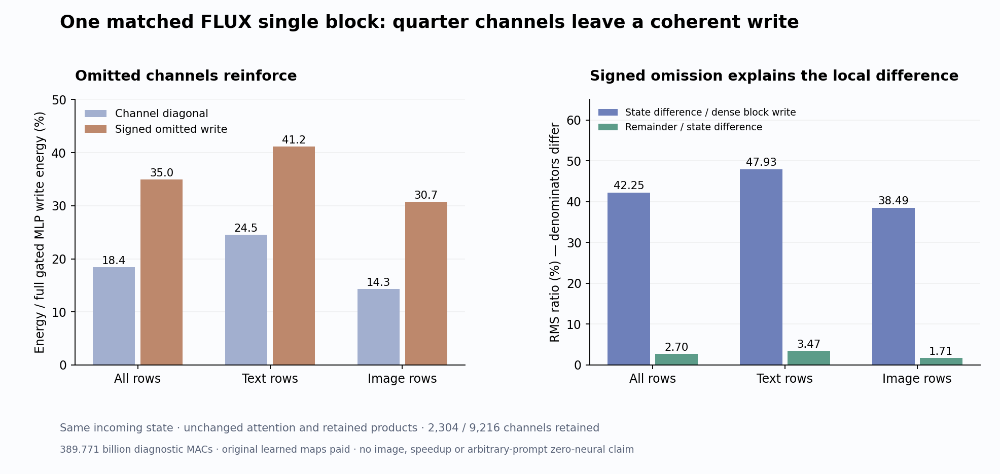

# The omitted MLP channels make a coherent write

The [quarter-channel trajectory](gate-first-trajectory.md) saved 24.30% of nominal matrix/convolution work but rounded the cube and blurred the blue object. The matched first-block diagnostic now separates one local cause: the omitted channels reinforce one another. Their signed, residual-gated write predicts the actual sparse-minus-dense state difference with a 2.70% RMS remainder. Attention and the retained channel products match exactly on this receiver.

This is one clock0/single0 input, with 512 text rows, 1,024 image rows and 2,304 of 9,216 MLP channels retained. It is a mathematical diagnosis of an existing approximation, not a new image generator. The full reconstructed generator accepts arbitrary prompts with the original learned computations; the strict zero-neural browser demo covers supplied scene families. Arbitrary-prompt images without neural evaluations remain open.

## Hold the incoming state fixed

We replay the frozen cycle72 sparse single-block operator and cycle70 dense single-block operator from byte-identical incoming text/image states, modulation and absolute rotary positions. Dense here means the existing [moment-text operator](image-partition-moments.md), with ordinary complete image attention. It is not original full text-query/image-key attention.

The sparse process computes full current gates and selects its own unchanged quarter support from source norms. It evaluates only those up rows, seals its outputs and exits. A separate dense process then forms full U, without access to sparse numerical outputs. Both seal before archived exits or diagnostic targets are opened. Only four original single0 parameters are loaded, totaling 245,367,296 BF16 bytes. No prefix, later block, head, sampler or VAE runs.

All 25 archived replay comparisons match exactly, including text/image exits, selection fields and moment observations. Between the new sparse and dense replays, normalized input, raw Q/K/V/G, SiLU gates, normalized/rotated attention operands, image attention, combined attention read, text read and residual gate match byte for byte. Selected U and the actual selected product are numerically exact against the dense fields indexed by the same support. The pre-residual update and emitted states differ.

That matters because splitting a fused GEMM can change finite arithmetic. Here the captured operands show that those upstream differences are absent in this specimen. It does not prove that all split geometries, blocks or inputs have this property.

## Expand the MLP as a sum of signed channel writes

Let Z be the normalized/modulated incoming rows, G the full gate preactivation, U the up coefficients and D the original down coefficients. With the row convention used here, U has shape 9,216×3,072 and D has shape 3,072×9,216. The admitted product is the actual BF16 tensor passed to the output linear operation:

\[
A=\operatorname{SiLU}_{\rm BF16}(G),\qquad
\widetilde U=\operatorname{Linear}_{\rm BF16}(Z,U),\qquad
P=\operatorname{BF16}(A\odot\widetilde U).
\]

We capture this product rather than recomputing it for the diagnostic. After both replays seal, convert admitted P and original D explicitly to FP64 and compute two contractions:

\[
Y=PD^T,\qquad Y_S=P_SD_S^T,\qquad O=Y-Y_S.
\]

Writing p_j=P_{:j} and d_j=D_{:j}, the omitted write expands as

\[
O\approx\sum_{j\notin S}p_jd_j^T,
\]

where the approximation sign records finite FP64 contraction/subtraction rather than an exact real-arithmetic certificate. Its real-arithmetic energy expansion is

\[
\|O\|_F^2=
\underbrace{\sum_{j\notin S}\|p_j\|_2^2\|d_j\|_2^2}_{E_{\rm diagonal}}
+\underbrace{2\sum_{j<k,\;j,k\notin S}
\langle p_j,p_k\rangle\langle d_j,d_k\rangle}_{E_{\rm cross}}.
\]

Individual channel magnitudes omit the second term. Negative cross energy would indicate net cancellation; positive cross energy indicates net reinforcement. We obtain diagonal energy from column norms and total energy from the contracted write, without constructing a 9,216² Gram matrix.

The residual gate g acts on output coordinates. The corresponding gated calculation replaces d_j by g⊙d_j, retaining text and image strata separately.

| Gated stratum | Omitted diagonal energy | Actual omitted energy | Cross-channel energy | Actual / diagonal |
|---|---:|---:|---:|---:|
| All rows | 18,471,455.78 | 35,020,402.58 | +16,548,946.80 | 1.896× |
| Text | 9,978,591.04 | 16,775,628.75 | +6,797,037.71 | 1.681× |
| Image | 8,492,864.74 | 18,244,773.83 | +9,751,909.09 | 2.148× |

All three ungated strata also have positive omitted cross energy. The omitted channels are not canceling into an inconsequential tail on this receiver.

The retained and omitted writes reinforce one another too:

\[
\|g\odot Y\|_F^2=
\|g\odot Y_S\|_F^2+\|g\odot O\|_F^2
+2\langle g\odot Y_S,g\odot O\rangle.
\]

For all rows, these terms are 100,167,461.60 = 36,652,404.45 + 35,020,402.58 + 28,494,654.57. The positive selected/omitted cross term also appears separately in text and image. This is a coherent contribution shared across many channels; retaining the largest individual scores need not preserve it.

## Compare the signed omission to the actual emitted state

Let Δ be the actual sparse exit minus the actual dense exit. Define an accounting remainder by

\[
\Delta=-g\odot O+R,\qquad R:=\Delta+g\odot O.
\]

This identity closes exactly for the saved diagnostic arrays. Closure alone is bookkeeping; the useful observation is the size and direction of R relative to the measured Δ.

| Rows | Exit error / dense exit | Δ / actual dense block write | R / Δ | Cosine of −g⊙O with Δ |
|---|---:|---:|---:|---:|
| All | 3.289% | 42.251% | 2.703% | 0.999635 |
| Text | 2.299% | 47.930% | 3.475% | 0.999396 |
| Image | 17.217% | 38.489% | 1.709% | 0.999854 |

Each column uses its stated denominator. The dense block write includes attention as well as MLP work; it differs from the common-product MLP energy in the previous table. A small pooled exit error can conceal a large change in the newly written increment, particularly when a large incoming residual dominates text norms.

The small remainder and exact captured upstream operands support a bounded working inference: removing the coherent channel write dominates this local discrepancy. R still includes output-contraction, gating, residual finite arithmetic and FP64 diagnostic effects. We have not independently assigned every remainder component, so it should not be labeled pure rounding. Nor does a small R establish the causal share of this block in the final cycle72 image: later states and other blocks were not replayed here.

The [per-row observations](results/matched-single-write-evidence/row-heterogeneity.json) retain an important countertrend. Eight of 512 text rows have R/Δ above one half; rows40/41 reach 93.71%/93.87%, with omission–difference cosines 0.3519/0.3491. Text median R/Δ is 1.365%. Image rows are more uniform: median 1.591%, maximum 4.545%, minimum cosine 0.99915. Pooled omission dominance does not make finite policy negligible on every text row.

## Why the source score did not protect the write

The existing selector ranks a current-gate/source-norm quantity

\[
b_j=\|U_{j:}\|_2\|D_{:j}\|_2
\sqrt{\sum_i a_{ij}^2\|Z_{i:}\|_2^2},
\qquad a=\operatorname{SiLU}(G).
\]

This follows the shape of a Cauchy–Schwarz magnitude bound before finite rounding, but neither its actual up/input alignment nor signed channel interactions are represented. The admitted-product diagnostic uses c_j=‖P_:j‖₂‖D_:j‖₂. Its Spearman rank correlation with b is 0.5757 overall, 0.5156 for text and 0.3538 for image. The all-row c/b median is 0.01663 and maximum 0.12439; there are no zero-score channels in this specimen. These are observations on rounded operands and scores, not a certified finite bound.

Even perfect ranking by individual c would not identify the signed cross terms above. We did not try an oracle reranking, alternate support, rescaling, budget sweep or fitted correction. The unchanged support makes the anatomy interpretable.

## What this diagnostic cost

| Actual matrix computation | Nominal MACs |
|---|---:|
| Dense local affines | 188,441,690,112 |
| Sparse local affines | 123,211,874,304 |
| Two complete image-attention QK/AV reads | 19,327,352,832 |
| Two moment-text operators | 4,432,330,752 |
| FP64 full and selected down contractions | 54,358,179,840 |
| Total | **389,771,427,840** |

The one guarded mrun job takes 90.33 scheduler seconds, with sampled peaks of 2,050.5 MB RSS and 1,508 MB device memory. Sparse and dense fresh-process walls after imports are 14.020 and 11.116 seconds. Their instrumented synchronized operation intervals are 4.029 and 1.032 seconds; these include internal diagnostics/copies and exclude later finite checks and fingerprints. Complete post-import analysis takes 22.680 seconds. The diagnostic is not a matched serving benchmark and establishes no speedup.

Source norm preparation, elementwise arithmetic, SiLU, ranking, gathers, conversions, copies, hashing and I/O are additional paid work. Incoming native state and historical prefix/conditioning/noise work remain supplied and paid. All original learned maps remain necessary.

## Evidence and next question

[Mechanics and work audit](results/matched-single-write-evidence/mechanics.json) verifies three typed Acts, 66 output ABIs, all five local affines, two image-attention reads, ten FP32 moment products and two FP64 diagnostic contractions. Complete byte verification covers 137 files / 8,643,305,507 bytes, including inherited checkpoint and parents, 104 NPY payloads, four original parameters, three actual-support maps, the original down slice and both emitted text/image joins.

The publication retains 59,963 signed comparison rows, 27,648 channel rows and 1,536 state-anatomy rows in lossless streams. These dependent rows are not independent prompt replications. The standard Saturn sweep and verification return 0 with three streams / 89,147 records, zero fires, claims or qualified addresses. No fire ledgers are written; verification reports three missing expected ledgers. This is the actual instrument scope, not semantic certification. The final local mechanics suite passes 337 tests in 18.85 seconds.

All 72 new raw arrays / 823,440,776 bytes remain near compute. The compact primary publication is 25 files / 3,973,222 bytes. [Cleanup72](results/storage-cleanup-cycle72/README.md) remains the last actual archive; the next storage and full newest-post reviews are due by cycle75 or earlier changed evidence/pressure.

The constructive question is how to preserve the signed population contribution economically before deleting channels. Astra's [next mean-Up completion plan](plans/current-stream-mean-up.md) projects two current stream means through original U, keeps own quarter Up values, and pays the full output write. It is written and unexecuted; positive coherence does not establish mean sufficiency. Any next representation must produce its own write from source coefficients and live input; the measured O is an analysis target, not a deployable cache. [The frozen original plan](plans/matched-first-single-write.md), [report](results/matched-single-write/report.json), [execution](results/matched-single-write/execution.json), [anatomy execution](results/matched-single-write/anatomy-execution.json) and [evidence summary](results/matched-single-write-evidence/README.md) retain the exact boundary and costs.
