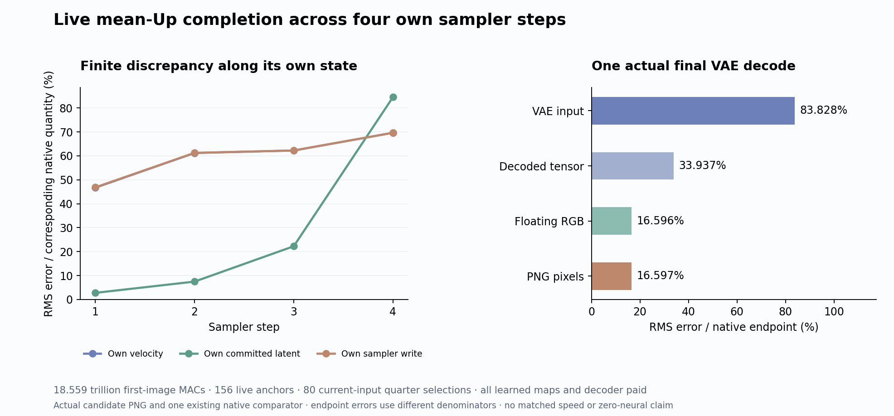

# Can live MLP means preserve their own image future?

Live mean-Up completion improves the first velocity and restores more cube-like red geometry, but final PNG RMS discrepancy worsens. Through all twenty single MLP blocks and four own sampler steps, PNG RMS error rises from the quarter-only path's 16.04% to **16.60%**, while MAE slightly improves. Actual matrix/convolution work is **18.559 trillion MACs**, 12.13% below the moment parent. The blue object remains distorted. Early improvement and later drift are both part of the result.

The [frozen plan](plans/mean-up-own-trajectory.md) carries the [local mean-Up completion](current-stream-mean-up.md) through one known supplied prompt embedding and noise. The candidate always consumes its own preceding state. Original learned maps, text conditioning, joint blocks, attention, head, sampler and VAE remain paid. The [arbitrary-prompt zero-neural objective](zero-neural-research.md) remains open. One guarded CUDA job, `job-371242570594`, succeeds in 353.35 seconds. All 339 local mechanics tests pass; they use tiny synthetic weights rather than pretrained-model evaluation.

Compare the [original native image](results/mean-up-trajectory/native-A.png), [measured report](results/mean-up-trajectory/report.json), [execution ledger](results/mean-up-trajectory/execution.json), and [evidence summary](results/mean-up-trajectory-evidence/README.md).

## What a mean preserves

Write one MLP on normalized, modulated row \(z_i\) as

\[
a_{ij}=\operatorname{SiLU}(g_j^Tz_i),\qquad
M_i=\sum_j a_{ij}(u_j^Tz_i)d_j.
\]

The current gate, current value and output direction jointly determine the signed write. The previous [quarter-selected trajectory](gate-first-trajectory.md) evaluates current Up only on its selected channels and omits the others. The local diagnostic found a coherent omitted contribution. Its [mean-based completion](current-stream-mean-up.md) improved local block-write error from 42.25% to 29.57%, while worsening 50 of 1,536 dependent rows.

For stream \(s\), form its actual current mean \(\mu_s=|s|^{-1}\sum_{i\in s}z_i\). Keep the same source-norm/current-gate selector \(S\), and define

\[
\widehat u_{ij}=\begin{cases}
u_j^Tz_i,&j\in S,\\
u_j^T\mu_s,&j\notin S.
\end{cases}
\qquad
\widehat M_i=\sum_j a_{ij}\widehat u_{ij}d_j.
\]

Every current gate remains active. Omitted values receive the projection of their own stream mean; selected values overwrite those anchors. The output uses the original full concatenated attention/product affine. These full-width output contractions are paid. The candidate avoids a full current Up projection, but retains complete activation, proxy-Up and product banks.

In real arithmetic, the omitted remainder is

\[
M_i-\widehat M_i=\sum_{j\notin S}a_{ij}\,u_j^T(z_i-\mu_s)d_j.
\]

Centering the value does **not** center the gated write. Averaging within the stream gives

\[
\frac1{|s|}\sum_{i\in s}(M_i-\widehat M_i)
=\sum_{j\notin S}\operatorname{Cov}_{i\in s}
\big(a_{ij},u_j^Tz_i\big)d_j.
\]

The gate and value read the same row, so their covariance can remain coherent. A useful simplifying assumption would be that this centered, gated write has a small or cheaply predictable component in the output directions that later consumers use. A small mean of the ungated residual is insufficient. This experiment tests composition of one frozen approximation; it does not establish that assumption or measure its covariance remainder on the candidate's own states.

These equations describe real arithmetic. The actual producer reduces FP32 means, admits BF16, evaluates the original U on two rows and applies BF16 selected overwrites and the original full output affine. Mean admission, GEMM geometry and finite output contraction remain part of the actual discrepancy. Independent byte witnesses check operands and overwrites; they do not numerically certify the algebraic remainder.

## State, liveness and time

The state inside a denoiser is the coupled pair \(s_l=(T_l,I_l)\). At every layer, the next query, gates, support and means are computed from the candidate's own current state. For parent transition \(F_l\), approximation \(\widehat F_l\), defect \(r_l(s)=\widehat F_l(s)-F_l(s)\), and discrepancy \(e_l=\widehat s_l-s_l\),

\[
e_{l+1}=F_l(\widehat s_l)-F_l(s_l)+r_l(\widehat s_l).
\]

The first term transports the incoming difference. The second creates a new difference on the changed input. The recurrence uses a common live output domain: at terminal single19, project the parent output to image coordinates before defining the defect. Later gates and supports can change too. A local correction that helps one supplied input can therefore fail along its own future.

Single blocks 0–18 form two means from 512 text and 1,024 image rows. Terminal single19 forms one mean from the 1,024 live image rows. All 1,536 K/V rows remain available to image attention, while dead final text Q/G/U/output rows remain omitted. The original final head consumes the actual emitted image state, preserving its established strided layout.

At sampler time, the unchanged rule has the real-arithmetic form

\[
x_{k+1}=x_k+(\sigma_{k+1}-\sigma_k)v(x_k,E,t_k).
\]

The actual native finite commit is retained separately; the equation alone is not its rounding certificate. The next denoiser reads that own latent. One original VAE decodes the actual final latent. No archived intermediate state repairs either stream. Existing native, moment-parent and quarter-parent comparisons open only after the candidate seals and its producer process exits.

## Paid computation and evidence

The frozen work inventory is **18,559,412,469,760 matrix/convolution MACs**: 2,561,289,486,336 below the moment parent (12.1269%), and 2,570,122,690,560 above the quarter-only path. It restores full output projections and adds 156 anchor rows. The generic avoided-MAC field uses the original native whole path as its denominator: 3,044,322,312,192 avoided. These are arithmetic accounts, not measured speedups.

The declared path has 600 denoiser affines, 100 image SDPA operations, 480 FP32 text/moment products, four sampler commits and one VAE decode. Source norms, nonlinearities, stream reductions, ranking, map copies, fingerprints and I/O remain additional work. Eighty nested completion transactions supplement ten outer Acts: 90 Acts and 3,139 explicit output ABIs.

Complete additional per-block capture totals 8,729,346,048 logical bytes. Activations, completed Up and products each account for 2,227,175,424 bytes. They stream to near-compute storage and release large GPU references after each block. Logical retention is distinct from peak residency and inherited model storage. Only compact metadata, scalar observations and actual PNGs return to the laptop.

## What survived the future

Every percentage below compares the complete candidate path with its corresponding existing original native quantity. These are dependent observations from one prompt and seed, not same-input MLP defects or prompt replications.

| Own sampler step | Velocity error | Committed latent error | Sampler-write error |
|---|---:|---:|---:|
| 1 | 46.71% | 2.78% | 46.85% |
| 2 | 61.20% | 7.48% | 61.25% |
| 3 | 62.24% | 22.25% | 62.24% |
| 4 | 69.65% | 84.53% | 69.65% |

The quarter-only path's velocity errors were 51.32%, 57.89%, 61.39% and 68.38%. Thus the first velocity improves, followed by worse velocity discrepancies at the remaining clocks. Final latent error is 84.53% versus 83.04%. VAE-input error is 83.83%, decoded-tensor error 33.94%, and PNG error 16.5969%; their different denominators cannot be compared as error attenuation factors.

PNG RMS discrepancy is 39.6496 on the 0–255 scale, mean absolute discrepancy 15.0269, with 590,214 of 786,432 channel values changed and maximum difference 255. Mean absolute discrepancy is slightly lower than the quarter-only path's 15.2072 while RMS is higher than its 38.3074. These measures disagree about the aggregate change. Direct inspection shows stronger red faces than the rounded quarter-only form, but rounded/deformed edges and a faceted or lobed blue object. Neither the native cube nor sphere geometry is restored. The moment parent's actual image remains visibly cleaner, with its previously noted sphere-base artifact.

The [post-seal comparisons](results/mean-up-trajectory/existing-trajectory-comparisons.json) also compare this image directly with the already executed moment and quarter trajectories. Their PNG discrepancies are 13.2875% and 17.0143% relative to those respective images. Those are distances between paths, not improvements relative to the common original native reference. No new reference was generated.

The work ledger records 16,126,795,841,536 affine MACs, 1,196,299,386,880 attention/moment MACs, and 1,236,317,241,344 decoder convolution MACs. The attention subtotal includes 983,547,510,784 native SDPA MACs and 212,751,876,096 explicit FP32 text/moment MACs. Original U is evaluated on 156 anchor rows rather than every live row. Full output projection and current gates remain paid.

The 353.35-second scheduler time includes the enlarged capture and orchestration. Sampled peaks are 8,332.8 MB RSS and 9,422 MB device memory; worker peaks are 8,624,988,160 allocated and 9,546,235,904 reserved CUDA bytes. Worker wall time after imports is 310.9117 seconds, setup 19.1712 seconds and process CPU time 249.7022 seconds. Separate post-seal analysis takes 9.7116 seconds. Parent times around 100 seconds use different capture scopes. There is no matched runtime saving claim. Nested completion intervals overlap their parent denoiser intervals and must not be summed.

This result narrows the next question. Mean completion can help a first local write and the first velocity while failing to preserve later state or final appearance. That does not show that gate–value covariance caused the failure. State propagation, changing supports, remaining centered variation and finite contractions remain separate explanations. Astra recommends the [one fixed own-state covariance diagnostic](plans/own-state-gated-covariance.md) at clock3/single0. One FP64 full Up and two FP64 Down products prospectively cost 130,459,631,616 MACs. They separate a stream-constant covariance mean write from centered row variation, with a combined finite-policy/reassociation remainder. The best supplied constant measures a representation floor, not a cheap producer. This plan is written and unexecuted; no next job is submitted.

The complete audit verifies 2,368 files totaling 18,361,012,624 bytes, including inherited assets: 2,324 NPY payloads, 169 original parameters, 244 physical source-map records, eighty full anchor-broadcast/selected-overwrite witnesses and four terminal text/image byte joins. Ninety typed Acts bind 3,139 output ABIs and 100 coupled block joins. Mean/projection/product numerics and final latent unpacking remain source-audited and tiny-tested; the byte verifier does not independently numerically replay them.

The standard Saturn sweep and verification both return zero: seven streams and 753,913 records, with no fires, formal claims or qualified addresses. Seven expected fire ledgers are absent because none were written. This supplies instrument and custody evidence, with no semantic or quality certification. All 11,840 signed native-comparison rows, 2,304 partition-head rows, 2,304 moment-head rows and 737,280 selection-channel rows remain losslessly published.

All 2,286 new raw arrays, totaling 10,292,271,488 file bytes, remain near compute. The primary compact publication contains 31 files totaling 24,182,230 bytes. [Cleanup75](results/storage-cleanup-cycle75/README.md) separately archives 677,763,634 bytes of two complete-custody failed-run transports with full cold SHA checks and durable restore pointers. The failure outcome and extracted evidence remain unchanged. The [post-audit](results/storage-audit-cycle75/README.md) checks 84 pointer/custody/remote metadata joins. Nine remaining candidates are retained; their names and sizes are not deletion certificates.
