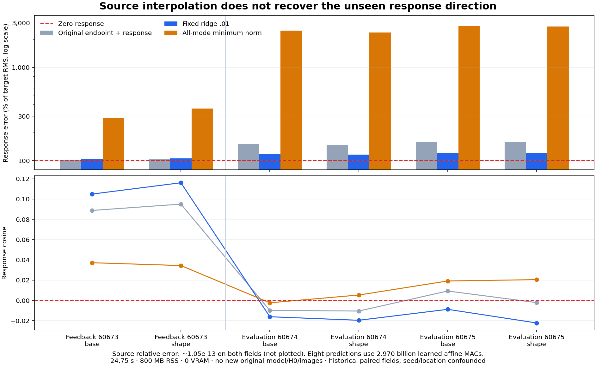

# Source interpolation does not recover a reusable response

The single all-mode minimum-norm map fits both discovery responses to about 10⁻¹³ relative error, but predicts much larger, poorly aligned responses on the six archived feedback/evaluation pairs. Removing the fixed ridge's attenuation therefore does not rescue transfer for this source extension. Three evaluation cosines become slightly positive; all six held responses still lose to zero by a wide margin.

Job job-3ad8f94c32ea succeeds in **24.75 scheduler seconds**, with **799.9 MB sampled RSS and zero VRAM**. It performs no new SVD or original-model/H0/VAE/image computation. It does form and evaluate a learned affine map. This is retrospective response research, not a complete velocity or arbitrary-prompt zero-neural generator.

The [frozen protocol](results/minimum-response/frozen-plan.md), [raw report](results/minimum-response/report.json), [coefficient seal](results/minimum-response/coefficient-seal.json), [candidate seal](results/minimum-response/candidate-seal.json), [mechanics](results/minimum-response-evidence/mechanics.json) and [scalar summary](results/minimum-response-evidence/scalar-summary.json) preserve the result. It follows the [source spectrum](source-response-spectrum.md) and [fixed-ridge response writer](source-native-response-writer.md).

## Change one endpoint of the law

The previous analysis retained the complete FP64 decomposition X=UΣVᵀ and C=UᵀY. X contains 1,888 discovery rows, 3,072 normalized global-read differences and 128 output response coordinates. Every singular direction is numerically resolved. Keep every mode, the inherited scale, no intercept and unit gain:

\[
B_0=V\Sigma^{-1}C,
\qquad
\Delta\widehat v=X_*B_0.
\]

This deliberately changes the regularization to the untuned interpolation endpoint. There is no new SVD, rank truncation, mode selection, gain fit or regularization search. With more features than source rows, source interpolation is expected algebraically. It is a mechanics observation, not a semantic capability test.

Only the saved factors and scale enter coefficient formation. A canonical Saturn Frame/Act records the coefficient write and immutable baseline branch. Baseline reselection verifies its identity; there is no mutable optimizer rollback claim. The coefficient receipt seals before a fresh actor predicts all eight archived input differences. Every prediction seals before the scorer opens old targets or the 24 inherited controls. Controls and targets match their original public records exactly.

The fresh numerical actors prohibit neural frameworks, original-model bytes, network access and undeclared files, including two target/control canaries. The canonical Frame/Act control process imports Torch but constructs/evaluates no model. These trusted-code audit hooks are not an adversarial sandbox.

## The source is exact; the new responses are not

| Field | Fixed ridge error | Minimum-norm error | Minimum-norm cosine | Amplitude / target |
|---|---:|---:|---:|---:|
|Discovery60672 base|81.79%|1.04×10⁻¹¹%|1.0000|1.000|
|Discovery60672 shape|81.61%|1.05×10⁻¹¹%|1.0000|1.000|
|Feedback60673 base|103.06%|289.47%|.03718|2.754|
|Feedback60673 shape|106.03%|362.20%|.03438|3.516|
|Evaluation60674 base|116.92%|2,483.23%|−.00236|24.810|
|Evaluation60674 shape|116.29%|2,370.88%|.00529|23.693|
|Evaluation60675 base|120.18%|2,765.35%|.01916|27.655|
|Evaluation60675 shape|121.22%|2,747.35%|.02047|27.476|

Error is RMS discrepancy divided by target response RMS. Zero response gives 100%. The source predictions are raw FP64 and are not requantized. All per-query observations and per-output accounts remain available. Queries and roles share source fields and seeds; they are not independent specimens. Same-location feedback and top-left evaluation also differ in seed, so these results cannot isolate location causally. All labels existed historically.

Coefficient energy is 144,842.4743, matching the saved spectrum's diagnostic, versus 4.8015 for ridge: a 173.68× norm ratio. This run now observes the associated large held output amplitudes. It does not test perturbation stability or establish that every way to use these directions must fail.

The direction matters separately from amplitude. For fixed prediction P, target T, amplitude ratio a and cosine c,

\[
E(g)=\frac{\|gP-T\|^2}{\|T\|^2}
=1+g^2a^2-2gac.
\]

Even an oracle nonnegative scalar has minimum E=1−max(c,0)². This is a post-hoc geometric bound, not a fitted or served gain. On these evaluation fields the maximum possible squared-error improvement over zero is about .042%; feedback's maximum is about .138%. Three evaluation directions are now weakly positive, so the previous ridge result's universal wrong-sign statement does not apply to this new map. A smaller amplitude could give a tiny improvement on those fields; it would not recover the missing response direction. No gain-adjusted candidate is generated.

## What this changes in our understanding

We now have an exact finite source fit and an explicit poor extension to other supplied inputs. The statement “the .01 penalty alone prevented this map from transferring usefully” does not survive this endpoint contrast. Other regularizations and nonlinear response laws remain untested. Neither source interpolation nor poor transfer demonstrates that H0 lacks useful information.

A model's finite response generally depends on its receiving state. For a differentiable transition F and change delta s,

\[
F(s+\delta s)-F(s)
=\int_0^1 J_F(s+t\delta s)\,\delta s\,dt.
\]

A shared linear response map assumes enough consistency in that state-dependent operator over the examples it serves. Normalization, attention and MLP gates can change it. This experiment does not identify which missing dependence matters: an undercovered linear extension, a nonlinear function of the supplied read or an insufficient state description remain alternatives. A response difference also remains distinct from the complete velocity needed to advance diffusion's own state.

The [next extension-geometry audit](plans/minimum-response-extension-geometry.md), selected by [Astra44](results/minimum-response-evidence/advisor.json), will explain where this particular map amplifies supplied inputs, using only retained fields. With P=VVᵀ, every source linear interpolant has B=B_0+(I−P)G. Its held response is X_*B_0+X_*(I−P)G. The first term is fixed by source interpolation; the second is unconstrained by it. The current minimum-norm map sets G=0. Its large response is produced inside the source span through inverse singular values; orthogonal input is ignored rather than directly amplified. The audit will measure both geometries without fitting another producer or causally identifying a missing conditioning variable. The [all-layer transition study](../../obsidian/blog/2026-11-06-184700-compiling-cheaper-transitions-on-the-states-they-create.md) and [producer/consumer study](../../obsidian/blog/2026-11-06-185200-producing-a-state-and-consuming-it-are-different-computations.md) supply complementary boundaries: local source representation, local writes and useful future consumption need distinct evidence.

## Work and custody

Coefficient formation takes 1.3026 worker seconds/.1087 CPU seconds including source access and retention. The eight forecasts take 2.1484 seconds/.3274 CPU seconds. Fresh-process phase walls are 1.4657 and 2.3173 seconds. Total worker work after control imports is 4.9351 seconds; scheduler elapsed is 24.75 seconds. These scopes differ, and no backend speedup is claimed. Intent-first admission reserves 4,096 MB RAM, zero VRAM and four CPU threads; numerical arithmetic is configured to one. NumPy 2.5.4/Python 3.14.6 are recorded.

The coefficient product costs 742,391,808 nominal MACs; eight learned response products cost 2,969,567,232, totaling **3,711,959,040 nominal learned MACs**. Divisions, reductions, I/O and retention are additional. The coefficient array is 3,145,728 bytes. All original H0/label production, previous decomposition and control predictions remain paid preparation. Zero model-runtime calls do not mean zero learned computation.

All 237 generator mechanics tests pass, including three new minimum-norm/no-truncation tests. The publication audit verifies seven frozen source pins, typed coefficient lineage, both release seals, eight new responses, 24 exact reused controls and 30,208 lossless observations. Complete byte custody covers 75 files/285,696,462 bytes. Ten new arrays/14,025,984 bytes stay near compute. The fourteen-file compact primary bundle is 3,959,490 bytes before separate figure/evidence. Saturn run/verify succeeds on the original observation stream, with no watch fires or formal claim receipts; applicability is not transfer certification.

The guarded payload is 14599647a84b270b204de865a7bb8043a849bc55f15c7efefc9e204e0ee411b6, 1,120,265 bytes. Candidate seal e2aab62d8446728850e3013ea634a45f3db377e38144e4b43979a39fc1fa95e3 binds all forecasts before scoring. Frozen workers remain unchanged. No new archive or deletion is claimed; actual cleanup remains cycle42, with review due45 or earlier pressure. The arbitrary-prompt zero-neural goal remains active and unsolved.
