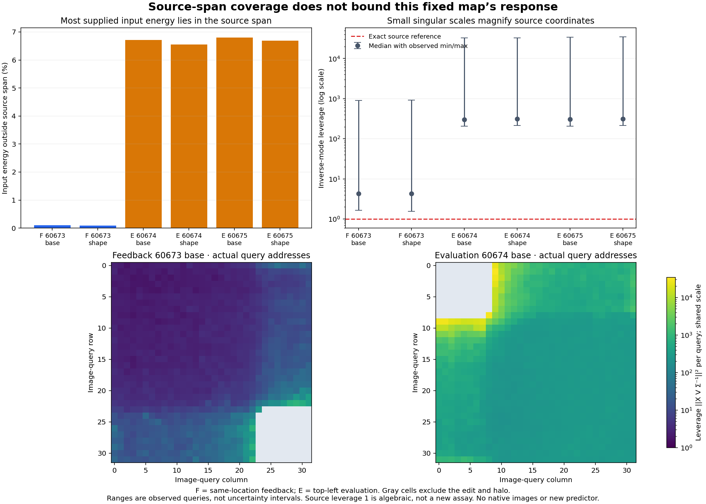

# The source span is covered; its response extension is still amplified

Almost all same-location feedback input energy lies in the discovery row-space, yet the fixed minimum-norm response map still transfers poorly. Its large predictions come from inverse singular coordinates inside that span. Input components outside the span describe uncalibrated extension freedom; this particular map ignores them. These observations resolve the geometry of the [minimum-norm result](minimum-norm-source-response.md) without identifying a missing receiver variable causally.

Job job-4150ce136012 completes in **7.67 scheduler seconds**, peaking at **333.8 MB RSS and zero VRAM**. One saved-array audit reconstructs the six old forecasts; it creates no new fit, selected predictor, original-model/H0 evaluation or image. Arbitrary-prompt zero-neural generation remains open.

The [frozen protocol](results/extension-geometry/frozen-plan.md), [report](results/extension-geometry/report.json), [geometry seal](results/extension-geometry/geometry-seal.json), [mechanics](results/extension-geometry-evidence/mechanics.json), [complete scalar summary](results/extension-geometry-evidence/scalar-summary.json) and [Astra review](results/extension-geometry-evidence/advisor.json) retain the evidence.

## What source interpolation determines

The discovery matrix has 1,888 independent numerical directions in 3,072 input features. Keep its saved X_source=UΣVᵀ and C=UᵀY_source. Put P=VVᵀ. Every exact source linear interpolant has the form

\[
B=B_0+(I-P)G,\qquad B_0=V\Sigma^{-1}C.
\]

For a supplied held input X, compute

\[
Z=XV,\quad A=Z\Sigma^{-1},\quad
X_\parallel=ZV^\top,\quad r=X-X_\parallel.
\]

Then XB=AC+rG. Source fitting determines AC, while it leaves rG unconstrained. B_0 chooses G=0. This is a statement about the declared linear family, not semantic sufficiency. The source row-space here lives in normalized global-read-difference coordinates; it is not a span of target images or meanings.

The audit uses every retained mode and reconstructs the fixed forecast as AC. It does not materialize T=AUᵀ or load U. Since U is orthonormal, leverage ||A_q||² is also the squared norm of that query's source-interpolation weights. Source leverage is 1 in exact full-row-rank algebra. That is a reference identity, not a new source assay.

## Near-complete coverage does not control the extension

| Field | Input energy outside source span | Median leverage | Maximum leverage |
|---|---:|---:|---:|
|Feedback60673 base|.09735%|4.293|909.3|
|Feedback60673 shape|.09088%|4.320|913.4|
|Evaluation60674 base|6.71284%|303.807|32,942.0|
|Evaluation60674 shape|6.54892%|314.875|32,877.3|
|Evaluation60675 base|6.80477%|304.519|33,921.4|
|Evaluation60675 shape|6.69127%|312.515|34,502.0|

Feedback has over 99.9% of supplied input energy in the source span, but its earlier response errors are 289–362%. Evaluation has 93.2–93.5% in-span energy and earlier errors of 2,371–2,765%. A small orthogonal residual is therefore not enough to make this extension useful. It could still matter to another true response law through rG; these measurements do not bound that unknown operator.

The per-query maps bind selected-row indices to their actual 32×32 image-query addresses. Gray cells exclude the edited region and its four-neighbor halo. Large leverage appears near that boundary in the displayed base roles. This is spatial geometry, not a causal localization of output error. Every role and every admitted query remains in the records; the two displayed maps share a color scale.

At the inherited ridge's half-response point, attenuated directions account for 99.832–99.836% of feedback leverage and 99.9886–99.9888% of evaluation leverage. Their signed modal powers account for about 97.76–97.78% and 99.950–99.970% of total prediction energy, respectively. These are descriptions of the complete fixed spectrum, not mode selection or a new regularization proposal. Signed power ratios are not probability masses in general.

## Preserve interference rather than summing only positive terms

For each mode the diagonal output energy is ||A_:i||²||C_i||². These diagonal terms alone omit interactions. The extra contraction D=AᵀYhat gives signed powers

\[
s_i=C_i\cdot D_i,\qquad
\sum_i s_i=\|\widehat Y\|_F^2.
\]

Feedback has 222/229 negative modal powers, with small net positive cross power. Evaluation has 676–687 negative powers. Its total diagonal energy is 382,899–391,640, reduced by signed cross power of −35,317 to −43,022 to actual prediction energy of 347,582–348,801. Cancellation removes about 9.22–10.99% of diagonal energy. None of those terms is discarded.

The maximum per-query finite energy-closure discrepancy is 7.51×10⁻¹⁴; modal-power closure differs by at most 5.82×10⁻¹¹ on totals near 350,000. All six forecasts reconstruct to maximum absolute differences of 2.84×10⁻¹⁴–7.82×10⁻¹⁴ and relative RMS differences of 1.57×10⁻¹⁵–7.76×10⁻¹⁵. These finite observations are retained without an arbitrary scientific equality gate. They support the accounting of the already-observed forecast, not a new consumer prediction.

## The next causal question

The geometry is now resolved enough to stop this spectral line. Source coverage, exact fitting and stable reconstruction do not establish a state-independent response law. The next [carrier–receiver crossing](plans/carrier-receiver-crossing.md) will hold an entire pair of saved attention payloads identical while changing the actual receiver. That can test receiver dependence directly; this observational audit cannot. Four ordinary native calls will still compute their own discarded H0 before the supported projection-input hook replaces it. Donor formation is reused, but new recipient attention is paid. Every arm is a supplied-payload intervention, without natural full-attention parity. This plan is written and unexecuted.

The [all-layer transition study](../../obsidian/blog/2026-11-06-184700-compiling-cheaper-transitions-on-the-states-they-create.md), [query-rescue result](../../obsidian/blog/2026-11-06-185301-the-right-query-can-rescue-a-memory-that-an-exact-read-cannot.md) and [producer/consumer distinction](../../obsidian/blog/2026-11-06-185200-producing-a-state-and-consuming-it-are-different-computations.md) preserve the same larger boundary: covering or supplying an operand is different from producing a useful state transition. The arbitrary-prompt zero-neural goal requires that whole chain.

## Computation and retention

The geometry actor takes 5.1366 seconds/2.2779 process CPU seconds including access and retention. The worker takes 5.5242 seconds; scheduler elapsed is 7.67 seconds. Intent-first admission reserves 4,096 MB RAM, zero VRAM and four CPU threads; arithmetic is configured to one. NumPy 2.5.4/Python 3.14.6 are recorded. No backend speedup is claimed.

Six pairs require **68,439,244,800 nominal leading MACs** for projection out/back, forecast reconstruction and signed modal contraction. Divisions, reductions, byte hashing, I/O and retention are additional. Old H0 production, source labels, factorization and fitted forecast arithmetic remain paid preparation. Framework exclusion does not turn target-derived reconstruction into arbitrary-prompt serving.

All 240 generator mechanics tests pass, including independent projection/alternative-interpolant and negative-power checks. The publication audit binds six worker source pins, eighteen retained arrays, all 5,664 query records with actual image indices, all 11,328 modes and exact old forecast/account joins. Full-byte custody covers 57 files/303,445,618 bytes. Eighteen new arrays/102,951,168 bytes remain near compute; twelve compact primary files total 1,437,477 bytes before separate figure/evidence. Saturn run/verify succeeds on the two original streams/16,992 records, with no fires or formal claim receipts. This is instrument applicability, not scientific certification.

The guarded executed payload is 188a84e30d2913f606285b0e97b270db4c4b0dceb59e5920816c4c5b2894aaf1, 24,279 bytes. Geometry seal 5c9d63ae84aa463fadb8b78619fe5b430d9ab9d34cada31307191beeefa42ed8 precedes reference access. Fresh numerical execution denies frameworks, original-model bytes, network and undeclared files; trusted-code quarantine is not an adversarial sandbox. Raw outcomes and frozen workers remain unchanged.

The [scheduled cleanup](results/storage-cleanup-cycle45/README.md) archives four verified redundant transport copies/645,412,771 bytes with restoration pointers. Extracted evidence remains local. The [post-audit](results/storage-audit-cycle45/README.md) verifies all 44 pointer/custody joins and fresh remote file sizes; historical forty cold objects are not freshly full-byte rehashed. Forty remaining name/size candidates are not deletion certificates. Next storage review is due48 or earlier pressure.
