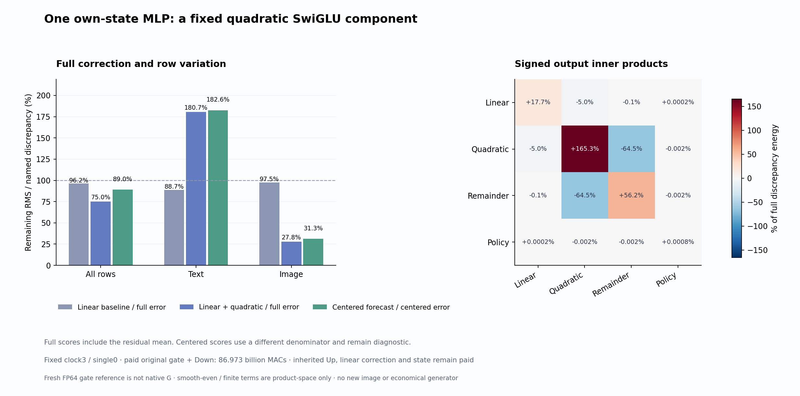

# A quadratic component recovers image writes and overshoots two text rows

One fixed quadratic SwiGLU component lowers reconstructed missing-write RMS from **97.48% to 27.75% on image rows**, with all 1,024 rows improving. Text improves on 510 of 512 rows, yet two large overshoots raise pooled text RMS from **88.68% to 180.66%**. Pooled full RMS falls 96.20%→74.98%. The result reveals useful multiplicative structure and a consequential cancellation problem on one own model state. It establishes no new image, economical compiler or arbitrary-prompt zero-neural generator.

The [mean-activation result](mean-gate.md) found a modest linear contribution after the [constant-family diagnostic](own-state-gated-covariance.md). The remaining computation involved changing activation times changing Up values. Here we test a fixed architectural term from that product, following the [frozen odd/even plan](results/odd-gate/frozen-plan.md).

## Factor the activation into odd and even parts

In real arithmetic,

\[
\operatorname{SiLU}(G)=G/2+H(G),\qquad
H(G)=\tfrac12G\tanh(G/2),\qquad H(-G)=H(G).
\]

Keep clock3/single0 from the [mean-Up generator's own trajectory](mean-up-trajectory.md). A is its admitted BF16 SiLU activation, g its separate output residual gate, U* the previously paid FP64 Up reference, S its actual selected quarter and D the saved original FP64 Down map. The earlier linear component was L=1_omitted·mean(A)·δU, with means taken separately over text and image rows.

G was not saved. We pay a fresh **G*=ZW_Gᵀ** using the original gate rows 9216:18432 of the fused checkpoint tensor, with saved BF16 Z and original weights promoted to FP64. This is not native finite G or a replay of its fused geometry. The producer computes

\[
T=\tfrac12 1_{\bar S}\odot(G^*-\bar G_s^*)\odot(U^*-\bar U_s^*),
\quad Y_T=TD^T,\quad \widehat X=g\odot(Y_L+Y_T).
\]

It seals the complete forecast and exits before actual A or prior error fields become available. Original full Up, earlier Y_L, support formation, maps and source generation remain paid.

After release, explicitly evaluate H*=0.5G*·tanh(0.5G*), A*=0.5G*+H*, and F=A−A*. A separately evaluated SiLU kernel is not assumed bit-identical to this expression. The product account is

\[
1_{\bar S}\delta A\odot\delta U
=T+1_{\bar S}\delta H^*\odot\delta U
+1_{\bar S}\delta F\odot\delta U.
\]

The measured product closure has maximum 7.05×10⁻¹⁵ and relative RMS 2.77×10⁻¹⁶. H/F remain product-space observations; neither receives another Down projection. The output remainder Y_R−Y_L−Y_T is subtraction-defined and includes reassociation. The older Q policy/reassociation boundary remains separate. Full signed output closure has 1.39×10⁻¹⁶ relative RMS; this excludes native concatenated-output/residual rounding.

## The full result includes both streams and every row

Let X=gY_E be the previous reconstructed total discrepancy. Primary error is ||X−Xhat||/||X||. C_s centers within each stream; centered scores use ||C_s(X)|| as their denominator and do not add an oracle mean to the forecast.

| Stratum | L-only full RMS | L+T full RMS | L+T centered RMS | Rows better/worse than L |
|---|---:|---:|---:|---:|
| All |96.20%|74.98%|89.00%|1,534 / 2|
| Text |88.68%|180.66%|182.58%|510 / 2|
| Image |97.48%|27.75%|31.30%|1,024 / 0|

Image full error energy falls 92.30% against zero correction and 91.90% against L's residual. Pooled full energy falls 43.77% against zero. Text full energy increases 226.37% against zero. These denominators describe missing-write discrepancies, not whole state or image errors.

The two rows that worsen against L are text rows **3 and 35**. Their residual energies grow 313,128.94→5,877,907.28 and 135,209.82→669,977.82. Together they account for 95.82% of the new full text residual energy. This is a retrospective localization; they remain in every primary aggregate. Row 36 also loses to zero while improving against L. Rows are dependent observations from one state, not prompt trials.

The quadratic term has positive alignment with L's remaining discrepancy on every row. Positive direction does not guarantee improvement:

\[
\Delta_i\approx2\langle X_i-\ell_i,t_i\rangle-\|t_i\|^2,
\]

where ℓ=gY_L and t=gY_T; the forecast's finite regrouping is measured separately. For row 3, twice the favorable inner product is about 0.897 million while quadratic energy is 6.462 million. The overshoot overwhelms the alignment. No row filtering or fitted gain changes the law.

## Mean recovery and cancellation are different effects

Unlike L, T can have a nonzero stream mean: half a G*–U* covariance. Pooled residual-mean energy falls **4.228 million→0.190 million**. The remaining mean is 11.76% of the full discrepancy norm. Centered variation still leaves 89.00% RMS, with a different denominator. The paid constant-only diagnostic remains 83.21% pooled / 98.77% text / 80.10% image; it is not part of the producer.

Text quadratic output energy is 8.921 million, remaining output energy 6.834 million and twice their cross term −14.108 million, with cosine−0.9034. The pooled quadratic/remainder cosine is−0.6690. These signed terms prohibit interpreting component energies as independent importance shares.

The text quadratic/even **product** cosine is −0.9126, compared with −0.3572 for image rows. This supports a cancellation mechanism. It does not yet attribute the output remainder to H: D has not separately consumed H or F. Likewise the 0.2379% activation discrepancy between A* and admitted A is not an output-error attribution. The [full report](results/odd-gate/report.json) retains all product/output Gram accounts, means, finite residuals and rows.

## Work, evidence and the next question

One guarded strict-preflight CUDA lease, `job-8f188150e795`, succeeds in **43.15 seconds**, with sampled peaks **2,894.6 MB RAM / 1,822 MB device**. It pays **86,973,087,744 MACs** for one gate projection and one Down. One 169,869,312-byte original fused BF16 checkpoint tensor supplies the 56,623,104-byte gate view. The saved original FP64 Down map adds 226,492,416 bytes of input. Learned maps and inherited operands remain paid.

The synchronized instrumented operation takes 0.817 seconds including internal affine fingerprints. Actor wall time after imports is 14.855 seconds and post-exit analysis 15.578 seconds. Their scopes differ; this is not a serving-speed comparison.

All **342 mechanics tests** pass. One Act binds nine inputs, eleven producer arrays, fourteen post-exit arrays and actual physical projection operands. Full byte verification covers **63 files / 9,531,807,282 bytes / 38 NPY payloads**, including original gate slice bytes and prior Down ancestry. Promotions, contractions, means and identities are source-audited and tiny-tested, not independently numerically replayed by the byte verifier. Standard Saturn run/verify both return zero for one 1,536-row stream, with no fires, formal claims or qualified addresses and one missing expected fire ledger. [Evidence and receipts](results/odd-gate-evidence/README.md) preserve these limits.

All 25 new arrays / 1,133,216,216 file bytes remain near compute; the public core is 16 files / 1,634,988 bytes before figure/evidence. The due [storage cleanup](results/storage-cleanup-cycle78/README.md) archives 3,806,240,603 bytes with full cold checks, remote fsync and durable restore pointers. It preserves incomplete historical scientific provenance explicitly. The [audit](results/storage-audit-cycle78/publication.json) checks 93 pointers: 84 older metadata/custody joins plus 9 new full byte checks, with no remaining 100 MB transport candidates in the two roots. Shared-volume free space rises 14.359→18.178 GB without exclusive attribution.

Astra's [newest-post survey](results/research-review-cycle78/advisor-survey.json) finds no stronger economical producer in neighboring work. Second-order read transport still pays baselines and dense derivative compilation; exact computation-family futures still pay original maps and captured prefixes. They support retaining nonlinear interactions while keeping source formation and consumer behavior distinct.

The next [saved-only operator-bound plan](plans/gated-even-operator-bound.md) uses K=diag(g)D[:,omitted] and ||P_F,omitted Kᵀ||≤||P_F,omitted||||K||, with Y_H^g=P_H,omitted Kᵀ. Stored products have 9,216 columns and K has 6,912, so product and closure fields must be restricted to omitted columns; any selected-column residue stays separate. Define η to bound ||R_g−Y_H^g|| for the gated remaining output, with both product closures and a separately qualified FP64 error envelope included. It may identify whether smooth-even cancellation must explain the text overshoot without another learned projection. It is written and unexecuted. This assay's useful quadratic structure still receives full Up and evaluates original gate/Down maps; an unsymmetrized dense quadratic tensor would exceed 231 GB in FP64. Economical formation, autonomous image benefit and arbitrary-prompt zero-neural generation remain open.
