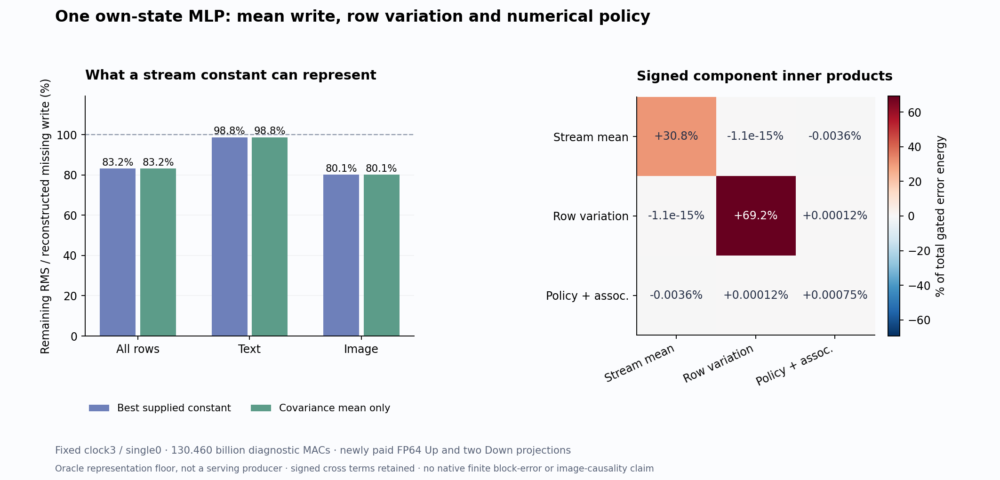

# A shared mean write helps, but most missing computation varies by row

Even a paid best per-stream constant leaves **83.21% of reconstructed missing-write RMS** on one own model state: **98.77% for text** and **80.10% for image**. The covariance mean nearly attains that constant-family optimum. A shared image contribution is useful, but estimating its mean more accurately cannot recover the remaining row variation in this representation.

This follows the [mean-Up image trajectory](mean-up-trajectory.md), where the first velocity and some red geometry improved while later velocity and PNG RMS mostly worsened. The [frozen diagnostic plan](plans/own-state-gated-covariance.md) fixes clock3/single0 before inspecting remainder magnitudes. It generates no new state continuation or image. Its quantities are reconstructed FP64 MLP-write discrepancies, **not actual native finite concatenated-block errors or a causal explanation of image drift**. The [arbitrary-prompt zero-neural goal](zero-neural-research.md) remains open.

See the [report](results/own-state-gated-covariance/report.json), [actual execution](results/own-state-gated-covariance/execution.json), [complete row observations](results/own-state-gated-covariance/observations.jsonl.gz) and [evidence summary](results/own-state-gated-covariance-evidence/README.md). Job `job-32438e275442` succeeds in 51.3 seconds. All 340 tiny mechanics tests and source/state/work/byte audits pass.

## What is being reconstructed

The original MLP acts separately on each normalized row. Its activation and value share that row; it does not explicitly compute the population covariance used in our diagnosis. The row already contains context from preceding attention and state advancement. Averaging rows is an approximation and an analysis instrument we introduced.

At this saved own-state receiver, A is the actual BF16 SiLU activation and P is the actual BF16 product formed by the candidate. Z, its selected support S, completed Up, anchors and residual gate g are also supplied from the authenticated own transaction. We pay for a new FP64 source-map reference

\[
U^*=ZW_U^T,\qquad P^*=A\odot U^*,\qquad E_P=P^*-P.
\]

This uses original BF16 coefficients and admitted inputs promoted to FP64. It is not the native BF16 full-Up contraction and is not a free operand. Its missing product includes both omitted centered Up and the candidate's finite admission/product policy.

For each text/image stream, form \(\bar U_s^*\) from these actual reference rows. Split

\[
R_P=1_{j\notin S}\,A\odot(U^*-\bar U_s^*),\qquad Q_P=E_P-R_P.
\]

Two more paid FP64 projections produce

\[
Y_E=E_PD^T,\qquad Y_R=R_PD^T,\qquad Y_Q:=Y_E-Y_R.
\]

D is the original MLP portion of the full output map. Y_Q is a **combined policy/reassociation remainder**. Its product-space counterpart contains selected-Up projection, omitted-anchor admission and multiplication rounding; the output subtraction also contains unseparated FP64 distributivity error. We did not evaluate a third Q_P D^T or recreate the current attention input and full native concatenated output affine. Residual gating here is FP64 multiplication by the saved BF16 g, not a replay of native residual rounding.

## Centering an Up value does not center its gated write

For a fixed support within this block, real arithmetic gives

\[
\overline{R_P}_s
=1_{j\notin S}\operatorname{Cov}_{i\in s}(A_{ij},U^*_{ij}).
\]

The value residual has zero stream mean, but multiplication by the row's gate can leave a coherent mean product. That is the missing term in an assumption that mean-Up completion is automatically unbiased. Two explicit FP64 reductions of this covariance agree to 1.15×10⁻¹⁶ relative RMS here; this is a measured reduction discrepancy, not a scientific tolerance gate.

After applying the saved residual gate, split gY_R into stream-constant mean M and centered row variation C, with Q=gY_Q. The measured total is approximately M+C+Q, with a separately retained FP64 closure residual. The signed Gram account is

\[
\|M+C+Q\|^2=\|M\|^2+\|C\|^2+\|Q\|^2
+2\langle M,C\rangle+2\langle M,Q\rangle+2\langle C,Q\rangle.
\]

Pooled energies are 4,229,325.83 for M, 9,521,036.79 for C and 103.81 for Q. Twice the mean/policy cross term is −982.59, centered/policy +31.71, and mean/centered about −3.13×10⁻¹⁰. The last near-zero value follows from centering; it is not evidence that the model has independent orthogonal circuits. Total reconstructed gated error energy is 13,749,515.55, with 1.86×10⁻⁹ Gram closure difference.

Q's norm is 0.2748% of the total reconstructed discrepancy norm. It is small within this boundary. That observation does not measure omitted native output/residual rounding or show that finite arithmetic is generally unimportant. Product-space expansion discrepancy is 1.20×10⁻¹⁴ relative to Q_P; final gated closure is 8.97×10⁻¹⁷ relative to gY_E. All remain observations.

## The best constant still leaves the row-dependent task

For a proposed constant b_s in each stream, the declared squared-error family has optimum

\[
b_s^*=\operatorname{mean}_{i\in s}(g\odot Y_{E,i}),\qquad
\sum_i\|gY_{E,i}-b_s\|^2
=\sum_i\|gY_{E,i}-b_s^*\|^2+|s|\|b_s-b_s^*\|^2.
\]

The constant is computed from the paid full reference and is not a cheaply produced candidate. It measures this family's capacity on one receiver, in this coordinate system and norm.

| Stream | Best constant: energy removed | Remaining discrepancy RMS | Covariance mean: remaining RMS |
|---|---:|---:|---:|
| All rows | 30.7527% | 83.2150% | 83.2150% |
| Text | 2.4490% | 98.7679% | 98.7680% |
| Image | 35.8369% | 80.1019% | 80.1019% |

Energy and RMS use different transformations: removing 30.75% of energy leaves the square root of 69.25%, or 83.21% RMS. These percentages normalize by the reconstructed missing write, not by a native block write, state magnitude, velocity or image.

Subtracting the supplied covariance mean improves 1,311 dependent rows and worsens 225: 290/512 text improve and 222 worsen; 1,021/1,024 image improve and three worsen. A pooled least-squares optimum need not improve every row. For each row,

\[
\|e\|^2-\|e-c\|^2=2\langle e,c\rangle-\|c\|^2.
\]

The correction has negative projection on 39 text rows. Another 183 worsened text rows and all three worsened image rows have positive projection that is insufficient to offset correction energy. Every image row has positive projection. The [scalar heterogeneity record](results/own-state-gated-covariance-evidence/row-heterogeneity.json) preserves those distinctions. These rows are not independent prompt replications.

The useful inference is bounded: a stream mean recovers part of a shared image write, while most of this receiver's missing computation requires a row-dependent representation. It does not justify another mean-only estimate as the next producer. It does not exclude richer state-conditioned programs or establish a universal property of other blocks, prompts or models.

## Paid work and the next constructive split

One full Up and two full Down contractions pay **130,459,631,616 MACs**, three times 1,536×3,072×9,216. Reductions, products, promotions, copies, fingerprints and I/O are additional work. The candidate uses two original BF16 parameter tensors totaling 245,366,784 bytes, with authenticated source views into U and D. The 101,548,032 input bytes and historical generation remain paid. There is no new attention, head, sampler, VAE or image call.

The 51.3-second scheduler run samples 1,836.8 MB RSS and 2,926 MB device memory. Worker CUDA peaks are 2,498,355,712 allocated and 2,745,171,968 reserved bytes. Its synchronized operation takes 4.5301 seconds, including internal projection fingerprints; worker wall time after imports is 37.1469 seconds, setup 6.9812 seconds and process CPU time 33.4493 seconds. The fresh post-seal scalar analysis takes 0.9268 seconds. These scopes do not measure a serving speedup.

One typed Act binds fourteen source inputs and 28 output ABIs. Complete byte verification checks 56 files / 9,669,525,057 bytes including inherited assets, 38 NPY payloads, two original parameters and both U/D source views. FP64 promotion/projection/reduction arithmetic is source-audited and tiny-tested, not independently numerically replayed by the byte verifier. Standard Saturn run/verify return zero: two streams / 19,968 records, zero fires/formal claims/qualified addresses and two missing expected fire ledgers. This is instrument and mechanics evidence, not semantic certification.

All 28 new arrays / 1,803,316,952 file bytes stay near compute, including promoted U/D maps. The 15-file primary compact publication totals 2,017,195 bytes. No new archive or deletion occurs. Last actual [cleanup75](results/storage-cleanup-cycle75/README.md) and scheduled review78 remain recorded; shared free-space observations are not cleanup attribution. The first scalar figure had a clipped colorbar label and overlapping legend. Its executed source/output are retained; a new [v2 figure](results/own-state-gated-covariance-figure-v2/figure.json) fixes display layout without changing science.

Astra recommends one [mean-gate versus changing-gate split](plans/mean-gate-variable-gate.md) at this same address. It will compute one new Down projection from the current activation mean times centered Up, seal, and only then compare with the paid previous output. Prospective work is 43,486,543,872 MACs, with no new Up or image. The resulting interface may suggest a useful factorization, but forming its two omitted-channel stream maps naively would itself cost 130,459,631,616 MACs plus 14,495,514,624 for application. Current support and coefficients change with the receiver. No economical compilation or strict zero-neural producer is established. The plan is written and unexecuted; the original goal remains active.
