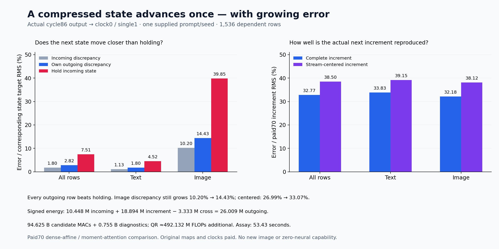

# Advancing the state we actually created

The reduced program now consumes its own preceding output and advances one complete FLUX single block. Every one of1,536 outgoing rows is closer to the retained successor than holding its incoming state unchanged. Error nevertheless grows: image-state RMS discrepancy rises **10.204%→14.431%**, and the next actual increment has **32.184% error**. This is one useful composed transition, with substantial accumulation; no new image or arbitrary-prompt zero-neural generator is established.

The [previous construction](receiver-weighted-row-output.md) selected row directions for the receiving output map and gate. Its local error improved, but it still consumed supplied normalized/read/product fields from earlier work. A state-machine claim needs a stronger test: the next computation must consume the state the replacement actually created. The [frozen plan](plans/receiver-own-state-successor.md) specifies clock0/single1 from actual86 text/image, and the [implementation contract](plans/own-successor-implementation.md) binds that test before staging.

Full [research review87](results/research-review-cycle87/README.md) retains this question. Newer forecast, MLP, family, history and search results expose useful local laws, but none supplies an economical arbitrary-prompt context/state/pixel producer. Repeated basis refinement can explain and reduce learned execution; by itself it has not supplied a route to zero neural evaluation.

Let x be the paid70 parent incoming state, \(\hat x\) actual86 outgoing state, \(F_{70}\) the retained70 dense-affine, moment-attention successor, and \(\hat F\) this reduced program. It computes \(\hat y=\hat F(\hat x)\), compared only after seal and successful producer exit with \(y=F_{70}(x)\). The reference is **not an independent original full-attention execution**. Paid clock modulation, absolute-position RoPE and original learned maps remain supplied.

The whole local computation is re-formed from \(\hat x\). With shared current modulation shift a, scale b and gate g,

\[
Z=(1+b)\operatorname{LN}(\hat x)+a.
\]

Physical original QKV weight rows0:9216 form one BF16 projection. Original Q/K RMS and absolute RoPE produce current queries/keys; current values enter image SDPA and the frozen FP32 text-moment law. Copying the projected Q/K/V into original fused-view strides restores the consumer's layout. It does not undo the narrower GEMM's changed kernel/finite policy, so native projection parity is unclaimed.

For each stream, the unchanged82 input-basis law uses current Z:

\[
H_s=Z_s^\top\Omega_s,\quad Q_sR_s=\operatorname{QR}(H_s),\quad
C_s=Z_sQ_s,\quad B_s=Q_s^\top W_{GU}^\top,\quad
\widehat {GU}_s=C_sB_s.
\]

A new operand-only implementation avoids calling the old complete producer and discarding its expensive full output projection. Complete G/Up crosses FP64→FP32→BF16 into original fused-view offsets before native SiLU/product. No archived normalized state, read, product or basis substitutes for this work.

Current attention read R and admitted product P form J=[R,P]. The unchanged86 output rule compiles its shared learned pullback V and then forms fresh row bases:

\[
V=W_o^\top(\Gamma\Omega),\quad H'_s=J_sV,\quad
U_sR'_s=\operatorname{QR}(H'_s),
\]
\[
K_s=U_s^\top J_s,\quad B'_s=K_sW_o^\top,\quad
\widehat Y_s=U_sB'_s.
\]

The actual finite update crosses FP64→FP32→BF16, then separate BF16 gate multiplication and residual addition. All rank128 columns, seeds, native nonlinearities and rounding conventions stay fixed. Nine typed inputs bind45 complete output fields. The outgoing state remains a full tensor; reduced computation does not establish a compact sufficient state.

| Error / corresponding target RMS | All rows | Text | Image |
| --- | ---: | ---: | ---: |
| Incoming state | 1.796% | 1.127% | 10.204% |
| Actual next increment | 32.774% | 33.835% | 32.184% |
| Outgoing state | 2.818% | 1.798% | 14.431% |
| Hold incoming, compare with outgoing target | 7.513% | 4.519% | 39.853% |
| Incoming, within-stream centered | 1.835% | 1.150% | 26.994% |
| Increment, within-stream centered | 38.502% | 39.151% | 38.124% |
| Outgoing, within-stream centered | 2.888% | 1.829% | 33.066% |

Every outgoing row beats holding. Yet1,535 rows have larger absolute outgoing error energy than incoming, including all1,024 image rows. The negative cross term on1,488 rows does not prevent this growth. Pooled state ratios are dominated by high-energy text states; reporting only the2.818% pooled exit would conceal both the image discrepancy and32.774% increment discrepancy. Incoming/outgoing targets and increment denominators differ and must remain explicit.

Define actual incoming difference and increment difference,

\[
D=\hat x-x,\qquad W=(\hat y-\hat x)-(y-x).
\]

Then \(\hat y-y=D+W\). The observed full energy account is

\[
26{,}008{,}929.870
=10{,}447{,}604.467+18{,}893{,}860.344-3{,}332{,}534.942.
\]

Text/image cross terms are−773,548.362/−2,558,986.580. Centering within each stream gives25,702,049.530=10,255,749.447+18,625,502.518−3,179,202.434. Vector subtraction closure energy is zero; scalar summation remainder is about10⁻⁸. Signed components are not positive causal shares. W combines changed-input response, approximation and finite-policy effects; this test does not identify them separately.

Text rows35/3 retain the largest outgoing error energies; image row512 is the largest image row. The [row localization](results/own-successor-evidence/row-localization.json), [phase summary](results/own-successor-evidence/phase-summary.json) and lossless observations preserve heterogeneity. Input-basis reconstruction error is29.568% pooled /36.947% centered. Output-sketch QR reconstruction is about6.85×10⁻¹⁶ relative RMS. Good factorization arithmetic does not certify state accuracy.

| Actual matrix work | MACs |
| --- | ---: |
| Physical QKV | 43,486,543,872 |
| Operand-only G/Up | 19,327,352,832 |
| Receiver output | 19,931,332,608 |
| Image attention QK+AV | 9,663,676,416 |
| FP32 text-moment products | 2,216,165,376 |
| Candidate | **94,625,071,104** |
| Post-exit diagnostics | 754,974,720 |
| Assay | **95,380,045,824** |

Four QR calls add approximately492.132M algorithmic FLOPs separately. Normalization/RMS/RoPE/SiLU/softmax, scalar moments, casts, padded buffers, copies, hashes and retention are additional. Original maps and upstream work remain paid. These counts establish neither whole-image work nor a matched runtime saving.

One guarded CUDA job, job-64601318e329, succeeds in **53.43 scheduler seconds**, with sampled **2,717.2MB RSS /2,554MB device**. Producer wall time after imports is21.224s, including5.465s setup; the analyzer separately takes5.302s after imports. Peak producer Torch allocation/reservation is1,800,834,048/2,311,061,504 bytes, a different scope from sampled process/device peaks. The6144MB RAM/4096MB VRAM envelope is an allocation-derived exception validated by actual admission, not an assertion that it was fully used. The3,189,925-byte payload has equal declared/sealed/executed SHA256.

All **362 mechanics tests** pass in19.49s, including three tiny dense, independent score/moment and scalar operand references, own-input response, typed zero-gate and RNG closure. Complete byte checks cover92files/686,015,758bytes/61NPY plus245,367,296 original parameter bytes. Physical QKV and actual QKV/J/sketch/pullback joins,45producer+7analysis ABIs, actual operation geometry and every scalar aggregate pass. This is source/toy/byte evidence, not independent real-array numerical replay. The [evidence index](results/own-successor-evidence/README.md) preserves exact source and custody boundaries.

Saturn run/verify applied to the raw result returns0 over1,536 records, zero fires/formal claims/qualified addresses and one expected missing no-fire ledger. All52new arrays/648,557,056NPY bytes remain near compute. Eighteen compact core files total1,590,434bytes locally/publicly. [Storage87](results/storage-audit-cycle87/README.md) preserves93recovery pointers:84older custody/type-size checks plus9fresh full SHA checks over3.806GB. There is no archive or deletion; last actual archive78, next full research/storage90.

Astra's next [matched-parent input plan](plans/matched-parent-successor.md) fills one missing corner \(y_0=\hat F(x)\), using exactly this frozen program and re-forming all operands. Then

\[
E_0=y_0-y,\qquad T=\hat y-y_0,\qquad
E_{\rm out}=E_0+T,\qquad W=E_0+(T-D).
\]

This would separate the reduced program's input response from its approximation on the parent input. It would still not identify native propagation or compression versus finite slicing. The plan is written and unexecuted, with no automatic depth or rank campaign. Contextual raw-prompt formation, economical own-state transitions and a general non-neural pixel producer remain open. Arbitrary prompts work in the full reconstructed learned pipeline; they do not yet work in a general zero-neural generator.

