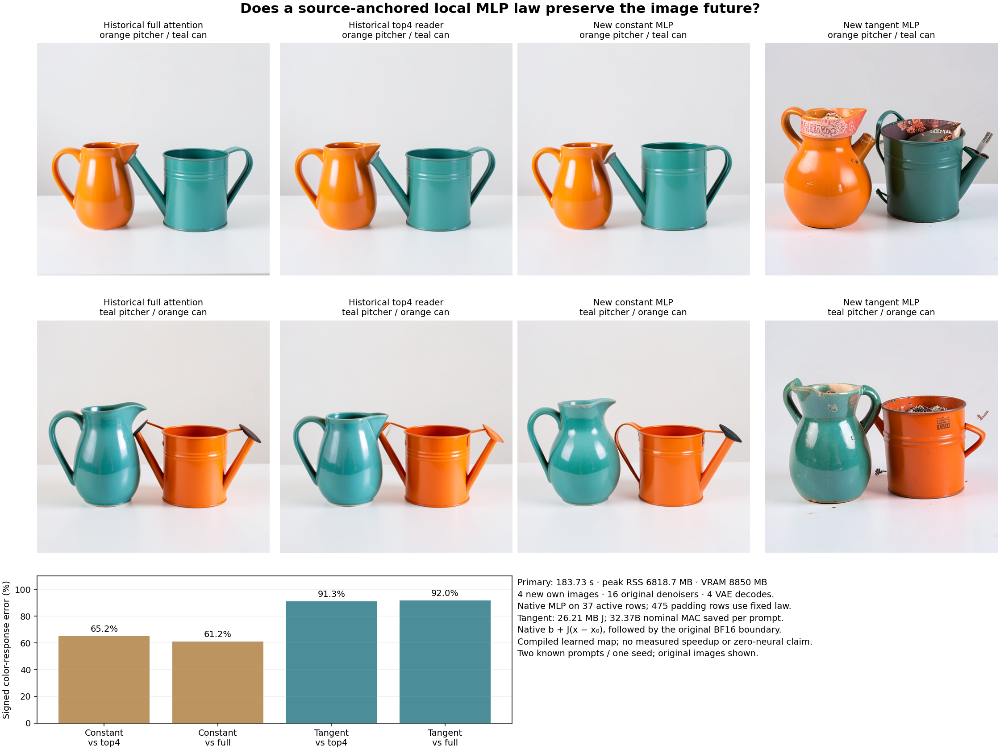

# A full-input tangent can be worse than a constant MLP write

The source-anchored tangent worsens both the direct padding MLP write and the final image response. Keeping every input coordinate was insufficient: the actual contextual receiver is outside the useful local regime of this lexical anchor. A separate post-seal diagnostic finds a large nonlinear remainder and strong cancellation with the linear response, far above the measured numerical discrepancies. This constrains this anchor and law; it does not rule out other source-derived computations.

The constant images preserve the coarse body colors and spatial order, with altered vessel geometry. The tangent images retain those coarse assignments but add conspicuous surface marks, interior clutter and extra structures. These are observations on two known development prompts at one seed, not an independent prompt-quality evaluation. [Visual observations](results/padding-mlp-tangent-evidence/visual-observations.json) retain the qualifications.

## The computation being replaced

This follows the [fresh prompt square](fresh-prompt-square.md), using its orange/teal pitcher-and-watering-can cases00/10 and seed 271828. Both candidates form their own raw-reader heads, residual receiver and native RMS-normalized input. All 512 query/residual/conditioning rows remain. Only block 0's 475 padding MLP writes change; the 37 active rows use one shared original MLP computation per prompt. Every later encoder layer and original image consumer consumes the candidate's actual emitted state.

Resolve the pad ID 151643 from the pinned tokenizer, authenticate its original embedding, and define

\[
x_0=N_{\rm native}(e_{\rm pad}),\qquad b=M_{\rm native}(x_0),\qquad
x=N_{\rm native}(e_{\rm pad}+W_oH).
\]

The compiler evaluates the source anchor with 512 repeated rows to preserve the inherited native affine profile; all repeated results agree exactly. It keeps native BF16 b separate from the smooth widened-weight function

\[
M_s(x)=D[\operatorname{SiLU}(Gx)\odot Ux].
\]

With g0=Gx0,u0=Ux0, the declared FP64 derivative is

\[
J=D\operatorname{diag}(u_0\odot s'(g_0))G
 +D\operatorname{diag}(s(g_0))U.
\]

This is the derivative of a smooth surrogate, rather than of the discrete BF16 program. The two serving laws are fixed before results:

\[
\widehat M_c(x)=b,\qquad
\widehat M_t(x)=\operatorname{BF16}\{b+J_{32}(x-x_0)\}.
\]

Tangent subtraction, matrix multiplication and addition use FP32, with CUDA TF32 disabled, before the original BF16 boundary. No input-rank truncation, target-fitted coefficient, new noise draw, native-image campaign or target-state refresh is used. All four new images seal before the original diagnostic MLP or saved full/top4 target values become available. The [frozen plan](plans/padding-mlp-tangent.md), [request](results/padding-mlp-tangent/request.json) and [candidate seal](results/padding-mlp-tangent/candidate-seal.json) bind that order.

## The actual consumer reverses the hoped-for improvement

| Observable | Constant anchor | Full-input tangent |
| --- | ---: | ---: |
| Direct padding-write error, case 00 | 134.92% | 160.00% |
| Direct padding-write error, case 10 | 134.26% | 158.84% |
| Signed H1 color-response error vs top4 | 69.07% | 86.26% |
| Signed E color-response error vs full | 106.43% | 1215.47% |
| Signed first-velocity response error vs full | 45.60% | 73.09% |
| Signed final-latent response error vs full | 84.62% | 121.48% |
| Signed PNG color-response error vs top4 | 65.18% | 91.26% |
| Signed PNG color-response error vs full | 61.16% | 91.97% |

Direct-write ratios compare the candidate write with the original 512-row MLP on that exact own receiver. Response ratios compare the difference between the two prompt outputs with the corresponding saved reference difference. They are RMS ratios, not fractions of a semantic capability explained. Endpoint PNG errors against full are 10.58%/14.19% for constant and 27.44%/25.31% for tangent. The large E discrepancy is retained alongside the smaller pixel discrepancy; later consumers change the error geometry.

The paid diagnostic's complete native H1 matches the historical top4 H1 at every retained scalar for both prompts. Receiver reconstruction is therefore supported directly. Changing the native active MLP from 512 to 37 rows introduces 0.2847%/0.3002% active H1 error against that parent. Both policies share exactly that active input/write, so this finite GEMM drift does not explain their difference. It remains part of each complete candidate's deviation from the historical parent.

## The missing remainder is large, and its sign matters

Let δ=x−x0, m0=Ms(x0), and use the original compiler's FP64 J before emission. Define

\[
L=J\delta,\quad R=M_s(x)-m_0-L,\quad
F=M_{\rm native}(x)-M_s(x),\quad A=m_0-b.
\]

If Qt=(b+L)−Mhat_t is the actual runtime emission/rounding difference, then

\[
M_{\rm native}(x)-\widehat M_t(x)=F+R+A+Q_t.
\]

For the constant policy,

\[
M_{\rm native}(x)-b=F+R+A+L.
\]

The [separate CPU diagnostic](results/padding-mlp-remainder/report.json) evaluates smooth source maps on the primary's actual saved receivers after image sealing. Its signed energy accounts retain every pairwise cross term:

| Padding error component / energy | Case00 | Case10 |
| --- | ---: | ---: |
| Nonlinear remainder R | 53,684.50 | 53,834.88 |
| Native-minus-smooth F | 0.3113 | 0.3237 |
| Smooth-anchor minus native base A | 0.5637 | 0.5637 |
| Tangent runtime emission/rounding Qt | 0.0805 | 0.0795 |
| Linear response L | 106,446.53 | 106,127.93 |
| Signed twice-cross term 2〈R,L〉 | −122,062.21 | −121,601.40 |
| Actual tangent error energy | 53,647.73 | 53,795.06 |
| Actual constant error energy | 38,144.18 | 38,433.73 |

The smooth remainder RMS is 0.21012/0.21041, while native-minus-smooth RMS is about 0.00051. The source-anchor CPU/CUDA association floor has maximum1.55×10⁻¹⁵; the complete decomposition closes to 4.44×10⁻¹⁶maximum absolute discrepancy. These are observed numerical floors, not threshold-based quality gates. The diagnostic's `smoothCurvature.relativeRms` field compares R with Ms(x), following the generic metrics API; it must not be mistaken for ||R||/||Ms(x)||. The energy and `candidateRms` fields above supply the intended remainder magnitude.

Why can the constant do better? Removing the linear response also retains its cancellation with R in the constant's error. R and L are vectors with a large negative cross term. Scalar component magnitudes cannot be added as error budgets.

Expanding the smooth gated product makes the omitted computation explicit. Write a=Gδ,c=Uδ, and Δs=s(g0+a)−s(g0). Then

\[
R=D\{u_0\odot[\Delta s-s'(g_0)\odot a]+c\odot\Delta s\}.
\]

The first part is gate curvature; the second couples the changed gate to the changed up payload. Keeping the full receiver preserves input information but does not perform these joint computations. Their exact evaluation would still require the original source maps; this identity is an explanation, not a free serving correction.

## Paid work and custody

The primary job `job-922839f9980e` succeeds in 183.73 scheduler seconds, peaking6818.7 MB sampled process-tree RSS and 8850 MB VRAM. Fresh-process phases are 30.16s compiler,6.17s reader,57.46s encoder,34.82s images and 12.83s native diagnostic; total time also includes sealing, scoring and transport/runtime overhead. This is an assay timing, without a matched speedup comparison.

Serving pays 104 original encoder blocks/SDPA calls,738 encoder linears (5.4011 trillion nominal MACs), two tangent products(6.22592 billion MACs),16 original denoisers/1,648 transformer linears(75.5828 trillion MACs), and 4 native VAE decodes. There are 4 new images,0 new reference images and 0 noise draws. The native post-seal diagnostic separately pays 2 full512-row MLPs/6 linears/76.5041 billion MACs.

The FP32 J payload is 26,214,400 bytes. Per prompt, the tangent replaces35.4877 billion nominal padding-MLPMACs with 3.1130 billion, avoiding32.3748 billion before overhead. That is 84.64% of the complete first512-row MLP's nominal work, but only about 0.16% of the inherited complete encoder-plus-denoiser affine total. Compiler products cost 127.5068 billion MACs, plus 38.2521 billion for the repeated native anchor and 0.0747 billion for the smooth anchor. Original active-row weights remain loaded. J is itself a learned dense map; this is not strict zero-neural serving.

The additive diagnostic `job-0ba07716745c` succeeds in 20.96s, peaking1015.8 MB RSS/0 VRAM with actual NumPyCPU 1 arithmetic. Intent-first admission reserves4 CPU threads; reservation and actual math threads are distinct. It pays 76.5041 billion smooth source-map MACs plus 6.7109 billion raw-JdeltaMACs, with no new image or native BF16 MLP.

The first request `job-a0b069724b5d` completed source compilation, then failed mechanically before reader heads because an outer target guard blocked integrity hashing. Its 63.99s/1729.5 MB RSS/1450 MB VRAM and completed compiler remain in the [failure record](results/padding-mlp-failed-v1/failure.json), with 0 candidate images. All seven emitted compiler arrays match the repaired run's arrays byte for byte. That failed attempt's paid source compilation is additional work; it is not a scientific null or omitted expense.

Independent full-byte checks cover569 primary/input/comparison members totaling 1,572,530,963 bytes,49 addon/input members totaling 209,261,067 bytes and 13failed-compiler members totaling 91,059,089 bytes. Those overlapping checks include inherited inputs; they are not new-storage totals. The 237 new primary arrays (788,457,088 bytes), eight addon arrays (83,887,104 bytes) and failed compiler stay near compute. Compact publications retain 122,880 primary and 1,900 dependent padding observations byte-losslessly. The [mechanics audit](results/padding-mlp-tangent-evidence/mechanics.json) checks108own encoder handoffs,16actual denoiser input joins, all 180 candidate boundary fields,20first-MLP fields,4 native diagnostic fields and original PNG identities. All 183 mechanics tests pass. Both Saturn run/verify sweeps return0 within observation-stream scope; they supply no semantic certification or physical-address proof.

## Next: retain nonlinear query trajectories and test their output reconstruction

[Astra's newest-post/source/result review](results/padding-mlp-tangent-evidence/advisor.json) selects a different structural boundary: retain every active row plus 16 fixed original padding positions, execute their own full original nonlinear trajectories through all 27 encoder blocks, then copy nearest retained padding rows into the demanded H9/H18/H27 conditioning taps. The [frozen next plan](plans/retained-padding-queries.md) uses original native attention from block 0and historical full as primary reference, without changing the first-reader approximation at the same time.

The exact structural premise is that padding never supplies an attended key. Omitted padding queries cannot affect retained rows when operations are rowwise and positions/masks are preserved. Finite compact GEMM/SDPA drift remains measured; the reconstruction of all 512conditioning rows is an approximation. Copying rows preserves count/multiplicity, not original attention mass or partition. Two new images will test that demanded reconstruction with no fit, noise draw or new reference campaign.

At 53 retained rows, nominal encoder affine work would fall89.65%, approximately 6.16% of the inherited encoder-plus-denoiser affine total. This is a proposed reduction in learned work, with no latency or strict zero-neural claim. The plan is written and unexecuted.

The [living research record](zero-neural-research.md) keeps the full goal active. Source/input/continuation closure and the real image consumer remain necessary; arbitrary raw prompts with zero neural evaluations are not established by this result.
