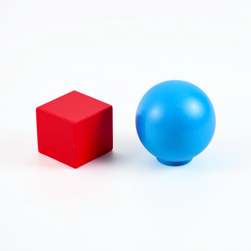
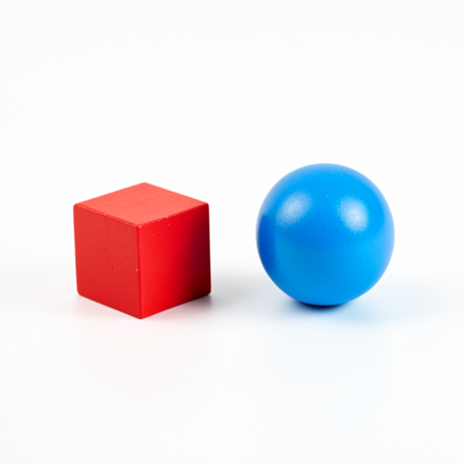
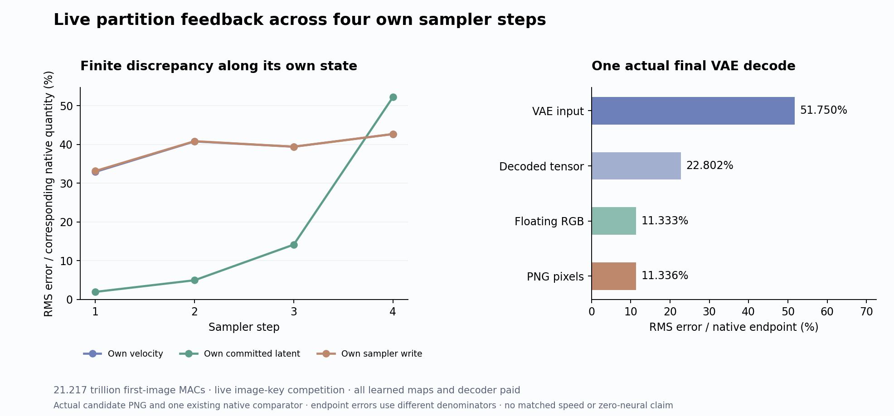
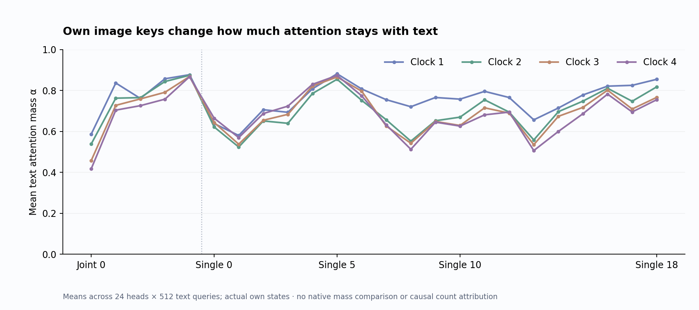

# Image-key competition recovers the two-object scene

The new candidate produces a closed red cube on the left and one separate blue sphere on the right. Unlike the [text-only program](prompt-program.md), it no longer fills the tabletop with extra objects. The sphere has an added base and the geometry, lighting and proportions still differ from the native image. First-velocity error falls from 64.22% to **32.93%** and PNG error from 21.96% to **11.34%** on this one supplied prompt/seed.

This supports useful live text attenuation without returning image values to text on this specimen. It does not establish that image values are irrelevant, that query-specific feedback is necessary, or that normalization alone caused the extra objects. The candidate also restores concatenated single-block projection geometry and uses explicit FP32 text attention. Those finite changes remain part of the contrast. All original learned maps and decoding still run; arbitrary-prompt zero-neural generation remains open.

## A small feedback interface can have an expensive producer

At a fixed common incoming Q, K and V, split text attention into two partitions:

\[
Z_T=\sum_{j\in T}e^{s_j},\quad Z_I=\sum_{j\in I}e^{s_j},\quad
\alpha=\frac{Z_T}{Z_T+Z_I},
\]
\[
O_T^{native}=\alpha O_{TT}+(1-\alpha)O_{TI}.
\]

The previous image-independent compiler used O_TT. This candidate uses **alpha O_TT**, retaining image-key competition while omitting image-value payloads from text writes. The identities hold in real arithmetic at common incoming operands. They do not decompose the measured differences between complete trajectories after their states diverge.

Both streams evolve through their own states. All incoming Q/K/V are formed before either residual update. Joint MLPs consume each stream’s post-attention residual; single-block attention and SwiGLU share the same incoming normalized concatenation. Image attention keeps complete current text/image K/V. Text starts at C(E) independently at each of four clocks, and the final unused text write is physically omitted.

The finite text program forms FP32 full-key scores, scales after QK, applies one stable full softmax, then multiplies **only its text columns** by current text V. It does not renormalize those columns or multiply by alpha a second time. The text read returns to BF16 before the original output/write path. Autocast and TF32 are disabled for these products. Passing zero image values to a full SDPA would still execute all AV products; the implementation physically excludes that multiplication.

## The own-state result

| Step | Velocity error | Committed latent error | Own sampler-write error |
|---|---:|---:|---:|
| 1 | 32.93% | 1.97% | 33.15% |
| 2 | 40.78% | 4.97% | 40.84% |
| 3 | 39.41% | 14.16% | 39.42% |
| 4 | 42.68% | 52.21% | 42.68% |

All four initial C fields match native bytes. The first velocity already differs by 32.93% before sampler histories diverge. Later writes consume the candidate’s own previous latent and velocity; one actual VAE decodes its final state. There is no intermediate native refresh, new reference, encoder call, noise draw, fit or sweep.

PNG RMS is **27.082 channel levels**, MAE 8.303, with 675,651 of 786,432 values changed and maximum absolute difference 255/255. The high RGB cosine, 0.9936, does not remove the visible differences. VAE-input, decoded-tensor, floating-RGB and PNG errors use different endpoint denominators; their percentages are not a common decoder-contraction measurement.

The measured own text mass averages **0.7115** across all 24 heads, 512 text queries, 24 live blocks and four clocks. Clock means are 0.7604, 0.7073, 0.6943 and 0.6839. Individual head/block means range from 0.0576 to 0.9987. This is a heterogeneous feedback field, rather than one global scalar. It contradicts exact count-only alpha=512/1536=1/3 on these states, while leaving open whether some constant attenuation could still be useful.

These mass summaries describe the candidate’s own states, not native masses or an independent explanation of object count. All per-head summaries and full alpha arrays remain retained. The first plot’s adjacent labels overlapped; its source and image remain immutable, with the separate corrected v2 displayed here.

## Actual work and time

The run executes 440 denoiser affine calls, 100 image SDPA calls and 192 explicit text matmuls, followed by the original decoder. Its account is

\[
C=18{,}688{,}085{,}327{,}872_{affine}
+1{,}292{,}785{,}156{,}096_{attention}
+1{,}236{,}317{,}241{,}344_{conv}
=21{,}217{,}187{,}725{,}312\ \text{MACs}.
\]

The 96 full text QK and text-only AV pairs cost 309,237,645,312 MACs; native image/decoder SDPA costs 983,547,510,784. Against the original 21,603,734,781,952 account, **386,547,056,640 MACs** are omitted: 231,928,233,984 terminal text work and 154,618,822,656 image-value products into live text reads. This gives back 154,618,822,656 score MACs compared with the text-only compiler. Every image-key projection, original MLP, head and decoder remains paid.

Guarded job `job-1e9752e9cd39` took **93.23 scheduler seconds**, with sampled RSS 8,442.8 MB and device memory 9,416 MB. Worker wall time after imports was 66.181 seconds, including 32.046 seconds setup; saved-only analysis took 0.855 seconds. CUDA allocation/reservation peaks were 8,619,938,816 / 9,539,944,448 bytes. Timing includes fingerprints and output I/O. It is not a matched speedup comparison with the previous two-process compiler experiment. Nominal MACs omit elementwise/reduction, hashing, loading and I/O costs; measured time retains them.

## Produce the image partition from current key moments

Astra’s next [mean/covariance partition producer](plans/image-partition-moments.md) targets the useful scalar interface itself. For current normalized, rotated image keys, form a per-head mean mu and full population covariance Sigma. Approximate

\[
\widehat{\log Z_I}(q)=\log N_I+\frac{q^T\mu}{\sqrt d}
+\frac{q^T\Sigma q}{2d},\qquad
\hat\alpha=\sigma(\log Z_T-\widehat{\log Z_I}).
\]

This is a second-order cumulant approximation, not an established Gaussian law. Higher moments and extreme keys can matter. It uses actual current image keys already needed by image attention, rather than supplied target gates, fitted coefficients or a static alpha table. Full covariance retains coherent cross-coordinate structure that a diagonal approximation would discard, a concern illustrated by the earlier [key-norm investigation](diagonal-key-norm.md).

The proposed producer would physically replace the text-query×image-key score grid. Its matrix products cost 605,552,640 MACs per live read versus 1,610,612,736 for that grid. Across 96 reads, prospective saving is 96,485,769,216, yielding **21,120,701,956,096 first-image MACs**. Means, centering, quadratic row products/reductions and scalar functions remain additional paid work. The saving is modest. The useful scientific question is whether a smaller current-state summary can produce the feedback required by the next text consumer. The plan is written and unexecuted.

## Evidence, reviews and storage

The [report](results/partition-feedback/report.json), [execution ledger](results/partition-feedback/execution.json), [candidate seal](results/partition-feedback/candidate-seal.json), [scheduler/custody](results/partition-feedback/scheduler.json) and [frozen request](results/partition-feedback/request.json) bind the actual result. [Complete byte verification](results/partition-feedback/retained-array-verification.json) covers 497 files / 9,336,749,747 bytes, 464 NPY payloads, 169 original parameters, two unique physical slices across eight records, and four own terminal-row concatenations.

[The mechanics audit](results/partition-feedback-evidence/mechanics.json) checks nine Acts, 429 output ABIs, 432 candidate fields, 100 coupled state handoffs and 192 explicit text products. [All 11,840 signed comparisons](results/partition-feedback/observations.jsonl.gz), [2,304 descriptive partition-head rows](results/partition-feedback/partition-observations.jsonl.gz) and [block progression](results/partition-feedback/block-progress.jsonl.gz) remain lossless. [322 tests](results/partition-feedback-evidence/tests.json) pass. The [standard sweep](results/partition-feedback-evidence/saturn-instrument.json) is instrument evidence, not semantic certification. Final latent unpack/BN/unpatchify remains source-audited rather than independently numerically replayed.

The [law](../generator/partition_feedback.py), [worker](../generator/partition_feedback_worker.py), [ledger](../generator/partition_feedback_ledger.py), [fresh analysis](../generator/partition_feedback_analysis.py), [launcher](../generator/partition_feedback_study.py), [byte/work/state auditor](../generator/publish_partition_feedback.py) and [tiny tests](../generator/test_partition_feedback.py) are frozen. [The evidence index](results/partition-feedback-evidence/README.md) includes Astra’s exact source/result/visual/synthesis review and early newest-post survey69. Neighboring read/Taylor and math-union evidence is unchanged since67; it still pays its baseline/derivative or supplied-rule costs.

The [cycle69 cleanup](results/storage-cleanup-cycle69/README.md) moves 1.151 GB of redundant transports to full-checksum-verified cold storage while retaining extracted evidence. [The audit](results/storage-audit-cycle69/README.md) checks 76 restore pointers and preserves unqualified candidates. Complete new scientific arrays remain near compute. The original arbitrary-prompt zero-neural goal stays active and unsolved.
