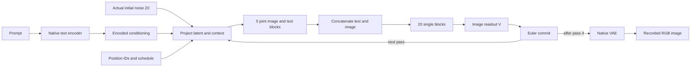

# FLUX pipeline visualization plan

Status: proposed implementation. The ISA explorer is implemented; this document specifies a second model pack without launching new model runs.

## Goal and first specimen

Show how a FLUX image is computed: prompt conditioning and initial noise enter a fixed architecture, live attention and MLP computations update image/text registers, the scheduler commits a new latent, and the next denoising pass consumes that latent. Keep recorded native execution alongside the independently calculated trajectory so the visitor can inspect both agreement and discrepancy.

Start with the accepted **FLUX.2 Klein 4B distilled, seed 113, CUDA BF16, batch one, four passes, 512×512** history. Its prompt describes a green cone left of a yellow cylinder. Each pass has projection, five joint blocks, twenty single blocks, readout, and an Euler commit: **28 addressable transitions per pass, 112 total**. These are four scheduler steps, not 112 denoising steps.

Use the [initial-noise workflow](https://github.com/JHollenb/saturn-pub/blob/main/packages/mdb/docs/FLUX-INITIAL-NOISE.md) and [executed campaign](https://github.com/JHollenb/saturn-pub/blob/main/packages/mdb/qualification/flux_initial_noise_campaign.py) as the first evidence source. The accepted audit SHA-256 is `314fe2d2c63aedf1392b87f0c599a417bfc241e54fac8a9f127d868c834f3115`. Resolve checkpoint identity, parameter recipes, input hashes, and execution profile from that bundle; do not substitute another FLUX family or current library defaults.

## Teaching experience

Keep the existing visual language and model menu. Selecting FLUX loads its adapter and data on demand. Preserve the ISA walkthrough and its independent playback position when switching models.

The FLUX walkthrough has six chapters:

1. **Inputs and context.** Show the prompt, native encoded conditioning, initial-noise fingerprint, position IDs, and actual timestep/sigma schedule. Encoding is an observed native input to this forecast. A seed is a label; the retained initial-noise bytes identify the state.
2. **Two interacting streams.** Expand one joint block to show image and text streams attending together, then applying their own receiving MLPs. Keep the five-block group collapsed in the overview, with all five selectable in the depth strip.
3. **One combined stream.** Animate the concatenation `[text; image]`, then open one of twenty single blocks. Attention and MLP features run in parallel before their shared output projection, gate, and residual addition. Text and image rows remain distinguishable inside the combined register.
4. **Commit the next latent.** Readout extracts the image rows and computes the denoiser output. The signed sigma interval scales that output, the latent is updated, and temporary working registers clear. The next projection receives the committed latent.
5. **Compare predicted and native futures.** Run the recorded full forecast and native trajectory in synchronized lanes, each using its own preceding state. Add the matched late forecast as a separately labeled origin at observed native Z2, after 56 native transitions.
6. **Inspect the difference.** Show the actual terminal images, latent errors, RGB error map, and worst pixel. Teach why a close image can coexist with nonzero hidden-state discrepancies.

The architecture remains visible above the computation and state views. Use the model's data flow, rather than a decorative neural mesh, to explain each operation. Preserve blue for native, amber for reconstructed, and the existing component colors; use row labels and border patterns to distinguish text from image without introducing a conflicting second color legend.

### Overview and linked controls

Provide play/pause, previous/next transition, reset, pass selection, and a 28-position depth scrubber. The playhead is a typed tuple `(history, pass, phase, blockIndex, boundarySide)` rather than ISA's bit-row clock. Use zero-based source addresses in the inspector and human-readable pass 1–4 labels in navigation. The 112-transition timeline advances recorded computation; it does not simulate worker wall time.

Selecting a boundary updates the architecture highlight, both lanes, source-qualified state fields, and error plot together. A token/feature selection changes the inspected coordinates, not the execution clock. Every comparison joins by exact history and cursor; missing native values remain unavailable rather than being interpolated.

For latent previews, use a fixed-scale 32×32 heatmap of a selected packed-latent channel, with token positions resolved from the recorded IDs. Label it as a latent channel, not an RGB reconstruction. The initial bundle has four terminal VAE PNGs. Display those actual images at terminal states; do not invent intermediate decoded images or animate a crossfade as if it were the model's trajectory.

## State and mathematics

At a pass boundary, display the carried state

\[
S_s=(Z_s,E,I_{img},I_{txt},\boldsymbol\tau,\boldsymbol\sigma,s).
\]

Parameters and numerical-profile identity are immutable external bindings. Within a pass, expose the live image register X, text register Y, time-derived modulation m, and phase/block cursor. The denoiser output V exists after readout. Show the lifetime of each field instead of carrying obsolete values across a commit.

The accepted geometry includes packed latents `[1,1024,128]`, conditioning `[1,512,7680]`, and a hidden width of 3072. The block binding specifies 24 attention heads, head dimension 128, MLP width 9216, and four RoPE axes of width 32. Read these from the exporter manifest and validate them against the selected bundle; the shared renderer must not hardcode these dimensions.

### Joint blocks and receiving MLPs

Use the following real-arithmetic diagram, with BF16 rounding boundaries available in the precision drawer:

\[
(A_X,A_Y)=\operatorname{Attention}(X,Y;\mathrm{IDs},m),
\]
\[
R_X=X+g_{A,X}\odot A_X,\qquad
X'=R_X+g_{M,X}\odot M_X(\operatorname{ModLN}(R_X;m)),
\]

with the analogous text update. The MLP receives the attention-updated residual. Open its SiLU product:

\[
M(x)=W_o[\operatorname{SiLU}(W_gx)\odot W_vx]
     =W_o\operatorname{diag}(\operatorname{SiLU}(W_gx))W_vx.
\]

This distinguishes the internal, input-dependent SiLU gate from the outer time-modulation gate. It also connects directly to the ISA lesson: fixed weights produce different finite responses on different receiving states. Use the [measured MLP account](https://github.com/JHollenb/saturn-pub/blob/main/packages/mdb/docs/FLUX-MLP-STATE-LAW.md) for context and scope; its separate CPU BF16 panel must not become a claim of CUDA parity in the initial-noise history.

### Single blocks and parallel merging

For H=`[Y;X]`, show normalization/modulation, fused projection into positioned Q/K/V and MLP operands, then

\[
A=\operatorname{softmax}(QK^T/\sqrt d)V_{attn},\qquad
M=\operatorname{SiLU}(u)\odot v,
\]
\[
P=W_o[A;M],\qquad H'=H+g\odot P.
\]

Include Q/K RMSNorm and RoPE before attention. This is unmasked, noncausal attention over the combined sequence. Keep the joint block's sequential attention-then-MLP update distinct from this parallel merge. The [complete single-block reference](https://github.com/JHollenb/saturn-pub/blob/main/packages/mdb/qualification/flux_transition_reference.py) defines the qualified ordering.

### Scheduler commit

The principal live calculation uses actual retained scalar coordinates from each pass. With Q denoting round-to-nearest-even BF16 conversion, preserve the measured CUDA scheduler profile:

\[
\delta_s=Q(\operatorname{FP32}(\sigma_{s+1}-\sigma_s)),\quad
D_s=Q(\operatorname{FP32}(\delta_s V_s)),\quad
Z_{s+1}=Q(\operatorname{FP32}(Z_s+D_s)).
\]

Show incoming latent, signed interval, output field, rounded update, and committed latent side by side. Export actual finite-value bit patterns and expected results; JavaScript uses `Math.fround` and an explicit ties-to-even BF16 helper. An optional ideal-arithmetic toggle exposes where rounding changes the answer. It does not silently change the recorded execution profile.

## Recorded evidence and browser computation

Use three explicit modes in the computation panel:

| Mode | What supplies the values | What the visitor can change |
| --- | --- | --- |
| Recorded comparison | Native captures and the sealed mathematical forecast | History, pass, depth, register, coordinates |
| Live recorded-input math | Small Euler calculations from retained scalar operands | Scalar coordinate and precision display; custom values lose the native comparison |
| Teaching sandbox | Deterministic small synthetic attention and SiLU-product examples | Toy inputs, logits, value vectors, and gates |

The toy attention example uses six tokens and four features; the MLP example uses four input and eight hidden features. They teach the same algebra without pretending to execute the 4B model. Full-size learned projections and attention remain recorded in this release. Do not download original weight banks, reconstruct hundreds of millions of values on page load, invoke an inference backend, or run a new scientific campaign.

Keep the measured differences visible. For full112, the final latent error is 3.3254% relative RMS and RGB MAE is 0.116628/255, with maximum channel difference 42. For matched56, the corresponding observations are 1.2509%, 0.066078/255, and 10. Exact reconstruction of the sealed mathematical program is a different comparison from its nonzero error against native CUDA.

Plot both absolute RMS and same-clock relative RMS, with field-specific units. Do not treat unavailable fields as zero. Use shared scales for paired heatmaps and retain the complete endpoint error tail. The native/sham endpoint is a replay control, not another independently predicted image. Full and matched forecasts share one native history and do not establish cross-seed generalization or inference speedup.

## Data export and implementation

### Shared presentation layer

`ModelHost` already handles adapter loading and disposal, but the current main HTML template and ISA adapter still own ISA-specific headings, controls, graph drawing, and state panels. First extract reusable architecture, walkthrough, playback, inspector, and dialog components. Let adapters supply their main body and clock/state renderers; do not clone ISA's register grid for FLUX. Leave the existing `mount(pack, environment)` and abort-signal contract intact.

Add a FLUX pack module, adapter, and small numerical-kernel module under `viz/src/`. Keep registry entries lightweight and dynamically load each family's implementation and evidence. The pack declares repeated groups, two-stream edges, concatenation, terminal decoding, clock domains, state-field lifetimes, lesson definitions, and source bindings. Collapse repeated blocks by default while retaining individual address selection.

### Exported bundle

Write an offline `viz/scripts/export_flux_evidence.py` accepting an explicit research-workspace/source path. Its primary source is `artifacts/mdb-flux-initial-noise-20261105-corrected/`, especially:

- `audit.json`, `numerical-summary.json`, and `depth-plot-data-v2.json` for comparisons and the complete depth curves;
- `run-01/extracted/flux-initial-noise-result/binding*.json`, transition records, typed-cut manifests, and retained arrays for identity, geometry, field lifetimes, schedules, samples, and previews;
- the original `full.predicted.png`, `matched.predicted.png`, `native.png`, and `sham.png` for terminal outputs;
- the corrected reader receipt and independent audit for numerical interpretation and source authority.

Verify source digests before deriving data. Preserve the producer tree. Read the retained lossless BF16 arrays through the qualified corrected reader; the original integer-reader bug must not be reintroduced.

Emit compact, versioned files in `viz/public/data/flux-klein/`: manifest/graph, timeline, field summaries, sampled coordinates, Euler fixtures, depth errors, endpoint metrics, images, and provenance. Every numeric record identifies its history, transition, field, coordinate or reduction scope, dtype, source path, and digest. Mark full-field reductions, coordinate samples, and display-only heatmap reductions separately. A sampled tensor view never stands in for full-field RMS.

Retain all 112 transition records while limiting initial JSON to metadata and compact summaries. Load selected-state tiles, endpoint images, and detailed errors only when requested. Keep immutable artifacts and human-facing summaries connected through a downloadable manifest. Cache assets per model pack; switching back to ISA must not refetch FLUX arrays or preserve its running timer.

Targets: keep ISA's compressed core below 1 MB; initial FLUX metadata and UI below 1 MB compressed; each lazy detail response below 2 MB. Use the original roughly 85 KB terminal PNGs. The multi-gigabyte source arrays and pretrained weights stay outside this repository and browser bundle.

### Delivery order

1. Extract the shared components and adapter-owned main view, keeping ISA numerical and playback behavior unchanged.
2. Implement the deterministic exporter, verify all source bindings, and generate the compact FLUX fixtures and four terminal images.
3. Add the FLUX architecture, nested clocks, synchronized recorded lanes, field-lifetime inspector, and endpoint comparison.
4. Add the live BF16 Euler calculation, small labeled attention/MLP sandboxes, equations, and six guided chapters.
5. Complete numerical, switching, performance, keyboard, and responsive verification, then publish a new private Site version with the existing identity. Public GitHub source does not itself change the Site's audience.

## Acceptance checks

- All 28 local transition addresses map to the correct four-pass global timeline. Boundary 55 is observed native Z2; boundary 111 is terminal Z4. Distinguish operation inputs from outputs explicitly.
- Full and native paths consume their own prior committed latent. The matched forecast begins only at its declared observed native Z2 and is unavailable at earlier clocks.
- Projection, joint, concatenation/single, readout, commit, and terminal states expose only live fields. Commit clears the temporary fields specified by the source profile.
- Exported samples, schedules, image files, and summaries reproduce their source hashes/values. Independent mathematical equality and native numerical discrepancy remain separate comparisons.
- BF16 conversion covers ties, signed zero, and the retained hostile scalar cases. The recorded-input Euler fixtures match the qualified scalar profile exactly. Toy attention weights sum to one; SiLU-product and merge examples reproduce their declared small arithmetic.
- Switching ISA → FLUX → ISA restores the correct interface and model-specific selection, cancels pending fetches/timers, and leaves one active adapter. No ISA bit-row/register assumptions leak into the FLUX view.
- Selecting a transition synchronizes graph, equations, lanes, error plot, and state. Missing fields and unavailable decoded images are shown honestly. Terminal images are the original VAE outputs.
- Validate desktop and mobile layouts, readable stream/field labels, keyboard controls, reduced motion, lazy loading, byte budgets, and absence of inference/weight-download requests. Retain all existing ISA checks.

The next content expansion can add the [four-context prompt factorial](https://github.com/JHollenb/saturn-pub/blob/main/packages/mdb/docs/FLUX-PROMPT-FACTORIAL.md) and [contextual interaction experiment](https://github.com/JHollenb/saturn-pub/blob/main/packages/mdb/docs/FLUX-INTERACTION-CORRECTIONS.md) as separate evidence-bound lessons. Keep their seeds, clocks, capture coverage, and causal claims separate from the initial-noise walkthrough.
