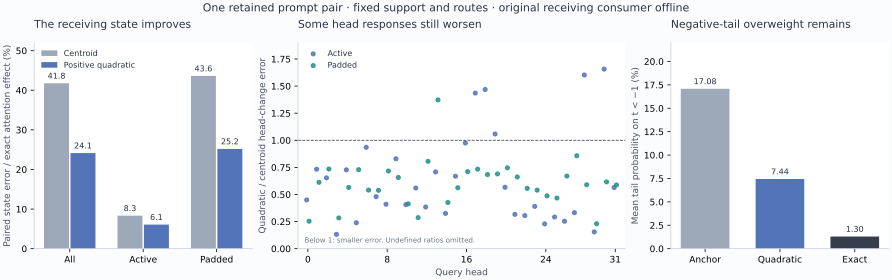

# A joint positive tail law preserves more of the prompt response

Status: **measured retrospective component result; arbitrary-prompt zero-neural images remain open**. One positive quadratic measure improves paired first-block state error from 41.76% to 24.15%, with active error 8.33%→6.08%. It improves all 32 heads overall, while five active heads and one padded head worsen. The candidate uses full supplied current-prefix operands; it does not yet provide a reusable compact state or complete contextual encoder.

The [frozen plan](plans/positive-tail-moment-closure.md) follows the [tail mass/value factorial](current-support-tail-factorial.md). That diagnostic found both omissions material and partly cancelling. Rather than repair them independently with exact targets, this experiment predicts both from one positive law, seals its complete output, and only then opens exact-tail diagnostics and original receiving parameters.

The figure uses one retained pair, with dependent rows and heads. Its right panel describes conditional probability inside the tail, not causal attribution of the remaining error. [Figure provenance](results/positive-tail-evidence/figure.json) distinguishes this local rendering from the original scientific run.

## One measure supplies numerator and partition

Keep the original current-query ordered top4 support S, complement T, source anchor and route. Let p_T be the anchor-normalized tail distribution, μ_T its key mean, δ the current query displacement and V the value vector. Center the directional tilt as

\[
t_j=\delta^\top(u_j-\mu_T).
\]

Exact attention uses κ=E_T[eᵗ] and H*=E_T[V eᵗ]/κ. The new law replaces eᵗ in both places:

\[
r_2(t)=1+t+\tfrac12t^2=\tfrac12[(t+1)^2+1]>0,
\]
\[
\kappa_2=E_T[r_2(t)],\qquad
H_2=\frac{E_T[V r_2(t)]}{\kappa_2},\qquad
Z_{T,2}=\widetilde Z_T\kappa_2.
\]

Z̃_T is the existing centroid tail mass. Combine Z_T,2 and H₂ with the unchanged selected mass/mean. Because the numerator and partition share one positive measure, the read remains inside the original value hull. This is stronger than adding a value covariance correction to an unrelated denominator.

Canonical arithmetic computes log r₂ using `logaddexp`, forms positive normalized tail weights and aggregates masses in log space. It does not square a huge t directly. Exact-tail outputs are absent from serving. The actual finite E[t] is retained rather than forced to zero; empty tails return the selected read and leave tail diagnostics undefined.

In ideal arithmetic the moment form is

\[
\kappa_2=1+E_T[t]+\tfrac12E_T[t^2],\qquad
H_2=H+
\frac{\operatorname{Cov}_T(V,t)+\tfrac12\operatorname{Cov}_T(V,t^2)}{\kappa_2}.
\]

The direct positive read is canonical; independently evaluated moment forms are diagnostics. Their observed tail-value closure is at most 1.11e−15 and logκ₂ closure about 1.97e−15. Small centering/gauge defects remain separate from approximation error.

## It improves the actual receiving state

The saved crane-before/crane-behind prompts each have 27 attended rows and 485 padded query rows. Only token 8 changes. All 32 query heads and 512 output rows are consumed through the original output projection, residual, RMS normalization and SwiGLU equations. Padding is part of the conditioning computation, not discarded output.

The primary error denominator is the same exact **attention-caused paired state change** used in the preceding experiments. Its RMS is .0248576 overall, .0317437 active and .0244172 padded. Complete endpoint-state ratios are reported separately.

| Read | All rows | Active rows | Padded rows | Changed row 8 |
|---|---:|---:|---:|---:|
|Previous centroid|41.76%|8.33%|43.61%|4.19%|
|Positive quadratic|24.15%|6.08%|25.19%|2.88%|
|Exact control|0|0|0|0|

Before row 8 the true change and candidate change are zero, so the relative ratio is undefined. Exact-control zero is identity with the reference, not a new general predictor result. This is one already-scored pair, with no new-prompt or seed replication.

Rounded head-bank paired error improves 37.13%→22.33% overall, 16.52%→9.96% active and 38.07%→22.89% padded. All 32 heads improve overall. Active heads 17, 18, 19, 28 and 30 worsen; padded head 13 worsens. For head 13 the true padded-change RMS is only 3.10867e−5, while error grows 6.42451e−5→8.81848e−5, or 206.66%→283.67%. Both the small denominator and absolute countertrend remain visible.

Both complete receiving endpoints improve too: attention-effect error 11.29%→6.33% and 11.38%→6.15%. Using the complete hidden-state denominator instead gives 12.62%→7.07% and 12.72%→6.88%. None of those endpoint observations substitutes for the paired change.

## Less cancellation hides the remaining error

Let w₂ and H₂ be the predicted tail weight/value, and w*,H* their exact counterparts. The ordered smooth error is

\[
A=(w_2-w^*)(H_2-h_S),\qquad B=w^*(H_2-H^*),\qquad h_2-h^*=A+B.
\]

Canonical control arithmetic C and BF16 rounding R complete the finite identity. The report retains A, B and C vectors, paired differences, every signed cross-energy and the independently reconstructed rounded error.

The quadratic's paired rounded head-error energy is 9.46874e−7, versus 2.61760e−6 for the centroid. Normalized mass/value energies are .54872/.44390, with signed cross-energy −.00336 and rounding energy .01169; remaining terms close the total. The old mass/value cross-energy is −.28044. Thus the new error is smaller and much less dependent on mass/value cancellation. Those are order-dependent vector decompositions, not unique causal credit.

## The polynomial's limits are measured too

Mean padded tail weight moves .17334/.17400→.23138/.23245, closer to exact .28290/.28424. Mean logκ₂ is .52180/.52267, versus exact centered logκ .92069/.92240. Mean tail log-mass error remains −.39889/−.39973, with some positive errors and minima near −6.10. These are equal-weight head/query descriptions, not a ratio of globally pooled partition sums.

The actual t range reaches about −7.30 to 14.87. The quadratic grows when t becomes more negative below −1, opposite to eᵗ. Mean conditional tail probability on that predeclared region is approximately:

| Distribution | P(t<−1), padded rows |
|---|---:|
|Anchor|17.08%|
|Quadratic tilt|7.44%|
|Exact exponential tilt|1.30%|

The candidate reduces the anchor's overweight but retains a substantial mismatch. Large positive t also exposes polynomial undergrowth. These observations do not identify which region causes most downstream error; that would require a matched intervention. Quadratic positivity also does not recover e^(a+b)=e^a e^b.

The separately retained Gaussian diagnostics are logκ−E[t]−Var(t)/2 and H*−H−Cov(V,t). Mean padded scalar residual is .14250/.14108, but spans roughly −3.76 to 5.20. Mean tail-value error relative to the exact value tilt is .39738/.39417 for the quadratic and .71035/.70457 for the Gaussian value approximation. Each prompt has 74 zero-effect padded ratios left undefined. No Gaussian bank receives a learned consumer; these diagnostics cannot establish its state quality or rule out all Gaussian/moment methods.

## A useful directional law is not yet a small state

Write X=u−μ_T. The numerator includes E[Vt²]=E[V(δᵀX)²]. Answering arbitrary δ from stored moments generally needs a value-weighted key–key statistic, not only Cov(V,X):

\[
E[Vt^2]=E[V\otimes XX^\top]:(\delta\delta^\top).
\]

A straightforward full FP64 tensor at d=128, 32 heads and 64 anchors per head would contain 34,359,738,368 bytes, before other state. Symmetry, sharing or factorization might reduce that, but no such representation is established by this directional assay. The experiment allocates no higher-order tensor; it reads actual saved keys and computes directional moments.

Query-dependent top4 selection adds another requirement: a streaming full-prefix summary needs a numerically qualified way to remove the selected contribution and form its tail. Supplying the selected addresses does not solve their retrieval cost, and naive complement subtraction can lose a small tail. These are the next representation and execution questions, rather than a reason to keep raising polynomial order on the same full prefix.

Astra's [review](results/positive-tail-evidence/advisor.json) selects one [source-defined rank-one streaming state](plans/rank-one-tail-state.md), shared per GQA group, with the full centroid preserved. Its declared moments cost8,437,760 logical FP64 bytes before other storage, while the full retrieval K/V remains. The subsequent [cycle19 result](rank-one-tail-state.md) executes that plan: streaming/direct BF16 banks match with no fallbacks, but paired state error is39.02%. The representation retains only part of the full-direction gain.

The newest [global-sign computation post](/Users/jakeholl/domains/obsidian/blog/2026-11-06-070800-where-a-sign-flip-becomes-a-different-computation.md) strengthens a related route: qualify reusable operation-specific rewrites through their actual consumers. Its attention oddness and SwiGLU even term predict changed downstream history, but original projections remain, including the proposed shortcut's down projection. That reference does not close the zero-neural image gap.

## Compute and custody

Guarded CPU job `job-e9d147a7b3a5` succeeds on its first attempt. The candidate-only child seals both complete raw/BF16 banks before any exact-tail diagnostics, old-output decoding or original parameter reads. Only support positions and routes are decoded from the historical frozen-support files; whole-file hashing remains paid custody I/O.

Post-seal candidate replay has zero raw-bit or BF16-word differences. Every frozen support/order and route matches. Reconstructed 00/11 controls also match their parents in all raw bits and BF16 words, so centroid/exact/zero consumers are inherited. Only the new quadratic bank is consumed once per prompt.

| Measurement | Observed |
|---|---:|
|Scheduler / worker wall time|28.79s / 25.683s|
|Peak sampled RSS / VRAM|1,804.0 MB / 0|
|Candidate child including startup|2.799s|
|Child after imports, wall / CPU|2.738s / 2.024s|
|Child high-water RSS|158,572 KiB|
|Runtime source geometry payload|3,153,920 bytes|
|Original parameter read/verification|5.016s|
|Post-seal diagnostics, per prompt|3.090s / 3.095s|
|Original consumer + serialization, per prompt|3.124s / 3.776s|
|New full output / MLP projections|2 / 6|
|Nominal new dense-consumer MACs|87,241,523,200|
|Exact-head references / nominal QK-PV MACs|64 / 4,294,967,296|

The MAC counts are geometry-derived contraction counts, not complete FLOPs, hardware instructions or energy. Candidate full-prefix contractions, routing, positive weights, diagnostics, nonlinearities, hashing and serialization remain additional. See the [accounting receipt](results/positive-tail-evidence/accounting.json). Timings cover different work from the earlier factorial and do not establish a native-model speedup. No framework forward occurs, but original learned receiving arithmetic remains paid offline work.

Execution uses CPU NumPy FP64 with one math thread, default 4CPU/4GB admission, strict preflight, 600-second timeout and no automatic retry. All 89 mechanics tests pass. This FP64/BF16/FP32 policy is not native CUDA/Flash numerical parity.

Independent full-byte checks cover 30 files / 5,804,744,363 bytes, including the original 4,967,215,360-byte shard and overlapping ancestors. Full arrays stay near compute. The compact result bundle is 11 files / 4,083,622 bytes, with all 23,040 observations and 11,088 scalar/vector descriptions preserved through lossless gzip. The [Saturn run/verify sweep](results/positive-tail-evidence/sweep.json) covers one observation stream, no fires and no terminal image claims or physical-address joins. An initial unsupported CLI flag was corrected before the instrument ran; the receipt preserves that distinction.

Request SHA: `3dc084fb8e6f60dd89df466706ba547628f3e1c02bae08f3034b68fc8cc5817c`. Prediction seal: `813a971dfa3635fa46cd0eead6f0a9adfcfd11d09ac8984648ff6576e567e640`. Declared/sealed/executed payload: `6ac2351c3c2bacd196e1e8bf13702ce5fe95c04d7bb672afc03a3a5664efdb68`.

Read the [report](results/positive-tail/report.json), [provenance](results/positive-tail/provenance.json), [retained-byte manifest](results/positive-tail/retained-array-verification.json), [serving law](../generator/positive_tail.py), [post-seal diagnostics](../generator/positive_tail_diagnostics.py), [study](../generator/positive_tail_study.py), [publisher](../generator/publish_positive_tail.py) and [tests](../generator/test_positive_tail.py). Contextual encoding, complete own-state diffusion, general pixels and independent prompt/image quality remain required for the full goal.
