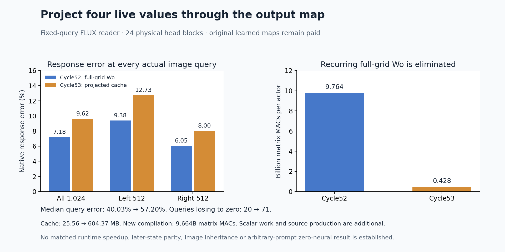

# Compose the attention read with its output projection

The sparse reader now projects only four live value directions through each physical Wo head block. Its recurring full-grid Wo evaluation is absent: **427,819,008 matrix MACs per actor**, versus 9,764,339,712 previously. The projected complement cache grows from 25.56 MB to 604.37 MB, and native response error rises from **7.18% to 9.62%**. This is a measured computation–memory–fidelity tradeoff on one supplied fixed-query family.

Median query error rises from 40.03% to **57.20%**, with **71 of 1,024 queries losing to zero**, versus 20 previously. Eighty-eight rows improve in absolute native response error and 936 worsen. The reduction does not establish a faster generator, a complete successor state or arbitrary-prompt zero-neural execution. Original source production, baseline construction and learned maps remain paid.

The [report](results/projected-complement/report.json), [compiler](results/projected-complement/compiler.json), [actors](results/projected-complement/primary.json), [complete query records](results/projected-complement/queries.jsonl.gz), [byte custody](results/projected-complement/retained-array-verification.json) and [mechanics](results/projected-complement-evidence/mechanics.json) preserve the actual computation. The [frozen plan](results/projected-complement/frozen-plan.md) and [Astra review](results/projected-complement-evidence/advisor.json) bind its scope.

## Move the linear reader across the normalized sum

Keep the [cycle 52](sparse-text-kv-innovation.md) sphere-cube-plain-2027 state, step 2/joint1, four tokenizer-resolved text rows, original parameters and numerical profile. Actual image queries and the complement bank remain fixed. The previous compiler supplied, per query/head, a stable reference m, complement partition Z and 128-wide complement numerator N.

Let Wo(h) be the original 3072×128 physical column block for head h. Compile once in CPU FP64:

\[
\widetilde N_{ih}=W_o^{(h)}N_{ih}.
\]

A fresh actor forms its own four K/V rows with the unchanged original normalizations, projections and RoPE. It projects only its four actual value directions:

\[
\widetilde v_{jh}=W_o^{(h)}v_{jh},\qquad j\in S.
\]

With the same selected scores, stable cache scale c, weights w and denominator D as cycle 52, evaluate this literal order:

\[
A_h=w_h\widetilde V_h,\qquad
T_h=(c_h\widetilde N_h+A_h)/D_h,\qquad
o=\sum_{h=0}^{23}T_h.
\]

The head sum runs in ascending order. Only the completed projection converts FP64→FP32→BF16, followed by the original BF16 gate and residual commit. There is no extra precision arm, fitted gain or output-selected policy.

The identity is exact in real arithmetic. Moving Wo changes projection accumulation and removes the intermediate BF16 head conversion. Native equality therefore remains a measurement. All **14 upstream K/V, score, peak, cache-scale, selected-weight and denominator payloads match cycle 52 exactly** across the two arms. This places the changed computation after partition formation; it does not isolate head quantization from projection accumulation.

The new compiler reads only sealed N and original Wo as numerical operands. It does not derive its cache from an old head, carrier or answer. The actor cannot read old N or completed targets; it receives the projected cache and actual source-bound inputs. Both complete actors seal and their process exits before either historical reference set is opened. Two typed MDB/Saturn Acts bind actual inputs, FP64 Wo, emitted outputs and lineage. Explicit complete JSON-to-seal joins protect both phases.

## The native and parent comparisons remain separate

The original family measures fidelity to native execution. Cycle 52 measures the changed finite program against its direct predecessor. Both comparisons use the actor's own PQP−QQQ response.

| Reference/panel | Response error | Absolute RMS | Native or parent response RMS | Median query error | Rows losing to zero |
|---|---:|---:|---:|---:|---:|
| Native/all | 9.62% | .003495 | .036342 | 57.20% | 71 |
| Native/left 512 | 12.73% | .003530 | .027724 | 72.34% | 51 |
| Native/right 512 | 8.00% | .003460 | .043277 | 43.53% | 20 |
| Cycle 52/all | 9.66% | .003510 | .036335 | 57.11% | 76 |

Native-response cosine is .99537; two rows have negative cosine. The new QQQ sham and PQP endpoint errors are .1789%/.1849% against native, and .1812%/.1839% against cycle 52. Physical grid halves are address panels, not identified object mechanisms. Small endpoint errors do not license inheritance of later MLPs or images.

## Count the new work and its paid ancestry

| Per-actor matrix operation | MACs |
|---|---:|
| Two four-row K/V projections | 75,497,472 |
| Selected QK | 12,582,912 |
| 24 physical Wo blocks on four values | 37,748,736 |
| Selected projected-value AV | 301,989,888 |
| Matrix total | **427,819,008** |

Separately, each actor performs 75,497,472 cache multiply/add pairs, 75,497,472 per-head divisions and 72,351,744 head-reduction additions. Norms, RoPE, softmax/partition scalars, casts, commits, checks and I/O remain additional. The new compiler performs 24 physical Wo projections and 9,663,676,416 matrix MACs; both actors together perform 855,638,016. Incremental work is **10,519,314,432 matrix MACs**. Including the historical baseline compiler gives 58,837,696,512 before original P/Q production and all other paid preparation.

Four distinct BF16 tensors occupy 56,623,360 bytes. One compiler Wo load plus four actor-process parameter loads total 75,497,728 bytes; each process also forms a 75,497,472-byte FP64 Wo copy. The 604,372,992-byte projected cache excludes actual queries, source states, row inputs, weights, outputs and scratch. Per-head working fields are streamed rather than retaining repeated 604 MB intermediates. Fifty-two actor affine calls use four K/V projections and 48 physical four-value Wo blocks; no actor full-grid Wo is executed.

Job job-832603af095e succeeds in **79.91 scheduler seconds**, with **3,429.1 MB peak RSS and 424 MB peak device usage**. Compiler/actor process phases take 35.89/38.71 seconds including imports; post-import scopes take 13.92/27.80 wall and 9.69/20.94 CPU seconds. The compiler projection alone takes .609 seconds. The first and second actor arithmetic samples take 2.922/.201 seconds before capture. These asymmetric single samples, source checks, cache I/O and instrumentation do not establish a controlled serving speedup. The compiler uses CPU FP64; the actors use CUDA BF16 K/V and CPU FP64 projection/cache arithmetic.

All **272 tests pass in 16.33 seconds**. [Byte verification](results/projected-complement/retained-array-verification.json) covers 86 files/8,660,586,506 bytes, including original assets and 25 new arrays/701,205,632 bytes kept near compute. Sixty-five independent NPY payload witnesses reread 907,474,944 bytes without new storage. Eighteen compact scientific files total 615,476 bytes before summaries and figure.

The evidence run/verify processes all 1,024 original query records, with zero formal claim receipts. Its standard numeric adapter recognizes only one top-level predicate: nested reference metrics are beyond its one-level field discovery. This is partial instrument coverage, not numerical certification. Array finite checks, exact typed inputs, complete bytes and dedicated scalar audits provide separate evidence. The [instrument receipt](results/projected-complement-evidence/saturn-instrument.json) and workspace feature request preserve that limit.

## Produce the source operands next

[Astra 53](results/projected-complement-evidence/advisor.json) recommends [forming the four demanded joint0 text rows](plans/selected-source-text-producer.md) from actual P/Q input cuts. Each source would retain every current K/V row but compute only four text queries and their sequential MLP ancestry, then emit its own QQQ/PQP rows into this unchanged reader. P's MLP must consume P attention even though the final PQP splice uses Q attention. That next cut is written and unexecuted; historical prefixes, receiving cache and original learned maps remain paid.

The latest [two-family result](../../obsidian/blog/2026-11-06-231247-two-computation-families-share-a-discovery-protocol.md) now reports twelve frozen inequalities and thirty exact numerical futures, with shape collateral and larger orthogonal probe changes. It strengthens ancestry and consumer discipline while retaining original dense execution. The [symbol-table synthesis](../../obsidian/blog/2026-11-06-230748-symbol-tables-in-mdb-from-causal-roles-to-cheaper-execution.md) identifies contextual resolution and operand production as the remaining general step. Those observations favor moving upstream from supplied ports.

This result establishes a bounded composition with an explicit fidelity cost. Arbitrary raw-prompt conditioning, changing-query closure, complete text/image continuation and general pixels remain unresolved. The full zero-neural goal stays active. Last actual storage cleanup is 51; the next is due 54 or earlier pressure. No archive or deletion occurs this cycle.
