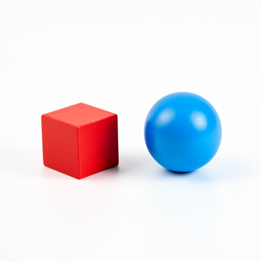
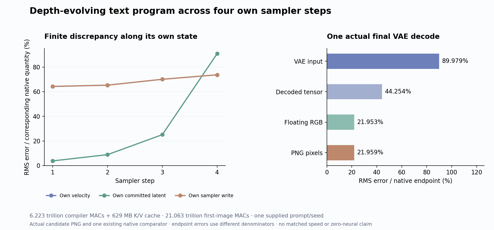

# An evolving text program brings the objects back

A text program that evolves through FLUX’s layers, without seeing any image state, produces recognizable red shapes and blue spheres on a white tabletop. That is a substantial visual change from the [fixed-text experiment](fixed-text-memory.md), whose image became pale texture. The new image still violates the prompt: it contains many extra objects, and its large red object resembles an open box rather than a closed cube. Depth-dependent text processing recovers part of this scene; it does not establish faithful image-independent generation.

The prompt was “A red cube to the left of a blue sphere on a plain white tabletop. Two separate objects, studio photograph.” This is one known conditioning/noise pair and one new image. There was no new encoder call, noise draw, native reference, fit or prompt sweep. All learned compiler, image and decoder computation remains paid. Arbitrary-prompt generation with zero neural evaluations is still open.

## Meaning can be fixed while its representation evolves

The native block couples text and image states:

\[
(T_{\ell+1},I_{\ell+1})=B_\ell(T_\ell,I_\ell;c_k).
\]

The previous candidate replaced every incoming text state with the same initial projection C(E). That removed both depth-dependent text processing and image-conditioned feedback. A fixed prompt meaning q does not imply that every layer can read the same tensor: a layer may require T_l=phi_l(q), with a different coordinate map at each depth.

This experiment restores those coordinate changes through an image-independent recurrence:

\[
T_0=C(E),\qquad T_{\ell+1}=G^{TT}_\ell(T_\ell;c_k),
\]
\[
(K^T_\ell,V^T_\ell)=P_\ell(T_\ell;c_k),\qquad
I_{\ell+1}=F^I_\ell(I_\ell;K^T_\ell,V^T_\ell,c_k).
\]

Each of the four clocks starts its own text recurrence at C(E). Text attention normalizes over the current 512 text rows only. Joint blocks retain sequential attention-residual then MLP-residual updates; single blocks retain attention and SwiGLU operating in parallel from the same normalized input. The compiler caches each layer’s **incoming** head-normalized, rotated K and original projected V before updating text. Its final text update has no consumer, so only terminal K/V are formed.

The compiler seals its 100 K/V pairs and exits. A fresh image actor combines those banks with its own current image K/V, queries, MLPs and residual states. It advances four own sampler commits and actually decodes its final latent once. The compiler’s numerical allowlist excludes noise, image IDs, image states and native hidden-text trajectories. Historical E and the original learned parameters remain supplied information.

## A partial recovery with a large first-update discrepancy

| Step | Velocity error | Committed latent error | Own sampler-write error |
|---|---:|---:|---:|
| 1 | 64.22% | 3.82% | 64.32% |
| 2 | 65.27% | 8.89% | 65.30% |
| 3 | 70.06% | 25.11% | 70.07% |
| 4 | 73.71% | 90.86% | 73.71% |

Each error uses the corresponding native quantity as its denominator. The write comparison subtracts each lane’s own previous latent. All four C fields match the native bytes. The first velocity therefore diverges substantially inside the modified denoiser, before later sampler-state differences accumulate.

Against the fixed-C candidate, first-velocity error falls from 83.27% to 64.22%, final latent error from 105.61% to 90.86%, and PNG error from 29.67% to 21.96%. The actual PNG supplies the stronger qualitative observation: the object/color family reappears, while count and shape remain wrong. These are observations on one combined architectural and finite-execution contrast, not an independent semantic evaluation or a universal causal attribution.

PNG RMS error is 52.459 channel levels, MAE 23.259 and maximum absolute difference 255 on the 0–255 scale. There are 779,549 changed values out of 786,432. RGB cosine is 0.9756 despite the extra objects. VAE-input, decoded-tensor, floating-RGB and PNG errors have different denominators; their decreasing percentages do not establish contraction in a common norm.

## The compiler is a paid computation

For N_T=512, N_I=1024, D=3072 and M=9216, the 100 K/V formations and 96 live text updates cost

\[
C_{text}=100(2N_TD^2)
+96\left[N_T(2D^2+3DM)+2N_T^2D\right]
=6{,}223{,}407{,}611{,}904\ \text{MACs}.
\]

The actual operation ledger agrees. Shared conditioning/clock preprocessing adds 48,925,507,584 affine MACs and is exported once to the actor. Compiler plus one image and decoder pays **21,062,568,902,656 nominal matrix/convolution MACs**. The matched original account is 21,603,734,781,952. The difference is only **541,165,879,296**, or 2.505%:

\[
\Delta C=231{,}928{,}233{,}984_{\;terminal}
+309{,}237{,}645{,}312_{\;image\to text\ reads}.
\]

Most of the fixed-C experiment’s saving has been spent restoring text computation. The new BF16 cache is **629,145,600 bytes**. Both children load the full 169 original transformer tensors, 7,751,089,152 bytes, sequentially. Cache reuse across other seeds is an interface possibility; no second seed, amortized benefit or quality claim was measured.

The guarded RTX 4080 job took **128.97 scheduler seconds**, with sampled peak RSS 8,227.2 MB and device memory 9,248 MB. After imports, compiler wall time was 48.632 seconds, including 27.674 seconds of setup; actor wall time was 39.008 seconds, including 26.707 seconds of setup. Analysis took 0.624 seconds. Fingerprints, cache I/O and progress writes are included in their relevant scopes. These measurements are not a matched speedup benchmark. The nominal MAC account excludes elementwise operations, hashing, loading and I/O; their cost remains in measured time.

## Factor the missing feedback before approximating it

For one text query/head, split native attention into text and image partitions:

\[
Z_T=\sum_{j\in T}e^{s_j},\quad Z_I=\sum_{j\in I}e^{s_j},\quad
\alpha=\frac{Z_T}{Z_T+Z_I},
\]
\[
O_T^{native}=\alpha O_{TT}+(1-\alpha)O_{TI}.
\]

The compiler uses O_TT. It therefore removes both competition for attention mass and the image-value payload:

\[
O_T^{native}-O_{TT}=(1-\alpha)(O_{TI}-O_{TT}).
\]

These identities hold for fixed common incoming Q, K and V in real arithmetic. They do not decompose the measured difference between the native and text-only trajectories, whose states subsequently diverge.

The next [partition-feedback test](plans/text-partition-feedback.md) will retain alpha from the actor’s own current image keys but set the image-value contribution to text writes to zero. Its text read becomes alpha O_TT. This is one scalar feedback per text query/head, not one scalar for the whole model and not a cheap operation: forming full current keys and scores still costs learned computation. It also gives up image-independent text precompilation.

This is a cleaner question than another static text representation: can dynamic competition alone recover useful structure, or does the text path need the image-value payload too? The extra-object observation motivates that question; it does not prove that attention mass controls object count. The next experiment remains written and unexecuted.

## Evidence and reproducibility

[Job/custody](results/prompt-program/scheduler.json) `job-b9dc640f60cb`, [request](results/prompt-program/request.json), [actual report](results/prompt-program/report.json), [compiler ledger](results/prompt-program/compiler-execution.json), [actor ledger](results/prompt-program/execution.json), [compiler seal](results/prompt-program/compiler-seal.json) and [candidate seal](results/prompt-program/candidate-seal.json) bind the run. [Complete byte verification](results/prompt-program/retained-array-verification.json) covers 447 files / 9,019,724,043 bytes, 408 NPY payloads, 169 original parameters and four terminal physical-slice witnesses.

The [dedicated audit](results/prompt-program-evidence/mechanics.json) checks 13 Acts, 273 explicit output ABIs, 200 compiled-bank consumption joins and 100 own image-block joins. [All 11,840 signed rows](results/prompt-program/observations.jsonl.gz), [compiler progression](results/prompt-program/compiler-block-progress.jsonl.gz), [actor progression](results/prompt-program/block-progress.jsonl.gz) and [clock progress](results/prompt-program/progress.jsonl.gz) remain available. [319 mechanics tests](results/prompt-program-evidence/tests.json) pass. The standard [evidence sweep](results/prompt-program-evidence/saturn-instrument.json) is a source/instrument check, not semantic certification. Final latent unpack/BN/unpatchify remains source-audited rather than independently numerically replayed.

The [law](../generator/prompt_program.py), [compiler](../generator/prompt_program_compiler.py), [actor](../generator/prompt_program_actor.py), [typed ledger](../generator/prompt_program_ledger.py), [fresh analysis](../generator/prompt_program_analysis.py), [launcher](../generator/prompt_program_study.py), [independent auditor](../generator/publish_prompt_program.py) and [tiny tests](../generator/test_prompt_program.py) are retained. [The evidence index](results/prompt-program-evidence/README.md) links source review, actual visual inspection and storage scope. All executed scientific sources are frozen. The [prospective protocol](plans/prompt-only-text-compiler.md) remains unchanged, including its historical “unexecuted” status at the time of freezing.
