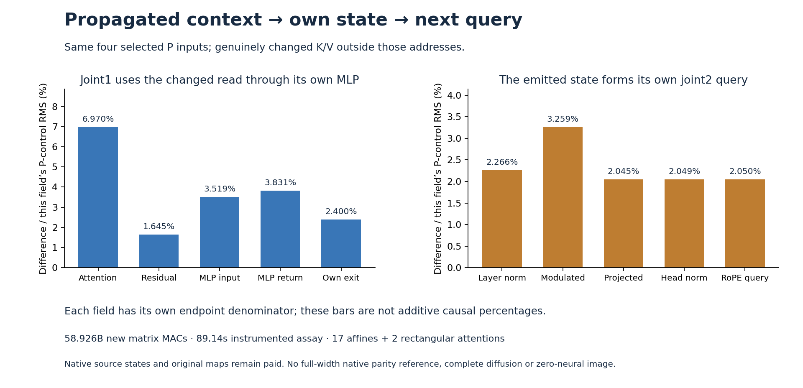

# Propagated context changes the next query

Holding four selected P operands fixed while replacing their surrounding K/V changes the joint1 attention return by **6.970%**, its own emitted state by **2.400%**, and the joint2 query formed from that state by **2.050%**. All percentages use the corresponding full-P control endpoint's RMS. This is an informative context contrast: every fresh K and V row differs between the two source banks, including all 1,532 rows outside the selected four.

The result identifies information missing from a proposed four-row state interface. It does not yet replace that context's production, establish an image effect or supply arbitrary-prompt zero-neural generation. The assay pays original learned maps and supplied native source states.

The [immutable report](results/propagated-context/report.json), [original source-byte inventory](results/propagated-context/byte-inventory.json), [complete observations](results/propagated-context/observations.jsonl.gz), [byte custody and splice witnesses](results/propagated-context/retained-array-verification.json) and [mechanics](results/propagated-context-evidence/mechanics.json) bind the executed result. The [frozen plan](results/propagated-context/frozen-plan.md) precedes execution.

## Begin where the change has actually spread

The previous [source-complement experiment](source-complement-transfer.md) had identical context outside S=[4,11,12,13]. Its identical outputs could not test context sufficiency. Here the same sphere-cube-plain-2027 pair is inspected **after joint0, entering joint1**, at logical diffusion step 2.

Authenticated original source states show changed BF16 words in all 512 text rows and all 1,024 image rows. Outside S, that is 508 text rows plus all image rows. The context descriptors—including global modulation and position factors—match exactly. This byte inventory happens before any learned computation. The original native prefixes remain paid; these are supplied intermediate states, not raw prompts interpreted by a new program.

Two fresh full joint1 K/V banks are then formed through original normalization, modulation, projection, head normalization and absolute RoPE. All 1,536 K rows and all 1,536 V rows differ. Four selected P keys and values are gathered from the fresh full P bank, and P's selected query is formed once. Both arms reload the identical sealed selected residual, Q/K/V and positional operands.

## Separate demanded outputs from the context they read

Let C∈{Q,P} identify the complementary source. Assemble

\[
\widetilde K_C=K_C[\bar S]\cup K_{P,S},\qquad
\widetilde V_C=V_C[\bar S]\cup V_{P,S}.
\]

Primary uses Q's complement; control uses P's. Both retain P's selected query and residual. The original rectangular attention and sequential MLP advance each arm's own state:

\[
A_C=W_o\operatorname{Attn}(q_{P,S},\widetilde K_C,\widetilde V_C),
\]
\[
U_C=B(R_{P,S}+B(g_AA_C)),\qquad
M_C=\operatorname{MLP}_{\theta}(\operatorname{ModLN}(U_C)),
\]
\[
T_C=B(U_C+B(g_MM_C)).
\]

B denotes the separate pinned BF16 output boundaries. There is no earlier PQP direct-attention splice in this experiment. The actual T emitted by each arm feeds its own next query:

\[
q_C^{next}=\operatorname{RoPE}\left[
\operatorname{HeadNorm}\left(W_q^{(2)}\operatorname{ModLN}(T_C)\right)\right].
\]

The outer native FLUX2 forward forms joint modulation once and passes the same values to every joint block, so the authenticated global text modulation is also the actual joint2 operand. No clock network is rerun. The next query consumes each candidate's T directly; no archived state refresh occurs.

| Captured field | Primary-minus-control RMS | Difference / control endpoint RMS |
|---|---:|---:|
| Attention head context H |.117919|8.7818%|
| Attention return A |.215864|6.9700%|
| After-attention residual U |.184740|1.6446%|
| MLP input X |.0202695|3.5185%|
| Fused gate/up projection |.0410327|2.9162%|
| Nonlinear product |.0430179|4.3737%|
| MLP return M |.124635|3.8306%|
| Own emitted state T |.246801|2.4003%|
| Next modulated query input |.0440638|3.2588%|
| Next query after RoPE |.0255126|2.0505%|

The denominator changes with the field. These bars do not show additive causal percentages or monotone error growth. In the final query, 11,057 of 12,288 BF16 values differ. Across the 96 row/head pairs, relative differences range from **1.157% to 3.574%**, with **1.737% median** and no zero-difference heads. The [scalar summary](results/propagated-context-evidence/scalar-summary.json) preserves that distribution.

If a proposed reduced state contains only the shared selected residual, Q/K/V, clock and positions, it has the same value in both arms while the next query differs. A deterministic update using only that interface cannot reproduce both measured conditional futures. The missing input is the complementary context or a sufficient summary of its effect. This is a scoped counterexample for the tested intervention family, not a general exclusion of compact states. Supplying the full complementary bank as context restores the dependency by definition; the difficult question is how to produce or update it economically.

No later joint2 attention, logits, velocity or image is computed. A changed query is not by itself evidence of a changed attention allocation or an image-level outcome.

## Factor the realized writes without losing cancellation

Capture the actual attention and MLP writes, D_A=B(g_AA) and D_M=B(g_MM). For Δ=primary−control, the exact saved-field account is

\[
\Delta T=\Delta D_A+\Delta D_M+\rho,
\]

where ρ collects the difference in realized residual-commit rounding. The reconstructed identity has maximum absolute discrepancy zero.

| Term | RMS | RMS / RMS(ΔT) |
|---|---:|---:|
| Attention write difference |.184968|.7495|
| MLP write difference |.176595|.7155|
| Residual-commit rounding difference |.0338231|.1370|
| Final ΔT |.246801|1|

The attention/MLP cross term is negative:

\[
2\operatorname{mean}(\Delta D_A\Delta D_M)=-.00558443.
\]

Their differences partly cancel in squared-norm composition. The signed dot contributions mean(term·ΔT)/mean(ΔT²) are .51635, .46526 and .01839, summing to one. They are algebraic accounting weights, not independent causal shares or a predictor of the MLP. In particular, the rounding term's 13.7% norm ratio and 1.84% signed dot weight answer different questions. All pairwise terms remain in the raw report.

## Context production dominates the remaining work

| New matrix work | Nominal MACs |
|---|---:|
| Two complete K/V banks |57,982,058,496|
| Shared selected P query |37,748,736|
| Two rectangular attention reads |75,497,472|
| Two own output/MLP paths |754,974,720|
| Two own next queries |75,497,472|
| **Total** |**58,925,776,896**|

Bank formation is **98.398%** of these nominal matrix MACs. Seventeen affines and two rectangular attentions execute. Thirteen distinct original parameter tensors occupy **301,990,912 BF16 bytes**; the three processes hydrate **509,609,216 parameter bytes** in total. There is no reused receiving cache, new fit or complete transformer load. Scalar normalization, softmax, nonlinearities, conversions, hashing and I/O remain additional work.

Job job-52b170ce67d8 succeeds in **89.14 scheduler seconds**, with **1,752.8 MB peak RSS** and **586 MB peak device usage**. Fresh bank/primary/control processes take 31.32/27.90/24.67 seconds including imports. These are single instrumented samples, not a serving-latency distribution or matched speedup. Native source acquisition and all original learned maps remain paid.

The result sharpens the next optimization target: producing the changing context is far more expensive than asking these four queries. It does not show that the surrounding information is intrinsically high-dimensional, only that omitting all of its change alters the tested future.

## Keep custody and instruments distinct from the claim

All **284 generator mechanics tests pass in 16.74 seconds**. Tiny independent fixtures check full-query versus selected ancestry, changed-complement own-state continuation and absolute positional factors. Astra's pre-stage review found a typed-output ABI issue: first renaming the positional input slots avoided stale full geometry, but a runtime round trip showed that new output slots otherwise had empty ABIs. The final worker explicitly declares and checks every output ABI. The earlier 283-pass/one-failure suite remains a pre-freeze diagnostic; no scientific job used that defective version.

Seven typed Acts bind two bank producers, one selected producer, two source updates and two next queries. All **21 declared output ABIs**, six source page-membership joins and two actual T→query handoffs verify. Primary cannot read the full P bank. Control starts after primary seals and exits, and cannot read primary arrays. A separate full-width native joint1 parity reference is not run; the result measures the pinned selected-query computation with matched finite geometry.

Complete verification covers **78 files / 7,849,631,015 bytes**, **45 independent NPY payload witnesses**, and four raw selected/complement splice comparisons. Both K and V complements are independently byte-different. Standard MDB evidence run/verify returns zero on 348 observations and 11 numeric predicates, with no accepted formal claims or bound xref addresses. Zero fires does not certify a semantic or image-level capability.

All **45 new complete arrays / 76,723,840 bytes** remain near compute. The primary compact publication contains 22 files / 1,131,914 bytes, before the figure and additional receipts. No archive or deletion occurs this cycle; the last actual cleanup remains54, with storage review due57 or earlier pressure.

Related work includes the [historical-payload read→MLP→next-query trace](../../obsidian/blog/2026-11-07-003606-how-a-historical-payload-becomes-the-next-computation.md), the [receiver-assisted read-composition result](../../obsidian/blog/2026-11-07-000659-the-read-was-observed-before-the-future-was-tested.md), the [selected source producer](selected-source-text-producer.md) and the [projected reader](projected-complement-reader.md). These expose useful dependencies while keeping native operands and original matrices paid. [Astra's review](results/propagated-context-evidence/advisor.json) chooses a [stale-key response test](plans/stale-key-context-response.md): two missing K/V corners, with retained keys fixed as the primary candidate and response error measured against the actual context change. It is written and unexecuted. Arbitrary raw-prompt interpretation, a closed economical state update and general zero-neural pixels remain unresolved.
