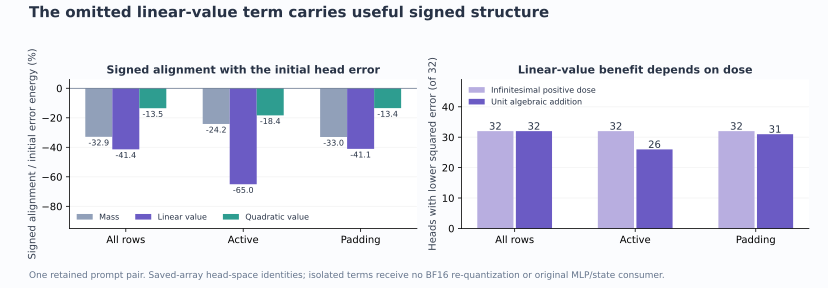

# What the rank-one state omits: signed value transport

The saved-array diagnostic finds a useful omitted **value-dependent** correction in all32 paired heads. Scalar lost variance alone does not describe it. The term points toward lower head error everywhere, yet a unit addition improves only26 active heads and31 padded heads. This explains a limitation of the [frozen rank-one state](rank-one-tail-state.md); it does not implement a repaired reader, rerun a receiving MLP or generate an image.

The [figure receipt](results/rank-one-omission-evidence/figure.json) binds this scalar rendering. It covers one retained prompt pair and dependent rows/heads, not fresh-prompt generalization.

## Expand the omitted score

Keep the supplied512-row first-block operands, source basis,64 anchors/head, current-query ordered top4 and routes fixed. Under normalized anchor tail p, the full residual score is t=δᵀ(u−μ_T), the rank-one score is t̃=β(z−E_p[z]), and ε=t−t̃. For the same positive quadratic,

\[
f=r_2(t),\quad g=r_2(\widetilde t),\qquad
f-g=\underbrace{\epsilon(1+\widetilde t)}_{L}
+\underbrace{\tfrac12\epsilon^2}_{Q}.
\]

Q is nonnegative. L is signed and includes the mixed product εt̃; it is linear in ε, not merely a first-order covariance correction. K_f−K_g=E_p[L]+E_p[Q]. Finite centering defects remain measured.

If H_f,H_g are their tail means, H_S is the exact selected mean and w_f,w_g the tail mixture weights, then

\[
h_f-h_g=A+B_L+B_Q,
\]
\[
A=(w_f-w_g)(H_g-H_S),\quad
B_L=\frac{w_f E_p[L(V-H_g)]}{K_f},\quad
B_Q=\frac{w_f E_p[Q(V-H_g)]}{K_f}.
\]

This factors mass and both value contributions without fitting another representation. In particular,

\[
E_p[L(V-H_g)]=\operatorname{Cov}_p(V,L)+(H_p-H_g)E_p[L],
\qquad H_p=E_p[V].
\]

The useful quantity is signed value transport, including mixed moments and normalization. The diagnostic accesses full-direction t and K_f; the rank-one state does not receive those quantities for free. These terms cannot simply be promoted into serving.

## What the measured vectors say

The table normalizes each squared term and signed cross term by the **whole paired head-correction energy**, not receiving-state error. The entries need not sum to one until every cross, rounding and arithmetic term is included.

| Paired pooled correction term | Energy / whole correction energy |
|---|---:|
| Mass A |.4272|
| Linear-in-ε value B_L |.5514|
| Squared-ε value B_Q |.2835|
| Mass × linear-value signed cross |−.0664|
| Mass × quadratic-value signed cross |−.1453|
| Linear × quadratic value signed cross |−.0675|
| BF16 rounding term |.0164|

Contraction arithmetic and old finite-profile differences have energies around10⁻²⁸ of the correction energy. All signed terms remain in the [report](results/rank-one-omission/report.json), including per-head countertrends.

Let e be the inherited rounded rank-one head error and b one smooth correction term. The signed quantity2E[e·b]/E[e²] describes its initial direction. It is not an additive attribution through a nonlinear MLP. A unit algebraic addition also pays E[b²]/E[e²]. Their exact relation is

\[
\frac{E[(e+b)^2]-E[e^2]}{E[e^2]}
=\frac{2E[e\cdot b]+E[b^2]}{E[e^2]}.
\]

| Region | Mass initial alignment | Linear-value initial alignment | Quadratic-value initial alignment |
|---|---:|---:|---:|
| All |−.3290|−.4138|−.1351|
| Active |−.2419|−.6505|−.1836|
| Padding |−.3302|−.4106|−.1345|

The linear-value initial alignment is negative for32/32 heads in all three regions. Its unit algebraic addition reduces squared error in32/32 pooled,26/32 active and31/32 padded heads. Active heads1,2,9,17,28,30 and padded head13 worsen at that unit dose. Pooled unit-change ratios are−25.18% overall,−36.21% active and−25.03% padding. These are saved-array head-space diagnostics with no isolated-term BF16 re-quantization, probability-law reconstruction or receiving consumer. The full quadratic's existing receiving-state error24.15% and rank-one39.02% remain inherited observations, not new results of this assay.

Mass and quadratic-value trends are less uniform. Their unit additions improve28/25 pooled heads,20/20 active and27/25 padded respectively. Their positive and negative alignments, and cancellation with the useful linear term, prevent dropping either based on a pooled ranking.

## Source geometry and actual causal tails differ

The mean per-read E_p[ε²]/E_p[t²] is1.146/1.077 on active rows and.938/.934 on padding for the two prompts. Active maxima reach31.72/12.22; padded maxima5.93/5.96. These are means/ranges of defined ratios, not pooled energy fractions or percentages of lost information. Each prompt retains160 undefined active ratios:128 selected-only reads and32 zero-score-energy tails. Padding retains74 zero-denominator ratios.

Ratios above one are consistent with an oblique source projection under a different actual tail measure:

\[
E_p[t^2]=E_p[\widetilde t^2]
+2E_p[\widetilde t\epsilon]+E_p[\epsilon^2].
\]

Mean signed L mass is−.0435/−.0300 active and−.0904/−.0844 padding; mean Q mass is+.6766/+.6585 active and+.6669/+.6691 padding. Scalar mass is dominated by the nonnegative squared term here, while the largest useful paired value alignment belongs to L. A scalar variance repair would leave that distinction unresolved.

## Mechanics, cost and scope

The common-profile full and rank-one laws match their complete parent BF16 banks with zero mismatches. Maximum raw discrepancies are1.2212×10⁻¹⁵ and3.6082×10⁻¹⁵. Independent tail-value closure is at most1.3809×10⁻¹⁵. `headClosure` includes a residual defined to complete the telescope, so its2.7756×10⁻¹⁷ maximum is **accounting closure**, not an independent validation. Polynomial/partition identities, independent synthetic probability calculations and parent-bank comparisons supply the substantive checks.

Guarded job `job-54dce85e782d` succeeds first attempt:14.51 scheduler seconds,12.471 worker seconds,7.302 CPU seconds,846.4MB peak RSS and0VRAM. It performs zero original parameter reads, learned projections, new exact-head references, model/consumer calls or rank fits. The worker blocks original checkpoint files, neural-framework imports and network access. This is source-audited saved-array execution, not hardware-level proof against adversarial code.

Request `a1a0e8e11a1e3f09c557fe0a794adc948944c772a45eb4b7cd7f44ae237133e4`, analysis seal `208ed3747dc19946b9b254c73f6227dbee5518822433be68966dd67ddb36c1e6` and matching guarded payload `1bf9dabb2a750e92c1b423839f3bda72949beb0212ca5e4459a313437e30c6d1` bind the result. The seal is explicitly retrospective, not a held-out prediction seal. Full-byte checks cover19 inherited/new files /541,200,601 bytes. Full canonical banks and signed arrays stay near compute;49,152 observations and7,524 scalar descriptions remain in the9-file17,029,302-byte [compact publication](results/rank-one-omission/provenance.json), with byte-lossless gzip. The raw observation stream remains local; the [collection amendment](plans/rank-one-omission-diagnostic.md) preserves the128MiB aggregate transport budget and all hash checks. All98 mechanics tests pass; the [Saturn sweep](results/rank-one-omission-evidence/sweep.json) is observation-stream verification, not image certification.

[Astra's review](results/rank-one-omission-evidence/advisor.json) leaves the [support-aware reuse priority](plans/support-aware-computation-reuse.md) unchanged. For a future compact reader, preserve signed value transport induced by omitted scores rather than source score energy alone. This does not prescribe a particular tensor, justify a rank sweep or certify a serving fix. Arbitrary raw prompts, later contextual states, own-state diffusion and general zero-neural pixels remain open.
