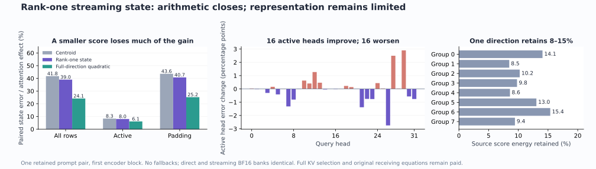

# A streaming state closes its arithmetic, but rank one loses useful information

The source-defined rank-one state executes the intended positive tail law without rebuilding the tail. On the retained prompt pair, its complete streaming and direct-calculation BF16 banks are identical, with no fallbacks. It reduces paired first-block state error **41.76%→39.02%**, retaining only part of the full-direction quadratic's improvement to **24.15%**. The useful result is a measured separation between state arithmetic and representation limits; arbitrary-prompt zero-neural image generation remains open.

The [figure receipt](results/rank-one-tail-evidence/figure.json) binds this local rendering to published scalars. Rows and heads are dependent observations from one retained pair, not independent prompt replications.

## What was supplied and what was compiled

The specimen is the first Qwen3 encoder block in FLUX.2 Klein4B. The supplied learned operands are the same512-row ports used by the [full-direction quadratic](positive-tail-moment-closure.md): “An orange paper crane stands behind a silver key on a dark wooden table,” and its “before” replacement. Both have27 attended rows and485 padded queries; token8 changes. All32 query heads and all512 rows enter the original receiving block equations after candidate sealing. No fresh raw strings, later encoder layers, diffusion rollout or decoder are evaluated here.

The compiler reuses immutable source key covariance C_y,4096 lexical and512 padding query candidates, their original .5/.5 mixture weights,64 landmarks per head and frozen source routing. It gathers1,747 unique learned atom rows /30,411,776 payload bytes, with source-shard authentication charged separately. Its uncentered displacement second moment D=E_source[δδᵀ] is pooled equally across the four query heads sharing each K/V group. No scored-prompt output or original parameter file enters this compilation.

For the leading eigenvector v of C_y^(1/2) D C_y^(1/2), define

\[
a=C_y^{1/2}v,\quad b=C_y^{-1/2}v,\quad
z_j=b^\top u_j,\quad\beta=a^\top\delta.
\]

The covariance uses a documented roundoff envelope and a Moore–Penrose inverse on resolved support; raw spectra, discarded positive variance, leading gaps and sign convention remain in the [compile receipt](results/rank-one-tail/compile-receipt.json). This rank-one construction optimizes the declared **independent source query/key product distribution**. It does not optimize causal-tail attention or receiving-state accuracy. The retained source score-energy fractions range8.47–15.38%; those are diagnostics, not an accuracy gate.

The residual score alone is reduced:

\[
t_j=\delta^\top(u_j-\mu_T)
\quad\longrightarrow\quad
\widetilde t_j=\beta(z_j-\bar z_T).
\]

The full-dimensional tail centroid μ_T, exact current-query ordered top4 selector, selected contribution and positive quadratic r₂(t)=1+t+t²/2 remain. Full current K/V retrieval is explicitly paid.

## The state and its read

For every anchor ℓ, admitted causal keys advance

\[
T_k=\sum_j e^{\ell^\top u_j}z_j^k(1,V_j),\quad k=0,1,2,
\qquad U_\ell=\sum_j e^{\ell^\top u_j}u_j.
\]

All64 anchors are updated, including unread anchors. Stable log scales follow admission; masked keys do not enter, while the512-row query clock advances. The four selected occurrences are subtracted using their cached original anchor scores in the same gauge. Empty complements take an explicit selected-only path.

With m=E_T[z], the tail polynomial coefficients are

\[
c_0=1-\beta m+\tfrac12\beta^2m^2,\qquad
c_1=\beta-\beta^2m,\qquad c_2=\tfrac12\beta^2.
\]

Contract c₀T₀+c₁T₁+c₂T₂ to recover the positive-law numerator and scalar denominator. The full centroid contributes exp(δᵀμ_T) to the tail mass. Exact selected and approximate tail contributions combine in log space. The implementation never rebuilds full-tail moments for each query and calls that streaming.

Absolute-moment envelopes accompany the core state. Unresolved complement or polynomial normalization invokes the **same direct rank-one law**, with per-row reasons and paid work; there is no silent clipping. The FP64 envelope is an engineering policy under stated arithmetic assumptions, not a formal BLAS error certificate. Denominator uncertainty is included in centroid-coordinate and directional log-mass diagnostics. A synthetic cancellation case exercises fallback; the real pair triggers none.

## The arithmetic measurement

The complete candidate raw/BF16 banks, source basis identity and16 final group snapshots seal before historical outputs, direct diagnostics or original consumer parameters. Post-seal references independently reconstruct admission scores and current-query selection. Across both prompts:

- Independent and parent support/order/route mismatches: **0**.
- Streaming versus direct rank-one maximum raw discrepancy: **3.6082×10⁻¹⁵**.
- Complete BF16-bank mismatches: **0** across4,194,304 values.
- Fallback calls/key visits: **0**.
- Per prompt:128 selected-only head/query reads and16,256 moment reads; all512 query rows have no fallback.

The direct receiving result therefore inherits the streaming result under complete BF16 input identity. Two new original consumers execute in total, rather than four. Existing full-quadratic, centroid, exact and zero consumers inherit authenticated same-input evidence; this creates no fresh native-CUDA parity claim.

## What the receiving computation sees

These errors normalize prediction error by the corresponding exact attention-driven state change, retaining the zero-attention consumer as baseline. Whole endpoint and per-row denominators remain separately available in the [report](results/rank-one-tail/report.json).

| Paired state region | Centroid | Rank-one streaming | Full-direction quadratic |
|---|---:|---:|---:|
| All512 rows |41.763%|39.018%|24.148%|
|27 active rows |8.330%|8.011%|6.084%|
|485 padded rows |43.609%|40.738%|25.190%|
| Changed token8 |4.190%|3.944%|2.878%|

Paired rounded-head error is37.129%→34.840%, versus22.331% for full quadratic. Rank one improves29/32 pooled heads relative to centroid; heads13,14,27 worsen. Active rows split16 improving /16 worsening heads. Padded rows improve30/32, with heads13,14 worse. Complete per-head values and active/padding/before8/at8/after8 strata remain public. Before8, exact paired responses and errors are zero; relative zero-denominator scores stay undefined.

Endpoint attention-effect state errors are10.548%/10.403% for rank one, versus11.294%/11.377% centroid and6.328%/6.149% full quadratic. Whole endpoint errors are11.785%/11.634%. A large unchanged state would make those endpoint numbers alone misleading about prompt-response fidelity.

The signed head decomposition telescopes into direct-rank-one minus full-quadratic, streaming minus direct, full-quadratic minus exact, and rounding terms. The historical `sourceRank` field includes **rank representation and finite implementation differences**: admission-score association differs from the older U@ℓ calculation, as do selected GEMV profiles. It is not a mathematically pure projection-error certificate. In the pooled paired result, state-arithmetic energy/error-energy is4.20×10⁻²⁹, while the rank/implementation term is.289 and its signed cross energy with the full-quadratic law is.300. Those are signed vector-energy diagnostics before the nonlinear receiving block, not additive percentages of state error or causal mediation claims.

## Costs that remain

| Quantity | Measurement |
|---|---:|
| Guarded scheduler elapsed / worker time |60.61 /58.089s|
| Whole worker peak RSS / VRAM |1,651.7MB /0|
| Source compilation child / atom gather |30.236 /22.915s|
| Serving child, both prompts |3.432s|
| Serving after imports wall / CPU |3.375 /2.738s|
| Per-prompt streaming + serialization |1.377 /1.339s|
| Serving child high-water RSS |125,256KiB|
| Post-seal direct diagnostics per prompt |2.237 /1.994s|
| Original consumers + serialization per prompt |1.301 /2.336s|
| Original parameter read |3.756s|

The logical core is8,437,760 FP64 bytes per prompt across32×64 anchors. Absolute envelopes add another8,437,760 bytes. The current K/V/z/position/**original-score cache** index allocates1,052,672 bytes, using888,192 bytes for27 keys per group; log scales/ranges add32,768 bytes. Counters, identities, routes, outputs, temporary arrays and serialization are additional. Shared runtime geometry is3,153,920 bytes and the basis16,384 bytes. The active BF16 K/V payload alone is110,592 bytes. This representation is larger, and the sequential implementation's RSS is a different measurement from total logical state.

Per prompt, partial counters record7,077,888 anchor-admission MACs,55,185,408 selector products,28,477,440 core and equally many envelope-cell updates,6,291,072 core moment-contraction and18,873,216 envelope-contraction MACs. Routing, downdates, feature formation, exponentials/logs, normalization, allocation, hashing and serialization remain additional. The two original consumers evaluate2 output and6 MLP projections,87,241,523,200 geometry-derived nominal MACs. Sixty-four post-seal direct rank-one head references run; no new exact-attention head reference is needed. These counts are not total FLOPs, energy or a speedup.

## Evidence and the next question

The [frozen plan and pre-execution amendments](plans/rank-one-tail-state.md) bind the compiler, streaming policy and conditional consumer arm. Job `job-49e50c9cb996` succeeds first attempt under one guarded CPU lease, strict preflight, default4GB/4CPU admission, one actual math thread, finite600s timeout and no automatic retry. Request `367bb3b9225a5a5fb90d919ad295081341d842b09126872731437c556a243190` binds the source. Candidate seal is `1994cd7fdecc6d707dbf44f0b84ea1333398068f7a5403985bc06ccef07230d3`; declared/sealed/executed payload hashes match `e9f5e68738b172429d9babde16dd2cb2af85709f29b9dbbb2b2e7c0d6e6d61eb`.

Independent byte checks cover348 retained files /8,161,671,237 bytes, including source atom shards and the original4.967GB parameter shard. This is overlapping source/research evidence, not new serving storage. Full arrays stay near compute. The14-file compact result is6,070,496 bytes, preserving38,400 observations and scalar descriptions through byte-lossless gzip. The [Saturn run/verify sweep](results/rank-one-tail-evidence/sweep.json) covers one stream with no fires, no terminal image claim and no physical-address joins. An initial verify invocation used run-only xref flags and stopped at argument parsing; the corrected verification exits0.

The [Astra review](results/rank-one-tail-evidence/advisor.json) recommends pausing rank tuning and following one [support-aware conditional rewrite](plans/support-aware-computation-reuse.md) from the newest three-context sign-shortcut result. The neighboring row-sign campaign already has a frozen protocol and helper under development; reuse its eventual evidence rather than duplicate model work. An optional saved-array diagnostic can factor omitted residual-score contributions into signed mass and centered-value transport. Mechanical closure makes that diagnosis interpretable, but source energy alone does not select consumer-useful directions. The full goal still requires raw-prompt contextual computation, later layers, own-state diffusion and pixels without neural evaluation.
