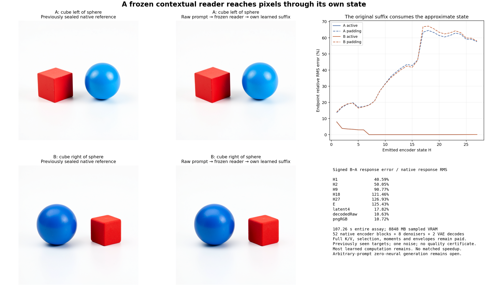

# Follow a frozen contextual reader from raw prompts to pixels

The frozen rank-one reader now starts from two raw strings and supplies all 32 first-layer attention heads to a complete image continuation. Both original PNGs preserve the requested red-cube/blue-sphere left/right swap. PNG RMS errors to the previously sealed native images are **6.19 and 4.06** on a 0–255 scale. The signed B−A image response has **10.72% relative RMS error**, despite **125.43%** error in the full conditioning response. This is a measured integration result: most original learned computation remains, and the reader's necessity has not yet been tested.

## One changed computation, its actual downstream state

The [frozen plan](plans/raw-rank-one-image.md) reuses the existing complete-vocabulary lexical table, source-only landmarks and rank-one basis. A/B describe a red cube to the left/right of a blue sphere on a white tabletop. Both have 35 attended and 477 padding rows. The reader had not previously processed these strings, but the full targets were already observed: this is retrospective integration, not prospective quality certification. Seed314159 noise and full references come from `job-394733a01129`; the experiment generates only two new candidate images.

Each raw string supplies its own embedding/QKV/position operands from all151936 compiled token IDs. All32 heads use the unchanged `rank1-fullcentroid-moments-fp64-envelope-v1` policy. There is no supplied prompt QKV, native head replacement, reference-state refresh, basis refit or compact-K/V arithmetic change. The lexical/reader process imports no neural runtime and performs no original dense projection. Its learned-output table and full current K/V remain paid dependencies.

Let scaled, source-centered keys be $u_j$, routed query anchor $\ell$, displacement $\delta=q-\ell$, and frozen source vectors $a,b$. Define $\beta=a^T\delta$, $z_j=b^Tu_j$ and $P(t)=1+t+\tfrac12t^2$. Selected current-query top4 keys keep their full scores. In the remaining tail, the same anchor measure supplies its full centroid $\mu$ and mean $\bar z$. The approximate weight is

$$
\widetilde w_j=\exp(\ell^Tu_j+\delta^T\mu)\,
P\!\left(\beta(z_j-\bar z)\right).
$$

The positive law contracts shared mass/value moments

$$
T_r=\sum_{j\le i,\,\mathrm{mask}(j)}e^{\ell^Tu_j}z_j^r(1,V_j),\quad r=0,1,2,
\qquad U=\sum_j e^{\ell^Tu_j}u_j.
$$

The running state advances causally, uses a stable exponential gauge, subtracts selected occurrences and contracts the polynomial coefficients. Absolute envelopes protect normalization. A counted direct fallback evaluates the **same approximation**, rather than native exact attention; no fallback occurs in this run. There are64anchors/head and a full current-query top4 selector. This is an exact state representation of a chosen approximate law, with finite arithmetic and representation error still distinct from original attention parity.

The actual BF16 `[1,512,4096]` bank enters the original block0 tail:

$$
R_0=H_0+W_O\widetilde A_0,\qquad
H_1=R_0+\operatorname{MLP}_0(\operatorname{Norm}(R_0)).
$$

Original full512-row blocks1…26 then consume each candidate's own H1…H27. Actual H9/H18/H27 form E. Each four-step native FLUX image consumes its own E and preceding latent; the original scheduler and VAE remain. Exact state-independent [clock constants](compiled-flux-clock.md) are inherited unchanged. Full rows and the original BF16 reduction policy isolate the new reader from earlier compact-GEMM rounding effects.

## A small image error can coexist with a poor conditioning response

For every port, response error compares $\widehat\Delta=\widehat X_B-\widehat X_A$ with $\Delta=X_B-X_A$, using widened subtraction:

$$
\epsilon_\Delta=\frac{\operatorname{RMS}(\widehat\Delta-\Delta)}{\operatorname{RMS}(\Delta)}.
$$

| Actual port | Signed B−A relative RMS error |
|---|---:|
| H1 | 40.59% |
| H2 | 50.05% |
| H9 | 90.77% |
| H18 | 121.46% |
| H27 | 126.93% |
| E | 125.43% |
| First velocity | 8.65% |
| First latent commit | 10.23% |
| Final latent | 17.82% |
| Raw decoder | 10.63% |
| PNG RGB | 10.72% |

The native PNG response RMS is68.0451; the candidate is68.9746, with error7.2958 and cosine0.99442. Both candidate images visibly preserve colors, shapes and the spatial relation. Edges, highlights and shading differ. This is stronger evidence than endpoint resemblance alone, but does not establish that the reader is necessary: lexical residual input and the substantial original suffix could carry this task without it.

Endpoint E errors are6.64%/6.79% overall, about0.080% on pooled active rows and58.16%/59.10% on padding. The active denominator is dominated by large common state: median individual active-row errors are1.88%, with maxima4.53%/4.85%. Median padding-row errors are47.72%/46.17%, with maxima182.36%/278.52%. Thus neither the pooled E figure nor a clean picture describes every row. Median PNG scanline RMS is0.604/0.450, while95th percentiles are13.224/7.625 and maxima19.217/8.629. All30,720 dependent row/scanline observations remain in the [lossless stream](results/raw-rank-one-image/observations.jsonl.gz).

We cannot infer from these ports whether FLUX ignores the erroneous conditioning directions, cancels them nonlinearly or mainly uses preserved information. The [next zero-reader control](plans/zero-reader-image.md) isolates the reader's contribution before further rank tuning.

## What the run pays

Guarded CUDA job **`job-7b206109b072`** completes once in **107.26 scheduler seconds**, with sampled peaks **8074.6 MB RSS /8848 MB VRAM**. Fresh-process phases are5.775s lexical/reader,59.319s encoder and31.414s images. These include imports, source validation, loading and captures; they are not isolated kernel timings. Reader arithmetic/serialization is3.260s across both prompts, with3.208s process CPU after its imports. First lexical calls are1.458s and0.0776s. No matched speedup is claimed.

Per prompt, the reader retains8.438MB core moments and8.438MB envelopes,1.151MB used retrieval index within2.105MB allocation, plus the complete QKV packets,3.154MB source geometry and16,384B basis. It performs70,963,200 selector score products,9,175,040 admission anchor MACs,16,728,064 selected-coordinate products,6,291,072 moment and18,873,216 envelope contraction MACs, plus36,915,200 moment and the same number of envelope cell updates. These categories are distinct counters, not a hardware FLOP total. Full causal keys and selection stay paid; zero fallbacks execute.

The remaining original consumers execute52 native encoder blocks/52SDPA/372linears (**2.774T nominal linear MACs**),8denoisers/8context projections/40joint/160single blocks,824transformer linears (**37.791T nominal linear MACs**) and2VAE decodes. Forty clock gathers replace clock affines; no new clock or basis compilation, reference image or noise draw occurs. There is no zero-neural contextual encoder, denoiser or decoder here.

## Evidence and limits

The candidate seals before target value reads. Actual lexical→reader→BF16 bank→encoder→E→image and inherited clock/noise joins are authenticated. Payload declared/sealed/executed SHA is `ee2da6d3bb4fa6ec0dfe2746f8f466dc6389773febaaa257025599e6cdf8640d` (156,237B). [Independent full-byte verification](results/raw-rank-one-image/retained-array-verification.json) covers328members/965,638,468B, including complete candidate/reference arrays, used atom shards, geometry/basis, moments, lexical packets, clocks/noise and seals. The142new scientific arrays/packets total586,077,004B and stay near compute. Primary publication is21files/3,859,126B, plus a separately derived figure and evidence receipts.

All129generator mechanics tests pass. The isolated staged scoring import also passes. An initial submission is refused before any job for a note longer than500characters; its [record](results/raw-rank-one-image-evidence/admission-v1.json) and original stage remain intact. The fresh v2 executes once. [Saturn run](results/raw-rank-one-image-evidence/saturn-run.json) and [verify](results/raw-rank-one-image-evidence/saturn-verify.json) return0 over the one observation stream; `target-streams-only` is an instrument scope, not semantic certification. [Astra's review](results/raw-rank-one-image-evidence/advisor.json) retains both the image trend and the poor conditioning response.

This supplies a raw-input dynamic-reader image consequence. It does not supply arbitrary-prompt zero-neural generation, prove reader necessity, establish quality over prompts/seeds, or show runtime savings. The full original goal remains active.
