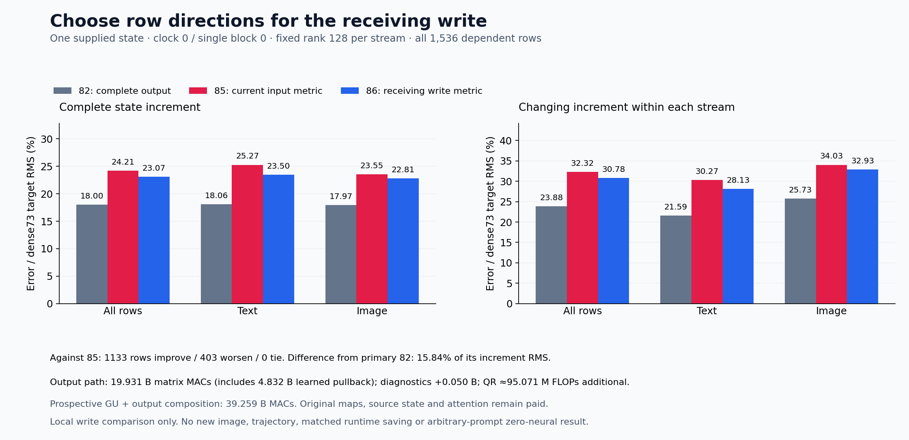

# Row directions for the receiving gated write

The receiver-weighted construction gives a modest local improvement at additional learned compute. Actual state-increment error against retained dense 73 falls **24.205%→23.069%**, with **1,133 rows improving and 403 worsening** against cycle 85. The complete cycle-82 output remains better at **18.003%**, and all 1,536 new rows are worse than it. This result supports this fixed construction on one supplied state; it establishes no new image, successor closure or arbitrary-prompt zero-neural capability.

The [previous experiment](current-operand-row-output.md) sketches the current output operand J=[R,P₈₂], where R is a paid attention read and P₈₂ is the exact retained BF16 SiLU/product field. That moves the basis past a nonlinear operation, but the sketch still selects row directions using J's input geometry. The next computation applies the original output map and a current channel gate. This [frozen plan](plans/receiver-weighted-output-sketch.md) asks whether selecting directions for that receiving write gives a useful approximation.

Let Wₒ have shape [3072,12288] and Γ=diag(g) be the shared current BF16 gate promoted to FP64. With one shared output-coordinate sign sketch Ω of shape [3072,128], compute

\[
V=W_o^\top(\Gamma\Omega),\qquad F_s=J_sV,
\]

then per stream

\[
U_sR_s=\operatorname{QR}(F_s),\quad K_s=U_s^\top J_s,\quad
B_s=K_sW_o^\top,\quad \widehat Y_s=U_sB_s.
\]

V is a paid learned operand, compiled once because the gate and map are shared by the streams. It is retained separately from Ω and ΓΩ. No complete original write or target output is formed to select U. The output sketch uses local PCG64 SeedSequence([20261107,86]), raw low bits in C order, unscaled signs and no selection. All 128 reduced Householder QR columns remain, with canonical diagonal signs. There is no rank, seed, centering, power or output-fitting search.

The idealized row error is weighted by the consumer:

\[
\|(I-UU^\top)J W_o^\top\Gamma\|_F^2,
\qquad M=W_o^\top\Gamma^2W_o.
\]

For ideal independent Rademacher entries, E[ΩΩᵀ]=rI gives E[FFᵀ]=r JMJᵀ. An isotropic input sketch instead has expected row covariance rJJᵀ. This algebra explains the representation criterion; it is not a statistical guarantee for the one fixed PCG64 draw or an optimizer of the exact finite residual commit. The comparison also changes sketch dimension, seed and shared-versus-independent construction relative to cycle 85. It does **not** isolate gate weighting as the cause of improvement.

The finite consumer remains unchanged. Reconstruct the complete FP64 update, admit through FP32→BF16, multiply by the actual gate in BF16, then add to incoming state in BF16. Using the gate for basis selection does not remove its final application. Comparisons use the observed exit-minus-common-incoming increment, not only the exit norm. For example, primary discrepancy from 82 is 1.201% of pooled complete-exit RMS but **15.839% of actual-increment RMS**; the carried residual makes these different questions.

| Actual increment error vs retained dense 73 | All rows | Text | Image |
| --- | ---: | ---: | ---: |
| Cycle 82: complete output | 18.003% | 18.065% | 17.966% |
| Cycle 85: current-input sketch | 24.205% | 25.270% | 23.550% |
| Cycle 86: receiver-weighted sketch | 23.069% | 23.498% | 22.811% |
| Cycle 82, stream-centered | 23.879% | 21.595% | 25.726% |
| Cycle 85, stream-centered | 32.323% | 30.271% | 34.031% |
| Cycle 86, stream-centered | 30.778% | 28.135% | 32.934% |

Primary same-J discrepancy from 82 improves **17.827%→15.839%**; centered discrepancy improves **24.097%→21.411%**. Primary row outcomes are 1,327 improvements / 209 regressions relative to 85. Pre-residual update discrepancy improves 14.925%→13.939%. Against dense 73, text has 430 improvements / 82 regressions and image 703 / 321. Every new row beats no update, but every new row is worse than the more expensive 82 output against dense 73. All rows are dependent observations from one supplied clock-0/single-0 state.

Text row 33 improves 58.80%→46.70% against its dense increment, while remaining worse than 82. Row 39 has the largest dense-error energy improvement; row 34 has the largest regression. Row 34 nevertheless improves on the primary same-J comparison, illustrating why inherited error alignment and approximation error cannot be conflated. The [scalar localization](results/receiver-weighted-row-output-evidence/row-localization.json) preserves both metrics and all observations remain losslessly published.

Signed accounting keeps inherited and added error visible. With I₈₆−I₇₃=(I₈₂−I₇₃)+(I₈₆−I₈₂), measured energy is

\[
10{,}447{,}604.467
=6{,}362{,}870.441+4{,}670{,}667.670-585{,}933.643.
\]

The cross term is −459.670 for text and −585,473.973 for image. Centered energy is 6,173,453.364+4,670,503.451−588,207.368=10,255,749.447. Relative to 85, the added delta energy is 6,559,163.391 and its cross with the old dense error is −7,613,596.480. These are signed accounts, not positive causal shares. Every full/centered account and row is retained; the new discrepancy is not independently decomposed into projection, finite-policy, admission and commit effects.

| Actual matrix work | MACs |
| --- | ---: |
| Shared original-map pullback | 4,831,838,208 |
| Two current sketches | 2,415,919,104 |
| UᵀJ | 2,415,919,104 |
| Compressed original output | 9,663,676,416 |
| U reconstruction | 603,979,776 |
| Candidate | **19,931,332,608** |
| Post-exit UR and UᵀU diagnostics | 50,331,648 |
| Assay | **19,981,664,256** |

QR adds approximately 95.071M algorithmic FLOPs separately. Candidate matrix work is 32% higher than cycle 85's 15,099,494,400 MACs. The matched full output uses 57,982,058,496 MACs. Adding historical G/Up formation gives a **prospective 39,258,685,440-MAC composition**, not an executed composed producer. Scalar gate/sign operations, casts, copies, hashes, retention, source formation, attention and original learned maps remain paid or additional.

One guarded CUDA job, job-d5fac5a3a384, succeeds in **22.81 scheduler seconds**, with sampled **1,823MB RSS / 1,566MB device memory**. Producer wall time after imports is 7.825 seconds. Cache/setup/scope differences prevent a matched runtime-saving claim against cycle 85. All **359** mechanics tests pass in 19.01 seconds after the queue-note-only revision; the earlier 19.11-second test receipt and original source hash remain. Astra caught an initial 518-character launch note before any submission; the corrected 343-character note, unchanged law and repeated tests are preserved.

The [evidence index](results/receiver-weighted-row-output-evidence/README.md) links original source and byte/typed/scalar checks. Complete byte verification covers 57 files / 253,020,765 bytes and 30 NPY payloads, plus original output parameter, actual BF16 J and physical Ω/ΓΩ/V witnesses. All 15 producer fields, four analysis fields, actual operation geometry/work and every scalar aggregate are checked without independent real-array numerical replay. QR reconstruction relative RMS is about 7.40×10⁻¹⁶, and Gram max error at most 2.11×10⁻¹⁵; these remain numerical diagnostics, not output sufficiency.

Saturn raw-result run/verify returns 0 on 1,536 records: zero fires, formal claims or qualified addresses, with one expected missing no-fire ledger. All 19 new arrays / 133,386,624 NPY bytes stay near compute; 17 compact core files total 3.062MB locally/publicly. No archive or deletion occurs. Full newest-post and storage review remain current at 84 and are due again at 87, or earlier material evidence/pressure.

The time-circuit requirement remains π(F(x,c))=T(π(x),c), alongside observation preservation, on states the replacement itself creates. This construction still consumes paid state and learned maps to improve one observation of its successor. Contextual raw-prompt formation, economical autonomous transitions, a general non-neural pixel producer and independent prompt faithfulness remain unresolved.

Astra recommends one [own-state successor](plans/receiver-own-state-successor.md) next, rather than a gate-only attribution control. It would start single block 1 from cycle 86's actual text/image and re-form normalization, Q/K/V, attention, G/Up/product and output basis. Incoming difference D and actual increment difference W must account for outgoing D+W with signed cross terms. The plan is written and unexecuted; the full cycle-87 research/storage review must precede staging and may supersede it. Existing parent/successor metadata joins are checked, while fresh complete custody/bytes and a new allocation/typed contract remain required before execution.
